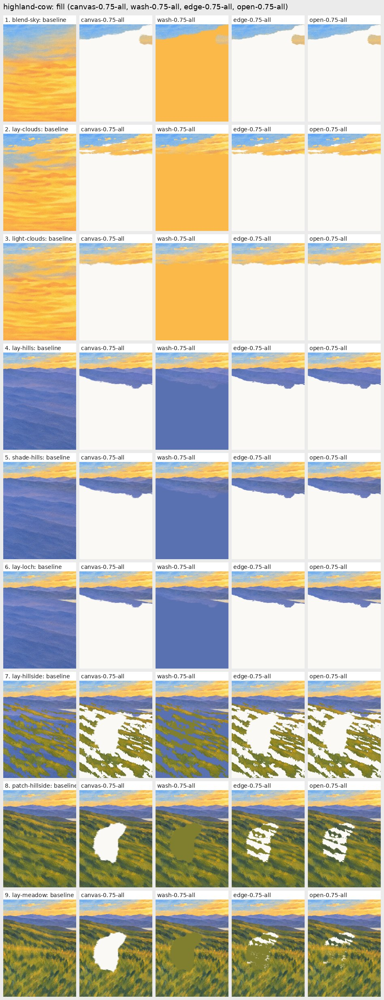
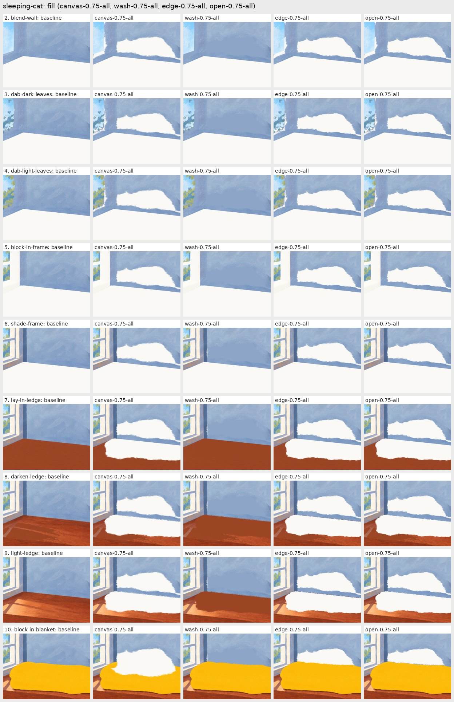
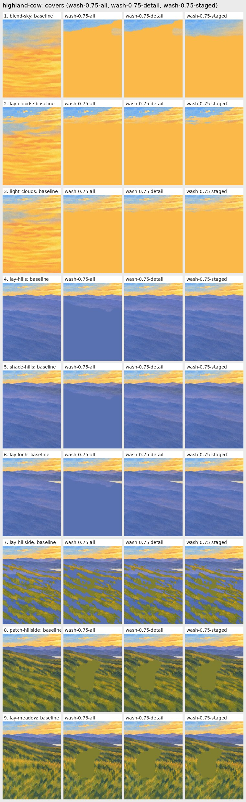
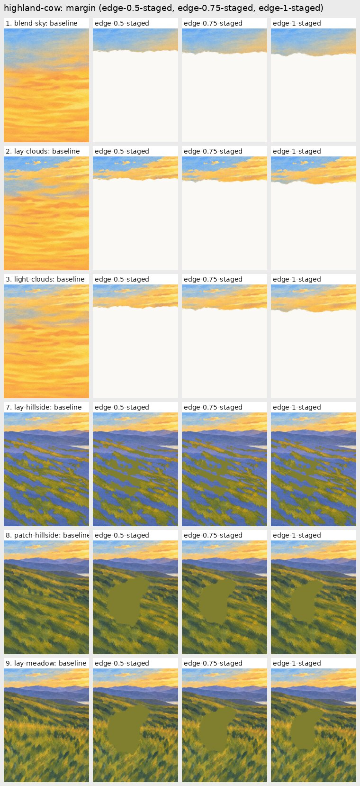
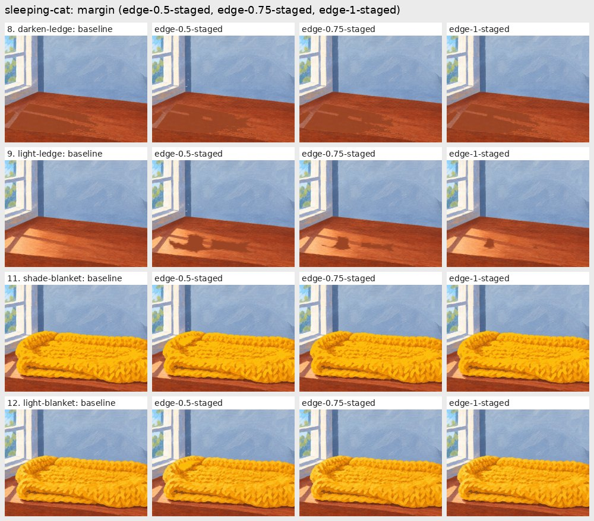
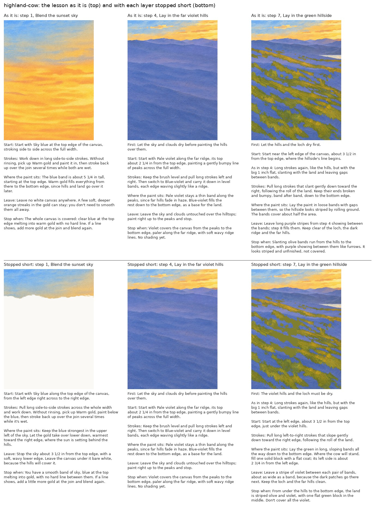

# Spike: stop a layer's step picture a little past where a later thing covers it

Spike #289, for #287. Code: `spike/experiments/cover_margin.py`. Its test: `spike/tests/test_v3_cover_margin.py`.
The numbers, the words, the graders' answers and the costs: `spike/experiments/cover_margin.json` (its `report` key
holds the stage 2 numbers below). The student test's answers: `spike/experiments/cover_margin/variant.json` and
`base.json`. Run on 2026-11-20, on the three v3.1 gate lessons.

**Verdict: adopt `line-1-next` (the owner's call, 2026-11-21: "This is the way").** Four versions were tested. The
first three are dropped. The fourth is the owner's own rule with the birch grove's gap fixed. It ties on every test
that can see it, and it skips painting no test can credit. Next is a design by Fable, since it is a new pipeline
version (`docs/decisions.md`).

- **`edge-1-staged` (the first pick): drop.** All four blind reads preferred the lesson as it is (the cow 2 of 2, the
  cat 2 of 2), and the student test fell (2.79 against 3.14, −0.36 ± 0.14). Where a later subject sits inside a layer
  (the cow on the hillside, the blanket on the ledge's sunlight), it leaves a flat shape of the layer's paint: the
  "ghost or blotch where a thing will go" the owner has sunk lessons for.
- **`open-1-staged` (no islands, only the cow's sky stops short): drop.** Both reads said "none", and the student test
  on its three steps fell (2.83 → 2.33).
- **`line-1-later` (the owner's rule, after he saw the first two): a tie on the cow, a loss on the birch grove.** Every
  layer a big area will cover, flat ones included, stops at a loose line a bit past the lowest point it's needed. The
  student test is level within its noise (2.97 against 3.09 over 16 steps, −0.12 ± 0.17). The cow's blind reads are a
  tie: none, none on the corrected words, and baseline, none before step 8's words were fixed. The birch grove's split
  by round, none, none, then baseline, baseline. Every read that preferred the baseline named the same thing: a white gap
  above the floor, left for undergrowth that isn't painted until four steps later. It saves about 1.4 canvases of
  painting on the cow and 0.3 on the birch grove. Neither test can credit that, and that saving is the owner's whole reason
  for #287. See "The owner's rule" below.
- **`line-1-next` (the owner's rule with the gap fixed, at his ask): a tie on both pictures.** A layer stops only where
  the next stage's paint lands, so no bare canvas waits behind finished paint. The cow's pictures are the same as
  `line-1-later`'s; the birch grove's white gap is gone. The birch grove's blind reads: none, none, and both called the
  bare lower canvas a little cleaner. The student test on the 12 changed steps: 2.92 against 3.12 (−0.21 ± 0.21), level
  within its noise. See "The gap fixed" below.

The owner looked at the first two versions' pictures. He said they didn't match what he meant: the issue's spec hadn't
captured it. His notes are on #289.

## What was run

**Inputs.** The gate lessons' chains as `spike/experiments/bench/v31-gate/<picture>/chain/` keeps them (#290). For each
unit there is `P<nn>.jpg`, plus `masks.npz` and `owner.png`. The plans, canvases and mixes come from `data/`. The
`output/` folders weren't used. The step pictures are rebuilt as `steps3.build` lays them, each step laying its unit's
P where its mask is. They match the bench's own 900-pixel step pictures to within 2% of the canvas (the cow, at
pixels more than 24 levels off); the cat and the birch grove are closer (`baseline_vs_bench_max`).

**The cover map**, as the issue specified. Walk the units in order, keeping which unit is on top at each pixel (the
last unit whose steps lay paint there). After unit u, a pixel is covered later when its owner at the finish comes
after u and shares no thing with the unit on top. The owner is `owner.png`, except on the 0.08% or less of each
canvas where that unit lays no paint; there it is the last unit that does. Otherwise a pixel hidden for its owner is
never shown again, and the last picture isn't the finish. (Taking the owner from the step masks alone was tried first
and is wrong. A unit that comes back to a thing is laid over the whole thing, so the cow's rim light and last lights
"owned" 29% of the canvas.)

**The hidden area** is the covered area shrunk by the margin, so a thin cover (horns, trunks, grass blades, cloud
streaks) is never hidden. Its edge is uneven. The margin is up to a third longer or shorter along the edge, changing
over about 3/4 in. The fade-in is about 1/8 in, ragged in short side-to-side streaks.

**A step changes only where it lays paint.** Inside the pixels a step lays, its picture takes its unit's hidden area.
Everywhere else it keeps what the step before showed, so paint already laid is never taken back. Both of
`build-steps`' checks hold on all 36 variants of the three lessons, and the test holds them on a made-up scene: the
last picture is the finish (0.003% off, the JPEG), and no step changes a pixel outside where its unit lays paint (0).

## Stage 1: pictures, screened by eye

No renders and no Claude calls. Each sheet has a row for every step that changes, with the baseline first.

**What the hidden area shows.** Bare canvas makes a pale hole wherever the covered area is inside a layer: the cat's
wall has a cat-and-blanket-shaped hole for six steps, and the cow's hillside a cow-shaped hole for three. A flat wash
of the layer's most-used paint hides those holes on a flat layer, where it is close to the layer's own color. But it
turns the cow's sunset into a flat orange slab over three quarters of the canvas.

So a third fill was tried, `edge`: bare canvas where the hidden area runs out to the canvas's edge or to canvas not
painted yet, and a wash where it is an island inside the layer. On the cow's sky that is what a painter's half-done
canvas looks like, a band of sky over white canvas (`cover-margin-highland-cow-fill-staged.jpg`).

**Which covers count.** Counting every other thing (`all`) cut the cow's first sky step off high with a blob (the
gold cloud streaks are a thing of their own, and `owner.png` gives them 12% of the canvas). It cut holes in the birch
grove's mist and in the cat's flat wall. "Has detail" was measured on each layer's own picture inside what it lays:
the mean Lab distance between that picture blurred by 0.05 in and by 0.5 in, over its covered part away from its edge
(`local`). That keeps the canvas's grain and the things around a layer out of it. An unmasked blur, tried first, read
the flat ledge and blanket as busy, because the neighbouring colors bled in. With the masked blur, flat coats scored
1.0 to 2.0 and layers with detail 4.3 and up, so the line is at 3. `spread` (the distance from the covered area's
middle color) is beside it. It isn't the rule, because a smooth blend scores high on it.

| Layer | Covered later | `local` | `spread` | Has detail |
|---|---|---|---|---|
| cow: sky (a blend) | 92% | 4.9 | 24.3 | yes |
| cow: clouds | 52% | 8.7 | 17.3 | yes |
| cow: far hills | 89% | 1.8 | 4.7 | no |
| cow: the hills' shadows | 17% | 2.0 | 3.4 | no |
| cow: loch | 53% | 11.9 | 16.6 | yes |
| cow: hillside | 55% | 10.3 | 15.1 | yes |
| cow: meadow | 24% | 9.5 | 13.8 | yes |
| cow: cow, its shadow side | 2% | 6.3, 9.2 | | yes |
| cow: horns, their shading | 10%, 7% | 21.2, 13.5 | | yes |
| cat: garden sky | 80% | 1.7 | 4.8 | no |
| cat: wall | 64% | 1.2 | 3.5 | no |
| cat: garden trees | 44% | 15.6 | 20.2 | yes |
| cat: window frame | 25% | 1.3 | 1.2 | no |
| cat: the frame's shadows | 30% | 9.4 | 21.8 | yes |
| cat: ledge | 68% | 1.0 | 1.3 | no |
| cat: light and shadow on the ledge | 68% | 4.3 | 12.2 | yes |
| cat: blanket | 42% | 2.0 | 1.5 | no |
| cat: the blanket's knit | 44% | 7.8 | 10.9 | yes |
| birch: sky (the mist) | 82% | 1.9 | 5.3 | no |
| birch: far woods | 48% | 4.3 | 13.3 | yes |
| birch: ground | 37% | 7.9 | 22.5 | yes |
| birch: far birches | 28% | 6.6 | 13.6 | yes |
| birch: undergrowth | 40% | 9.4 | 15.6 | yes |
| birch: rock, its mossy top | 5%, 5% | 13.5, 5.0 | | yes |
| birch: the leaf carpet | 16% | 9.5 | 14.8 | yes |
| birch: birches, their bark | 5%, 3% | 4.9, 9.9 | | yes |

"Covered later" is the share of the paint a layer's steps lay that a later thing covers. It is higher than the
probe's on every layer (the cow's sky 92% against 85%, the cat's wall 64% against 29%). That is because the probe took
the share of each unit's shape, and this takes the share of all the paint its steps lay; the order on the cow is the
same.

With `detail`, the flat layers are painted straight through. That takes out the cat's hole, the birch grove's mist
holes and the cow's hills. The cow's far hills score lowest of any layer (1.8), so the hills step #287 names keeps
its whole hills. The blob on the cow's sky is still there, because the sky has detail and the clouds cover it. A third
rule, `staged`, counts only a cover from a later stage of the plan. A thing painted in the same stage is one passage
with the layer: the cow's clouds go on its sky in "The sky", and the birch's far woods on its mist. That takes the
blob out.

**The margin.** 1/2, 3/4 and 1 in, with `edge` and `staged`. A wider margin keeps more of a layer around a subject,
and leaves fewer stray specks where a cover is only just wider than twice the margin (the birch grove's far trunks at
1/2 in, `cover-margin-birch-grove-margin-1.jpg`). At 1 in the cow's sky stops about 1 1/4 in below the far ridge. On
the cat, the one hidden island left is a dark patch in the sunlit ledge, under where the blanket goes. It is smallest
at 1 in.

**Picked: `edge-1-staged`** (bare canvas where the hidden area runs to the edge, a wash on an island, a 1 in margin,
covers from a later stage on a layer with detail). It is the only one that looks like a painter's half-done canvas on
the cow's sky. It leaves the cat's wall and the birch grove's mist alone, and changes nothing on the birch grove.
What it changes:

| | Steps changed | Their paint the variant spares (share of each step's) |
|---|---|---|
| cow | 1, 2, 3 (the sky and clouds), 7, 8, 9 (hillside, meadow) | 74%, 43%, 29%, 14%, 9%, 12% |
| cat | 9 (sunlight on the ledge) | 4% |
| birch grove | none | |

On the cow that is about one canvas's worth of painting spared over the six steps (the shares of the canvas added
up: 1.02). It isn't clean. The cow's hillside still gets a flat, cow-shaped island, and the cat's sunlit ledge a
dark one. Stage 2 was run to see whether the graders would forgive those for the sky.

## Stage 2: the pick against the baseline

**The words.** Only the 7 changed steps were written again: the lesson writer's brief (`lesson-brief.md`), on Opus,
one call a picture. It was sent the changed steps' headers, facts and cards, the plan, the photo and finish, and each
step's pair and change pictures made from the masked pictures. One sentence was added: "a layer stops a little past
where a later thing will cover it ... say how far the layer goes, in inches from an edge or from a thing already
painted". The fact sheet doesn't measure where a layer stops, so each changed step's facts got one measured line: the
box of what its picture leaves out, and whether that shows bare canvas or a flat coat. The words weren't run through
`check-text`. It needs the lesson folder, and its sheet measures the unmasked pictures. They cost **$0.50** of Claude
(the cow $0.35, the cat $0.15).

They follow the pictures. The sky step says "Stop the sky about 3 1/2 in from the top edge, with a soft, wavy lower
edge. Leave the canvas under it bare white, because the hills will cover it". The hillside step says "Where the cow
will stand, fill one solid block with a flat coat". The writer said it couldn't fit the cat's dark patch into the
word limits.

**The student test** on the 7 changed steps, carried by the image model and graded alone (`v4_student.py --bench`,
as the gate ran it). The baseline is the gate's own carry plus one more; the variant got two:

| | baseline | variant |
|---|---|---|
| cow (6 steps) | 3.00 | 2.67 |
| cat (1 step) | 4.00 | 3.50 |
| all 7 | 3.14 | 2.79 (−0.36 ± 0.14) |

By step, the variant scored lower on the sky (step 1: 4, 4 against 3, 3), the clouds (2), the hillside (7) and the
cat's ledge, and level on the rest. The carries do stop the sky where the words say. On the hillside none of them
lays the flat block where the cow goes: they paint the stripes straight through.

**The blind A/B**, two graders a picture with the sides swapped, a fresh Opus call each, whole lessons
(`bench/ab_grader.md`). The variant's side is the gate lesson with the changed steps' pictures and words. The birch
grove's two sides would be the same lesson, so it is "none" without a grader.

| | `edge-1-staged` | `open-1-staged` (no islands) |
|---|---|---|
| cow | baseline, baseline | none, none |
| cat | baseline, baseline | (no step changes) |
| birch grove | (no step changes) | (no step changes) |

What they said of the pick: "a flat cow-shaped block sitting in the land for three steps and changing shape unasked
... one of the owner's named faults" (the island is a ragged patch in step 7 and a clean silhouette in step 8, as
the hillside's later paint goes round it). And of the cat: "an unexplained dark blotch on the ledge, a mark no brush
in the step makes". Of the sky band, both cow graders called it sensible, and none counted it against the lesson.

**`open-1-staged`** is the pick with islands painted straight through, so on the cow only steps 1 to 3 change. Their
pictures differ from the pick's on 0.15% of the canvas or less (specks along the sky's lower edge), so they kept the
pick's words and its student scores (2.83 → 2.33 on those three steps). Both graders: "none". "A's bare canvas is
slightly tidier and B's full coverage is slightly more forgiving; neither is a real preference"; "a little more
sensible than A's full-canvas gold, but it changes nothing a painter would notice by the end." The paint it spares
is the sky's: 74%, 43% and 28% of steps 1 to 3 (0.88 of a canvas added up over the three).

**Cost.** Renders (the student test's carries, low quality): $0.18 for the variant and $0.11 for the baseline's
second carry, $0.29 in all, under the $2 cap, so all three pictures were tested. Claude: the rewritten words $0.50;
grading the carries $0.65; six blind reads $3.64.

**Not run.** The issue's one exception, the cow's plan chained again with the far hills' `behind` set to `[]`, would
have the image model leave the canvas bare under the hills. That is `open-1-staged`'s sky drawn by the model rather
than masked, and the masked one tied. It also needs the lesson's folder, which isn't on disk. Soft covers: the birch
grove's mist is the one on the three pictures. With every cover counted, the hard owner map cut holes in it where
the woods, the ground and the undergrowth go (`cover-margin-birch-grove-fill-all-1.jpg`). With `detail` the mist
scores flat (1.9) and is painted through.

## What it would take, had it been adopted

Not built; for the record, if #287 comes back.

- **The fact sheet**: a step's area and "the paint it adds" would have to be measured on what the masked picture
  shows, not the unit's change, or the sheet says the sky reaches the bottom edge while the picture stops it at
  3 1/2 in. It would also need a fact of its own for where a layer stops and against what (the line given to the writer
  here), so `check-text` can hold the words' new inches.
- **The Where picture and the paint map**: drawn from the shown part of the step's area, or they send the painter
  over canvas the picture leaves bare.
- **The transfer outline**: unchanged (it outlines things in front). An island would repeat the subject's outline a
  stage early, which is the fault the graders named.
- **`build-steps`' checks**: 1 and 2 hold as built here, because a step only changes where it lays paint. Check 3 (a
  pixel far from its step's paints) passes on a wash of the step's own paint. Bare canvas isn't laid, so it isn't
  counted. Check 4 (a step that changes almost nothing) could fire on a later stage of a layer that is mostly hidden.
- **`plan-brief.md`'s rule that `behind` and the `after` lines agree**: the sky's `after` ("the whole canvas is sky")
  would have to say where it stops. The far hills' `behind` would be the sky above and bare canvas below, which `erase`
  has no request for: today a thing is either on bare canvas or on what `behind` names.
- **A pipeline version.** It changes how step pictures are made, which `docs/decisions.md` (2026-11-20) puts in a new
  version: a design by Fable first.

## For the owner

*Top: the lesson as it is. Bottom: the pick. The sky stops about 3 1/2 in down and the canvas below stays white.
The hills are one flat coat, so they're painted through and step 4 doesn't change. The hillside leaves a flat
block where the cow goes. With the islands taken out, the bottom row's step 7 is the top row's.*

## The owner's rule (`line-1-later`)

After seeing the first two versions, the owner said the sky left "a mountain-shaped hole" (the margin followed the
outline of what covers it), and that the lavender hills should stop short too (the `detail` rule had painted them
through as flat). What he wanted was "extend a bit past where they were needed for large areas that would be covered".
He looked at the result (`stop_line` in `cover_margin.py`) and said: "Yea that's right. I like it."

**The rule.** Only a cover painted in a later stage that runs up from the canvas's bottom edge counts (at least
1 1/2 in up a column). In each column the layer is painted down to the deepest point it is needed within 2 in to
either side, the line is smoothed, then about 1 in more is added, with a small wobble and a ragged fade. Below the line
the canvas stays bare. Everything else (thin things, subjects inside a layer) is painted through. Both of build-steps'
checks still hold. It changes cow steps 1 to 7 and birch grove steps 1 to 7. On the cat nothing changes: its ledge strip
runs along the whole bottom edge and stays visible.

**Paint skipped** (share of each step's own paint): the cow's sky 69%, clouds 45% and 28%, lavender hills 73% (1.42
canvases added up); the birch grove's mist 32% (0.32). Steps 5 to 7 skip nothing themselves but show the earlier
layers stopped.

**The words.** The 14 changed steps were rewritten by the same writer, then step 8 of each picture. The issue said to
rewrite only the steps whose picture changed. But step 8's picture starts from a changed canvas, and the cow's old
words told the painter to "fill every purple stripe" that is now bare canvas. Both cow graders in round 1 named that.
$1.14 of Claude for all 16.

**The student test**, 16 steps (1 to 8 on each picture), two carries a side, graded alone:

| | baseline | `line-1-later` |
|---|---|---|
| cow | 3.31 | 3.06 |
| birch grove | 2.88 | 2.88 |
| all 16 | 3.09 | 2.97 (−0.12 ± 0.17) |

**The blind A/B**, two reads a picture, sides swapped, each round:

| | round 1 (old step 8 words) | round 2 (step 8 rewritten) |
|---|---|---|
| cow | baseline, none | none, none |
| birch grove | none, none | baseline, baseline |

What they said:
- **The cow, round 2:** "B paints only where each thing goes ... This is more economical" (round 1); "the two lessons
  only differ in the underpainting (white gaps versus a gold-then-violet base)" (round 2).
- **The birch grove, round 2:** "a floating white hump of bare canvas on the canvas for four steps"; "a brushless patch
  on the canvas for four steps". In round 1 the same picture was "an odd hard-edged white blob ... The words do explain
  it ... but it looks like a mistake", and still a toss-up.

**Claude's reading.** On the cow the rule costs nothing the tests can see and saves well over a canvas of painting.
The birch grove's one fault is a rule problem, and it looks fixable: the mist stops for undergrowth that comes four
steps later, so bare canvas shows between paint that is already done. A rule that only stops a layer where the next
thing painted there covers it would leave no gap. That wasn't built or tested. Before any build, an adopt here is a new
pipeline version (`docs/decisions.md`, 2026-11-20), so a design by Fable comes first. The facts, the Where picture and
the words of the step after a changed run need to follow (see "What it would take").

**Cost of this round:** renders $0.42, and $0.18 for the baseline's second carries on the new steps. Claude: words $1.14,
grading the carries $0.98 (plus $0.34 on the baseline side), blind reads $4.73 over two rounds.

## The gap fixed (`line-1-next`)

The owner asked for the birch grove's gap to be fixed and the version tested again.

**The rule.** As `line-1-later`, and a layer stops only where the next thing painted there, from a later stage, is in
the stage right after the layer's (`next_stage_paints`). Work in the layer's own stage doesn't count; on the cow, that
work is the clouds on the sky. A first try counted it, and the cow's sky then swooped far down on the left where the
clouds paint next. On the birch grove the mist now stops only above the floor, which the next stage paints, and the
floor closes it in step 4. The undergrowth is four steps later, so the mist is painted there as before. The cow comes
out exactly as `line-1-later`: its hills, hillside and meadow each come in the stage right after what they cover.
Both checks hold. Only birch grove steps 1 to 3 change now; 28% of the mist step's paint is skipped (0.28 of a canvas).

**What was run again.** Only the birch grove, since the cow's pictures didn't change and its words, carries and
round 2 reads stand. Steps 1 to 3 were rewritten, and step 4, which starts from a changed canvas ($0.43). There were
two carries of each of steps 1 to 4, and two blind reads with the sides swapped.

**The student test** on what changed in this version (cow steps 1 to 8 from `line-1-later`, birch grove steps 1 to 4):

| | baseline | `line-1-next` |
|---|---|---|
| cow (8 steps) | 3.31 | 3.06 |
| birch grove (4 steps) | 2.75 | 2.62 |
| all 12 | 3.12 | 2.92 (−0.21 ± 0.21) |

**The blind A/B:** the birch grove none, none. "Leaving the lower canvas white in step 1 is sensible"; "Leaving the
lower canvas bare in step 1 and painting the floor onto white in step 4 is a little cleaner for a beginner than putting
ochre over wet-looking blue fog." The cow (round 2 of `line-1-later`, the same pictures and words): none, none.

**Where that leaves it.** All four reads are ties, and the student test is level within its noise, a little below on
average. The two tests can't credit the painting skipped: about 1.4 canvases on the cow and 0.3 on the birch grove.
Spikes count only clear wins (`docs/decisions.md`, 2026-11-17), but here the yardstick can't see the benefit, so the
call is the owner's. An adopt is a new pipeline version: a design by Fable comes first, and it has to cover the facts,
the Where picture and the words of the step after a changed run ("What it would take").

**Cost of this round:** renders $0.11; Claude: words $0.43, grading the carries $0.24, blind reads $0.99.

