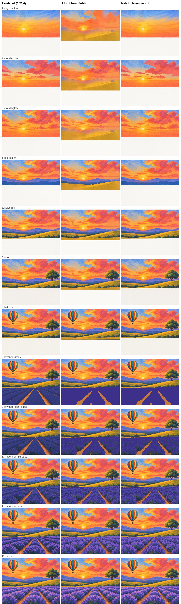

# Spike: step pictures cut from the finished painting (#8)

2026-11-12, on the lavender balloon (`balloon-lavender_skill_20261111-142734`, made with POC 0.20.0). The owner
asked for more tools and less inference, for speed and consistency. Both new runs are in the lesson history.

## How it works (`spike/from_finish.py`, `tools.py from-finish`)

- Each pixel of the finish goes to one step: the step whose region box contains it and whose paints are closest
  in color, with a second pass that also counts how much of each step is nearby.
- Things in their own small box (the balloon, the tree) are cut out whole with OpenCV GrabCut, since the
  balloon's stripes match the sunset.
- Earlier steps paint straight through where later steps go (inpainted, and row by row behind objects).
- The first of several steps over one area is a flat coat in the step's paints. The passes after it go on by
  value, darkest first, in equal shares, whatever paint the plan named for each.
- No renders, no lock. Free, and about 13 seconds.

## What we found

| Steps | Cut from the finish | Rendered |
|---|---|---|
| Lavender rows and dab passes | Better: truly flat rows, then dark, mid, light, every time, no drift | Rows already striped; the passes depend on the run |
| Sky, clouds, mountains | Worse: the sky runs down its whole box into the fields, smudges where the balloon goes | Clean, like a teacher's |
| Balloon, tree | Fine once cut out, faint trace behind | Fine |

The sky problem comes from the plan's regions being boxes: the sky's box reaches 0.66 down, and the field's gold
matches the sun's gold, so color can't tell sky from field there. Limiting how far paint runs past its own edge
left white holes instead. Telling sky from field needs real shapes, not boxes.

## Recommendation

1. **Use the hybrid now:** `from-finish --steps <a group of passes over one area>` cuts only those steps inside
   their regions and keeps the rendered steps elsewhere. On the lavender it costs the same as before for the
   other steps and fixes the passes. The skill should use it for any area with a base coat and texture passes
   (flowers, grass, foliage), and skip `split-texture` and the texture redos there.
2. **Next, outlines instead of boxes:** if the plan gave each part an outline (from a segmentation model, or
   Claude tracing the finish once), the sky steps could be cut from the finish too, and the renders, image
   review, and lock-steps would go away. That's the bigger win, and the next spike.
