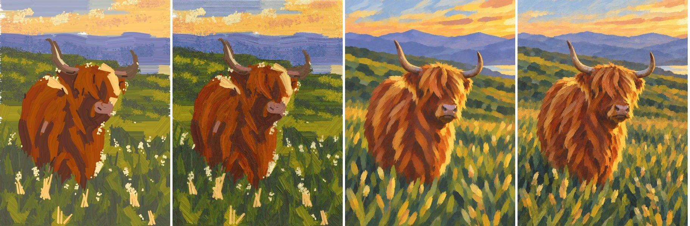
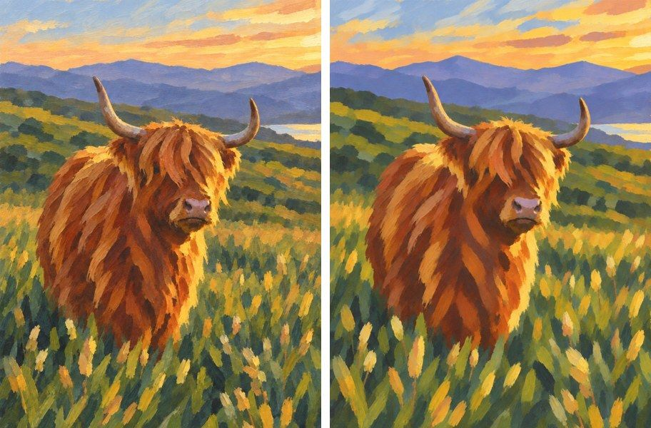
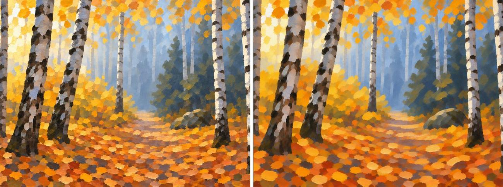
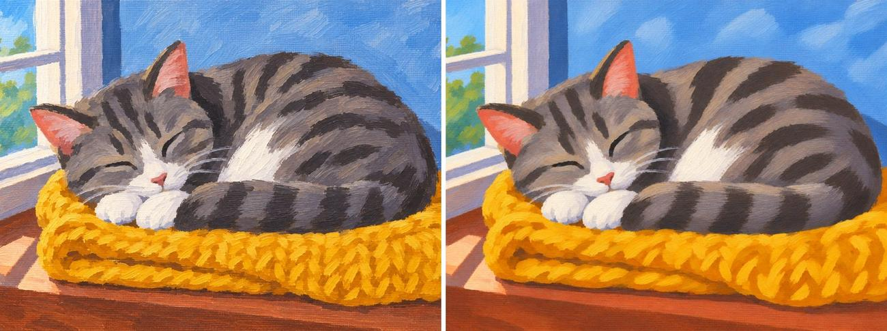
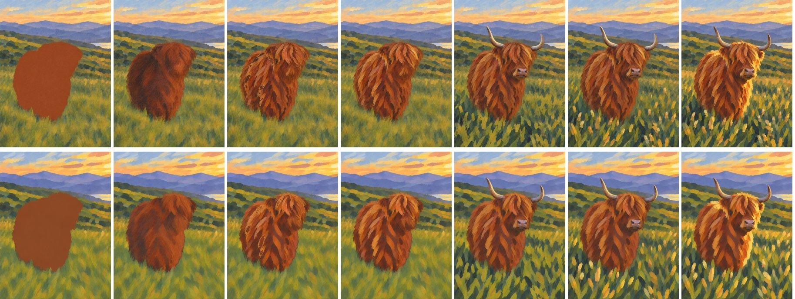

# Probe: stroke-built step pictures, and a finish made for a small kit

2026-11-27. Not a filed spike: a probe run from one session while the owner and Claude looked for Gesso's next step
after POC 2.2.0. It asked two questions, got a no and a yes, and led to the kit lesson trial (#316). The code was
throwaway and is not in the repo; the requests it sent are below, word for word. 23 low-quality renders, 47 cents.

**Verdicts.** Step pictures built from brush strokes: **drop** (`docs/decisions.md`, 2026-11-27). A finish asked for
in marks a four-brush kit can make: **try it on one real lesson** (#316; the owner said yes).

## Why it was run

A read of three POC 2.2.0 lessons (the highland cow, the sleeping cat, the birch grove) as a painter would:

| Lesson | Brushes | Recipes to mix | Steps |
|---|---|---|---|
| Highland cow | 11 | 17 | 22 |
| Sleeping cat | 12 | 19 | 21 |
| Birch grove | 8 | 20 | 22 |

Paint-night formats and the YouTube teachers use 2 to 4 brushes (from search summaries: Paint Nite lists 3 for a
painting, Tracie Kiernan's beginner posts 2 to 4, Cupixel's kit ships 2). Nothing in the technique file caps
brushes, and `max_mixes` skips a paint that is a version of another.

- **A step's work isn't measured, and it is uneven.** By the area that changes between step pictures, the cow's step
  7 changes 142 of the canvas's 192 square inches and its step 9 changes 1. The birch grove's step 1 is a whole misty
  forest and its step 3 changes nothing measurable.
- **The picture asks for more than the words.** Cow step 14 says "add only a handful" of gold locks, over a picture
  that already holds a few hundred from one step with a half-inch angle brush.
- **A recipe disagrees with its picture.** "Pale gold", the cow's rim light, is fitted to `#c2b1a5` and mixes to a
  gray beige. This is the known problem "paints fitted far from their names".
- **The yardsticks have stopped moving.** Since the six-line writer (2026-11-18) no change has moved the student
  test outside its noise, and every lesson scores 3.0 to 3.5 of 5.

Claude's first reading was that the finish is an image with no brush in it, and proposed making each step picture
from strokes a program lays with the step's own brush and paints (#170's idea). The owner doubted it.

## 1. Will the image model repaint a stroke layout as paint?

A stroke engine of about 300 lines (numpy and OpenCV, no model) carried out the cow's 22 steps: for each step the
plan's brush at its real width, its stroke kind and its paints in the recipes' mixed colors, placed where they most
reduced the distance to a target, up to a budget a step. About 1,450 strokes, 4 to 6 minutes on four cores. Alone
its pictures look computer-made.

The image model was then given the engine's last picture and asked:

> This picture is a painting plan drawn by a program: every flat mark is one brush stroke, at the width of the brush
> that makes it and in the color of the paint mixed for it. Repaint it as real acrylic paint laid with a brush by a
> careful beginner on stretched canvas: visible bristle marks, paint a little thicker at the start of a stroke,
> slightly soft and uneven edges, a matte finish, canvas weave showing faintly where the paint is thin. Keep every
> mark where it is, at its size, in its direction and in its color. Do not add marks, detail, shading or new colors
> that the plan does not have, and do not make any mark finer than it is drawn.

From the left: the engine's layout aimed at the kit finish of section 2; the image model's repaint of it; the kit
finish; the published finish. Three repaints were made (two requests on a first layout, one on this one). **Every
one kept each mark's place, size and color and made it look like acrylic, and every one kept the layout's
mistakes.** So a picture made this way is exactly as good as the program that lays out the strokes, and this one is
far short of what the image model composes by itself.

**Drop.** Closing the gap means a program that composes a painting as well as an image model does. A search found no
open one that looks hand-painted at a stroke count a person could paint. As a measure of how many strokes a step
asks for, the engine was not tried properly (a count of color patches in each step's change was too rough to
quote), so that use stays open.

## 2. Can the image model make a finish a small kit could paint?

Given the published finish and a card of the lesson's own mixed paints, and asked (the canvas size and the fourth
brush changed for each picture):

> The first picture is an acrylic painting. The second is a card of the only paints the painter has mixed. Repaint
> the first picture as two beginners could really paint it in one evening on a 12 by 16 inch canvas with four
> brushes: a 1 inch flat, a 1/2 inch flat, a #6 round and a fan brush. No mark may be finer than the #6 round makes,
> about a quarter of an inch on the canvas. Fur, grass, bushes and clouds become a few dozen broad, separate strokes
> each, where the first picture has hundreds of fine ones. Use only the colors on the card, as flat paint, with no
> blending finer than a brush width. Keep the composition, every shape and the light exactly where they are.

with the same sentence on the look of the paint as in section 1. One low render a picture, about 3 cents.

Published on the left, kit on the right. The cow's coat is a few dozen broad locks, and its grass and seed heads can
be counted. The birch grove has fewer, larger leaves and far fewer misty trunks; the change is smaller there. The
cat has broader stripes and bigger stitches, and its wall's brushwork turned into cloud shapes nobody asked for. All
three are still good to look at. The card didn't hold the colors: the cow kept its gold where the card's "Pale gold"
is gray.

## 3. Does that finish give better steps through the chain?

`erase` and `build-steps`, unchanged, on the cow's kit finish with the published plan (written for the old finish,
11 brushes). 14 units, 17 renders (the far hills asked again twice and the bushes once), 32 cents. `build-steps`'
checks 1 and 2 held.

- **Better:** the texture steps ask for fewer, broader marks. The grass, the seed heads and the locks are things a
  half-inch brush and a fan brush can make.
- **The same:** step 12 still turns a flat shape into soft fur, and step 13 still brings every lock at once.
- **Worse in this run:** the far hills would not erase (2.1% of the canvas left after two more tries), so they show
  from step 1, and a strip of violet appeared along the bottom edge. Both are the chain's known faults, and one
  chain differs from the next.

**Try it on one real lesson.** It is a change to what the finish render is asked for and two limits on the plan.
Expect a plainer lesson a beginner's kit can paint, and expect the uneven steps to stay.

## What it cost

| | Renders | Cost |
|---|---|---|
| Repaints of a stroke layout | 3 | $0.05 |
| Kit finishes (cow, cat, birch grove) | 3 | $0.09 |
| The cow's chain on its kit finish | 17 | $0.32 |
| **All** | **23** | **$0.47** |

No Claude calls beyond the session's own.

## Limits

- Everything ran once.
- The kit finishes were made from the published finishes. A lesson makes its finish from the reference and the
  photo, with the kit's sentences in that request and no card of paints (the paints aren't planned yet). That
  request has not been run; #316's lesson is its first run.
- The chain used a plan written for the old finish.
- The numbers on other formats' kits come from search summaries, not from the pages.
- No blind grader and no student test looked at any of this. The owner looked at the pictures.

## Not solved, and where it might go

The in-between pictures are an edit model's guess at an unpainted state. That is where the soft fur, the locks all
at once and the things that won't erase come from, and nothing here touches it. Loomis Painter (Pobitzer et al.,
arXiv 2511.17344, November 2025) is a video model trained on real painting tutorials, 81 of them acrylic by its
paper; it needs a rented GPU, runs at 480p, states no license and its order can't be commanded. It is the one thing
found that goes at this fault directly. Not tried.
