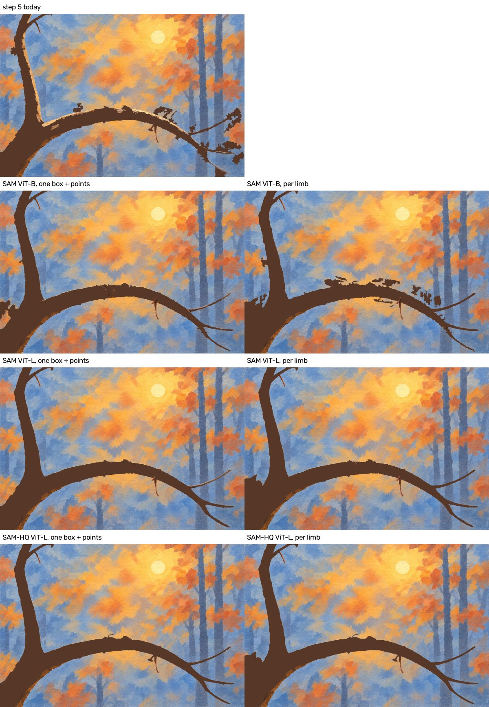
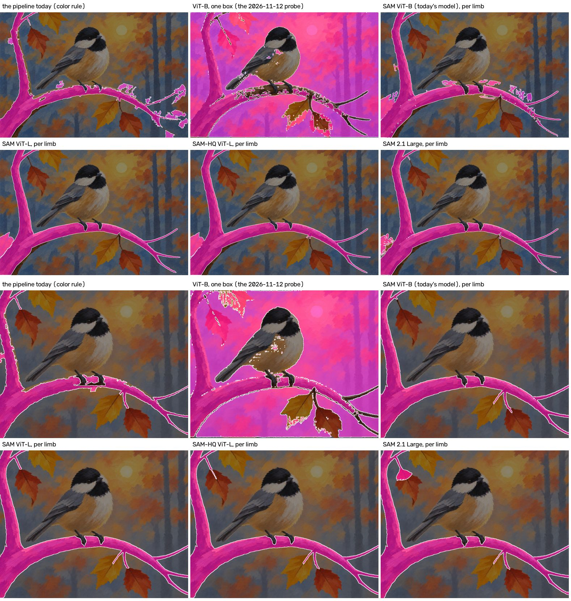
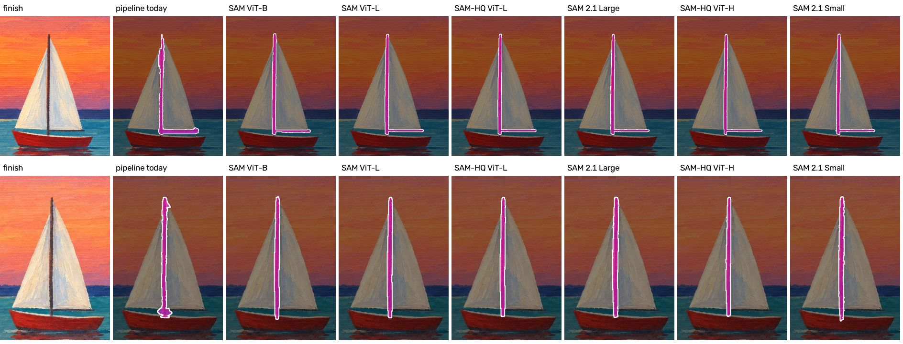
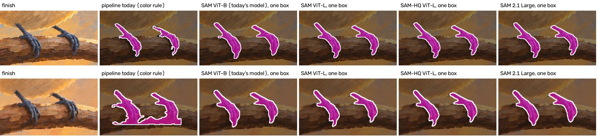
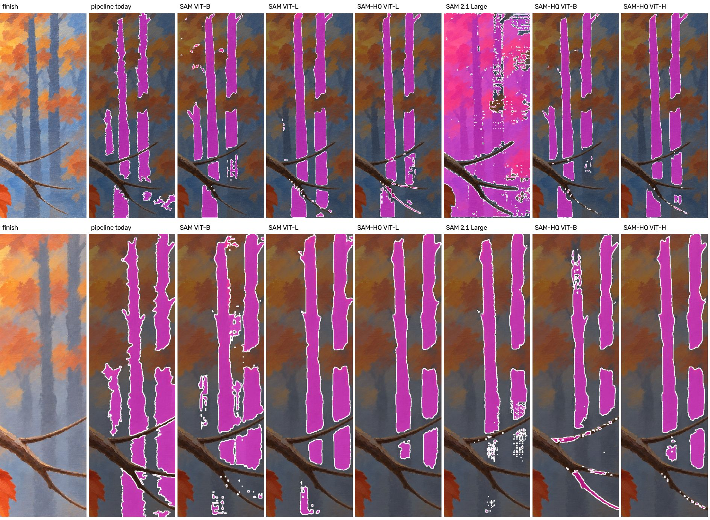
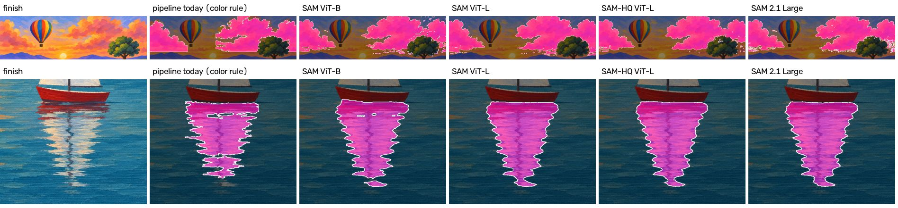
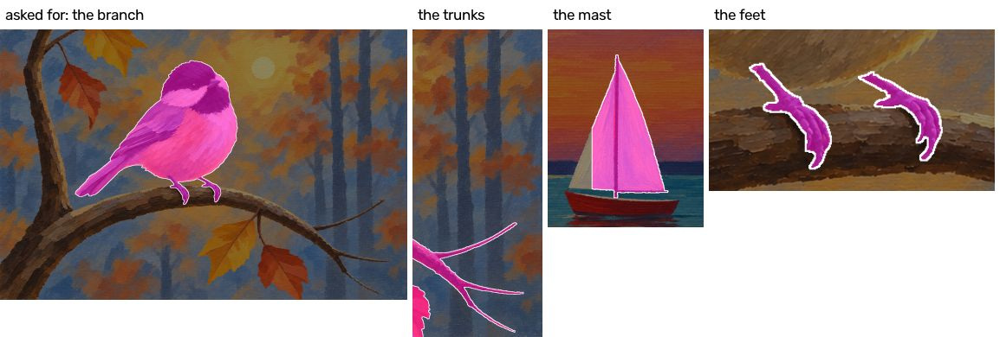

# Spike: a better outline model for thin and soft parts (#85)

2026-11-14. Follows `outline-probe.md` and `outlines.md`. The code is `spike/experiments/issue85.py`; nothing in
the pipeline changed.

**Answer: swap the local model for SAM-HQ ViT-L, and ask it for thin parts with a box and the plan's points. No
hosted model looks needed, though none was run.** The chickadee's branch, the worst outline on the site, comes out
clean and in one piece on the gate run, twigs included (345 MB, 4 seconds more per picture, free). Much of the gain is not the
model at all: the pipeline never asks the model for a thin part, because the probe of 2026-11-12 asked with one
box and no points and got the background back. Given the points the plan already has, even today's ViT-B returns a
far better branch than the color rule, and it outlines the mast and the feet better too.

Step 5 of the chickadee gate run ("Paint the branch and trunk dark"), built by the real tools with only the
branch's and the feet's outlines swapped. Left: one box around the whole branch plus the plan's points. Right: one
prompt per limb.



## What was run

Nine promptable models and one matting model, all as ONNX files on CPU with `onnxruntime` (no PyTorch), on six
pictures: the three fixtures (1000 x 786) and the three gate runs (1536 x 1024; `chickadee_skill_20261113-041241`,
`red-sailboat_skill_20261113-041240`, `balloon-lavender_skill_20261113-041226`). Prompts came from the plans as
they are: nothing was hand-tuned for a model.

| Model | Files | Once per picture | Per prompt | Same result twice |
|---|---|---|---|---|
| SAM ViT-B, quantized (today's) | 109 MB | 4.1 s | 0.04 s | yes |
| SAM ViT-L, quantized | 341 MB | 8.2 s | 0.04 s | yes |
| SAM ViT-H, quantized | 666 MB | 13.7 s | 0.03 s | yes |
| SAM-HQ ViT-B, quantized encoder | 121 MB | 3.0 s | 0.10 s | yes |
| SAM-HQ ViT-L, quantized encoder | 345 MB | 7.6 s | 0.12 s | yes |
| SAM-HQ ViT-H, quantized encoder | 679 MB | 13.4 s | 0.12 s | yes |
| SAM 2.1 Small | 183 MB | 1.5 s | 0.04 s | yes |
| SAM 2.1 Base+ | 360 MB | 2.6 s | 0.04 s | yes |
| SAM 2.1 Large | 910 MB | 5.9 s | 0.03 s | yes |
| BiRefNet, small (a matting model, no prompts) | 224 MB | 7.1 s per part | | not checked |

Times are on 4 CPU cores, the median over the six pictures. All of it is free. Loading a model takes 0.6 to 2.8
seconds more, once per run of the tool. "Same result twice" is the same prompt asked twice of one picture; the
part that reads the picture was run twice only for ViT-L and SAM-HQ ViT-L, and gave the same numbers both times.
The files come from GitHub releases: today's model from rembg's, the others from X-AnyLabeling's exports
(`CANDIDATES` in the script has every address). A lesson runs `outline` up to three times, so ViT-L or SAM-HQ
ViT-L adds about 12 seconds to a run of 16 to 20 minutes.

Each part was asked for in up to five ways (`recipes` in the script): one box; the box with the plan's
`points_in` and `points_out` (**one box + points**); the points alone; points along a thin part's `paths`; and
**per limb**: for each of a thin part's paths, a box around that path, points along it, and the `points_out` that
fall inside the box, with the limbs' outlines joined. For a thin part the box is the bounds of its paths, and the
result is kept inside the band the pipeline already draws around the paths, with pieces under 0.05% of the picture
dropped. Piece counts below are after that clipping (`load` in the script); `results.json` holds the unclipped ones.

There is no hand-drawn outline to score against, so "clean" is by eye, from the pictures below. The script also
counts pieces and overlap with today's outlines (`output/spike85/results.json`); those numbers only back up what
the pictures show.

## What it showed

**The branch.** Top eight: the gate run. Bottom eight: the fixture.



- Today (the color rule): on the gate run, seven pieces, with misty background stuck along the top and the right
  twigs. This is #100's fault. The fixture's branch was tuned by hand over three rounds and is fair.
- One box and no points, the probe's way: SAM and SAM 2.1 return most of the picture at nearly every size (63 to
  87% of it; the branch is 13%). SAM-HQ returns the branch with background attached, in 3 to 15 pieces. This is
  what "the model fails on thin parts" was based on.
- One box + points: SAM-HQ ViT-L returns one clean piece on both pictures. On the gate run it has every twig and
  is the cleanest branch in the run, with a sliver at one foot its only fault. On the fixture it loses three
  limbs: the long right twig, the small twig at the top left, and the leaf stem. ViT-L is as clean, loses the
  same three on the fixture, and drops the long right twig on the gate run too. ViT-B gives three pieces on the
  gate run (no blobs above the branch, a patch of foliage at the left edge, a scrap of the right twig) and keeps
  more of the fixture's twigs than either larger model.
- Per limb: ViT-L and SAM-HQ ViT-L keep every twig and leaf stem, but on the gate run both take a wedge of
  orange foliage at the left edge, where three of the plan's paths run close together (it's the dark block at the
  bottom left of step 5 above). ViT-B per limb is clean on the fixture and the worst of all on the gate run (nine
  pieces).
- So neither prompt is enough alone for a branch. The single box gives the clean body with no stray foliage but
  can lose thin limbs; per limb keeps every limb but can take what lies between close paths. Joining them (the
  single box, then per limb only for a path the first result doesn't cover) wasn't tried.

**The mast.** Top: the gate run (a mast and a boom). Bottom: the fixture (a mast).



Every model returns a straight mast of even width; the color rule's is ragged, with a lump at the foot and a boom
twice too thick. The boom is where the prompts differ: with one box + points ViT-B drops it and the two larger
models draw it too thin, while per limb every model, today's included, gets mast and boom right. The boom is the same kind of loss as the
fixture's twigs: a limb the single box misses and per limb keeps.

**The feet.** Top: the gate run. Bottom: the fixture.



One box, no points, and every model returns two clean feet, today's included. The color rule's fixture outline
takes a slab of branch under them. The feet never needed the color rule: as an `object` with a box they work with
the pipeline as it is.

**The misty trunks.** Top: the gate run. Bottom: the fixture. Box and points.



Mixed, and not a reason to swap. The larger models give smoother-sided trunks, and on the fixture they leave out
haze the color rule takes between the trunks. But on the gate run ViT-L, SAM-HQ ViT-L and SAM-HQ ViT-H all drop
the short trunk on the left, which the color rule and today's ViT-B both find, and SAM-HQ ViT-L takes slivers
along the twigs that cross the trunks. SAM 2.1 Large fails outright there (44% of the picture in 37 pieces). The
trunks stay on the color rule.

**Paint with no single edge** (clouds, a reflection): the models return one solid shape where the color rule
returns the marks themselves. Neither is wrong; the marks are what the steps paint, so these stay on the color
rule.



**Parts with a clear edge** (the bird, the sails, the trees): every model agrees with today's to within what
later parts take back. A swap doesn't cost the easy parts anything that showed here.

**A matting model can't be asked for a part.** BiRefNet returns "the thing in front" of whatever crop it's given:
the bird when the branch was wanted, the branch when the trunks were, the sail for the mast. Only the feet, alone
in their crop, came back right. Its edges are soft, and that didn't help: a painted edge is hard, and every pixel
has one owner in `parts/owner.png`. A soft edge would mean blending two parts' paint in `build-steps`, for no
visible gain on these pictures. (The full-size BiRefNet, 973 MB, ran out of memory on this machine.)



**SAM 2.1 may be better than it looked here.** Its middle size did worse than its small one and its confidence
numbers ran from 0.0 to 0.9 on good outlines, which can be the export or this script's handling of it as much as
the model. The recommendation doesn't rest on it.

## Hosted models: looked up, not run

Nothing hosted was called. This session had no key for any provider and couldn't reach them. What follows is from
the providers' pages as a web search returned them on 2026-11-14; the prices disagreed between pages and none was
confirmed on a live pricing page, so treat them as rough.

| What | Where | Price | Notes |
|---|---|---|---|
| SAM 3 and 3.1, text, box or point prompts | fal.ai | about $0.005 to $0.01 a request | hard outlines; no seed or same-result promise found |
| SAM 3, text prompts | Roboflow | well under a cent a picture | hard outlines |
| SAM 3 | Replicate, community copies | about $0.001 to $0.002 a run | could disappear |
| BiRefNet, BRIA RMBG 2.0 (matting) | fal.ai, Replicate, Bria | $0.0004 to $0.03 a picture | no prompts: only "the thing in front" |
| ZIM (matting you can prompt like SAM) | nowhere hosted | | local only, non-commercial licence |

- A lesson would cost about 1 to 5 cents more (one request per part that needs it, up to three outline rounds).
- Nothing published shows SAM 3 doing better than SAM 2.1 on thin things, and SAM 2's own paper lists fine detail
  as a weak point. SAM-HQ is the one with published thin-object results (ThinObject-5K: 89.5 against SAM's 73.6
  mIoU; DIS: 78.6 against 62.0; its paper, arXiv 2306.01567).
- No provider promises the same outline twice. The pipeline's rule is the same bytes for the same input.
- A text prompt ("the branch") would save writing paths and points. That's the one thing a hosted model offers
  that the local ones don't, and it's about the plan's effort, not the outline's quality.

Not reachable from here, so not tried locally either: SAM 3 as ONNX (about 3.6 GB) and ZIM.

## Recommendation

Checked against `docs/decisions.md`: tools over inference (a free local tool), cost never at the expense of
quality (it costs nothing and looks better), the outline model runs only where a lesson is made (still true), and
every tool gives the same output for the same input (the two recommended models repeated exactly; see the table).

1. **Swap the local model for SAM-HQ ViT-L.** 345 MB once, 4 seconds more per picture, no cost. On the gate run
   it's the only model that returned the whole branch, twigs included, from the single box; on the fixture it and
   ViT-L lose the same limbs, so there the two are level. SAM-HQ is also the one with published thin-object
   results. SAM ViT-L is the runner-up. ViT-H costs 6 more seconds a picture for nothing that showed.
2. **Ask the model for thin parts**, inside the band the pipeline already draws, with both prompts: one box
   around the part's paths with the plan's points for the body, and per limb for a path that result doesn't cover
   (a boom, a twig). The build issue has to build and test that join; it wasn't tried here. Keep the color rule as
   the fallback when the model returns nothing.
3. **This prompt change alone, with today's ViT-B, is already a clear gain** if the swap is ever unwanted: three
   pieces and no blobs above the branch, against seven with blobs.
4. **A small thing with a clear edge is an `object`, not `marks`**: the feet. That's a change to the skill's
   guidance, not to the tools.
5. **Misty trunks, clouds, sun paths, reflections, foliage stay on the color rule.**
6. **No hosted model, on what's known.** The local swap fixes the fault, costs nothing, and repeats exactly. This
   rests on the lookup above, not on a trial: whether a hosted model repeats run to run, and how long it takes,
   weren't measured.

For #100: its option 2 (a better outline model) fixes its step 5, so the image-model edit and the re-render
aren't needed for this case.

## What isn't known

- Two scenes have a thin part (one branch, one mast, each in two renders). Which prompt suits which thin part is
  drawn from those.
- The plans' paths and points were written for the color rule. Whether a hands-off run writes points good enough
  for the model in two rounds is for the build issue's first real runs to show.
- On the gate run the recommended model loses the short left trunk if the trunks are ever moved to it.
- The ONNX files are other people's exports of the published weights. The build issue pins each by SHA-256, as
  today's are.
- Small faults are left with the recommended model on the branch: a sliver at one foot on the gate run, and
  three limbs lost on the fixture with the single box.
- Hosted prices and behavior are from search results, not from running anything.

## To run it again

```
python spike/experiments/issue85.py fetch     # 4.5 GB into models/spike85/
python spike/experiments/issue85.py run       # about 10 minutes; outlines and numbers in output/spike85/
python spike/experiments/issue85.py sheets    # the pictures on this page
```
