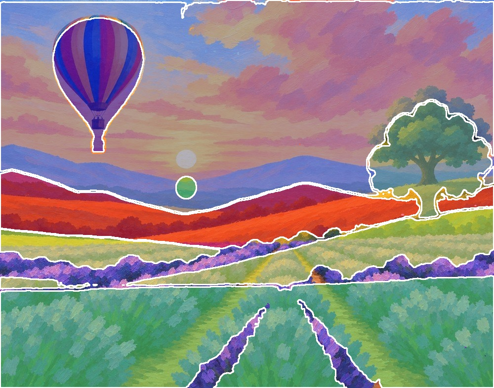
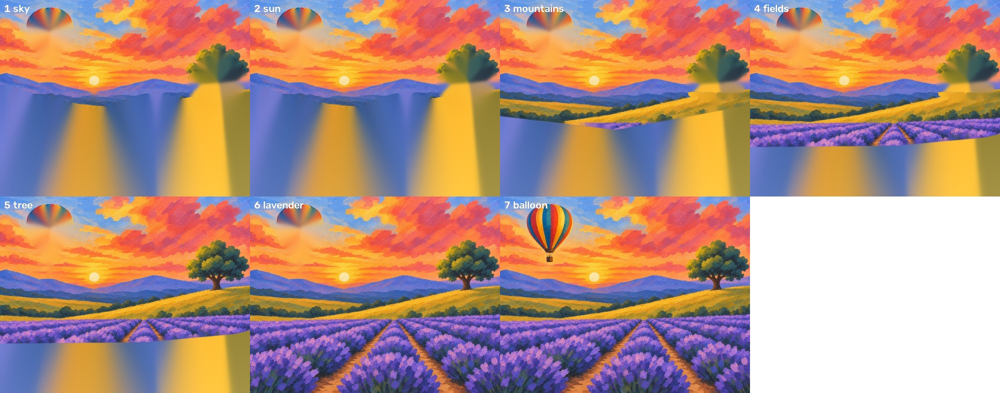
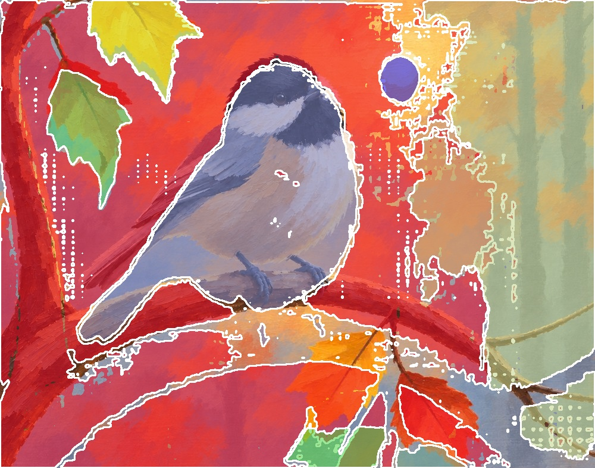

# Probe: outlines from a local model, on finishes already on the site

2026-11-12. A one-hour check before writing `docs/design/pipeline-v2.md`, to see whether real outlines fix what the
from-finish spike (`from-finish.md`) got wrong. It is a probe, not the spike: no code landed, the fills are crude,
and only two finishes were tried. Issue #62 does it properly.

## What was run

- Model: Segment Anything (SAM) ViT-B, quantized ONNX, on CPU with `onnxruntime` (no PyTorch).
  Weights (108 MB together), from the rembg project's releases:
  - `https://github.com/danielgatis/rembg/releases/download/v0.0.0/vit_b-encoder-quant.onnx` (100 MB)
  - `https://github.com/danielgatis/rembg/releases/download/v0.0.0/vit_b-decoder-quant.onnx` (9 MB)
- Input: the finished paintings taken from `site/lessons/lavender-balloon/index.html` and
  `site/lessons/chickadee/index.html` (the last large inline image in each page, 1000 x 786).
- Prompts: one box per part, typed by hand from looking at the picture, the way a plan's `regions` are today.
- Time: about 5 seconds once per picture (the encoder), then about 0.1 second per part.

## What it showed

**Works: things and areas with a clear edge, from a box.**



On the lavender balloon every part came back clean from one box each, with the model's own confidence between
0.96 and 1.0: sky, sun, mountains, gold fields, tree, lavender, balloon. This is the picture where the from-finish
spike failed, because a box could not tell the sky's gold from the field's gold. With outlines, the back-to-front
steps from the mountains on are right with no renders:



Steps 3 to 7 are correct. Steps 1 and 2 show the probe's crude fill, not a problem with the outlines: it filled
the whole canvas below the sky and smeared color down (the real tool leaves unpainted canvas white, and
`spike/from_finish.py` already has better fills, `row_paint` and `continue_paint`). The ghost where the balloon and
tree will go is the hidden-area problem the design handles separately (`pipeline-v2.md`, "Hidden areas").

**Works: a compact subject.** On the chickadee, the bird, all four leaves, and the sun came back clean from one
box each (confidence 0.89 to 1.0).



**Does not work: thin or soft parts from point prompts.** The branch (thin, runs across the whole picture) and the
misty trunks (soft, no real edge) came back as large wrong blobs from clicked points, and a box per limb was no
better. These need a different method, which the design gives (`kind: thin` and `kind: soft`), and #62 has to test.

## The probe's code

Kept here so #62 can start from it. `box` is `[x0, y0, x1, y1]` as shares of the width and height.

```python
import numpy as np, cv2, onnxruntime as ort
enc = ort.InferenceSession("vit_b-encoder-quant.onnx")
dec = ort.InferenceSession("vit_b-decoder-quant.onnx")

def embed(rgb):                                   # once per picture, about 5 s on CPU
    h, w = rgb.shape[:2]; s = 1024 / max(h, w); nh, nw = int(h * s + .5), int(w * s + .5)
    x = cv2.resize(rgb, (nw, nh), interpolation=cv2.INTER_LINEAR).astype(np.float32)
    x = (x - [123.675, 116.28, 103.53]) / [58.395, 57.12, 57.375]
    p = np.zeros((1024, 1024, 3), np.float32); p[:nh, :nw] = x
    return enc.run(None, {"x": p.transpose(2, 0, 1)[None]})[0], s

def mask(emb, s, shape, box=None, pos=(), neg=()):  # about 0.1 s per part
    h, w = shape; pts, lab = [], []
    for x, y in pos: pts.append([x * w, y * h]); lab.append(1)
    for x, y in neg: pts.append([x * w, y * h]); lab.append(0)
    if box: pts += [[box[0] * w, box[1] * h], [box[2] * w, box[3] * h]]; lab += [2, 3]
    else: pts.append([0, 0]); lab.append(-1)
    m, iou, _ = dec.run(None, {
        "image_embeddings": emb,
        "point_coords": (np.array(pts, np.float32) * s)[None],
        "point_labels": np.array(lab, np.float32)[None],
        "mask_input": np.zeros((1, 1, 256, 256), np.float32),
        "has_mask_input": np.zeros(1, np.float32),
        "orig_im_size": np.array([h, w], np.float32)})
    return m[0, 0] > 0, float(iou.ravel()[0])      # the outline, and the model's confidence (0 to 1)
```

The lavender boxes: sky `[0, 0, 1, 0.47]`, mountains `[0, 0.36, 1, 0.54]`, fields `[0, 0.44, 1, 0.64]`, lavender
`[0, 0.6, 1, 1]`, sun `[0.34, 0.37, 0.41, 0.45]`, tree `[0.73, 0.21, 1, 0.49]`, balloon `[0.1, 0.03, 0.3, 0.34]`.
The chickadee boxes: bird `[0.12, 0.08, 0.63, 0.78]`, leaves `[0.12, 0, 0.36, 0.2]`, `[0.06, 0.1, 0.25, 0.46]`,
`[0.46, 0.78, 0.69, 1]`, `[0.62, 0.84, 0.82, 1]`, sun `[0.62, 0.07, 0.73, 0.2]`.

## What it means

- Outlines from boxes are good enough to build on for objects and clear-edged areas, and they cost nothing per run.
- The same boxes give the same outlines every time, so step pictures stop varying between runs.
- Thin and soft parts are the open risk. #62 decides how they're handled before anything is removed.
