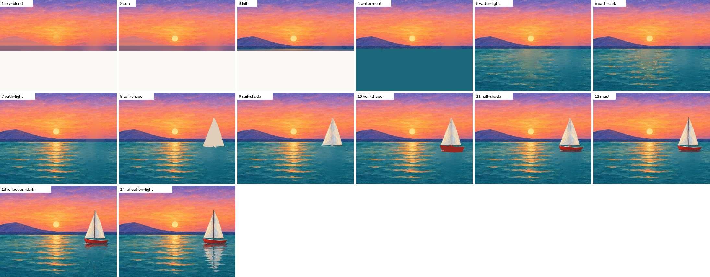
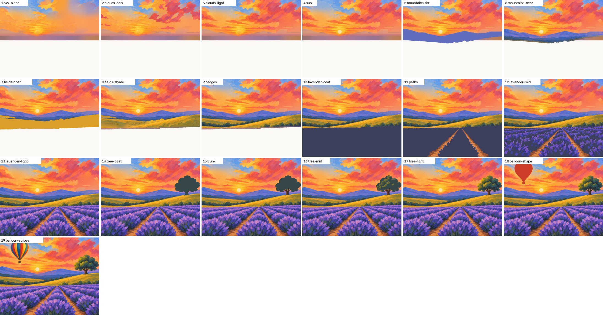
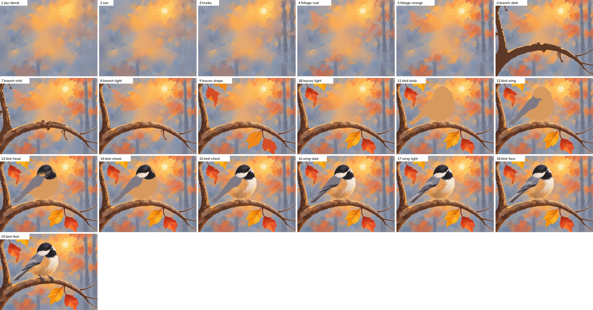
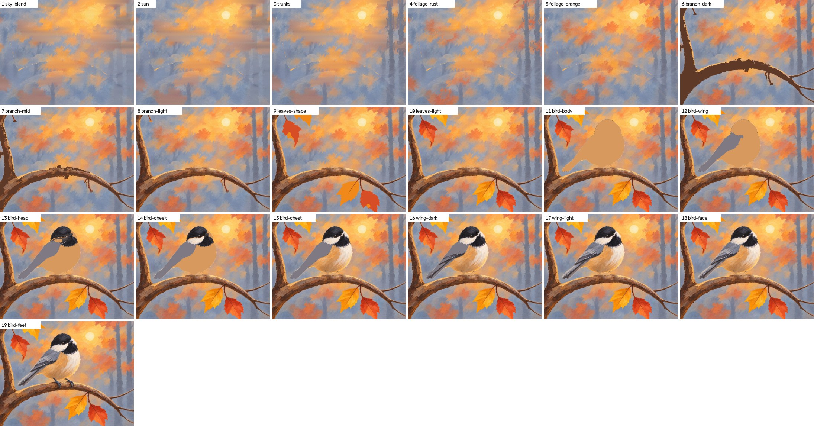

# Spike: every step picture cut from the finish, using real outlines (#62)

2026-11-12. Follows `outline-probe.md` and `from-finish.md`. The code is in the repo: `spike/outline.py`,
`spike/build_steps.py`, `spike/paints.py`, `spike/plan2.py`, the `outline`, `part-colors`, and `build-steps`
tools, and `spike/tests/test_pipeline_v2.py`. The design they belong to is `docs/design/pipeline-v2.md`.

**Answer: go.** With an outline per part, every step of all three test lessons is cut from the one finished
painting. No step is rendered, nothing drifts, and a step can be as small as one move. One limit was found and
it has a known fix: when objects cover a lot of the picture, what's behind them needs one render (below).

## What was tested

The finished paintings of the three lessons on the site (`spike/tests/fixtures/finishes/`, 1000 x 786), each with
a hand-written version 2 plan (`spike/tests/fixtures/plans/`): parts back to front, paints measured from the
picture, and small steps. No image model was called.

| Lesson | Parts | Steps | v1 steps | Outline | Step pictures | Renders |
|---|---|---|---|---|---|---|
| Red sailboat | 9 | 14 | 10 | 10 s | 5 s | 0 |
| Lavender balloon | 10 | 19 | 12 | 12 s | 7 s | 0 |
| Chickadee | 12 | 19 | 11 | 11 s | 8 s | 0 (wants 1, see below) |

Times are on 4 CPU cores. v1 spent 13 to 21 renders and 4 to 7 render minutes on the same pictures.

## The pictures

**Red sailboat.** Clean from start to end. The boat, the mast, and the reflection are each built in their own
small steps. What's behind the boat is a free fill, and it can't be seen.

**Lavender balloon.** The picture where the from-finish spike failed (sky and field were both gold). With
outlines the sky, mountains, and fields come apart cleanly. Steps 10 to 13 are a dark coat, the paths, the middle
dabs, and the light tips: the way lavender is taught.

**Chickadee.** The bird, which v1 took from a flat shape to finished feathers in one step, is 9 steps here: body,
wing, cap and bib, cheek, chest, wing stripes, feather edges, eye and beak, feet. The branch (the part the probe
couldn't outline) is clean.

Steps 1 to 5 show the limit. The bird, branch, and leaves cover 33% of this picture, and the free fill for what's
behind them is streaky. The same lesson with a picture of the background supplied (here a stand-in: step 4 of the
v1 lesson, which was a render of exactly that) is right:

The stand-in wasn't made for this, so its seams show faintly in steps 1 to 3. A render asked for directly ("the
finish with the bird, branch, and leaves removed") hasn't been tried: there was no API key in this session. That
is the next issue (pipeline v2, 2 of 8).

The outlines themselves, one tint per part:
[sailboat](outlines-red-sailboat-parts.jpg), [lavender](outlines-lavender-balloon-parts.jpg),
[chickadee](outlines-chickadee-parts.jpg).

## What was learned

**How each kind of part is found.**
- Things and areas with a visible edge: the outline model from one box each. All 16 such parts across the three
  pictures (19 boxes) came back usable, and none was flagged by the outline checks.
- Thin parts (the branch, the mast) and soft or scattered paint (misty trunks, hazy foliage, clouds, the sun path,
  the bird's cap, the reflection): the model fails on these. A simple color rule works: a pixel belongs to the part
  when its color is nearer the part's own colors than the colors behind it. Thin parts also stay inside a band
  around a hand-given path. All 14 such parts came out usable, some after their points were moved.
- The color rule needs good colors. Points placed on a narrow path missed the paint (the lavender's earth paths
  came out as purple shadow). Two fixes, both now supported: give the colors outright as hex (read them from
  `part-colors`), or don't make it a part at all and let a pass in that paint bring it in. The second is simpler
  and is what the lavender fixture does.

**How a part is built up.** Equal thirds by lightness (what `from-finish` does) is wrong for most things: the
"light" pass is a third of the part instead of a few accents. A pass now shows the finish wherever its color is
nearest that step's paint. A flat coat in the part's dark or main color, then one pass per paint, gives the
order a teacher uses, and each pass covers what that paint really covers.

**What's behind things.**
- Behind a part's own marks (sky under clouds) and under the next part's edge: carried across from the part's own
  paint, with brush texture borrowed from beside the gap. Good enough everywhere it was tried.
- Behind objects: fine when they're small (8% of the picture on the sailboat and the lavender). Not when they're
  big (33% on the chickadee). `build-steps` reports the share and asks for a background picture above 15%. That
  number sits between the two cases seen and needs more pictures to pin down.
- A horizon or shoreline must carry straight on behind an object. Giving the gap to the nearest part made the hill
  bulge around the boat; giving it along each row fixed it.
- An object's soft rim has to be cleared from the background along with it (0.8% of the long side), or a ghost of
  its edge shows in every earlier step.

**Same result every run.** Outlines and step pictures came out byte for byte the same on repeated runs on one
machine. Across machines this isn't promised (the model's arithmetic can differ by CPU).

**A mistake that cost an hour.** The probe first drew every outline stretched (`outline-probe.md`). The fix is in
`outline.Sam.mask`, and a test compares the model's outlines with saved ones.

## What isn't done or isn't known

- The background render (above). Until it's tried, "one render fixes the chickadee" is expected, not shown.
- These pictures are 1000 x 786 JPEGs already cropped to the canvas. A real run's finish is a larger PNG in the
  image model's frame, sometimes with gray bands. Sizes in the code are shares of the picture, but that case
  hasn't been run.
- The parts, boxes, and points were written by hand, with the pictures on screen and a few tries each (the
  chickadee took three rounds). Whether Claude does this well inside the skill, in at most 2 rounds, is for the
  last issue's hands-off runs to show.
- A wet blend with a lot painted on it (the lavender's sky is half cloud) shows soft bars in its first step where
  the sky was carried under the clouds. It reads as a blended sky, and it's gone a step later.
- `publish`, the lesson page, and the history don't read version 2 plans yet.
