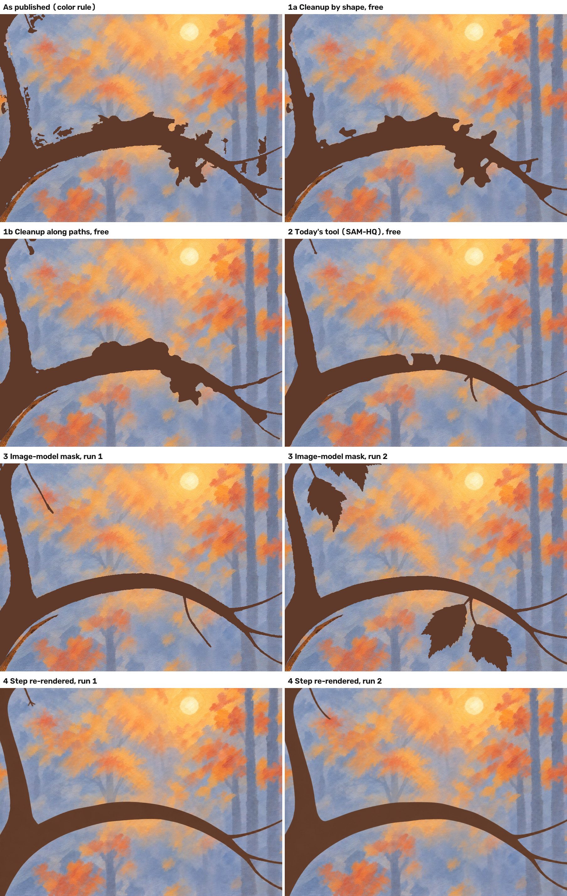
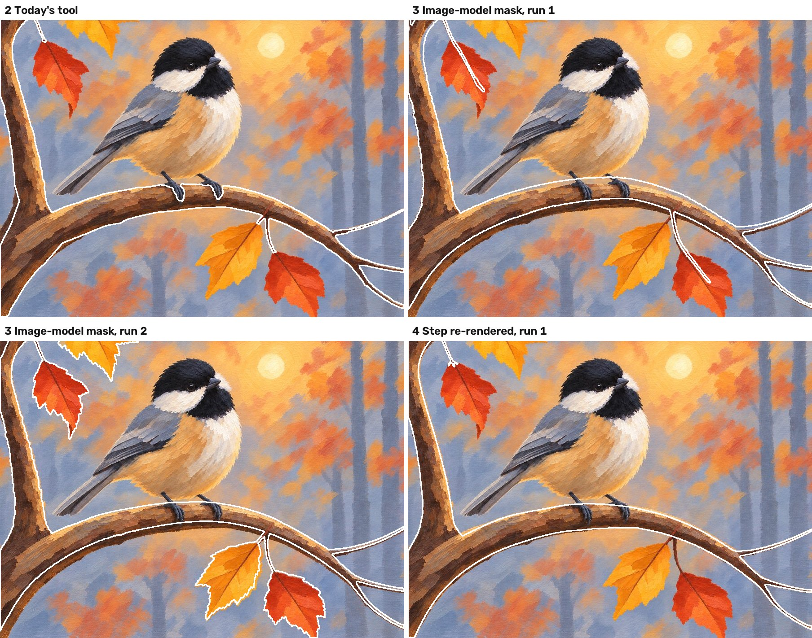
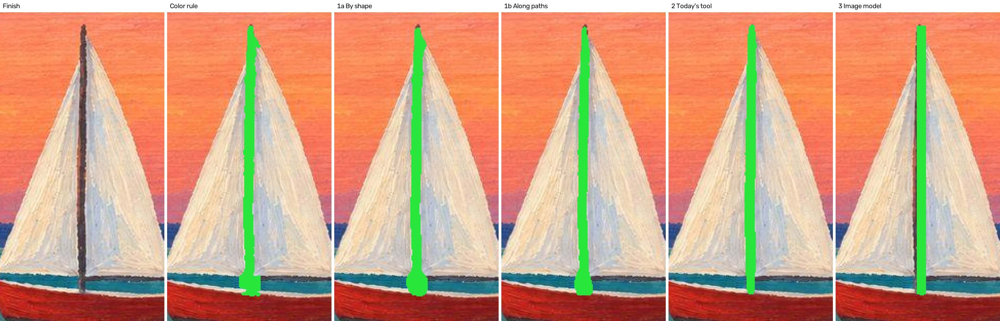
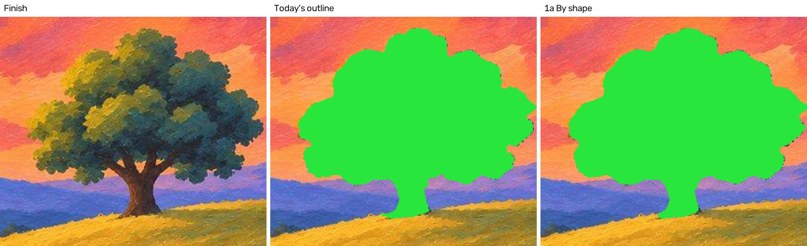

# Spike: clean outlines for thin parts (#100)

2026-11-14. Follows `outline-models.md` (#85), which ran this issue's option 2 and led to the build in #129. This
page runs the other three options the issue lists and puts all four side by side. The code is
`spike/experiments/issue100.py`; nothing in the pipeline changed.

**Answer: today's tool (#129) is the cheapest clean outline, and nothing here beats it or adds to it.** The free
cleanup takes the loose specks off the old outline but leaves the big lumps, so there's no build issue for it. An
image-model mask looks clean and doesn't line up with the painting, and it changes from run to run. Re-rendering
the step does give a clean step 5 for 3 cents and 12 seconds, with the background untouched, but the branch is the
model's redrawing of it, a little off the real one. It stays what the owner already allowed: a fallback for a step
the free tools can't get right, not something to build now.

Step 5 of `chickadee_skill_20261113-130614` ("Paint the branch and trunk dark"), eight ways:



## What was run

The run's plan and full-size finish weren't kept (`output/` is local to the session that made it), so everything
is on the pictures its published lesson page holds (900 x 707): step 4, step 5, and the last step as the finish.
The published branch outline is read back from those: it's where step 5 laid its flat brown. Laying that brown on
step 4 inside each new outline rebuilds step 5 (it matches the published picture to 1.6 levels in 255). The branch's paths and points were written for this spike, by eye, the way a
plan gives them.

1. **Free cleanup, by shape** (no plan needed): close small gaps, keep only what's joined to the main body, open
   away what's thinner than half the branch's usual thickness, give back the long thin pieces (twigs), smooth the
   edge.
2. **Free cleanup, along the plan's paths:** measure how far the outline reaches on each side of each path, take
   the usual reach near there as the real edge, and cut back any stretch that reaches further.
3. **Today's tool** (`outline.thin`, SAM-HQ ViT-L joined with the color rule, #129), given the paths and points.
4. **An image-model mask** (gpt-image edit, low quality, one call): the finish and the rough outline in, "the
   corrected mask, pure white on the branch" out. Twice, to see if it repeats.
5. **The step re-rendered** (gpt-image edit, low quality, one call): step 5 and the finish in, "the brown covers
   exactly the trunk, branch and twigs, change nothing else" out. Twice.

There's no hand-drawn outline to score against. The numbers below use today's tool as the reference, after
checking it by eye against the finish (the white line in the first tile of the next picture), so its own row is
zero by construction. "Stuck on" is outline that isn't branch and "lost" is branch that's missing, each as a share
of the branch's size.

| Way | Stuck on | Lost | Pieces | Time | Cost | Same result twice |
|---|---|---|---|---|---|---|
| As published (color rule) | 40% | 9% | 16 | | $0 | yes |
| 1a Cleanup by shape | 34% | 10% | 1 | 0.06 s | $0 | yes |
| 1b Cleanup along paths | 26% | 9% | 2 | 0.14 s | $0 | yes |
| 2 Today's tool | reference | reference | 1 | 8.2 s | $0 | yes |
| 3 Image-model mask, run 1 | 15% | 21% | 1 | 16 s | $0.030 | no: the two runs overlap 54% |
| 3 Image-model mask, run 2 | 68% | 21% | 1 | 10 s | $0.030 | |
| 4 Step re-rendered, run 1 | 5% | 10% | 1 | 12 s | $0.030 | nearly: the two runs overlap 93% |
| 4 Step re-rendered, run 2 | 6% | 6% | 1 | 13 s | $0.030 | |

The tool's 8.2 seconds is almost all reading the picture, which a lesson already pays once for its other parts;
the branch's own prompts take about a second.

## What it showed

**The free cleanup removes specks, not lumps.** By shape, the 16 pieces become one and the loose specks go, but
the lumps above the branch and around the leaf stems are as thick as the branch itself, so nothing that keeps the
branch removes them (34% still stuck on, against 40%). It also bridges the two right twigs with a web. Along the
paths does better (26%) and tidies the right twigs, but the lump under the bird is a quarter of the branch long,
so the "usual" width there is the lump's. Taking the usual width over a longer stretch was tried: it still left
the lumps, and what it lost rose from 9% to 14% as it cut into the trunk where the trunk widens. The cleanup can't tell mist the branch's color from
branch; that takes something that sees the picture. Run on today's outline instead, the path cleanup changes under 2% of
it: there's nothing left for it to do.

**Today's tool is clean, in one piece, with every twig and stem.** Two small notches in the top of the branch are
the bird's feet, which the lesson paints on top later. This is the same result #129 got on this run from its own
plan (`outline-models-join.jpg`), from paths written fresh here, which is some evidence it doesn't depend on a
lucky plan.

**The image-model mask is a drawing of a branch, not this branch's outline.** Both runs returned a smooth, tidy
silhouette, and neither lines up: the branch is redrawn thinner and lower, the trunk narrower (21% of the real
branch is outside it). Run 2 also added all four leaves, though the prompt asked for the branch. The two runs
overlap 54%. An outline that's off by a few pixels is worse than a ragged one in this pipeline, because every
later step cuts the finish inside it: the branch's light step would show a sliver of mist along one edge and miss
bark along the other.



**The re-render gives a good-looking step, a little off the real branch.** The background came back unchanged (it
differs from step 4 by 3 levels in 255, about what JPEG does, and hasn't moved), the blobs are gone, and the two
runs agree 93%. But the branch is again the model's version: smooth where the real one has knots, and it drops the
leaf stems and one twig. In a lesson, step 5 would show a slightly different branch from the one step 6 then
paints inside the real outline, so about 5% of the brown would vanish between the two steps and 6 to 10% of the
branch would appear from nowhere. It also fixes only the picture: the outline stays wrong, so the where-line, the
paint map and the later steps that are cut inside it stay wrong too.

**The mast** (the sailboat fixture, 1000 x 786):



The same story, smaller. The color rule's mast is ragged with a lump at the foot. By shape rounds the lump and
keeps it; along the path trims the top and keeps it. Today's tool returns a straight, even mast. The image-model
mask is a perfect bar about one mast-width to the right of the mast (39% of the mast outside it).

**The lavender's tree** was never a thin part: it's an `object`, and its outline is already clean. The shape
cleanup changes under 1% of it. Nothing to fix.



## What each would add to a run

A run costs about $0.08 to $0.15 today.

- Free cleanup: nothing, under a second.
- Today's tool: nothing more; it's already in every run.
- Image-model mask: 3 cents and 10 to 16 seconds per thin part per outline round, so up to 9 cents on a run with
  one thin part and three rounds. That would roughly double a cheap run.
- Step re-render: 3 cents and about 12 seconds per step re-rendered.

## Recommendation

Checked against `docs/decisions.md`: tools over inference, cost never at the expense of quality, a step may be
re-rendered when the free tools give a bad result and nothing better works, and don't raise the image model's
quality.

1. **Keep today's tool as the way thin parts are outlined.** It's free, repeats exactly, lines up with the finish,
   and it's the cleanest result here on both the branch and the mast.
2. **Don't build the free cleanup.** Alone it doesn't fix the branch (so no build issue, per the issue's
   acceptance), and on top of today's tool it has nothing to do.
3. **Don't use the image model to make outlines.** It doesn't line up and doesn't repeat, and a misplaced outline
   damages every later step.
4. **A step re-render stays an allowed fallback, unbuilt.** It works as a picture and is cheap. If a lesson ever
   has a block-in the outline tool can't get clean in its fix rounds, a re-render of that one step is a fair last
   move, knowing the shape will be slightly the model's. No lesson needs it now, so there's nothing to file.

## What isn't known

- One branch and one mast. The owner's question was about this branch; other thin, soft-edged things (reeds,
  rigging, fence wire) weren't tried.
- The reference outline is today's tool, checked by eye. The numbers say how far each way is from it, not from a
  true outline, and they flatter the tool by construction. The pictures are the evidence.
- The pictures are the page's 900-pixel JPEGs, not the 1536-pixel finish a run works on. The image model was given
  them on a 1536 x 1024 page with gray bars at the sides; a full-size finish needs no bars, and the masks might
  line up a little better without them.
- The image model was asked once per prompt at low quality (the standing rule for experiments). Other wordings
  weren't tried.
- Whether a hands-off run's own plan gives the tool paths this good is #129's question; its runs so far say yes,
  with small faults (a few foliage specks on this run from its own plan, a deck line taken with a boom).

## To run it again

```
python spike/experiments/issue100.py free     # no cost, about 20 seconds
python spike/experiments/issue100.py paid     # five image-model calls, about $0.15
python spike/experiments/issue100.py sheets   # the pictures on this page, and output/spike100/numbers.json
```
