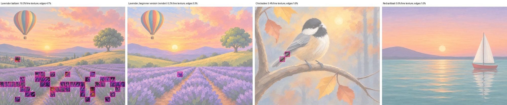
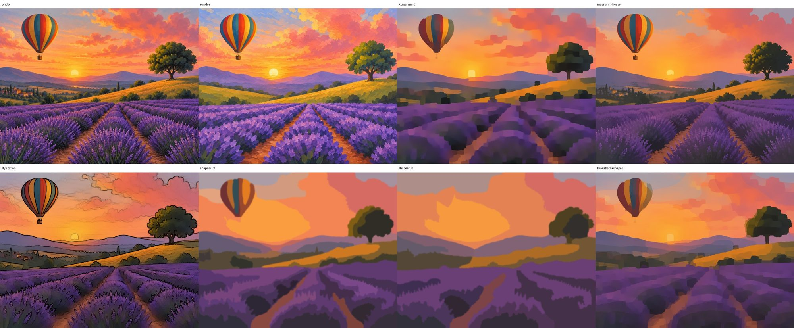
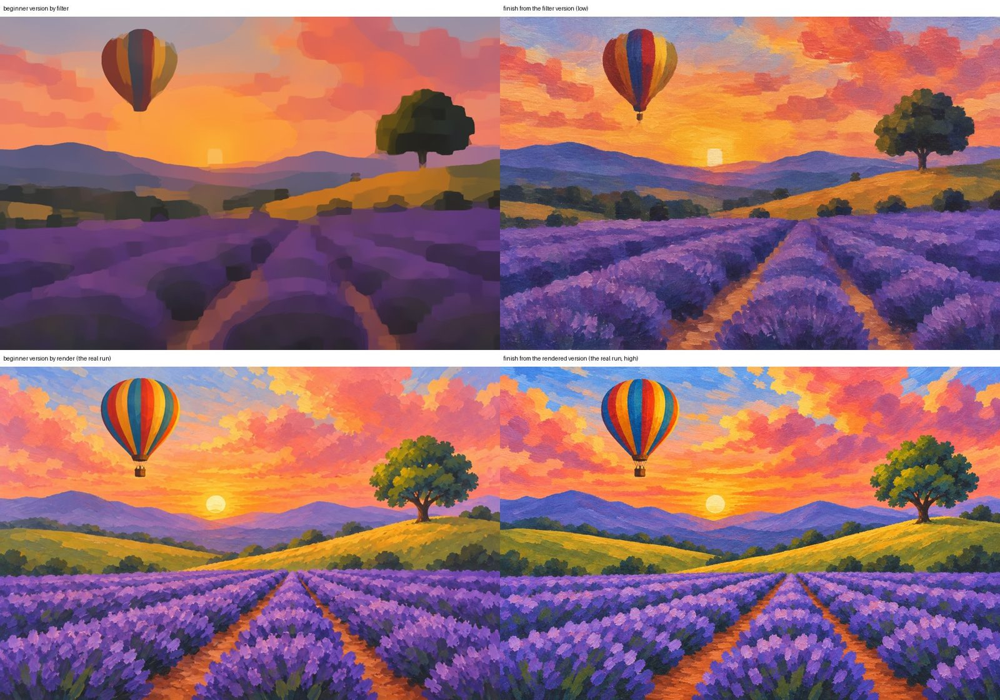
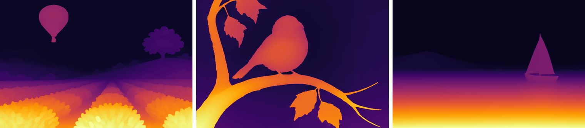

# Spike: busy check, beginner version, and painting order from tools (#52)

2026-11-13. The question (owner, 2026-11-12: more tools, less inference): can tools replace what Claude still
judges before the plan? The code is `spike/experiments/issue52.py`. It is experiment code: no lesson tool, the
skill, or a test was changed.

**The owner's calls (2026-11-13):** build the busy measure (#109); drop the painting-order tool
(`docs/decisions.md`). **Built 2026-11-14 (#109, POC 1.8.0):** the `busy` tool (`spike/busy.py`), run at step 0c, on
the beginner version, and on the finish; it gives the numbers in section 1 exactly.

**Answers, short:**

| Judged by Claude today | Can a tool do it? | Recommendation |
|---|---|---|
| Is the picture too busy for a beginner? | Partly. A free measure agrees with Claude on all three pictures and finds texture made of hundreds of items. It misses tiny separate things (the village). | Add the measure as a number and a picture Claude reads at step 0c, and as a check that the beginner version worked. Claude still decides. |
| The beginner version (a $0.024 render) | No. A filter strong enough to drop the village also drops the sun and the balloon's basket, and blurred stalks don't become dabs. | Keep the render. |
| Painting order, back to front | Not usefully. The tool found no mistake in Claude's order in 18 plans, and gets a close subject wrong on its own. | Don't build it. |

## What it was tested on

The 15 hands-off runs of 2026-11-13 in `output/` (5 each of the lavender balloon, the chickadee, and the red
sailboat: each has the photo as fitted to the canvas, Claude's busy-check answers in `notes.json`, its plan, and
its outlines), plus the three fixture plans and outlines in `spike/tests/fixtures/`.

What Claude chose in those runs:
- **Busy check:** lavender balloon, too busy, 5 runs of 5. Chickadee and sailboat, fine as they are, 5 of 5 each.
- **Beginner version:** rendered for the lavender in all 5 runs ($0.024 and 17 seconds in the latest, 130631).
- **Painting order:** the order of `parts` in each plan.

"The latest run" below means the 13:06 runs (130631, 130614, 130625), the ones the pictures come from.

## 1. Busy check

Measured on the canvas part of the picture at 1000 pixels on the long side:
- **edges**: the share of pixels on an edge (Canny, after a light blur);
- **fine texture**: the share of 40-pixel tiles where more than 1 pixel in 8 is an edge;
- **small shapes**: the picture smoothed and snapped to 12 colors, then the count of separate patches between
  0.02% and 0.5% of the picture.

| Picture | Claude | Fine texture | Edges | Small shapes |
|---|---|---|---|---|
| Lavender balloon, photo | too busy | **10.3%** | 4.7% | 263 |
| (run 031314 cropped it differently) | too busy | 10.1% | 4.6% | 221 |
| Chickadee, photo | fine | 0.4% | 1.6% | 124 |
| Red sailboat, photo | fine | 0.0% | 1.0% | 66 |
| Lavender, the 5 rendered beginner versions | (made to be fine) | 0.0 to 0.2% | 2.1 to 3.3% | 138 to 222 |
| The 15 finishes | | 0.0 to 1.7% | 1.5 to 3.5% | 92 to 327 |



- **Fine texture separates them cleanly**: 10% against 0.4% and under, with nothing in between. Any line from
  about 2% to 8% gives Claude's answer on all three photos and on all five beginner versions.
- **Edges** agree but with less room (the beginner versions, at 2.1 to 3.3%, sit between the chickadee and the
  busy photo).
- **Counting small shapes doesn't work.** These pictures are painted, and brush marks count as shapes: the
  beginner versions (138 to 222) overlap the busy photo (263) and the chickadee (124), and one beginner-sized
  lavender finish counts 327, more than the busy photo.
- **What it catches and what it misses.** The tiles land on the lavender stalks ("textures made of hundreds of
  items"). Only one tile lands on the village, and none on the cypresses or the dozen small bushes, which Claude
  named in every run. Tiny separate things are a few small shapes, not a texture, and nothing here tells a house
  from the balloon's basket. "More parts than `detail_budget.max_parts`" can't be measured before the plan
  either; `check` already counts it after.
- **Three pictures is thin.** One busy picture and two calm ones can't set a threshold anyone should trust as a
  gate.

**Recommendation: build it as an aid, not a judge.** A `busy` tool that prints the fine-texture share and writes
the picture above, run at step 0c:
- Claude reads the number and the picture before answering the four questions, so the texture answer is
  measured and the drop list can point at where the texture is.
- When a beginner version was made, the same number checks it and the finish made from it: fine texture has to
  come down (10.3% to 0.2% and under here). Today that is "Read the result". Only then: on a calm picture the
  finish measures a little more than the photo (chickadee 0.4% to as much as 1.7%, sailboat 0.0% to 0.6%), from
  brush marks.
- Claude still answers the questions about tiny separate things and parts, and still writes the drop and merge
  list. No threshold blocks a run until more pictures have been measured (#5 will bring five).

## 2. Beginner version by filter

Six filters on the lavender photo, against the render from the latest run:



| Version | Fine texture | Edges | What it did |
|---|---|---|---|
| Photo | 10.3% | 4.7% | |
| Render (latest run) | 0.2% | 3.3% | village, cypresses, and lake gone; lavender is rows of loose dabs with clear paths |
| Kuwahara, strength 5 | 0.0% | 0.8% | everything blurred to blocks: square sun, balloon lost its basket, village is dark smudges |
| Mean shift, heavy | 0.0% | 1.3% | the village and cypresses are still there, softer; stalks are noise |
| OpenCV stylization | 6.9% | 4.4% | adds dark outlines; nothing removed |
| Smooth, 16 colors, drop shapes under 0.3% (the issue's recipe) | 0.0% | 0.2% | flat poster: the village is gone, and so are the sun and the basket; the balloon is a blob with four stripes |
| The same, 12 colors, under 1% | 0.0% | 0.1% | the balloon is gone too |
| Kuwahara mixed with the recipe | 0.0% | 0.6% | the least bad: still a blocky sun and a lumpy balloon |

Every filter gets the numbers down, and none makes a picture to paint from. Three reasons, and no setting fixes
them:
- **A filter can't tell the subject from clutter.** The balloon's basket and the sun are the same size as a
  house. Whatever is strong enough to drop the village drops them.
- **Dropping isn't replacing.** The render put hill where the village was. A filter leaves a dark smudge the
  same shape.
- **A texture doesn't become a mark.** The decision asks for "rows of loose dabs, darker at the base". Blurred
  stalks are purple mush with no rows, and nothing in it says how to paint it.

**One paid test** ($0.030, low quality): the finish rendered from the least bad filter version, with the usual
finish prompt.



It's closer than the filter picture suggests: the image model repaints the mush as lavender rows, and the
village stays gone. But the filter's damage comes through: a square sun, a lumpy balloon with a stub for a basket,
and duller color everywhere (the filter averaged the sunset toward gray). The latest run's finish has a round
sun, a whole balloon, and the photo's color. (Both keep a row of dark bushes.) Low against high quality is part of the difference, not all of it: the square
sun and the color are in the input.

**Recommendation: keep the render.** It costs 2.4 cents and 17 seconds, only on a busy picture, and it's the one
tool here that does what the decision asks. A filter saves the 2.4 cents and costs the subject. That fails
"save cost but never at the expense of quality".

Not tried, and not worth an issue yet: filtering everything except the subject's box (the `--keep` box from
`fit-canvas`). It would save the balloon, not the sun, and the village would still be a smudge.

## 3. Painting order

For each plan's parts with no parent (children counted with them), three ways to order them from the finish and
the outlines:
- **position**: parts sorted by where they end, top of the picture first;
- **depth**: a local depth model (Depth Anything V2 small, ONNX, 99 MB, about 1 second a picture on 4 cores),
  each part's middle depth, far to near;
- **depth + split**: Claude's own split into behind and in front (`pipeline-v2.md` section 5: the first object
  or thin part in the list, and everything after it, is in front), and depth inside each half. This one borrows
  from Claude's list, so it's the tool with help.

Share of pairs of parts in the same order as Claude's list, over 6 plans a picture (5 runs and the fixture):

| Picture | Pairs | Position | Depth | Depth + split |
|---|---|---|---|---|
| Lavender balloon | 115 | 55% | 86% | **94%** |
| Red sailboat | 103 | 75% | 73% | **90%** |
| Chickadee | 60 | 12% | 52% | 52% |



- **Position alone fails**: a balloon in the sky and a tree on a hill end high up, so it paints them first,
  before the sky. Claude paints them last.
- **Depth is mostly right about the land**: sky, mountains, hills, field, water come out in Claude's order in 10
  of the 12 lavender and sailboat plans. In the other two (sailboat runs 041240 and 130625) it puts the far shore
  before the hill. Most of what's left is pairs that don't touch (tree and balloon), where either order paints
  the same picture.
- **Depth is wrong about a close subject.** On the chickadee the branch runs toward the viewer, so its middle
  depth is nearer than the bird's, and the tool paints the bird before the branch it sits on. Claude's split
  doesn't help: bird, leaves, and branch are all in front.

A fourth try works pair by pair, only on parts that touch: which side of their shared edge is nearer (the
middle depth of each part within 1.5% of the long side of the edge; a difference under 0.03 of the picture's
depth range counts as can't tell), or which part sits inside the other's filled shape. Over the 190
touching pairs in the 18 plans:

| | Pairs | |
|---|---|---|
| The tool agrees with Claude | 122 (64%) | |
| The tool can't tell | 61 (32%) | mostly neighbors on the land (sky and mountains, mountains and hill), where the depth step at the edge is tiny, and a boat standing on water |
| The tool disagrees | 7 (4%) | below |

The 7 disagreements, read one by one. None is a mistake in Claude's order:
- 2 are outline faults, not order: pieces of soil path filed under the sky (known, `pipeline-v2.md` section 6),
  so "sky" touches the field and measures near.
- 2 are the "sits inside" test misreading gaps: the paths between lavender rows and the hill between bushes
  fall inside the filled shape of the part painted over them. Claude's order (ground first, plants over it) is
  how it's taught.
- 3 are the depth model off by a hair on thin things (branch and bird, branch and leaves, hull and mast).

So when the tool answers, it agrees 95% of the time, and its 7 disagreements were 7 false alarms. That isn't
proof Claude's order was right in all 18 plans: only the disagreements were read one by one, and a wrong order
among the 61 pairs the tool can't tell would go unseen. But none of the 15 runs lists an order problem, and the
reviewer of this spike planted two wrong orders (mast before sails, branch last) and the pair test caught both,
so it can see one when it's there.

**Recommendation: don't build it.** The order comes free with listing the parts, no lesson so far went wrong
there, and a 99 MB model that confirms it adds a download, a second or so a run, and false alarms. Two things worth keeping from
this:
- The pair test did find the stray sky pieces. `outline` already reports those a better way (the enclosed-area
  check, section 6).
- If a lesson ever ships with parts in the wrong order, the pair test is the place to start, and it's in
  `issue52.py`. Untried: the depth model takes a square picture, so the 3:2 finish is squashed to fit, which may
  be behind the misses on thin parts.

## Costs of this spike

One paid render: $0.030 (the finish from the filter version, low quality). Everything else ran locally.
The depth model isn't in the repo or in `models/` by default; the link is in `issue52.py`.

## To run it again

```
python spike/experiments/issue52.py busy <picture> [...]
python spike/experiments/issue52.py beginner <picture> --out <folder>
python spike/experiments/issue52.py order <lesson folder> [...]      # needs models/depth_anything_v2_vits.onnx
```

These print the numbers. The four pictures here, and the filter picture sent to the paid render (the
`kuwahara+shapes` variant on the whole frame), were put together by hand from their outputs.
