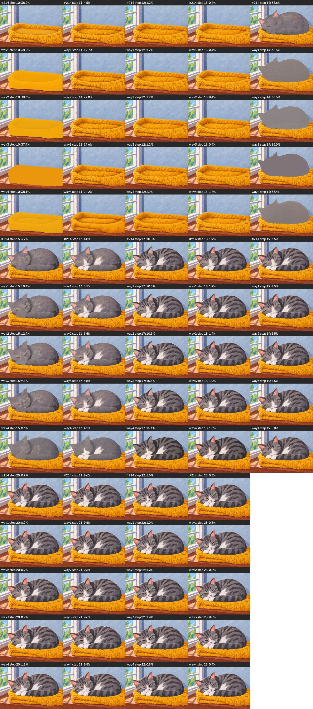
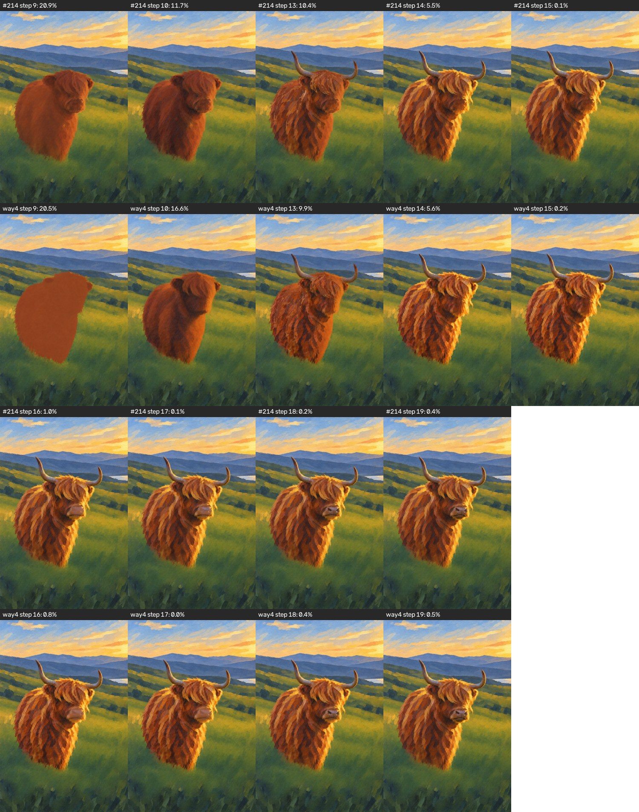
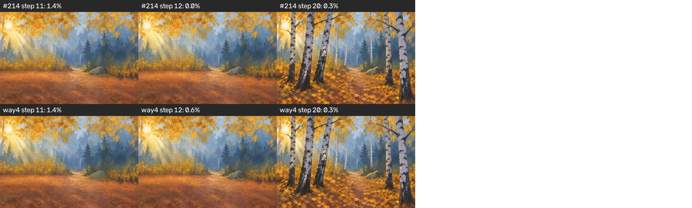

# Spike: a block-in that arrives finished, and the near-empty steps after it (#217)

2026-11-18. The one v3 fault #214 left with no known answer (`docs/spikes/v3-combined-round2.md`): a block-in's
picture is whatever the render before it left, a shaded and textured thing, and the steps after it then have
little to add. Three ways to make the block-in were tried on the sleeping cat's blanket and cat, a fourth was
added when those three left the later steps as they were, and the fourth was run on the highland cow and the
birch grove's rock. The code is `spike/experiments/v3_block_in.py`, the numbers `spike/experiments/v3_block_in.json`,
the scores `spike/experiments/bench/scores/s217-block-in.json`. It is experiment code: no lesson tool, the skill,
or the site changed. It reads #214's chains and pays only for the renders it makes again.

**Verdict: adopt way 4. That is Claude's call, not the 2026-11-17 rule's: the rule isn't met.** Way 4 is two
changes to the chain, at no extra render: every "back" request says what is left and lists what the plan hasn't
painted yet, and a thing's render is kept over the whole thing, not only where it changed by a lot. Blind graders
compared the lesson made with it against #214's on three pictures. Both of the sleeping cat's graders preferred it
(clearly). The highland cow's split: one for it, slightly; one "none", leaning slightly to #214's. The rule counts
a split as a tie. Both of the birch grove's said "none" (one leaning slightly to way 4): only the rock's two steps
differ there. That is preferred on one picture of three and a tie on two, and the rule asks for most pictures. No
grader chose #214's lesson on any picture. The reasons for adopting anyway: the one picture where it changed two
whole things is the clear win, the ties are where it changed little, and it costs nothing more. They are reasons,
not a result, and the owner may read one of three as not enough.

**The owner's answer (2026-11-18): "Adopt stands."** It is recorded in `docs/decisions.md` and goes into the build (#219).

**It moves the fault as well as fixing it.** The block-in is now flat and agrees with its words. The step after
it is now the big jump: on the cat and the cow it is among every grader's worst steps of the new lesson (the cat's
11 and 15, the cow's 10). On the birch grove the graders' worst steps are ones both lessons share.

## What was wrong, and it wasn't the request alone

Two things made #214's block-ins, and the second was not known before this spike.

1. **The request.** "A smooth first coat" wasn't enough. Naming the block-in's one paint, saying it is "the same
   from edge to edge, like a shape cut from colored paper", and listing what the plan paints on the thing later
   ("None of this is painted yet, so none of it may show: ...") gave a flat coat on the first try, four times of
   four on the cat, and on the cow and the rock.
2. **The guard threw good renders away.** The chain keeps of each render only what changed by 9 Lab units or more
   in a patch that holds a change of 20 (`diff_mask`). A flat yellow coat is close in color to much of the knit it
   replaces, and smooth gray to much of the fur. So the guard kept the render in patches and left stitches and fur
   between them. The first try of ways 1 and 2 looked like a failure of the request and was this. The render that
   took the blanket's knit off (smooth, shaded yellow) was thrown away whole. Kept over the whole thing (the solid
   shape of what the thing's block-in unit adds, with its holes filled), the same renders gave the pictures below.

## The ways

Each makes the block-in's picture again. The pictures under it stay (the thing gone is the thing gone), and so do
the pictures over it; only the changes of the units beside it are measured again, so the last picture is still the
finish (0.00% off, and no step changes a pixel outside its unit, on every way and picture).

| Way | What | Renders |
|---|---|---|
| 1 | A stronger request for what is left: the "back" request that leaves the block-in also names its paint and lists what isn't painted yet | the same one, asked differently |
| 2 | A second render for the block-in alone: from the picture the "back" render left, the thing is asked for as one flat coat | one more a block-in |
| 3 | No render: a flat coat of the block-in's fitted paint over the solid shape of what the unit adds | none |
| 4 | Way 1, the same list on every later stage of the thing, and every stage's render kept over the whole thing | the same ones, asked differently |

Way 4 was added by this spike. One unit was also told by hand that what is left has no texture (the blanket's
stitches, `--smooth 9`): with only the stitches named, the knit stayed.

## The sleeping cat: the three ways, then the fourth

The share of the canvas each step changes by enough to see (9 Lab units or more after the guard's blur, from one
step picture to the next):

| Step | #214 | Way 1 | Way 2 | Way 3 | Way 4 |
|---|---|---|---|---|---|
| 10 block the blanket | 38.2% | 38.2% | 38.3% | 37.9% | 38.1% |
| 11 shade the blanket | 4.5% | 19.7% | 22.0% | 17.6% | 24.2% |
| 12 dark stitches | 1.2% | 1.2% | 1.2% | 1.2% | 2.9% |
| 13 light stitches | 0.4% | 0.4% | 0.4% | 0.4% | 1.8% |
| 14 block the cat | 36.6% | 36.5% | 36.5% | 36.0% | 36.4% |
| 15 shade the cat | 3.7% | 10.4% | 12.9% | 9.4% | 8.6% |
| 16 white patches | 4.8% | 5.5% | 5.5% | 5.8% | 4.1% |
| 17 stripes | 10.5% | 10.5% | 10.5% | 10.5% | 15.1% |
| 18 inner ears | 1.9% | 1.9% | 1.9% | 1.9% | 1.6% |
| 19 silver fur | 0.5% | 0.5% | 0.5% | 0.5% | 5.0% |
| 20 lit fur | 0.9% | 0.9% | 0.9% | 0.9% | 1.3% |
| 21 eyes and mouth | 0.6% | 0.6% | 0.6% | 0.6% | 0.5% |
| 22 nose | 1.0% | 1.0% | 1.0% | 1.0% | 0.8% |
| 23 whiskers | 0.8% | 0.8% | 0.8% | 0.8% | 0.4% |

- **Ways 1, 2 and 3 all give a flat block-in, and none of them helps a later step.** They change one picture, so
  the next step brings everything the block-in no longer shows (the blanket's step 11 goes from 4.5% to about 20%)
  and steps 12, 13, 18 and 19 are as they were.
- **Way 1 and way 2 look alike.** Both renders are a flat shape with a soft edge and a hint of the form. Way 2
  costs one more render a block-in and its cat already shows two paws. Way 1 is the same render the chain makes.
- **Way 3 is a slab.** It has the old shape's outline exactly, one dead color and a hard edge, and it loses the
  blanket's bowl. It is free.
- **Way 4 is the only one that reaches the later steps.** The blanket goes flat (10), then smooth and shaded (11),
  then stitched (12, 13: 2.9% and 1.8%, from 1.2% and 0.4%). The cat goes flat (14), shaded (15), white patches
  on a blank face (16), stripes (17), pink ears (18), fur (19: 5.0% from 0.5%), eyes (21). In #214 the ears and
  eyes were on the canvas from step 14.
- **Not fixed:** the last three steps (eyes, nose, whiskers) are small things and change under 1% either way; step
  18's ears are 1.6%. The stage writers found whiskers faintly on step 22 and no toe lines on step 21.

## Way 4 on the cow and the rock

| Step | #214 | Way 4 |
|---|---|---|
| Cow 9 block in the cow | 20.9% | 20.5% |
| Cow 10 shade the cow | 11.7% | 16.6% |
| Cow 13 copper locks | 10.4% | 9.9% |
| Cow 14 golden locks | 5.5% | 5.6% |
| Cow 15 rim light | 0.1% | 0.2% |
| Cow 16 nose | 1.0% | 0.8% |
| Cow 17 light on the nose | 0.1% | 0.0% |
| Cow 18 nostrils and eye | 0.2% | 0.4% |
| Cow 19 mouth line | 0.4% | 0.5% |
| Rock 11 build the rock | 1.4% | 1.4% |
| Rock 12 shade the rock | 0.0% | 0.6% |
| Rock 20 light the rock | 0.3% | 0.3% |

- **The cow's block-in is a flat rust shape** where #214's was a modeled cow with a fringe, ears and a muzzle. It
  has no legs (the plan asks for them). Its shade step now does work.
- **The cow's small steps didn't move** (15, 17, 18, 19). Seven units were made again, the horns' two between them
  as #214 asked for them, and the list of what isn't painted yet changed none of those four. They are small things
  (a rim, a highlight, two dots, a line), and the render leaves them faint or early: the nose's block-in already
  has a crease, and step 18 brings the mouth line with the nostrils.
- **The rock is 1.4% of the canvas.** Its block-in is now one smooth dome and its shade step changes something
  (0.6% from 0.0%). The shade step also recolors most of the rock and narrows it, and shows a mossy top edge that
  is step 20's. Step 20 was not made again: it is five units later, with the trunks, branches and leaves between.

## The grades

Two graders a picture, each in a fresh context on Opus with `spike/experiments/bench/ab_grader.md`, sides swapped
for the second. The folders were pair-01 to pair-06 in a seeded shuffle, outside the repository (`/tmp/g217/`),
and held nothing that names a way. The key was moved to another folder before any grader started and opened after
all six had reported. Both sides are the combined lesson, so nothing but the changed steps tells them apart: on
the birch grove 21 of 22 step pictures are the same file. Scores are real / paintable / agree, 1 to 5.

| Picture | Grader | #214 | Way 4 | Prefers | How sure |
|---|---|---|---|---|---|
| Sleeping cat | g1 | 3 / 2 / 2 | 3 / 3 / 3 | way 4 | clear |
| Sleeping cat | g2 | 3 / 3 / 2 | 4 / 3 / 3 | way 4 | clear |
| Highland cow | g1 | 3 / 3 / 2 | 3 / 3 / 2 | none | a toss-up |
| Highland cow | g2 | 3 / 2 / 2 | 3 / 3 / 2 | way 4 | slight |
| Birch grove | g1 | 3 / 3 / 3 | 3 / 3 / 3 | none | a toss-up |
| Birch grove | g2 | 3 / 3 / 3 | 3 / 3 / 3 | none | a toss-up |

**What they credited.** The cat's second grader: "The blanket is built in honest stages (flat yellow shape, then
folds and fuzz, then dark stitches, then light stitches), and the cat starts as a truly flat gray silhouette, with
stripes, pink ears and face each arriving on their own step." Against #214's cat, in their reports: step 14 is
magic (pink ears, closed eyes and toes on a one-gray step), step 10 goes from bare sill to a knitted blanket, and
steps 12, 13, 18 and 19 barely change. The cow's second grader: way 4 "gives a real flat block-in before its one
magic step". The cow's first grader leaned the other way: #214's lesson "spreads the cow build a little more
evenly, but the edge is small".

**What they marked way 4 down for:**

- **The step after the block-in is now the big jump.** The cat's step 11 turns the whole flat blanket fuzzy with
  one ochre; the cow's step 10 goes from a flat cut-out to a shaded cow with a fringe, ears, hair texture and an
  orange glow that its one dark paint can't make. Both cow graders' worst step of the new lesson is 10, and both
  cat graders named 15 and 11. No birch grove grader named the rock's steps among the worst.
- **Flat cut-out patches on the cat's step 15.** A unit of two steps is cut between them by nearest paint, so the
  shade step leaves the places the white will go as hard-edged flat gray, with a small violet triangle at the nose
  that, in the first grader's words, "no brush makes". Over a flat block-in that cut shows; over #214's textured
  one it didn't.
- **The flat coat itself can look pasted:** the rock's dome "looks like a smooth pasted blob rather than
  brushwork", and its outline changes on the shade step.
- Paintable and agree are still 3 at best, and the cow's agree is 2 on both sides.

## Cost

| | Renders | Cents | Seconds |
|---|---|---|---|
| Sleeping cat: ways 1 and 2 (4), way 4 (6), the blanket's two again with the smooth sentence (2) | 12 | 23.4 | 162 |
| Highland cow: way 4, the cow's units 9 to 15 | 7 | 13.2 | 95 |
| Birch grove: way 4, the rock's unit 11 | 1 | 1.9 | 15 |
| **All** | **20** | **38.5** | **272** |

In a lesson, way 4 is the renders the chain already makes: no more of them, and the same price each (1.8 to 2.1
cents here).

The words: 9 stage writers for the stages whose pictures changed (the other stages keep #214's words), then 6 for
the checker's failures. The cat 134 checkable claims, 9 failed the first check, 1 after the fix round and that
sentence was taken out. The cow 124, 3, 0. The birch grove 123, 0.

## What the design gets from this

- **A block-in is made by its own render, asked for as one flat coat** (way 1's sentence), not by a second render
  and not by a flat fill. Section 6 says so now.
- **Every "back" request lists what the plan hasn't painted yet on the thing.** It comes from the plan's `lays`
  with no hand work, and it is what took the cat's ears and eyes off its earlier steps.
- **A "back" render is kept over the whole thing.** The change-only guard is right for a thing that goes and wrong
  for a layer that comes off: it can't see texture leaving. The thing's shape is known only once the chain has
  erased the thing, so the chain needs a second pass that lays each stage's render over that shape. This spike did
  exactly that with renders made in the old order, and it worked. What it costs is that a thing is drawn again at
  every stage, so its brushwork and outline can shift between steps (the rock narrowing on step 12).
- **The next weak step is the first one after the block-in.** It carries the render's brush texture for the whole
  thing on a step that names one shading paint. Not tried here: asking the block-in for brushed strokes in one
  color and no shading, in place of a paper cut-out, so that less is left for the next step.
- **The cut inside a unit by nearest paint needs a look** once block-ins are flat (the cat's step 15).
- **"What is left has no texture" had to be said by hand once** (the blanket's knit). The plan could mark a step
  that brings a thing's texture, as it must mark its block-ins.

## Limits

- Three pictures, Claude's graders, and a preference on one. The birch grove's round tested two steps of a small
  rock, and its step 20 wasn't made again.
- The cow's and the birch grove's other block-ins (the clouds, the horns, the nose, the canopy, the bushes, the
  trunks) and the cat's window frame and sill were left as #214 made them.
- The new lessons keep #214's words for every stage whose pictures didn't change, so the two sides share most of
  their words and all of their paints' names.
- The renders of ways 1, 2 and 4 were made from pictures the old guard had kept. A chain built this way from the
  start would give each render a cleaner picture to work from; that wasn't run.
- No fault counter ran.

## Running it

    python spike/experiments/v3_block_in.py prompts sleeping-cat 7                  # the requests; no render
    python spike/experiments/v3_block_in.py try sleeping-cat 7,10                   # PAID: ways 1, 2, 3
    python spike/experiments/v3_block_in.py try sleeping-cat 7,10 --ways 4 --smooth 9   # PAID: way 4
    python spike/experiments/v3_block_in.py try highland-cow 8 --ways 4 --far       # PAID
    python spike/experiments/v3_block_in.py try birch-grove 10 --ways 4             # PAID
    python spike/experiments/v3_block_in.py sheet sleeping-cat 7,10 --ways 1,2,3,4
    python spike/experiments/v3_block_in.py lesson sleeping-cat                     # then the writers, merge, page
    python spike/experiments/v3_block_in.py grade-folders sleeping-cat,highland-cow,birch-grove <outside the repo>
    python spike/experiments/v3_block_in.py results

It needs #214's chains in `spike/experiments/bench/runs/combined/` (git-ignored; 25 to 33 cents a picture to make
again with `v3_combined.py erase`). A render already in `runs/block-in/<picture>/renders/` is used, not paid for
again.

## What the next v3 session needs to know

None of this is in the design. It is for #218 (stray changes) and #219 (the build).

- **On disk, git-ignored, only while the container that made them lives:** #214's chains in
  `spike/experiments/bench/runs/combined/`; this spike's renders in `runs/block-in/<picture>/renders/`
  (`w4_U<nn>_raw.png` is the raw render, its `.json` holds the request); way 4's chains in
  `runs/block-in/way4/<picture>/` and its three lessons in `runs/block-in/way4/lessons/`. The chains of ways 1 to 3
  were deleted for space; `try sleeping-cat 7,10` builds them again from the kept renders at no cost.
- **The disk is nearly full** (about 280 MB free of the session's allowance). `runs/` holds about 12 GB of older
  spikes' pictures (`paints-first`, `edges`, `peel`, `combined`, `stages`). A lesson folder is about 140 MB, so a
  new one needs something removed first. A full disk shows as test failures in `test_bench`, not as a clear error.
- **#218 and the guard are the same code.** `v3_combined.erase_one` keeps only the strong change, with no box. #217
  needs more kept (the whole thing, for a "back" unit); #218 needs less kept (nothing far from the thing). The
  thing's shape that #217 uses (`keep` in `v3_block_in.py`: the solid core of what the thing's block-in unit adds,
  plus the render's strong change) is also a place to start for "far from the thing".
- **`assemble` in `v3_block_in.py` makes part of a chain again without paying for the rest:** it takes new pictures
  for a row of units and measures their changes again as every pixel that differs. Use it to try a guard on kept
  renders before spending on new ones.
- **A unit's change measured as "every pixel that differs" makes `changed` in `build.json` read as the whole thing.**
  Use `seen` (`v3_block_in.py`) for how much a step changes.
- **The stage writers still get wrong sizes for a returning unit** from the fact sheet. Telling them to leave those
  sizes out (the prompt this spike used) cut first-check failures to 12 of 381 claims across the three lessons.
- **In this container** `test_v3_edges.MatteTests` fails with or without changes (`pymatting` isn't installed).
