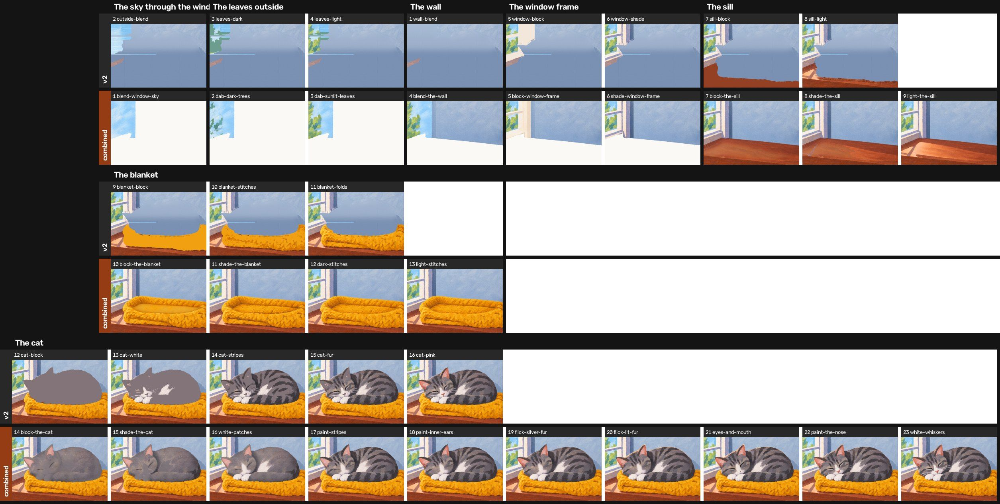
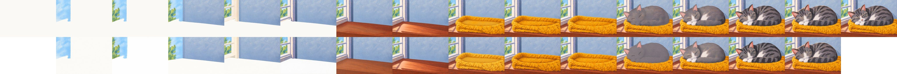
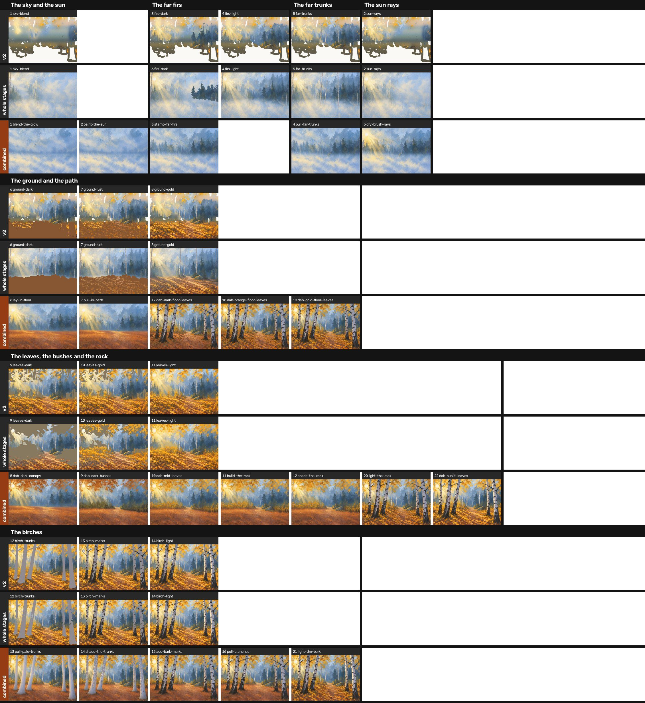
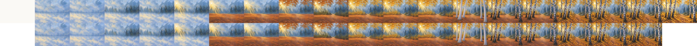

# Spike: the combined v3 lesson on two more pictures, graded blind against v2 (#214)

2026-11-17. Step 3 of the build order in `docs/design/pipeline-v3.md` (section 12). The combined lesson
(`docs/spikes/v3-combined.md`: plan first, the finish erased backward a stage at a time, words from facts) was
made on the sleeping cat and the birch grove, and all three pictures were graded blind against v2 by Claude's
graders. The code is `spike/experiments/v3_combined.py`, the numbers `spike/experiments/v3_combined.json` (one
entry a picture), the scores `spike/experiments/bench/scores/s214-combined.json`. It is experiment code: no lesson
tool, the skill, or the site changed.

**Verdict: adopt, by the 2026-11-17 rule** (preferred on most pictures, a clear loss on none). The graders
preferred the combined lesson on the highland cow (both graders) and the birch grove (both), and split on the
sleeping cat (one for the combined lesson, one "no real difference"), which the rule counts as a tie. No grader
preferred v2 on any picture. Next is building it into `/paint-lesson` behind `plan_version: 3` (design section
12, step 4). The owner still decides the gate, on one finished lesson.

## The grades

Two graders a picture, each in a fresh context on Opus with `spike/experiments/bench/ab_grader.md`, sides swapped
for the second. Their folders were named pair-01 to pair-06 in a seeded shuffle, held nothing that names a
pipeline, and were outside the repository (`/tmp/g214/`). The key was moved to a different folder before any
grader started and was opened after all six had reported. **What a grader could still tell:** the two sides differ
in ways no folder can hide. The combined side always has 22 to 24 steps and v2 14 to 16, its step names start with
a verb, and only its words say "as the after picture shows". That tells the sides apart, not which pipeline made
which.
Scores are real / paintable / agree, 1 to 5.

| Picture | Grader | v2 | Combined | Prefers | How sure |
|---|---|---|---|---|---|
| Highland cow | g1 | 1 / 2 / 1 | 4 / 3 / 3 | combined | clear |
| Highland cow | g2 | 2 / 2 / 2 | 4 / 3 / 3 | combined | clear |
| Sleeping cat | g1 | 2 / 3 / 3 | 3 / 3 / 2 | none | a toss-up |
| Sleeping cat | g2 | 1 / 2 / 2 | 4 / 3 / 3 | combined | clear |
| Birch grove | g1 | 1 / 2 / 1 | 4 / 3 / 3 | combined | clear |
| Birch grove | g2 | 1 / 2 / 1 | 4 / 3 / 3 | combined | clear |

**What decided it.** On every picture the graders marked v2 down for the owner's hardest fault: something on the
canvas before its step (the cow's blotches through steps 1 to 10, tiled and mirrored patches, hard boxes, a stray
line across the cat's wall for ten steps, finished leaves and the rock on the birch grove's step 1). The combined
lesson had no tiles, boxes or ghosts of that kind on any picture (the cow's first grader: "every picture looks like
a real half-done painting"). It did have smaller faults of the same family: a pale hard-edged patch on the cat's
sill (steps 7 and 8, both cat graders), and things a step early or late, listed below.

**What they marked the combined lesson down for** is the same on all three pictures, and no grader gave it more
than 3 for paintable or for agree:

- **A block-in that arrives finished.** The cat's blanket goes from bare sill to knitted and shaded with one
  yellow (step 10); the cat's one-gray block-in already has pink ears and closed eyes (14); the cow's block-in is
  a modeled cow (9); the cow's meadow and sky arrive nearly finished (6, 1); the birch grove's rock arrives shaded
  (11) and its flat trunks come with far birches already marked (13).
- **Steps that then change almost nothing,** because the block-in took their work: the cat's steps 12, 13, 18 and
  19; the cow's 3, 8, 15, 17, 19 and 24; the birch grove's 12, 20 and 21.
- **A thing that shows a step early or late.** The cat's whiskers on the nose step (22); its eyes fade on step 17
  and come back on 21; the birch grove's sun is a faint smudge on its own step (2) and a disc on the rays' step (5).
- **A render that restyles what it wasn't asked to.** The cow's grass steps redraw the hillside's bushes (20, 21).
- **Words that lean on "as the after picture shows",** and paints that don't match their names.

The cat's split is this list against v2's: the grader who said "none" weighed the blanket and cat block-ins as
heavily as v2's ghosts, and found v2's second half (the blanket and the cat) the cleaner of the two.

## The two new lessons

The sleeping cat was not in #204, so its sheet has two rows. The chains: top row, the picture after each unit;
bottom row, the raw renders.

| | Sleeping cat | Birch grove | Highland cow (#210) |
|---|---|---|---|
| Steps (v2's plan) | 23 (16) | 22 (14) | 24 (16) |
| Units, renders kept | 15, 14 | 19, 18 | 17, 16 |
| Kept renders: cost, seconds | 25.4 cents, 179 s | 32.5 cents, 247 s | 29.0 cents, 214 s |
| Renders made again | 0 | 10 (17.8 cents) | the tall grass asked for three times; 29 thrown on #210 in all |
| The last step picture is the finish | 0.00% off | 0.00% off | 0.00% off |
| A step changes a pixel outside its unit | 0.00% | 0.00% | 0.00% |
| What a step lays, from its nearest paint (median) | 8.6 Lab units | 18.8 | 14.1 |
| Steps that change under 0.2% of the canvas | none | 1 (step 12) | 1 (step 24) |
| Paints, and how many fitted over 20 Lab units from their name | 22, 8 | 13, 5 | 17, 4 |
| Checkable claims; failed the first check; after one fix round | 151; 16; 0 of 130 | 147; 19; 0 of 127 | 130; 3; 0 of 126 |
| Sentences taken out | 0 | 0 | 0 |
| Teaching pictures: Where lines, close-ups, paint maps | 23, 5, 10 | 22, 6, 10 | 24, 9, 7 |

Each lesson has its page (`lesson.html` in its folder under `spike/experiments/bench/runs/combined/lessons/`,
git-ignored) and a transfer outline.

**Render spend on this issue: 83.1 cents.** The cat 29.0 (the chain, and two probes at 3.6). The birch grove 54.0
(the kept chain 32.5, ten renders made again 17.8, two probes 3.7). The cow's lesson was still in its run folder
and wasn't made again.

## What the two pictures showed that the cow didn't

**Taking a thing back a stage held** on both: the cat's face, fur, stripes and white patches, the blanket's
stitches, the sill's light, the frame's shading; the birch grove's bark, its golden leaves, the rock. No "back"
request was made again.

**The birch grove needed two redos, both of a "behind" request.**

1. Removing the bushes, the render repainted the far woods: new brown trunks in the mist and different firs. With
   no box the change was kept, so seven steps showed trunks that vanished when the bushes arrived. Asked again with
   a sentence written by hand ("Only the low bushes go. The far firs and the pale far trunks behind them stay
   exactly as they are, and no new tree trunk is painted anywhere"), it held. Eight renders were made again.
2. The far firs were left standing on the first try, so step 1 showed them. A sentence that says every fir goes,
   "the dark ones right of the middle too", removed them. This is the faint-things-on-a-sky fault of #204. The far
   trunks and the sun were erased only in part: step 4 changes 1.2% of the canvas and step 2's sun is a smudge.

A probe also caught one before the chain: erasing the fallen leaves took the rock with them. A sentence that says
the rock stays fixed it.

**What the hand-written extras had to hold, beyond the cow's** (`spike/experiments/v3_combined_plan.json`):

- **`called`:** a thing's name in a request, when the plan's own misleads. The cat's window sky is named "The
  sky and trees through the window", which would have told the render that trees are behind the trees.
- **`say`:** a sentence for one unit's request (the three above, and one for the canopy).
- **`not_flat`:** a step the fitted plan shows as a flat coat that is no block-in. The birch grove's dark leaf
  dabs were one. Left as a block-in they would have had their own render, with a request for "a smooth first coat
  with no dabs".
- **`areas`:** the parts that get no chalk outline (the birch grove's firs, rays, floor, canopy, leaves).

**The fact sheet read some places wrong.** A unit that comes back to a thing gets a shape only where its core is
on top at the end, so the sheet measured the cat's fur as 1 1/2 in wide, the blanket's stitches as 1/2 in, and
the sill's light as a strip at the left edge when 98% of its paint is on the right. The checker also read "the
trunks" as the far trunks and "the window" as the sky. The writers left those numbers out; most of the 35 first
failures were of this kind, and the fix was usually "as the after picture shows".

**The stage writers' notes** (16 writers, each back in about a minute) list the same faults the graders found,
before any grader ran: the blanket, the cat's and the rock's block-ins already shaded, the sun coming back on
step 5, the trunks' shading as ragged patches where the plan says a band down the right, the wall's and the
backdrop's blend not the gradient the plan describes.

## What the design gets from this

- **The block-in is now the weakest step.** Its request only says "remove the thing"; what the render leaves is
  whatever the "back" request before it left, and that is a shaded, textured thing. The "smooth first coat"
  sentence is in the request that makes it, and it wasn't enough on the blanket, the cat, the rock or the cow.
  This is what holds paintable and agree at 3.
- **A "behind" request must say what stays,** as the "bare" request already does. Both of the birch grove's
  wasted redos and the probe's catch were a "behind" render changing a thing behind or beside the one it removed.
- **The guard needs something in place of the box.** A change far from the unit's thing was kept on the cow (bush
  rows) and on the birch grove (the far woods). Step 5's look caught the second; the graders caught the first.
- **The plan must say which step is a block-in,** not leave it to how v2's cutter would show the step.
- **A unit's shape for the sheet** should be what the unit changed, not the part of it still on top at the end.
- **Paints are still unsolved:** 22 on the cat against a target of 10, and 17 of 52 across the three pictures
  fitted far from their names.
- **Cost:** 14 to 18 renders, 25 to 33 cents and 3 to 4 minutes of chain a lesson, more when a unit is asked again.

## Limits

- Three pictures, graded by Claude, not the owner. Every combined score is 2 to 4: it is the better of two flawed
  lessons on two pictures and a tie on the third.
- The two lessons differ from v2 in the plan, the pictures and the words at once, so the grades don't say which
  piece earned them. The graders' notes point at the pictures.
- The extras, and four sentences in the birch grove's requests, were written by hand after looking at renders.
  A run with no one looking would have kept the brown trunks.
- No fault counter ran, and v2's own `check` isn't held to (its part rules don't fit units).

## Running it

As in `docs/spikes/v3-combined.md`, with a picture's name, then:

    python spike/experiments/v3_combined.py grade-folders highland-cow,sleeping-cat,birch-grove <a folder outside the repo>

`results <picture>` writes that picture's entry in `v3_combined.json` and leaves the others.
