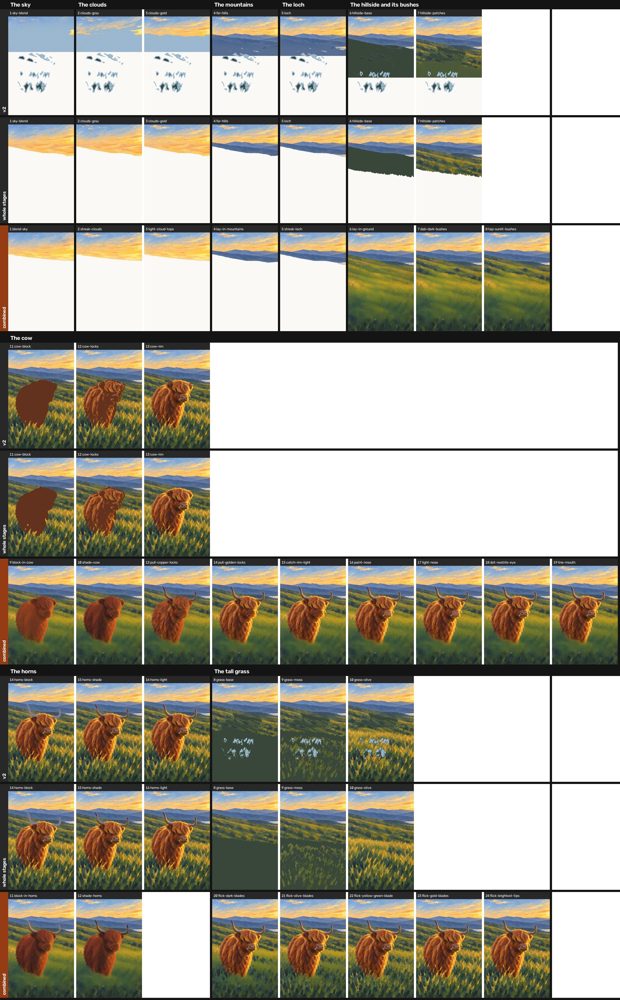
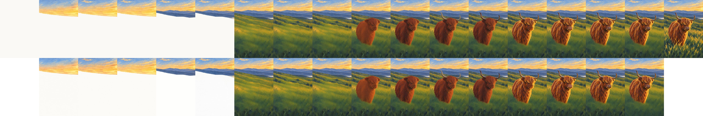

# Spike: the three adopted v3 pieces in one lesson (#210)

2026-11-17. Step 5 of `docs/design/pipeline-v3-plan.md`: the first lesson made the way `docs/design/pipeline-v3.md`
describes, on one picture, the highland cow's frozen finish. The code is `spike/experiments/v3_combined.py`, its
numbers `spike/experiments/v3_combined.json`, its tests `spike/tests/test_v3_combined.py`. It is experiment code: no
lesson tool, the skill, or the site changed.

**Verdict: go** (owner's call, 2026-11-17, after looking at the first lesson's page and step sheet): "Go, fix
those two things first." The two things were a unit's last step bringing more than its words, and two steps that
share a paint. Both are fixed below, the same way: each gets a render of its own. Next is the same on two more
bench pictures, with blind graders against v2. No graders ran here.

## What was run

1. **The plan** is the plan-first painter's plan (#172): 24 steps in 7 stages, written before any outline.
2. **The chain** erases the finish backward by that plan's units, one low render a unit, each made from the
   last. The first lesson had 11 units (#207's rule); after the two fixes there are 17. The guard keeps only what a render changed by a lot, with no box (the plan has none).
3. **Paints** are the plan's 17, each fitted to the color it has in its unit's change.
4. **Step pictures** are cut from the chain: a unit's last step lays all of its change; an earlier step is a flat
   coat or a pass of the pixels nearest its paints.
5. **Shapes come from the changes.** A lesson folder is made in which a part is a unit and its shape is the core
   of what its render changed. No outline model ran. v2's own tools then read it unchanged: Where lines,
   close-ups, paint maps, the transfer outline, drafted lines, recipes, the page.
6. **Words** are #173's: a fact sheet measured on these pictures, 7 stage writers on Opus in parallel, each with
   its before and after pictures and the plan's `after` line for every step, then the checker and one round of
   fixes.

Three rows a thing: v2, whole-picture stages (#204, on v2's plan), and the combined lesson after the two fixes. The
rows are lined up by the thing being painted, each picture under its own step number.

The chain: top row, the picture after each unit; bottom row, the raw renders.

## The first lesson (11 units), and the two fixes

**The untested request worked.** Taking a thing back a stage (the design's third kind of request) was the main
guess. On the face and the coat the first answer was kept. On the tall grass the first request took off only the
gold blades and left the green ones, and stricter words gave the same. A third wording that says what is left ("a
first coat: smooth, flat and softly blended, with no separate strokes, blades, dabs or texture") worked.

**What the owner asked to have fixed:**

1. **A unit's last step brought more than its words.** It laid everything of the unit no earlier step had: dark
   bush rows on the step that names the bushes' sunlit green, hair strokes on the step that shades the cow. And a
   block-in cut from the next step's render was a slab of one color.
2. **Two steps of one unit that share a paint couldn't be told apart.** The nostrils and the mouth line are both
   Dark umber, so the first step took both and the second changed nothing.

**The fix is one rule, used twice: such a step gets a render of its own.** `units` in `v3_combined.py` cuts a unit

- after a block-in (a step shown as a flat coat), and
- before a step whose paints the unit has all used already.

The cow's plan then has 17 units where it had 11: 16 renders. A request that takes paint off a block-in also says
what is left (the "first coat" sentence), from the first try. Inside the units that still hold several steps (the
coat's three, the nose's light and nostrils, the grass's five) each pixel of the change now goes to the step whose
paint it is nearest, so the last step lays only its own.

What was tried and dropped on the way: showing a block-in's own pixels as they are and a flat coat on the rest. It
gave a half-finished cow beside a flat slab, worse than either.

**After the fixes** (Claude's read of the sheet above):

- The cow's block-in (9) is a painted rust shape, not a slab. Step 10 adds the shadow and nothing else. The horns
  go on flat (11), then shaded (12).
- The face is four different pictures: a plain nose (16), its light (17), the nostrils and eye (18), the mouth and
  chin lines (19).
- The bushes arrive dark on step 7, and step 8 only lights their tops.
- Step 1 is a sky with faint streaks; the clouds arrive on step 2 and their tops on step 3.

**What is still wrong,** most of it from the stage writers comparing each picture with the plan:

- **Some steps are faint.** Step 24 (brightest tips) changes 0.04% of the canvas; step 3 (cloud tops) and step 8
  (sun on the bushes) can barely be seen; step 15's rim shows on the fringe but not on the horns.
- **A render can do more or less than asked.** The cow's block-in already has a fringe, ears and a darker muzzle;
  step 10 darkens most of the cow, not only its left; step 14 puts gold on the left side too; step 16's nose
  already has a darker lip; step 20's dark blades are scattered clumps, not a dense cover over the legs.
- **With no box, a stray change is kept.** The tall-grass render smoothed a few bush rows on the hillside, which
  come back on step 24. The mouth render darkened a few hairs by the right horn.
- **Step 6 has a dark strip under the mountains** where the plan says lighter and yellower, and step 1's sky is a
  band about 2 1/2 in tall, not the top half of the canvas.
- **Some paints aren't in the finish.** Fitted to the picture, Dark umber came out an olive brown (43 Lab units
  from the plan's color), Copper orange a dark brown (30), Pale rose a tan (26), Rosy brown a plain brown (22).
- **17 paints,** against the target of 10. Nothing merges them.
- **Two part names confused the checker.** "The cow's shadow side" and "The cow's mouth and chin lines" were taken
  for the subject of other steps' sentences (9 false failures). Renamed "The cow's shading" and "The cow's mouth".

## The numbers (the 17-unit chain)

| Unit | Request | Steps | Erased (share of canvas) | Raw render moved the rest |
|---|---|---|---|---|
| tall grass | back (third wording) | 20 to 24 | 38.7% | 2.6% |
| mouth and chin lines | back | 19 | 1.4% | 1.6% |
| nose light, nostrils, eye | back | 17, 18 | 0.6% | 1.4% |
| nose | back | 16 | 1.8% | 1.0% |
| coat (and the horns' rim) | back | 13 to 15 | 23.5% | 0.3% |
| horns, shade | back | 12 | 1.9% | 0.3% |
| horns, block-in | behind | 11 | 2.2% | 0.3% |
| cow, shade | back | 10 | 15.1% | 0.5% |
| cow, block-in | behind | 9 | 23.0% | 0.8% |
| bushes, sunlit tops | back | 8 | 2.0% | 0.5% |
| bushes, dark | behind | 7 | 15.3% | 0.4% |
| hillside and meadow | bare | 6 | 72.3% | 3.1% |
| loch | bare | 5 | 0.3% | 1.2% |
| mountains | behind | 4 | 9.8% | 0.8% |
| clouds, tops | back | 3 | 3.1% | 4.4% |
| clouds, streaks | behind | 2 | 12.5% | 2.9% |

- **The three checks.** The last step picture is the finish (0.00% of pixels off). No step changes a pixel outside
  what its unit adds (0.00%). What a step lays is a median 14.1 Lab units from the nearest paint it names.
- **Steps that change under 0.2% of the canvas:** one, step 24.
- **No request was made again** in this chain, apart from the tall grass's wording found on the first lesson.
- **Renders:** 16 kept, at 29.0 cents and 214 seconds one after another. The 11-unit chain was 18.1 cents and 127
  seconds. All spent on this issue: 86.8 cents (three chains thrown on the way, 52.2 cents; three probes not used,
  5.6 cents).
- **Words:** 7 writers, each back in about a minute. 130 checkable claims; 3 failed the strict check once the two
  part names were changed. After one round of fixes: 0 failures of 126, nothing taken out.
- **Teaching pictures from the changes:** 24 Where lines, 9 close-ups, 7 paint maps and a transfer outline, made
  with no change to v2's tools.

## What the design gets from this

- A step's `after` line describes the whole canvas, so it can't be handed to a render as it is: "no cow yet" in
  the meadow's line would ask for the cow to go. The request drops the sentences about what isn't there yet. A
  plan should give each thing a line for how it looks after each of its stages.
- A thing needs a name for its first stage ("the plain green meadow"), and each unit a name ("the cow's coat").
  Here they were written by hand (`spike/experiments/v3_combined_plan.json`), with `behind`.
- The "back" request should say what is left, not only what goes.
- A redo of a late unit throws the whole chain after it. A probe of one unit first costs 2 cents.
- The stage writers are a good check of pictures against the plan. Their notes are the list above.
- One render a step that can't be cut cleanly: after a block-in, and before a step that reuses the unit's paints.
  About 16 renders and 29 cents a lesson on this plan, where the draft said 11 and 20.
- A part's name must not hold words the checker reads as a side or a size ("side", "lines").

## Limits

- One picture, read by Claude and by the writers. No graders and no fault counter. The owner looked at the
  first lesson (11 units), not yet at the fixed one.
- The plan's extras (`behind`, the names, the rough paint colors) were written by hand for this picture.
- v2's own `check` wasn't held to: it reads numbers only v2's cutter makes, and the plan's units break two of its
  part rules (a coat that starts with a pass).

## Running it

    python spike/experiments/v3_combined.py units highland-cow --prompts   # the requests, last first; no render
    python spike/experiments/v3_combined.py probe highland-cow 15          # PAID: one unit alone
    python spike/experiments/v3_combined.py erase highland-cow --redo 16:2 # PAID: the chain (unit 16, third wording)
    python spike/experiments/v3_combined.py build highland-cow             # step pictures, the three-row sheet
    python spike/experiments/v3_combined.py lesson highland-cow            # the lesson folder, aids, writers' packets
    python spike/experiments/v3_combined.py merge highland-cow [--final]   # the writers' words in, checked
    python spike/experiments/v3_combined.py page highland-cow              # the lesson as a page
    python spike/experiments/v3_combined.py results highland-cow           # writes v3_combined.json

It writes under `spike/experiments/bench/runs/combined/` (git-ignored). A render already in its folder is kept.
