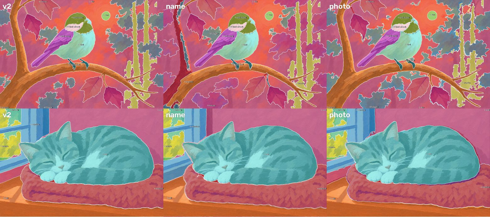
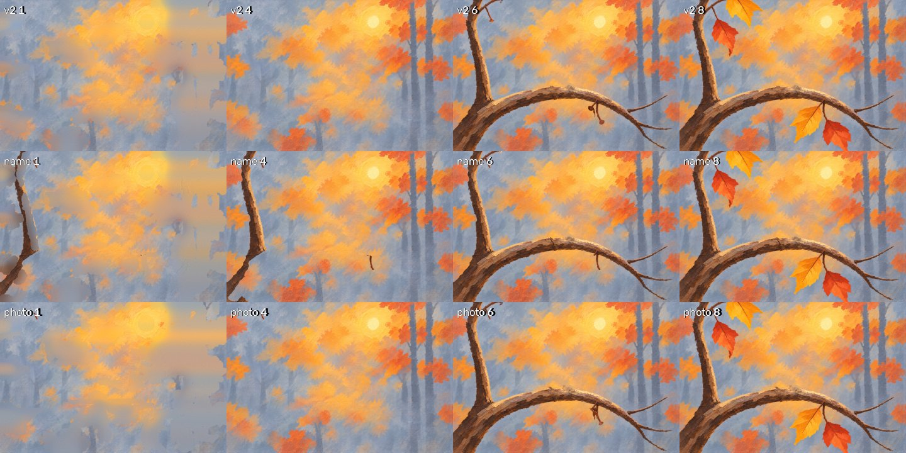
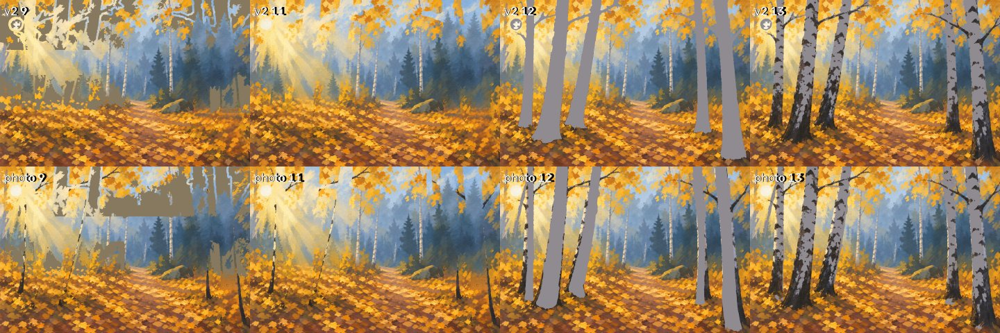
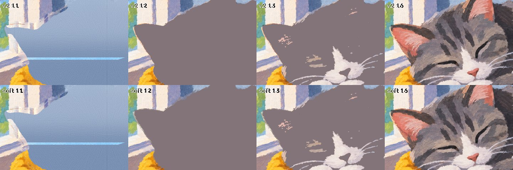
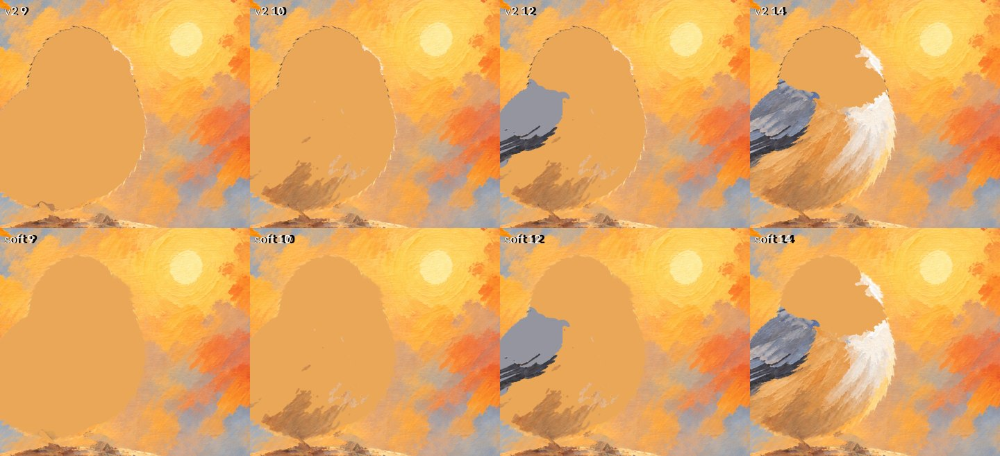

# Spike S3: outlines prompted by name, soft edges, and the photo against the finish (#168)

2026-11-17. Wave 1 of `docs/design/pipeline-v3-plan.md`. The code is `spike/experiments/v3_edges.py`, its numbers
`spike/experiments/v3_edges.json`, its tests `spike/tests/test_v3_edges.py`, the graders' scores
`spike/experiments/bench/scores/s3-edges.json`. It is experiment code: no lesson tool, the skill, or the site changed.

**Verdict, three parts:**

- **Outlines prompted by name (SAM 3): drop.** Blind graders preferred v2 on the chickadee (both, clearly) and the
  birch grove (both, slightly) and saw no difference on the sleeping cat. Where a thing has a plain name (a cat, a
  cow, a blanket, a bird) SAM 3 draws the same outline as v2's box and points, so there is nothing to gain. Where it
  doesn't (a branch that is also a trunk, "four leaves" among a hundred painted ones, a sill, a loch, legs and feet)
  it takes too much, too little or nothing, and the step pictures show it: the chickadee's trunk is on the canvas
  from step 1. It is also less steady from run to run than the boxes it would replace: one changed word moved the
  branch's outline to an IoU of 0.41 and the leaves' to 0.31, where reading every box and point again 3% off moved
  them to 0.90 at worst. The fault counter didn't separate it from v2 (section 5). And it's slow: 14 s to load and 23 to 28 s to read a picture on 4 cores, against v2's 13 to
  18 s for the whole outline.
- **Soft edges (a matte at every thing in front): park.** No grader preferred v2 on any picture; one chickadee grader
  preferred the soft edges (slightly), every other said no difference. A split is a tie, so that's four ties: not the
  clear win a spike needs (`docs/decisions.md`). It does what it set out to: the dashed rim of the bird's cap and cheek
  that shows around v2's flat bird for six steps is gone, the fur of the cow and the edges of the trunks look painted
  rather than cut, and it costs 6 to 14 s a lesson, free, with checks 1 and 2 holding as they do for v2. Park it for v3's layers,
  which need a soft edge on each layer anyway.
- **Outlining the photo instead of the finish: drop.** For the cow and the birch grove the photo is a real photo and
  the finish was painted from a beginner version, so the shapes have moved: the photo's birch trunks show as slivers
  three steps before the birches, and the cow's horns miss v2's by a third (IoU 0.65). For the cat and the chickadee, whose
  photos are already paintings, the outlines mostly agree (IoU 0.93 to 0.97; the chickadee's feet 0.79) but follow the finish's own edges less well on
  every part (edge fit 0.36 to 0.85 against v2's 0.52 to 0.96). Not graded: it lost on the numbers and the pictures.

What it says for v3: **keep v2's outlines** (SAM-HQ with Claude's boxes, points and paths), and when layers come, give
each layer the soft edge from this spike's matte. The run-to-run differences the issue blames on Claude's boxes are
real but small on anything bigger than a few percent of the picture (IoU 0.90 to 0.998); they are large only on tiny
parts (the chickadee's feet, the cow's loch), where a name doesn't help either.

## 1. What was tried

Everything on the frozen bench, on the four pictures most likely to show an edge (`docs/decisions.md`: spikes start
on 3 or 4): the highland cow (fur), the sleeping cat (whiskers, a window frame), the chickadee (a branch that is also a
trunk, leaves among painted foliage, thin feet), the birch grove (a dozen thin trunks). Each keeps its v2 baseline
run's plan, paints and words; only the outlines, or only their edges, change, and the step pictures are built again
by v2's own builder (`build_steps.build`) with the baseline's background render. So the A/B sees one change.

| Variant | Outlines | Edges |
|---|---|---|
| `v2` | the baseline's own (`parts/owner.png`) | hard |
| `name` | objects and thin parts from SAM 3 and the part's name alone (no box, no points, no paths); areas and marks as v2 | hard |
| `soft` | the baseline's own | a matte at every thing in front |
| `name-soft` | as `name` | as `soft` |
| `photo` | v2's tool and the plan's own prompts, run on the photo in the finish's frame | hard |

**SAM 3** is Meta's segmenter you can prompt with a phrase ("highland cow") and get every instance back. It ran
locally, ViT-H, as X-AnyLabeling's ONNX export (release v3.0.0, 3.1 GB, CPU; `models/spike168/`, git-ignored),
with OpenAI CLIP's tokenizer from the `osam` package. Hugging Face and the hosted services (fal, Replicate) are
blocked from this session, and GitHub release downloads aren't. The export takes text only: no box with the name.
The prompt is the part's own `name` from plan.json, lower-cased, with a leading "the" and a count taken off ("The four
leaves" becomes "leaves"). Every instance over SAM 3's default score (0.5) is joined into one outline. A part SAM 3
finds nothing for falls back to v2's prompt.

**The matte** (`matte` in the script): for each thing in front (an object or thin part with no parent, with what's
painted on it), a trimap from its hard outline: sure inside, an unsure band 1.2% of the long side each way, sure
outside. pymatting's closed-form alpha fills the band, and its multi-level foreground estimate gives the thing's
color and the color behind it at every band pixel, so the finish is `alpha * front + (1 - alpha) * behind`.
`soften` lays it into v2's step pictures:

- before the thing's first step, band pixels outside its outline that already show the finish (fur or whiskers
  painted with the wall) show `behind` instead;
- from its first step, outside its outline: its paint by the matte over `behind`, where the paint is what the part
  shows now at the nearest pixel inside (a flat coat gives a flat fringe);
- inside its outline only a 3-pixel feather blends with `behind`;
- from its last step on, nothing: the part is done and v2's picture is the finish there.
- A fringe only ever lies over parts listed before the thing: never over a part in front (the horns beside the cow,
  the cat in front of the window), painted yet or not.

Two of those rules came from faults seen while building: the cow's fringe first painted bits of horn before the
horns' step, and the window's fringe painted the cat's pink ear at the cat's flat-coat step. Both are tested
(`StagedSoftenTests`), as is the last-step rule the review of #202 added.

## 2. The outlines

Per thing in front: IoU with v2's outline, and **edge fit**, the share of the outline's border within 2 pixels of a
Canny edge of the finish (1 = the outline follows the paint). Running v2's tool again gave the baseline's outlines
exactly, on all four pictures.

| Picture | Part (share of picture) | By name: SAM 3's scores | By name: IoU | Edge fit v2 / name / photo | Photo IoU |
|---|---|---|---|---|---|
| highland cow | cow (20%) | 0.91 | 0.97 | 0.86 / 0.79 / 0.60 | 0.90 |
| | horns (1.1%) | 0.87, 0.89, 0.80 | 0.93 | 0.87 / 0.89 / 0.57 | 0.65 |
| | loch (0.25%) | nothing: v2's prompt | 1.0 | 1.00 / 1.00 / 0.18 | 0.50 |
| sleeping cat | cat (35%) | 0.98 | 0.99 | 0.90 / 0.82 / 0.52 | 0.97 |
| | blanket (20%) | 0.92 | 0.98 | 0.93 / 0.91 / 0.43 | 0.94 |
| | sill (14%) | 0.85 | 0.98 | 0.52 / 0.42 / 0.36 | 0.96 |
| | window frame (7%) | 0.68 | 0.74 | 0.96 / 0.85 / 0.56 | 0.93 |
| chickadee | bird (9%) | 0.98 | 0.99 | 0.87 / 0.90 / 0.85 | 0.97 |
| | branch (14%) | 7 found, 0.56 to 0.85 | 0.57 | 0.88 / 0.84 / 0.72 | 0.95 |
| | leaves (6.7%) | 16 found, 0.57 to 0.90 | 0.31 | 0.62 / 0.31 / 0.53 | 0.94 |
| | legs and feet (0.3%) | nothing: v2's prompt | 0.94 | 0.78 / 0.78 / 0.72 | 0.79 |
| birch grove | birch trunks (23%) | 7 found, 0.53 to 0.57 | 0.88 | 0.86 / 0.85 / 0.47 | 0.69 |

- **A plain name gives v2's outline.** The cat, the blanket, the bird, the cow: IoU 0.97 to 0.99. A name helps only
  where it agrees with a box, so it adds nothing there.
- **A name that isn't the painting's word goes wrong.** "Leaves" finds all 16 leaf-shaped things, most of them the
  painted background foliage. "Branch" takes the trunk on the left as one more instance and leaves it out of v2's
  branch elsewhere. "Loch" and "legs and feet" find nothing. "Window frame" takes the frame's light side and leaves
  its shadow side to the wall.
- **The photo is the wrong picture to outline.** Where the photo is a real photo (the cow, the birch grove), the
  finish was painted from a beginner version and the shapes moved. Where the photo is itself a painting (the cat, the
  chickadee), it lines up, but its edges are the photo's, not the finish's: edge fit is lower on every part.

## 3. The step pictures

By name, the chickadee's trunk and the twig at the right are on the canvas from step 1, because SAM 3's "branch"
left them out of the branch and they stayed with the sky. v2's ghost check (`build_steps.ghosts`) agrees: 3 steps with
a part showing plainly before its step, worst 0.67 of its edge, where v2 and soft have none. From the photo the
birch grove's trunks show as slivers from step 9, three steps early:

Soft edges on the sleeping cat and the chickadee, steps around the cat's and the bird's first coat:

v2's bird carries a dashed dark-and-white rim, the finished cap and cheek where the hard cut meets them, for six
steps; soft has none. The cat's silhouette is softer and nothing comes early. The difference is small in every
picture: soft and v2 differ on at most 3.75% of a step's pixels (the birch grove's trunks at step 12), and under
1.6% elsewhere.

**The three checks** (`docs/design/pipeline-v3-plan.md`), on every variant and picture:

1. *All layers together equal the finish:* the last picture is the finish in every variant; before it's set, v2's
   builder is 0.00 to 0.03% off (`final_gap`, measured on v2's builder before softening); `soften` leaves every
   part as v2 has it from the part's last step on, so a soft lesson's last steps are v2's.
2. *No picture changes a pixel outside its step's layer:* at most 0.11% of the picture on any step, the last
   included, counting a soft step's band as its layer (`outside_max`). That 0.11% is v2's own last step on the cow;
   every variant matches v2 or is below it, except the photo on the cow (0.12%).
3. *Every pixel near a step's paint:* not measured; the paints are the baseline's, and S6 (#171) was the spike for it.

| Variant | Ghost steps (cow, cat, chickadee, birches) | Worst ghost |
|---|---|---|
| v2 | 0, 0, 0, 0 | 0 |
| soft | 0, 0, 0, 0 | 0 |
| name | 0, 0, 3, 0 | 0.67 |
| name-soft | 0, 0, 3, 0 | 0.67 |
| photo | 1, 0, 0, 0 | 0.35 |

## 4. Run to run

The issue says run-to-run differences come mostly from where Claude puts the boxes. The bench has no second
independent v2 run of these finishes (S7's plan-first runs started from the baseline's parts and boxes), so the
spike measured it two ways that need no Claude run (`repeat`):

- **Boxes read again:** every box edge, point and path point moved by up to 3% of the picture (a third of the 10% grid
  cell Claude reads positions off), five seeded draws, outlined by v2's tool; IoU with the baseline's outline.
  These draws were made before the review of #202 kept an edge on the picture's border from moving (it could move
  inward, shrinking a backdrop box); the reviewer found no draw where that changed an outline, so they weren't rerun.
- **Names said another way:** each name swapped for one other wording at a time (the second plans' names where they
  differ, and plain paraphrases), outlined by SAM 3; IoU with the outline from the baseline's name.

| Picture | Part (share) | Boxes read again: IoU, five draws | Another name: IoU |
|---|---|---|---|
| highland cow | cow (20%) | 0.99, 0.99, 0.995, 0.99, 0.99 | "cow" 0.997, "shaggy cow" 0.999 |
| | horns (1.1%) | 0.95, 0.99, 0.97, 0.92, 0.99 | "cow horns" 0.995 |
| | loch (0.25%) | 0.87, 0.98, 0.96, **0.22**, 0.87 | "lake", "water": nothing found either way |
| sleeping cat | cat (35%) | 0.996 to 0.998 | "cat" 0.999, "tabby cat" 0.999 |
| | blanket (20%) | 0.99 to 0.997 | "blanket" 0.99, "knitted blanket" 0.999 |
| | sill (14%) | 0.95 to 0.996 | "window sill" **0.82**, "sill" **0.78** |
| | window frame (7%) | 0.92 to 0.99 | "window" 0.90, "window frame" 1.0 |
| chickadee | bird (9%) | 0.98 to 0.996 | "bird" 0.996, "small bird" 0.999 |
| | branch (14%) | 0.90 to 0.98 | "tree branch" 0.99, "branch and trunk" **0.41** |
| | leaves (6.7%) | 0.92 to 0.99 | "autumn leaves" **0.31** |
| | legs and feet (0.3%) | 0.99, **0.48**, **0.47**, 0.97, **0.46** | "bird feet" 0.94, "feet" 0.94 |
| birch grove | birch trunks (23%) | 0.95, 0.94, 0.94, 0.96, 0.90 | "birch trees" **0.88**, "white birch trunks" **0.88** |

So on a thing bigger than a few percent of the picture, boxes read again give the same outline within a few
percent. Names are the same only when the name is plain and the thing is one obvious object; one word more or less
moves a branch, leaves or a sill much further than a box 3% off does. Boxes go badly wrong only on tiny parts (the
feet, the loch), and there a name found nothing at all. A second v2 run's differences come more from Claude choosing
different parts (S7's plans split the cow's muzzle and the birches' branches out) than from where the boxes go.

## 5. Fault counts

One fresh fault counter (`spike/experiments/bench/fault_counter.md`) on each name-prompted lesson, against the two
that counted each baseline lesson (`spike/experiments/bench/baseline/`). Distinct faults; B is outlines, A step
pictures. The counts are in `spike/experiments/bench/edges/<picture>/faults-name.json`, with the packet key beside
them. Soft edges keep v2's outlines, so they weren't counted again: their outline faults are v2's.

| Picture | v2: B, A, all (counter 1; counter 2) | By name: B, A, all |
|---|---|---|
| sleeping cat | 6, 11, 31; 2, 12, 27 | 3, 11, 33 |
| chickadee | 6, 6, 28; 5, 13, 31 | 6, 12, 29 |
| birch grove | 4, 15, 28; 4, 15, 31 | 5, 15, 30 |

The counts sit at or just past the edge of the two baseline counters' spread (the cat's total 33 against 31 and 27,
the birch grove's outlines 5 against 4 and 4, both worse for names), and the two baseline counters themselves
differ by up to 7 A faults on one lesson, so one count each can't separate the variants. It
does name what the graders saw: on the chickadee "the leaf block-in takes in about six background foliage clumps"
(a blocker) and "the left trunk is fully painted in bark from step 1"; on the birch grove "hard rectangular orange
windows in the ground" in steps 6 to 11.

## 6. The A/B

Round `s3-edges`: the baseline against soft edges on all four pictures, and against name prompts on the three where
the outlines differ most (on the cow the outlines of the things in front agree at IoU 0.93 to 0.99; its name-built
steps still differ from v2's on 1.2 to 2.0% of pixels in steps 1 to 10, more than soft's, so leaving it out was a
judgment call to save two graders, not a certainty). Photo outlines weren't graded (section 2). Two graders a picture in fresh contexts, each given only
`spike/experiments/bench/ab_grader.md` and a folder holding the two lessons as `A/` and `B/`, sides drawn from seed
168 and swapped for the second. The folders were named `pair-01` to `pair-14`, so a grader didn't see the
experiment's name either; the key is `spike/experiments/bench/scores/s3-edges.key.json`.

Scores are (a) real / (b) paintable / (c) agree, 1 to 5.

| Picture | Against | Grader | v2 | Variant | Prefers | How sure |
|---|---|---|---|---|---|---|
| highland cow | soft | 1 | 2 / 2 / 2 | 2 / 2 / 2 | no difference | a toss-up |
| | | 2 | 2 / 3 / 2 | 2 / 3 / 2 | no difference | very sure they're equal |
| sleeping cat | soft | 1 | 2 / 2 / 2 | 2 / 2 / 2 | no difference | sure |
| | | 2 | 2 / 2 / 2 | 2 / 2 / 2 | no difference | sure |
| chickadee | soft | 1 | 2 / 3 / 2 | 3 / 3 / 2 | soft | slight |
| | | 2 | 3 / 3 / 2 | 3 / 3 / 2 | no difference | a toss-up, leaning soft |
| birch grove | soft | 1 | 2 / 2 / 2 | 2 / 2 / 2 | no difference | sure |
| | | 2 | 2 / 2 / 2 | 2 / 2 / 2 | no difference | sure |
| sleeping cat | name | 1 | 2 / 2 / 2 | 2 / 2 / 2 | no difference | a toss-up, leaning name |
| | | 2 | 2 / 3 / 2 | 2 / 3 / 2 | no difference | a toss-up, leaning name |
| chickadee | name | 1 | 3 / 3 / 3 | 2 / 3 / 2 | v2 | clear |
| | | 2 | 3 / 3 / 3 | 2 / 3 / 2 | v2 | clear |
| birch grove | name | 1 | 2 / 2 / 3 | 2 / 2 / 2 | v2 | slight |
| | | 2 | 2 / 2 / 2 | 2 / 2 / 1 | v2 | slight |

**What the graders saw, and the fix after.** The soft lessons were graded as first built. The adversarial review of
#202 then found that `soften` kept blending a part's inner feather with what's behind after the part's last step,
until the lesson's last picture. Fixed: from a part's last step, soft leaves it as v2 has it. Against the graded
lessons the fix changes only those steps: up to 1.6% of the picture on the chickadee (the branch's and leaves' edges
from steps 6 to 17), 0.8% on the cat, 0.7% on the cow, nothing on the birch grove, and each changed pixel goes back to
v2's. So the fix moves soft toward v2 and can't turn the ties into a win; the bird's rim the graders named (steps 9 to
14, before the bird's last step) is unchanged. They weren't graded again.

**By the rule** (most pictures, and a clear loss on none; two graders who split are a tie): soft ties all four and
loses none, so it isn't a win. Names lose the chickadee and the birch grove and tie the cat: dropped.

What the graders said, unblinded:

- **Soft:** "B's softer edge looks a little more like paint, but a painter wouldn't notice it" (cow, B being soft);
  the other cow grader saw v2's "hard cut edge with slivers of the finished gold hair showing before step 13"; "faint seams
  along shape edges: a thin peach fringe around the cat and frame in A, a soft gray one in B" (cat, A being v2). On the
  chickadee both named v2's dashed rim around the bird: "the gold bird head has a jagged dark-and-white rim exactly
  where the black cap and white cheek will go" (the grader who preferred soft), "real but small next to the problems
  both share" (the one who didn't).
- **Names:** on the chickadee both called out the trunk on the canvas from step 1 and red and orange blobs at step 7
  that step 8 takes away (the leaves outline taking background foliage). On the birch grove, hard orange rectangles in
  the ground from step 6 to 13, and branches floating in the sky at step 11. On the cat both leaned, slightly, to the
  name side: the name side shows the frame's shadow from step 1, but v2 has a long stray sky-blue line across the
  wall from step 2 to 11, which the graders weighed as worse.
- **What every grader marked down on both sides** is the same list as earlier rounds: a tiled step 1, jumps from
  flat to finished, blotches where a thing will go. Edges are a small part of what makes these lessons weak.

## 7. Seconds

On 4 CPU cores, per picture. Outlining (all of a plan's parts):

| | highland cow | sleeping cat | chickadee | birch grove |
|---|---|---|---|---|
| v2 (SAM-HQ, boxes and points) | 13.4 | 16.2 | 18.2 | 17.3 |
| by name (SAM 3, read and prompts, plus SAM-HQ for areas) | 51.9 | 57.0 | 57.9 | 45.7 |
| from the photo (SAM-HQ) | 12.9 | 11.9 | 14.1 | 15.0 |

SAM 3 also takes 14 s to load (3.1 GB), and needs about 7 GB of memory beside SAM-HQ; the first try with both models
and onnxruntime's memory arena on ran this 15 GB machine out of memory. A name prompt is 2 to 6 s.

Soft edges add the matte and laying it into every step: 6 to 14 s a lesson (7 to 17 s on name outlines), on top of
a build of 10 to 14 s, free.

## 8. Limits

- The A/B is Claude's graders, not the owner (`docs/decisions.md`). On S4 the owner disagreed with them.
- Four pictures, one plan each. The name prompts were the baseline plans' own names, written for v2, not for a
  name-prompted tool; a plan written for SAM 3 could pick its words better ("the four leaves on the branch"). The
  wording table says how much that matters: a lot.
- SAM 3 ran from a third-party ONNX export with text only. SAM 3 itself takes a box with the name; that wasn't tried,
  and a box is what v2 already gives.
- The matte is pymatting's closed-form, on a band of fixed width. A whisker longer than the band stays where v2
  puts it. A learned matting model (ViTMatte and the like, a trimap in, a matte out) might do better; none was
  reachable here without Hugging Face.
- Run to run is measured by moving the boxes and changing the words, not by two real runs (section 4).
- Two graders worked in the same scratch folder for their own comparison pictures, and one found its pictures
  overwritten by another's; it rebuilt them from its own folder and graded from those.
