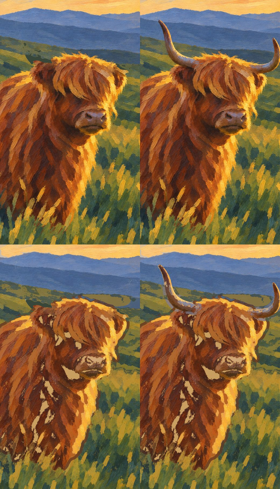

# Spike S6: paints before the picture (#171)

2026-11-17. Wave 2 of `docs/design/pipeline-v3-plan.md`. The code is `spike/experiments/v3_paints_first.py`, its numbers
`spike/experiments/v3_paints_first.json`, its tests `spike/tests/test_v3_paints_first.py`, the graders' scores
`spike/experiments/bench/scores/s6-paints-first.json`. It is experiment code: no lesson tool, the skill, or the site
changed.

**Verdict: drop** both ways of making the finish fit the paints after it's rendered.
- **Locking the finish to the paints** (moving each pixel toward a named paint) does what the measure asks. The
  strict form, toward the paints of the step that shows each pixel, leaves 0 to 3 off steps per lesson, where v2 has
  4 to 11. But the blind graders preferred v2 on the highland cow and the birch grove (both graders each), tied on
  the chickadee and the lake cabin, and preferred the lock on none (section 5).
- **Handing the render the swatches** does nothing: the image model repaints the same picture and ignores the card
  (section 4).

The lesson is in what the lock breaks. Where a step names the wrong paint, the lock paints the finish in the wrong
paint. The cow's face turns cream-blotched, because the step that shows it names only the rim's gold. So the paints
can't be fixed after the picture: it is the plan that has to name the right paints, and the picture has to be made
to them (S7, #172, adopted).

What the numbers say (8 bench pictures, v2 baseline plans and outlines, section 3):

- **v2 today:** 5 to 28% of what a step adds is more than Delta E 12 from every paint the step names, with 4 to 11
  steps per lesson over a quarter off. A part's last step is the worst: 6 to 43%.
- **Locked toward the part's paints, to within Delta E 8** (`lock-8`): 1.3 to 16% off, 1 to 5 off steps. The finish
  moves 0.8 to 1.6 Delta E on average. By eye its step pictures can't be told from v2's.
- **Locked toward the showing step's paints** (`lock-step-8`, the one graded): 0.8 to 12% off, 0 to 3 off steps. The
  finish moves 1.4 to 5.1 Delta E on average, and 2 to 17% of it moves by more than 12: visible blotches and halos.
- **Snapped onto the paints** (`lock-0`): 1.2 to 12.5% off, but the finish turns into flat posterized patches (it
  keeps 56 to 87% of its local detail and 66 to 88% of its edges).
- **Mixes:** the lock can't lower a lesson's mix count. The paints are the plan's, so the count is the plan's (8 to
  16). Measured again from a locked finish by v2's own `paints`, the count moves by one either way (section 3).
- **Cost:** the lock is free (2 to 9 seconds by part, 23 to 41 by step). The swatch round cost $0.31 for 5 renders.

## 1. What was tried

v2 renders the finish, then measures the paints from it and merges them toward 10 mixes. The finish keeps every
color it was rendered with, so a step's picture can show colors its paints don't name. #154 found it on pass steps
and #158 on a part's last step; the yardstick's fault counters found it on all 8 bench pictures (class D, "steps
that add colors their paints don't name", `docs/spikes/v3-yardstick.md`). The issue asks to put the paints first in
two ways:

1. **Lock** (free). Each pixel of the finish moves toward the nearest paint it may show, along the straight line
   in Lab, until it is within `tol` of it; a pixel already that near stays. Three forms:
   - `lock-8`: toward the paints the pixel's part names (the part is the outlines' owner), to Delta E 8 (the
     tint line, `paints.TINT`).
   - `lock-step-8`: toward the paints of the step that shows the pixel (`shown_by`: the last step that moved it by
     more than 15 Lab), built and locked twice, since a moved pixel can move to another pass. Where no step's move
     shows, toward the part's paints.
   - `lock-0`: onto the part's nearest paint itself.
   The background render behind the objects (`98_background.png`) is locked by part in all three, by
   `build_steps`' owner of what's behind.
2. **Swatch** (paid). An image-model edit of the finish with a second input: a card of the lesson's paints as plain
   squares, no words. The request is to repaint the same picture with only those colors (`SWATCH_PROMPT`), and once
   more in stronger words (`STRICT_PROMPT`). It ran at the finish's own quality (high), on the same model.

Everything else is the v2 baseline run's: plan, paints, parts, outlines, background render and words. Step pictures
are built by `build_steps` unchanged, so a lesson differs from its baseline only in its finish and the pictures cut
from it. The A/B shows one change.

## 2. The measure

Per step, the pixels it **adds**: inside what it paints (`build_steps`' painted area, rims included), moved by more
than 15 Lab units (#154's `paints.ADDS`; a smaller move is texture under a coat, not a new color). An added pixel is
**off** when it is more than Delta E 12 (2000; `paints.MAX_MERGE`, the line a painter sees) from every paint the
step names. A step is an **off step** when over a quarter of what it adds is off (`paints.MATCHED`). A lesson's off
share weights each step by what it adds. The pictures are measured at 768 px on the long side. Also kept:
- `off_last`: the same over each part's last step only (#158's case);
- `off_part`: off against every paint the part's steps name, through the whole lesson. It's close to `off`
  throughout (v2: 3 to 24%), so most off pixels are near no paint of their part at all;
- `off_finish`: the share of the finish more than 12 from every paint its part names;
- `remeasured`: v2's own `paints`, first measurement, run on the finish with the baseline's parts: how many mixes
  this finish would give, the mix rules unchanged.

## 3. The lock, on all 8 pictures

Off share of what steps add, in percent (off steps in brackets):

| Picture | Mixes | v2 | lock-8 | lock-step-8 | lock-0 |
|---|---|---|---|---|---|
| chickadee | 10 | 18.2 (5) | 8.4 (2) | 7.0 (0) | 7.4 (2) |
| red-sailboat | 15 | 4.9 (5) | 2.1 (5) | 1.6 (3) | 1.8 (5) |
| balloon-lavender | 16 | 9.9 (7) | 6.4 (3) | 4.1 (1) | 6.8 (1) |
| sleeping-cat | 13 | 7.5 (4) | 1.3 (1) | 0.8 (0) | 1.2 (1) |
| snow-lantern | 12 | 5.8 (4) | 2.7 (1) | 2.8 (2) | 1.6 (1) |
| highland-cow | 10 | 10.5 (4) | 5.6 (3) | 6.4 (2) | 4.8 (4) |
| lake-cabin | 13 | 12.6 (11) | 5.6 (4) | 4.2 (1) | 3.0 (2) |
| birch-grove | 8 | 28.3 (5) | 16.3 (1) | 11.7 (0) | 12.5 (1) |

A part's last step (`off_last`), v2 against `lock-step-8`: 21 to 8, 6 to 1, 15 to 7, 12 to 1, 8 to 4, 17 to 13, 21 to
7, 43 to 17.

What the lock costs the finish:

| Picture | lock-8: mean Delta E / moved over 12 | lock-step-8 | lock-0 | lock-0 detail kept |
|---|---|---|---|---|
| chickadee | 1.3 / 0.6% | 1.9 / 2.8% | 7.0 / 11.0% | 72% |
| red-sailboat | 0.8 / 1.0% | 1.4 / 2.0% | 5.5 / 4.7% | 56% |
| balloon-lavender | 0.9 / 1.0% | 3.3 / 8.9% | 5.5 / 5.3% | 77% |
| sleeping-cat | 0.8 / 1.4% | 1.4 / 3.1% | 4.7 / 4.3% | 76% |
| snow-lantern | 0.9 / 1.4% | 2.2 / 4.7% | 5.4 / 4.8% | 56% |
| highland-cow | 1.2 / 0.9% | 3.0 / 7.0% | 6.3 / 9.0% | 75% |
| lake-cabin | 1.5 / 2.0% | 2.8 / 6.4% | 6.7 / 9.9% | 71% |
| birch-grove | 1.6 / 2.2% | 5.1 / 16.6% | 7.2 / 11.7% | 87% |

("Detail kept" is the mean local contrast of lightness, a 5-pixel Laplacian, against the finish's. `lock-8` and
`lock-step-8` keep 88 to 106%.)

- **The lock doesn't reach zero, even by step.** What's left is built in the steps, not in the finish: the rim of
  an object laid with the finish beside it (its halo belongs to the part behind); v2's fill under things in front;
  and a pass picking pixels by the nearest paint on a blurred, median-filtered map, so specks of a neighbor's paint
  ride along with it. The cat's fur step locked to its own paint changes almost nothing (under 0.05% of the
  picture), which is a fault of another kind (an empty step).
- **Locking by part leaves the paints the plan didn't spread.** A part's last step still shows pixels near paints
  of its earlier steps that those steps didn't bring out. That's why `lock-8`'s off steps fall less than
  `lock-step-8`'s.
- **What locking by step moves is exactly where the plan's paints are wrong.** On the cow, the step that shows the
  face and the lit coat ("Light the gold rim", one gold) pulls them to the gold's pale tint: cream holes in the coat
  and on the face that last to the finish. On the birch grove, the sun is shown by a step that names the trunk gray,
  so it becomes a gray disk. And the trunks' tops go gray where a step that names the trunk's paint shows the sky's
  glow around them.
- **The outlines are the other half of it.** A pixel the outline gave to the wrong part (the blanket's rim caught
  on the sill, a whisker crossing the blanket) moves to the wrong part's paint. On the cat it leaves an orange halo
  round the blanket, and the sill's light streaks go flat.

**Mixes.** The lock leaves the plan's paints as they are, so the mix count is the plan's: 8 to 16, as before. The
issue's "12 to 16 mixes against a target of 10" is the measured paints merged under the rule that keeps two paints
more than Delta E 12 apart. A locked finish doesn't change that rule's answer much. `paints` run again from scratch
on the finish gives (v2's finish, then `lock-8`, then `lock-step-8`): chickadee 10, 10, 10; red sailboat 14, 13, 12;
balloon 13, 13, 10; cat 10, 11, 10; lantern 10, 11, 11; cow 10, 10, 10; cabin 11, 13, 13; birch 10, 10, 10. Lowering
the count needs fewer, farther paints in the plan, which the mix rules forbid merging (out of scope here).

## 4. The swatch render

Four renders of the finish with the swatch card (the four pictures graded below), and one with the stricter
request. Each was $0.06 and 32 to 37 seconds, $0.31 in all.

| Picture | Finish off its part's paints (v2 / swatch) | Off share of what steps add (v2 / swatch) | Off steps | Edges kept |
|---|---|---|---|---|
| chickadee | 13.8% / 16.2% | 18.2 / 22.1 | 5 / 7 | 98% |
| chickadee, stricter | 13.8% / 19.2% | 18.2 / 22.4 | 5 / 6 | 99% |
| highland-cow | 11.5% / 12.5% | 10.5 / 9.1 | 4 / 5 | 96% |
| lake-cabin | 11.6% / 10.8% | 12.6 / 15.4 | 11 / 11 | 94% |
| birch-grove | 14.8% / 15.7% | 28.3 / 29.8 | 5 / 7 | 98% |

The model keeps the picture (94 to 99% of its edges), moves it 3.4 to 5.6 Delta E on average, and doesn't move it
toward the swatches: the finish is as far from its paints as before, or further. Stronger words made it worse. The
image model treats a palette card as a reference to look at, not a limit on what it paints. Drop: there is nothing
to grade, and no form of the request that's likely to change it without a model built to paint from a palette.

## 5. The A/B

Round `s6-lock-step-8`: the v2 baseline lesson against the same lesson cut from the finish locked by step, on the
four pictures with the most off pixels in v2 (birch grove, chickadee, lake cabin, highland cow). Two graders a
picture in fresh contexts, each given only `spike/experiments/bench/ab_grader.md` and a folder with the two lessons
as `A/` and `B/`. Sides were drawn from seed 171 and swapped for the second grader; the key is
`spike/experiments/bench/scores/s6-paints-first.key.json`. The words are the same on both sides, as every grader
noticed, so this is a grade of the pictures alone.

Scores are (a) real / (b) paintable / (c) agree, 1 to 5.

| Picture | Grader | v2 | Locked | Prefers | How sure |
|---|---|---|---|---|---|
| birch grove | 1 | 3 / 2 / 2 | 2 / 2 / 2 | v2 | fairly clear |
| | 2 | 2 / 2 / 2 | 1 / 2 / 1 | v2 | fairly sure |
| chickadee | 1 | 3 / 3 / 2 | 2 / 3 / 2 | no difference | a toss-up, leaning v2 |
| | 2 | 3 / 3 / 2 | 2 / 3 / 2 | v2 | slight |
| lake cabin | 1 | 2 / 2 / 2 | 2 / 2 / 2 | no difference | "B is a bit cleaner" (v2) |
| | 2 | 3 / 3 / 2 | 2 / 3 / 2 | v2 | slight |
| highland cow | 1 | 2 / 3 / 2 | 1 / 2 / 1 | v2 | clear |
| | 2 | 3 / 2 / 2 | 2 / 2 / 2 | v2 | fairly sure |

**By the rule** (most pictures, a clear loss on none; two graders who split are a tie): the lock loses the birch
grove and the cow and ties the other two. It loses to v2. Every grader scored v2 at least as high on (a), "the
pictures look like a real half-done painting", and seven of eight a point higher.

What decided it, in the graders' words:
- **Highland cow:** "cream holes and a hard halo sit on the cow and horns. No step ever covers them, so the finish
  itself looks broken"; "A's flaws run all the way to the finish."
- **Birch grove:** pale outlines of every birch from step 9, "a round stamp where the sun goes", "both still there
  in the finished painting"; "B's artifacts last to the finish."
- **Chickadee:** "hard flat patches in the sky, and jagged dark flecks along the branch edges that no brush would
  make"; "a ragged blotch" for a foot.
- **Lake cabin:** "a ragged red blob" by the cabin, the slope "speckled all the way to the finish".

None of them mentioned a step whose paints now match its picture better. The faults the lock removes (a color no
paint names, one of eight fault classes) are smaller to a grader than the ones it adds, which last to the finish.
The worst faults on both sides are v2's own and stay: the blue blotches behind the cow, the tiled fills, the jumps.

`lock-8`, the gentle form, wasn't graded. By eye its step pictures can't be told from v2's: a round would come out
"no difference" on the pictures and say nothing about the paints. It halves the off share, but mostly by nudging
pixels just inside the line.

## 6. What it means for v3

- **Paints first means the plan's paints, not the finish's pixels.** Every way of forcing the finish onto paints
  measured from that same finish shows the plan's mistakes as damage. The cow's "magic" step (a face that comes into
  focus with only a gold) doesn't go away; it becomes a face painted in gold. The v3 idea's third check ("every pixel
  in a layer is within a set color distance of a paint that step names") only helps if the layer is *made* from the
  step's paints, which is S5's (#170) or a layer render's job, after S7's plan names them.
- **An image model won't paint to a palette when asked.** Don't plan on gpt-image taking swatches as a constraint.
- **Keep the measure.** `off` and `off_last` are cheap (seconds a lesson, no render) and agree with what the fault
  counters call class D. Any v3 way of making layers can be held to them: v2's numbers are in section 3.
- **The rest of the off share is v2's step builder**, not the finish: rims laid from the finish, fills under objects,
  and passes picked on a blurred nearest-paint map. Layers made per step wouldn't have any of these.

## 7. Not done

- **The other four pictures in the A/B.** By the rule, a spike that loses on its four most likely pictures doesn't
  go to all 8.
- **A lock toward a plan-first lesson's paints** (S7's plans name more, better-placed paints). With the cow's face
  given its own steps and paints, the face would lock to them. It still couldn't fix the outline halos, and S7's own
  finding is that the finish has to be made to the plan, not bent to it.
- **Lowering the mix count.** It needs merging past Delta E 12, which `docs/decisions.md` rules out.
- **A model made to recolor to a palette** (palette-transfer or recoloring networks): not tried, since no host is
  set up for one and the lock shows what an exact recolor costs.
- A second counter or the fault counter: the graders' round was decisive without it.

## Running it

    python spike/experiments/v3_paints_first.py measure all                  # v2's numbers, no render
    python spike/experiments/v3_paints_first.py lock all --tol 8             # lock-8; --by-step for lock-step-8; --tol 0
    python spike/experiments/v3_paints_first.py swatch chickadee             # PAID: one render ($0.06); --strict
    python spike/experiments/v3_paints_first.py grade birch-grove,chickadee,lake-cabin,highland-cow \
        --variant lock-step-8 --out <a folder outside the repo>              # the blind graders' folders and key
    python spike/experiments/v3_paints_first.py results                      # writes v3_paints_first.json

It reads the baseline runs from `/home/user/gesso-baseline/output` (plans, outlines and background renders; they
aren't in the repo) and writes under `spike/experiments/bench/runs/paints-first/` (git-ignored): each variant's
finish, step sheet, `measure.json`, and a copy of the baseline lesson with the new pictures for the A/B.
