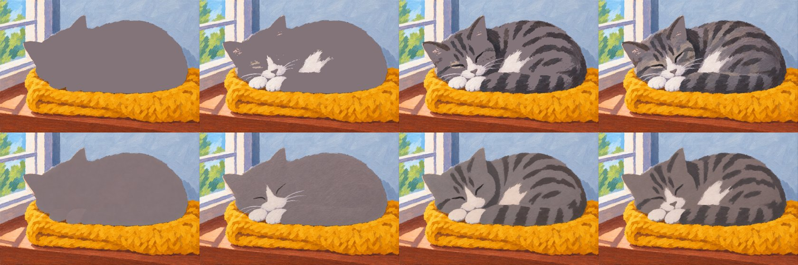
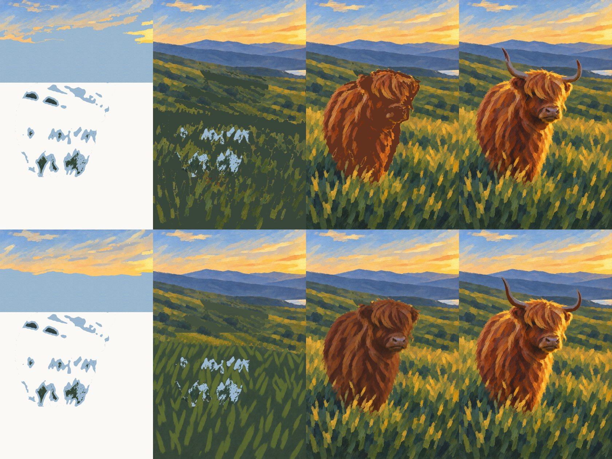
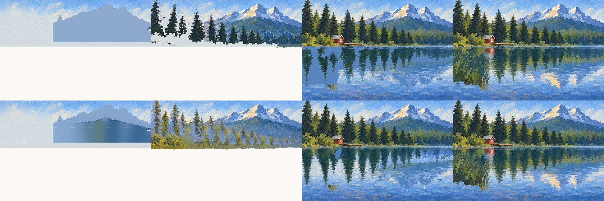
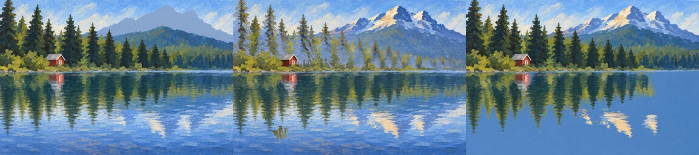

# Spike S4: stages inside a part by peeling detail (#169)

2026-11-17. Wave 1 of `docs/design/pipeline-v3-plan.md`. The code is `spike/experiments/v3_part_stages.py`, its
numbers `spike/experiments/v3_part_stages.json`, its tests `spike/tests/test_v3_part_stages.py`. It is experiment
code: no lesson tool, the skill, or the site changed.

**Verdict: drop.** The owner scored the blind A/B on 2026-11-17 (section 7): v2 preferred on the sleeping cat and
the highland cow, no difference on the lake cabin. The stages won on none. A spike that loses the A/B to the v2
baseline is dropped (`docs/design/pipeline-v3-plan.md`, "How a spike runs"). What the numbers and the pictures said
before it, which the A/B did not bear out where they favored the stages:

- **The image model can paint a stage the plan describes.** Asked for the cat "blocked in", "with the white chest
  done" and "with the stripes done", it gave a plain gray cat, then the white, then flat stripes with no fur. 29
  renders, none failed to come back.
- **It works on a thing that starts with a flat coat.** The cat, the cow, the horns, the rocks, the reeds, the
  grass: each half-done stage looks like paint a person put down, where v2 shows the finish with holes in it. The
  colors are a mixed result (section 4): a stage stays nearer the paints its part has named so far than v2 does, but
  against the step's own paints, the plan's third check, v2 is nearer on 6 of 11 steps.
- **It fails on a part that starts with a pass.** Clouds, a forest, a reflection: the plan's first step is one
  paint of several, and the model answers with the whole thing painted pale. 22 to 53% of what those steps add is
  near a paint the part has named by then, where v2 has 87 to 99%.
- **The model's idea of a part isn't the outline's.** It is told the part's name, not shown its outline. On the
  lake cabin it flattened only the mountain's snowy peak and only the open half of the lake. The guard keeps the
  render inside the plan's outline, so the rest of the part stays finished and the step picture is half and half.
- **Nothing moves outside the part.** By construction, as in v2.
- **Two stages of one part are two renders.** A white patch on the cat's side is missing from one stage and back in
  the next. Up to 4% of a part goes from finished-looking to not between steps, and 9% once (v2: almost none).
- **It costs about a render a step:** 8 to 12 low renders a lesson, 14 to 22 cents, where v2 spends 2 cents on its one
  background render. The renders take 24 to 43 seconds a lesson, run together.

Before the A/B, the recommendation here was to adopt the stages for parts that start with a flat coat if the A/B
was a clear win. It wasn't: the owner preferred v2 on the two pictures where the stages looked best to Claude. v2's
flat coat and passes stay.

## 1. What was tried

A v2 step that isn't its part's last shows a flat coat (`flat`), or the finish wherever its color is nearest the
step's paints (`pass`). The design doc lists the second as a risk: "A pass by nearest paint doesn't match how the
area is really painted."

- **Stage.** A part as it stands after one of its steps that isn't its last. The plan decides the stages: they are
  its steps. The image model only paints a stage the plan describes. A part's last step is the finish, as in v2.
- **The request** is written from the plan alone (`prompt_for`): the part's name, each step done so far with its
  name and paints, and each step still to come, which "may not show". A part with only its flat coat done is "only
  blocked in: flat, even color in its own shape". A part that starts with a pass is told "where it has no paint
  yet, show" what's behind it.
- **The picture the stage is painted on.** For a thing in front, the finish. For a part behind, v2's own picture
  with the things in front taken out (the finish plus the baseline run's background render), so the part is whole
  where they will stand.
- **The guard** is v2's (`build_steps.make_background`): of each render only the pixels inside the part's outline
  are kept, matched in tone to the picture around it. Nothing else can move.
- **All at once**, at low quality, as the peel spike found best (`docs/spikes/v3-peel.md`). Every stage is asked
  for from the finished part, all of a picture's renders running together.
- **Step pictures.** v2's builder with one change: a step that has a stage lays the stage's paint over the part's
  whole area. Under the things that will cover the part, and where its children go, the stage's own paint is
  carried across by v2's fill, given the stage picture in place of the finish. What's behind things, rims, the
  order of parts, each part's last step and every step with no stage are v2's, unchanged.

It ran on the frozen bench with each baseline run's own plan, outlines, paints and words, so only the step
pictures change. Three pictures: the sleeping cat, the highland cow and the lake cabin, three of the owner's four
lowest baseline scores. The birch grove was left out: its fault is the sky's fill under its own marks, in a
one-step part that has no stage.

## 2. What the pictures show

Each is the v2 baseline above and the stages below, the same steps of the same plan.

The cat is the clearest case. v2's "white" step shows the finish's white, whiskers and all, on a flat gray shape,
and its "stripes" step is the finished cat less a little fur. The stages show a flat cat, then white shapes, then
flat stripes, then fur. Two faults: the white patch on the cat's side is missing from the second stage and back in
the third, and the eyes sit a little differently in each.

The grass and the cow's locks are whole strokes over the coat, where v2 shows scattered finished pixels. The gray
clouds (step 2, a part that starts with a pass) came back as the finished clouds in full color: the stage shows gold
that step 3 is meant to add.

The lake cabin is where it goes wrong. The mountain's coat is flat only at the peak, and under it the fill smears
the finished lower slope sideways. The "dark spruces" are pale, see-through trees with yellow bushes. The
reflection and the reeds are better than v2's: whole strokes, and no blue hole where v2's pass leaves the coat.

The raw renders say why. Asked to block in "the mountain", the model flattened the snowy peak and left the green
slope the plan's outline also holds. Asked for the water's coat, it flattened the open water and left the
reflections, which is right, but only as far as it took the reflections to reach. Asked for the first pass of the
forest, it faded every tree.

## 3. Nothing changes outside the part

Holds by construction. The most any built step changes outside its part's painted area is 0.02% of the picture, on
the lake cabin, the same step and the same number as v2. The built last picture is within 0.05% of the finish
before it is set to it, the same as v2.

What the guard throws away: the raw renders moved 2.0% (sleeping cat), 3.2% (highland cow) and 5.8% (lake cabin) of
the pixels away from the part, 10.0% at worst. Without the guard every stage would also repaint its surroundings.

## 4. Each stage's colors against the paints its step names

Read from the pictures, the same way for both sides (`measure`): of the pixels a step changes inside its part, the
share within Delta E 12 (CIEDE2000, `paints.MAX_MERGE`: the line past which a painter sees another color) of a
paint. Two readings:

- **Own paints** (`named`): a paint this step names. This is the v3 plan's third check.
- **Paints so far** (`named_so_far`): any paint the part's steps have named by then.

A staged step lays its part again whole, so most of what it changes is the earlier coat laid again, which is not
this step's paint. Its own-paints share is therefore taken from the build that lays only what a stage changed
(`build --changes`, section 5), the nearest thing to "what this step added". v2's pass picks the finish's pixels
nearest the step's paints, so v2 starts with an advantage on own paints. A flat step is left out: v2's is the paint
itself, 100% by construction, and the stages' block-ins are 89 to 100% except the lake cabin's mountain (54%) and
cabin (81%).

| Picture | Pass step | Starts with | Own paints: stages, v2 | Paints so far: stages, v2 |
|---|---|---|---|---|
| sleeping cat | blanket-stitches | flat | 90%, 99% | 100%, 100% |
| | cat-white | flat | 83%, 93% | 97%, 94% |
| | cat-stripes | flat | 82%, 98% | 98%, 99% |
| | cat-fur | flat | 40%, 90% | 99%, 93% |
| highland cow | grass-moss | flat | 98%, 96% | 99%, 97% |
| | cow-locks | flat | 45%, 80% | 96%, 84% |
| | horns-shade | flat | 80%, 75% | 89%, 75% |
| | clouds-gray | pass | 41%, 99% | 41%, 99% |
| lake cabin | mountain-shade | flat | 90%, 63% | 83%, 64% |
| | reeds-mid | flat | 75%, 74% | 96%, 75% |
| | rocks-shade | flat | 94%, 82% | 97%, 85% |
| | cabin-shade | flat | 4%, 62% | 36%, 63% |
| | forest-dark | pass | 22%, 92% | 22%, 92% |
| | tree-reflection-dark | pass | 47%, 87% | 47%, 87% |
| | tree-reflection-olive | pass | 42%, 89% | 53%, 90% |

- **Parts that start with a flat coat, own paints:** mixed. The stages are nearer on 5 of 11 steps (grass, horns,
  mountain, reeds, rocks) and v2 on 6 (all four of the cat's and blanket's, the cow's locks, the cabin). The third
  check, as the plan words it, does not favor the stages. In the plain build, where a step lays the whole part
  again, the stages' own-paints share is lower on most steps (5 to 83%), because it counts the coat laid again.
- **Parts that start with a flat coat, paints so far:** the stages are level with v2 or better on 10 of 11 steps, by
  12 to 21 points on five. So a stage stays inside the part's palette better than v2's finish pixels do (the finish
  holds colors no step names, #158), but what a single step adds is often an earlier step's paint again: the cat's
  fur step repaints stripes and gray.
- **Parts that start with a pass:** the stages lose on all four, on both readings, badly. The model doesn't paint
  "only the dark of the forest". This is the half of v2's flat-and-pass that already works: a nearest-color pass on
  scattered marks is close to how they're painted.

**Does a later stage undo an earlier one?** `undone` is the share of a part that was within Delta E 12 of the
finish before a step and isn't after it. v2's passes: 0.0 to 0.2%, and 3.4% once. The stages' passes: 0.2 to 3.9%,
and 8.9% once (the reflection's second pass). So a stage does take back a little of what the last one showed. It is
the same thing as the cat's white patch: two renders of one part don't agree in every place.

## 5. Two free variants, from the same renders

- **Lay only what changed** (`build --changes`): after a part's first step, a step lays its stage only where it
  differs from the canvas by 8 Lab units or more. Section 4 uses it to read what a step adds. On paints so far its shares are within 8 points of the plain build's,
  either way, and `undone` is the same. Its pictures weren't compared by eye. Not worth its rule.
- **Keep v2's flat coat** (`build --passes`): only pass steps take a stage, 4 to 7 renders a lesson in place of 8 to
  12. The block-ins are where the two sides differ least, so this halves the cost for little loss, and it avoids
  the half-flattened mountain. It also puts a render's tone beside a flat coat's exact paint, and the first pass
  then changes the whole part's tone a little. If the stages are adopted, this is the form to start from.

Neither is on the A/B page. The page has the plain form: every stage a render.

## 6. Cost and time

| Picture | Steps | Stages rendered | Cost | Renders, all at once | Build |
|---|---|---|---|---|---|
| sleeping cat | 16 | 9 | 16.3 cents | 41 s | 12 s |
| highland cow | 16 | 8 | 14.4 cents | 24 s | 13 s |
| lake cabin | 23 | 12 | 21.7 cents | 43 s | 19 s |

- **Spend:** 29 low renders, 52 cents, 1.8 cents each. Under the $2 the plan allows.
- **A lesson's stages cost** 14 to 22 cents and 24 to 43 seconds of rendering, where v2's one background render is
  about 2 cents and 15 seconds. The baseline lessons' renders came to 8 to 22 cents each, so this about doubles or
  triples the image cost of a lesson.
- The build takes 11 to 19 seconds against v2's 8 to 12: each stage's fill is worked out again from its own picture.
- Renders ran at most 8 together. Each took 13 to 21 seconds.

## 7. The A/B

Round `s4-stages`: the three baseline lessons against the same lessons with step pictures from the stages (the
plain form). Same plan, paints and words on both sides, so (a) "the step pictures look like a real half-done
painting" is the score this spike moves. The words weren't rewritten for the new pictures.

The page is https://claude.ai/artifact/F4SNZQ2LbiWwJtmDxz7VcB (3 pictures, 110 steps, 9.2 MB, sides drawn with
`--seed 169`), made by `ab_page.py make --round s4-stages`. Its answer key is
`spike/experiments/bench/scores/s4-stages.key.json`: it says which side is which, so the owner doesn't open it
before scoring. This time the experiment's lesson folders have their own names (`<run>-stages`), so the key alone
says which side is which.

### The owner's scores (2026-11-17)

Saved in `spike/experiments/bench/scores/s4-stages.json`. The owner scored (a), "the step pictures look like a real
half-done painting", 1 to 5, and which lesson they'd paint from. (b) and (c) were left blank on purpose: the words
and paints are the same on both sides.

| Picture | v2: (a) | Stages: (a) | Prefers | Worst steps tapped |
|---|---|---|---|---|
| sleeping cat | 4 | 3 | v2 | stages: step 16, the pink ears and nose |
| highland cow | 3 | 2 | v2 | stages: step 12, the rust locks |
| lake cabin | 2 | 2 | no difference | none |

The stages lost by a point on two pictures and tied on the third. The owner's scores move by a point between
sittings (`docs/spikes/v3-yardstick.md`, Limits), but these were given side by side in one sitting, and the
preference agrees with them both times.

- **Sleeping cat.** The step tapped, 16, is the part's last step: the finish, the same picture on both sides. What
  differs is the step before it. On the stages' side the picture goes from a render of the cat to the finish in one
  step, and the whole cat shifts a little (the eyes, the white patch, section 2), on a step whose words add only
  pink ears and a nose.
- **Highland cow.** Step 12 is where the stage shows the cow's locks, and also its face: the owner wrote "In both,
  the facial features just magically appear even though they're not disclosed in the steps or the paint colors.
  They just happen in different steps." The stage puts the face a step earlier than v2 does, and no step's words or
  paints cover it on either side. That is the plan and the words (S7 #172, S8 #173), not the pictures.
- **Lake cabin.** The stages' better reflection and reeds and worse mountain and forest came out even.

**What it means.** A render of a half-done part looked more painted to Claude and scored lower with the owner. Two
things the stages add count against them: each step redraws the whole part, so things move between steps and a step
shows more than its words say; and the jump to the finish at a part's last step is bigger. v2's passes show less,
but what they show is the finish's own paint in the finish's own place.

## 8. Not done

- **The lavender balloon** (not needed now: the stages lost on two of three), picked as the fourth picture for its six-step balloon and five-step field. The image
  model's account ran out of credits before its 15 renders started. Nothing was spent on it.
- **Chained stages** (each made from the one after it: un-paint one step at a time). It might make two stages of a
  part agree better. The code is there (`render --mode chained`); no render was made, for the same reason.
- **Showing the model the part's outline.** The request names the part and doesn't show it. A second input picture
  with the part marked, or the edit call's mask, could fix the half-flattened mountain. Not tried.
- **A better request for a part that starts with a pass.** Not tried. v2's pass may simply be the right tool there.
- **Fault counts** by a fresh counter (`docs/spikes/v3-yardstick.md`, section 3): three counters, one a lesson. The
  owner hears a batch's size before it starts (`docs/decisions.md`).
- **Words and cards.** A stage picture changes what a step shows, so "It should leave ..." lines and close-ups
  would be drafted from it. S8 (#173) and S10 (#175).

## Running it

    python spike/experiments/v3_part_stages.py stages all4 [--prompts]            # the stages and requests; no render
    python spike/experiments/v3_part_stages.py render sleeping-cat [--mode chained] [--parts cat]    # PAID
    python spike/experiments/v3_part_stages.py build sleeping-cat --variant parallel-low [--changes] [--passes]
    python spike/experiments/v3_part_stages.py compare sleeping-cat --variant parallel-low --steps 12,13,14,15 --out x.jpg
    python spike/experiments/v3_part_stages.py results                            # writes v3_part_stages.json

It reads the baseline runs from `/home/user/gesso-baseline/output` (plans, outlines, words; they aren't in the repo)
and writes under `spike/experiments/bench/runs/stages/` (git-ignored). A render already in its folder is kept;
delete it to render again.
