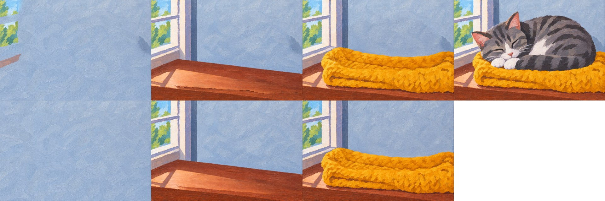
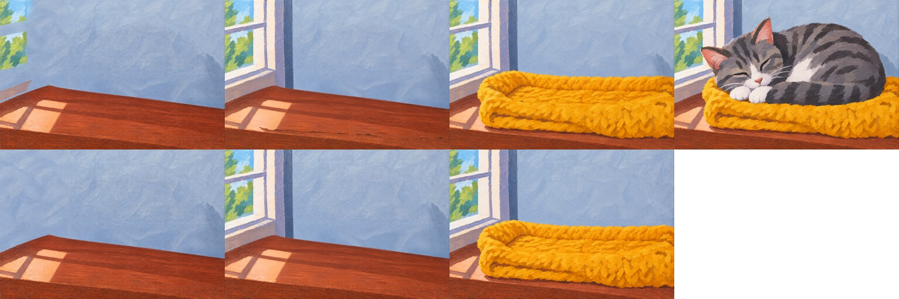
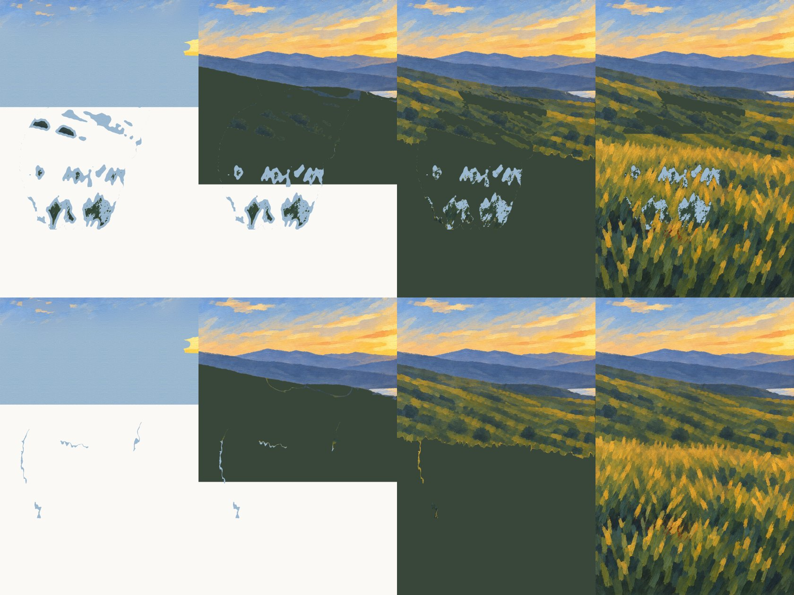
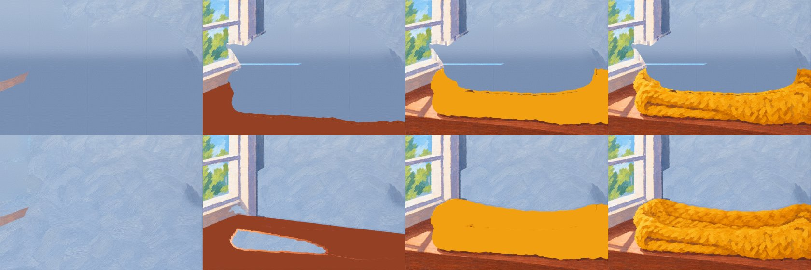
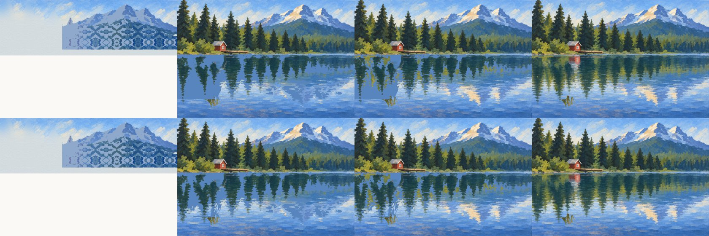
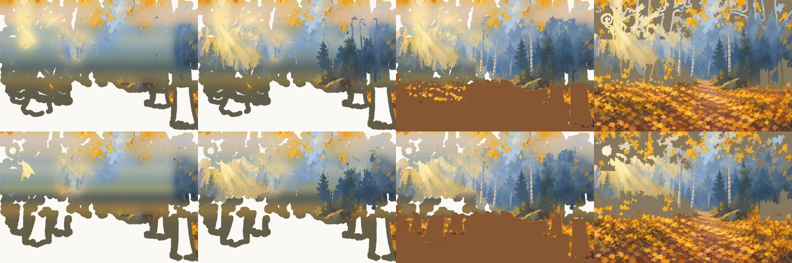
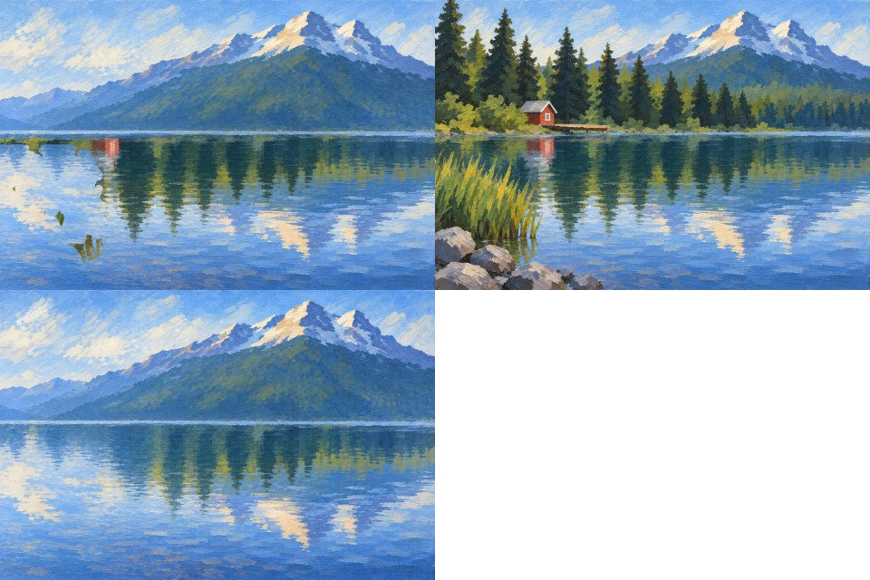
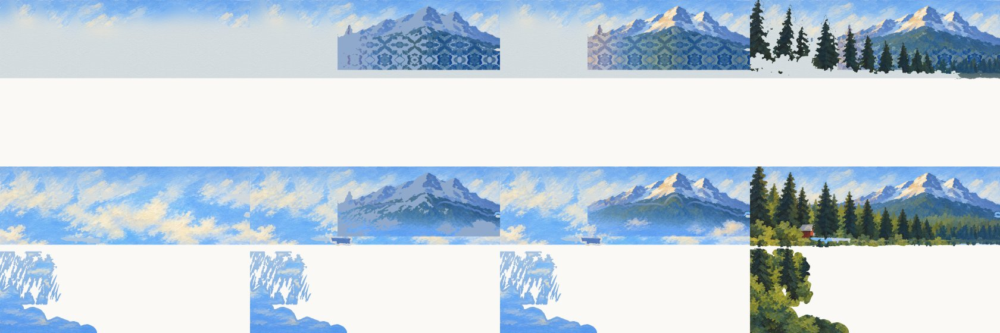

# Spike S1: peel the finish backward to get complete layers (#166)

2026-11-17. Wave 1 of `docs/design/pipeline-v3-plan.md`. The code is `spike/experiments/v3_peel.py`, its numbers
`spike/experiments/v3_peel.json`, its tests `spike/tests/test_v3_peel.py`. It is experiment code: no lesson tool,
the skill, or the site changed.

**Verdict: park.** The owner scored the blind A/B on 2026-11-17 (section 8): no difference on all four pictures,
with the same three scores on both sides of each. A spike beats v2 only on a clear win (`docs/decisions.md`), so the
peel is not adopted. It isn't dropped either: the renders work and cost almost nothing, and the layers they give are
what S3 (#168) and S4 (#169) need. But a peel alone doesn't change what the owner sees. What the numbers and the
pictures say:

- **The image model can peel.** Asked to remove the things in front, it painted a whole blanket under the cat, a
  whole meadow behind the cow, and a whole mountain behind the forest. 47 of 49 renders passed v2's check that the things were removed; the two
  that didn't were the same request, in a chained peel. One that passed still left 29% of a loch (section 6).
- **All at once beats chained.** 18 to 21 seconds a picture whatever the number of levels, where chained's renders
  add up to 33 to 41 on the pictures with more than one level, and the only failed renders were chained.
- **Low is enough.** Medium costs a third more and the step pictures look the same.
- **It fixes what's behind things in front, and only that.** Clearly better step pictures on the sleeping cat and
  the highland cow, little change on the lake cabin, none on the birch grove. Those two pictures' faults are among
  the parts behind (a tiled pattern on the mountain under the forest, blurred bands in the sky under the leaves),
  which this peel doesn't touch.
- **Peeling the parts behind too works as a render and not yet as step pictures.** The mountain's tiled pattern
  goes, but new faults come in: the peeled pictures need outlines of their own, and today's outlines aren't good
  enough for it.

Before the A/B, the recommendation here was to adopt the front peel. The A/B says otherwise. What stands: if a
later spike peels, it peels **all at once at low quality**; chained and medium are **dropped**; the deep peel waits
for better outlines (S3, #168).

## 1. What was tried

A v2 step picture is the finish with later parts taken away, and whatever was hidden is made up by fill rules. v2
already asks the image model for one picture of what's behind the objects (`98_background.png`) and keeps only its
pixels inside the objects' outlines. The peel makes that general.

- **Level.** The parts behind everything (areas, and marks listed before the first object) are level 0. A thing in
  front is level 1, or one more than the highest earlier thing in front it touches. Things of one level don't touch,
  so one render removes them all. The sleeping cat: wall 0, window and sill 1, blanket 2, cat 3.
- **P[L]** is the picture with every level above L un-painted. P[top] is the finish.
- **The guard** is v2's own (`build_steps.make_background`): of each render only the pixels inside what was removed
  are kept, matched in tone to the finish around the hole. Nothing else can move.
- **Chained:** P[L-1] is made from P[L]. **All at once (parallel):** every P[L] is made from the finish, all
  renders running together.
- **Layers.** Each peeled picture is a complete painting of what's left, so it is outlined the way a finish is: the
  same `outline` tool, the plan's own boxes and points, only the parts of that level and lower. That says which part
  owns each pixel that came into view. No rows, no colors, no fill.
- **Step pictures.** v2's builder, with one change: a part is cut from its own level's picture, so it is whole
  under everything above it. What a step does inside its part (flat, pass, full) is v2's, unchanged; that is S4
  (#169). What a part has under its own children (sky under clouds) and under the next part's edge is still v2's
  fill.

Everything ran on the frozen bench, on the owner's four lowest baseline pictures (highland cow, sleeping cat, lake
cabin, birch grove), with each baseline run's own plan, outlines, paints and words. Only the step pictures change.
The other four pictures weren't run (`docs/decisions.md`: spikes start on 3 or 4 pictures).

## 2. The three checks

1. **All layers together equal the finish.** Holds by construction: the top picture is the finish, and the guard
   keeps every render inside its hole. Before the last picture is set to the finish,
   the built one differs from it on 0.00 to 0.09% of pixels (v2: 0.00 to 0.05%).
2. **No picture changes a pixel outside the layer its step adds.** Holds in the built steps: the most any step
   changes outside its part is 0.02% of the picture, the same step and the same number as v2 (the lake cabin). It
   does not hold for the peeled pictures taken as they come: where two levels are both hidden, P[L] and P[L+1] are
   two renders of the same place. Counting only the pixels the same part owns in both (so not the blanket's own
   paint under the cat), 9 to 76% of them differ by more than 24 levels all at once, and 1 to 57% chained
   (`same_place_moved`). The builder never shows both: each pixel comes from the picture of the level that owns it.
3. **Every pixel within a set distance of a paint the step names.** Not measured. The paints are the baseline's,
   fitted to the finish, and S6 (#171) is the spike for this.

## 3. Chained against all at once

Low quality, front levels only. Seconds are for the renders of one picture: chained, each render's time added up
(they run one after another); all at once, the clock from the first request to the last answer.

| Picture | Levels | Chained: seconds, failed renders | All at once: seconds, failed renders |
|---|---|---|---|
| highland cow | 2 | 33, 0 | 19, 0 |
| sleeping cat | 3 | 41, 1 (and its redo) | 18, 0 |
| lake cabin | 2 | 34, 0 | 20, 0 |
| birch grove | 1 | 17, 0 | 21, 0 |

- All at once takes one render's time whatever the number of levels.
- Chained failed once, twice over: with the cat and the blanket already gone, "remove the window frame and the
  wooden sill" left the sill standing (64% of it unchanged), and the one redo did the same. The same level from the
  finish, with all four things named, came back clean. `background_problems` (v2's check) caught both.
  
- A chained peel can't use a hole of only the level it removes. What the level has under the levels already gone
  (the blanket under the cat) was painted by the last render and has no outline, so it stays behind. The hole has to
  be everything above, as in the all-at-once peel, and then chained has nothing left to offer.
- The pictures are otherwise alike. The share of the removed things' edge still showing (`edge_left`) is within
  0.04 of each other on three pictures; on the cat chained is 0.09 against 0.03, from the failed render.

## 4. Low against medium

All at once, front levels only.

| | Low | Medium |
|---|---|---|
| Cost a render | 1.76 cents | 2.32 cents |
| Seconds a render | 13 to 19 | 16 to 23 |
| Pixels the raw render moved away from the hole, mean of 4 pictures | 6.1% | 5.0% |
| Edge of the removed things still showing, worst level, mean of 4 | 0.22 | 0.26 |
| Failed renders | 0 of 8 | 0 of 8 |

Medium keeps the rest of the picture a little closer, but the guard throws that part of the render away. Inside the
holes the two look the same on the step sheets, and the outline faults (section 6) are the same or worse. Low is
enough.

## 5. Step pictures: peel against v2

What changed, read from the step sheets of the same plan built both ways (all at once, low).

| Picture | v2 baseline | Peel |
|---|---|---|
| highland cow | Pale blue blotches with dark centers where the cow will stand, steps 1 to 10 | Gone. Three thin sky-colored slivers along the cow's edge, steps 1 to 7 |
| sleeping cat | Step 1 paints the wall over the whole canvas with a streak where the sill ends; the blanket is a hollow shell until the cat | Step 1 is a clean wall; the blanket is whole before the cat. New: a wall-colored hole in the sill, steps 7 and 8 |
| lake cabin | Tiled pattern on the mountain, steps 3 to 5; a pale patch in the water where the reeds go, steps 13 to 17 | The patch is water now. The tiled pattern is unchanged |
| birch grove | Blurred bands across the sky, steps 1 to 5; ragged white holes | Unchanged |

**The measured numbers don't show this.** `build_steps.ghosts` reports no ghost on v2's highland cow, blotches and
all, and one on the peel's (the loch's edge, 0.35). It reads edges of parts, and the blotches aren't on one. So
the ghost counts are in `v3_peel.json` and not in a table here: on these four pictures they don't tell a better
lesson from a worse one. The owner's A/B does.

**Where the peel's own faults come from.** Not the renders. The cat's sill has a hole because the `outline` of the
peeled picture gave a patch of bare sill to the wall. The cow's slivers and the cabin's leftover reed are places
the baseline's outline missed, so the guard kept the finish there. Every fault found on the sheets is an outline
fault (class B), on the finish or on a peeled picture.

**Fault counts** by a fresh counter (`docs/spikes/v3-yardstick.md`, section 3) are not run yet. That is four
fresh-context counters, one a lesson; the owner hears a batch's size before it starts (`docs/decisions.md`).

## 6. The deep peel: the parts behind too

The lake cabin and the birch grove didn't change because their faults are under parts behind: the mountain under
the forest, the sky under the leaves. A probe asked for the lake cabin with the forest, dock, reeds and rocks
removed. The model painted the mountain down to the shore.

So `--deep` gives the parts behind levels by the same rule (sky 0, mountain 1, forest 2, dock 3, lake 4, reeds 5,
rocks 6), 3 to 6 renders a picture, still about 22 seconds all at once. A part behind keeps v2's painted area and
takes that area's pixels from its level's picture in place of the fill.

| Picture | Renders | Cost | What the step sheet shows |
|---|---|---|---|
| highland cow | 6 | 10.6 cents | Much as the front peel; one render left 29% of the loch |
| sleeping cat | 3 | 5.3 cents | The same as the front peel |
| lake cabin | 6 | 10.6 cents | The mountain is real paint in steps 3 and 4. New: sky, then bushes, painted in the corner where the reeds and rocks go, steps 1 to 10 |
| birch grove | 3 | 5.3 cents | The sky's bands are still there; the built last picture is 5% away from the finish |

It fixes what it was aimed at and breaks something else. With the lake removed, the render invents a shore where the
lake was, and the outline of that picture hands the reeds' corner to the forest. A deep peel needs to know, for
every level, which part each newly seen pixel belongs to, and that is the question v2's fill rules were answering
badly. Asking `outline` again is a cleaner answer than rows and colors, but it's only as good as the outlines, and
those are S3 (#168). Parked until then.

## 7. Cost, time, and the A/B

- **Spend:** 49 renders, 91 cents: 41 low at 1.76 cents and 8 medium at 2.32. That counts two probes, one redo,
  and four chained renders made again after a mistake in the first chained hole. Under the $2 the plan allows.
- **A front peel costs** 1 to 3 low renders a picture, 1.8 to 5.3 cents, where v2 spends 1.8 cents on its one
  background render. Renders take 18 to 22 seconds all at once. Outlining the peeled pictures adds 11 to 31 seconds
  (about 10 a level), and the build 8 to 12, as v2's.
- **The A/B round** is `s1-peel`: the four baseline lessons against the same lessons with step pictures from the
  all-at-once low peel. Same plan, paints and words on both sides, so (a) "the step pictures look like a real
  half-done painting" is the score this spike moves. The words weren't rewritten for the new pictures.
  The page is https://claude.ai/artifact/8wVSjPsn5MmUM8TWYbHHDQ (138 steps, 9.7 MB, sides drawn with `--seed 166`),
  made by `ab_page.py make --round s1-peel`. Its answer key is `spike/experiments/bench/scores/s1-peel.key.json`:
  it says which side is which, so the owner doesn't open it before scoring.

## 8. The owner's blind A/B (2026-11-17)

Round `s1-peel`, scored on the phone page; saved in `spike/experiments/bench/scores/s1-peel.json`. (a) real,
(b) paintable, (c) agree, each 1 to 5.

| Picture | v2: a, b, c | Peel: a, b, c | Prefers | Worst steps tapped |
|---|---|---|---|---|
| sleeping cat | 3, 2, 2 | 3, 2, 2 | no difference | none |
| highland cow | 2, 2, 2 | 2, 2, 2 | no difference | peel: step 1, the sky |
| lake cabin | 2, 2, 2 | 2, 2, 2 | no difference | peel: step 13, the trees' reflection |
| birch grove | 1, 2, 1 | 1, 2, 1 | no difference | peel: step 1, the sky |

The peel won on none and lost on none. The three worst-step taps all fell on the peel's side, but the first two are
steps the peel builds the same as v2 or nearly (a tap is made on whichever side is open), and the owner's notes are
about each picture, not a side.

**What the owner wrote**, and where each belongs:

- Highland cow: "Mountains have at least four shades of blue, but only one is shown, and the instructions don't say
  anything about tinting." Paints and words (S6 #171, S8 #173).
- Highland cow: "There is a lot of cow artifacts up until you get to the cow steps that are very distracting." Read
  with the same scores on both sides: the peel's slivers along the cow's edge (section 5) bother the owner as much
  as v2's blotches did. Smaller isn't enough; nothing of the cow may show before its step. They are outline faults
  (S3 #168).
- Lake cabin: clouds in the first step that the words don't mention; the "weird crosshatch pattern in the mountain"
  that "magically becomes trees" on a step whose paints and words aren't about trees; reflection strokes that
  wouldn't give ripples. The crosshatch is the fill under the forest, which the front peel leaves alone and the deep
  peel removes (section 6). The rest is words and teaching (S7 #172, S8 #173).
- Sleeping cat: "Some steps use multiple tones of a color like the window frame and there's no mention of it."
  Stages inside a part and paints (S4 #169, S6 #171).
- Birch grove: "Both are pretty much unpaintable because they start out with a blobby mess." The sky's fill under
  its own marks, the same on both sides.

**What it means.** The faults the front peel removes aren't the ones that set the owner's scores. On these four
pictures the scores are set by what a step shows inside its own part, by fills among the parts behind, and by paints
and words that don't match the picture. None of that is a layer behind a thing in front.

**A flaw in how the round was keyed.** Both sides of a picture were folders with the same name (the peel lesson is a
copy of the baseline run), and the answer key holds folder names, so the key alone couldn't say which side was which.
The sides were worked out again from the seed with `ab_page.plan_round` and written into the key as `which`. A later
round should give the experiment's lesson folder its own name.

## 9. Not done

- **The second edit model.** It needs a new host allowed and a key (`pipeline-v3-plan.md`, "How a spike runs").
  `v3_peel.py` takes a model by name (`RENDERERS`); adding one is a function that sends a picture and a prompt and
  saves the answer. Skipped (owner's call, 2026-11-17, after the A/B: "Skip the second model"): gpt-image's renders weren't where the
  peel fell short.
- **Fault counts** for the peel lessons (section 5).
- **The other four bench pictures.** They would have gone in only on a clear win here.
- **A part's own children.** The sky under its clouds is still v2's fill; a peel could remove them too.

## Running it

    python spike/experiments/v3_peel.py levels all4                      # the levels, front and deep; no render
    python spike/experiments/v3_peel.py peel all4 --mode parallel --quality low [--deep]     # PAID
    python spike/experiments/v3_peel.py build all4 --variant parallel-low     # step pictures, as a copy of the lesson
    python spike/experiments/v3_peel.py probe lake-cabin --remove forest,dock,reeds,rocks    # PAID, one render
    python spike/experiments/v3_peel.py results                          # writes v3_peel.json

It reads the baseline runs from `/home/user/gesso-baseline/output` (plans, outlines, words; they aren't in the
repo) and writes under `spike/experiments/bench/runs/peel/` (git-ignored). A render already in its folder is kept;
delete it to render again.
