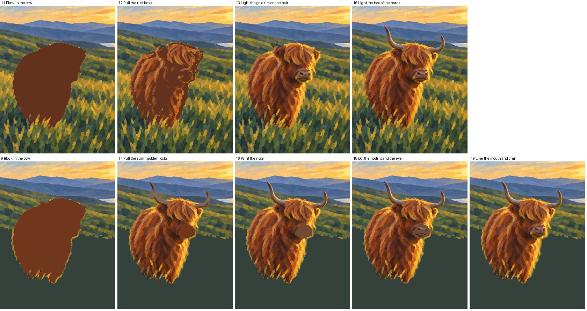

# Spike S7: plan the lesson as a painter's process before the pixels (#172)

2026-11-17. Wave 2 of `docs/design/pipeline-v3-plan.md`. The code is `spike/experiments/v3_plan_first.py`, its numbers
`spike/experiments/v3_plan_first.json`, its tests `spike/tests/test_v3_plan_first.py`. The plans, the fitted plans,
the folded lessons' words and the fault counts are in `spike/experiments/bench/plan-first/<picture>/`. It is
experiment code: no lesson tool, the skill, or the site changed.

**Verdict: open until the owner scores the blind A/B** (section 7; the page is
https://claude.ai/artifact/PrA7Gi1d6pLnQWfndRkZmp). What the plans and the fault counts say before it:

- **A plan written before any outline is a longer, better-shaped lesson.** 22 to 24 steps where v2 planned 14 to
  16, with the extra steps on the subject: the cow's nose, nostrils and eye, and mouth each get a step with its own
  paint, where v2's cow face arrived in one step that named neither.
- **Two writers given the same picture write nearly the same plan.** They paint things in the same order (0.86 to
  1.0) and line up step for step at 0.68 to 0.98. The one pair of v2 plans there is to compare scores 0.81.
- **Steps that cross parts are rare, and small.** None, one, two or three in a plan of 22 to 24. The two sleeping
  cat writers each looked for one and found none. They are the leaf dabs across canopy, bushes and ground, the sun's
  rim on the cow and its horns, and one wet lay-in of two fields.
- **The layers can be made to fit the plan, at a cost in outlines.** The fits carried 67 of the painter's 69 steps.
  But a plan that names more things needs more parts: 1, 2 and 7 new ones. On the birch grove the seven new
  outlines made the step pictures worse than v2's (77 picture faults against 39 and 51).
- **Teaching faults (class F) didn't move:** 2, 10 and 0, against v2's 1, 7 to 8, and 1 to 2. Nearly all of them on
  both sides are one fault, a load word ("creamy", "a light load") the step never explains, which comes from the
  stroke cards and not from the plan.
- **Weighted faults per step fell on two pictures and held on the third:** down 40% on the cow and 24% on the cat,
  up 4% on the birch grove, against the mean of v2's two counters. Only the cow's is past what two counters differ
  by on one packet (about 30%).
- **No render was made.** The work is Claude's: a plan writer took 3.5 to 4 minutes, a fit 21 to 23.

## 1. What was tried

v2 renders the finish, outlines its parts, and then fits steps to the parts: one step paints inside one part. Here
the plan comes first.

1. **The painter's plan** (`painter.json`). A writer in a fresh context, on Opus, gets the photo, the frozen finish,
   the canvas size, the technique file, the element techniques, the stroke cards and the research file. It sees no
   outline, no grid, no measured paint, no earlier plan. It writes the lesson the way a teacher plans a session: the
   things in the picture (named, no boxes), the stages, and for each step what it lays down (`lays`, one entry per
   thing), its paints by name, its stroke card and brush, and `after`: what the canvas shows when the step is done.
   A step may lay paint on several things when that is one move. The brief is `v3_plan_first_painter.md`.
   `painter-check` checks the file's shape and the counts.
2. **The fit.** A second fresh context, on Opus, makes the lesson that plan describes with v2's own tools. v2's
   builder already takes steps in any order (`build_steps`: "never paint over something in front that's already
   there"), so a painter's step that lays paint on k parts becomes k v2 steps in a row, each marked `"of": "<the
   painter's step>"`, and nothing in the tools had to change. The fitter may add a part or a paint, never a
   painter's step, and records what the layers couldn't show (`painter_dropped`, `lays_dropped`, `things_dropped`).
   The brief is `v3_plan_first_fit.md`; `v3_plan_first.py check` holds the fit to the plan.
3. **The fold.** `fold` writes the fitted lesson again with one step per painter's step: its picture is the canvas
   after its last v2 step, its lines are its parts' lines merged (a line they share said once, the Where and Paint
   lines led by the part's name when they differ, step numbers turned into the folded lesson's). The A/B page and
   the fault counter read the folded lesson.

What stood, as the issue says: paint-along on a white canvas, back to front, 12 to 24 steps in 4 to 9 stages, one
move per step, technique from the element files and cards.

**What the fit started from.** Each fit began with the baseline run's parts, their outlines, its measured paints and
its background render, and no stages. That keeps the A/B to one change (the plan and its words, on the same finish
and mostly the same outlines) and saves the outlining that takes most of a v2 run. It also means this spike did not
test outlining from nothing to fit a plan; where a fit had to (the birch grove), section 4 says how it went.

**Pictures.** Three, the owner's lowest three on "I could paint each step from its words" in the baseline round (2
each): the highland cow, the sleeping cat, the birch grove. Two plans were written for each; plan A, fixed before
either was read, was the one fitted.

## 2. The plans

| Picture | Plan | Steps | Stages | Things | Steps that cross things |
|---|---|---|---|---|---|
| highland cow | plan-first A | 24 | 7 | 9 | 2 |
| | plan-first B | 23 | 7 | 10 | 1 |
| | v2 baseline | 16 | 6 | 8 | none can |
| sleeping cat | plan-first A | 23 | 8 | 7 | 0 |
| | plan-first B | 24 | 8 | 7 | 0 |
| | v2 baseline | 16 | 7 | 7 | none can |
| birch grove | plan-first A | 22 | 8 | 13 | 2 |
| | plan-first B | 22 | 6 | 12 | 3 |
| | v2 baseline | 14 | 5 | 7 | none can |

**Where the extra steps go.**

- **Highland cow.** v2: block in, rust locks, gold rim (3 steps), then the horns. Plan A: block in, shade, copper
  locks, golden locks, rim light, then a stage called "The face": paint the nose, light the nose, dot the nostrils
  and the eye, line the mouth. Plan B has the same face steps in three. This is the fault the owner named on the
  baseline ("the cow's face suddenly coming into focus even though the step did not have the right paints or
  instructions").
- **Sleeping cat.** v2: block in, white, stripes, fur, pink (5 steps). Plan A: block in, shade, white patches,
  stripes, inner ears, two fur passes, then eyes and mouth, nose, whiskers (10). The sill and the frame get a shade
  and a light step each.
- **Birch grove.** v2 has seven things. Both plans name the rock, the path or ground, the undergrowth, the branches,
  the sun and the fallen leaves, and give the birches four or five steps (pale trunk, shade, bark marks, branches,
  light) where v2 has three.

**The steps that cross things,** all of them (each is one brush, one stroke, one paint, or one wet blend):

| Plan | Step | Lays paint on |
|---|---|---|
| cow A | Lay in the green ground | the hillside and the meadow, one wet blend |
| cow A, cow B | Catch the sun's rim | the cow and the horns |
| birch A | Dab the golden leaves | the canopy and the bushes |
| birch A, birch B | Tap the sunlit leaves | the canopy, the bushes and the fallen leaves |
| birch B | Dab the dark leaves, dab the golden leaves | the canopy and the fallen leaves |

Both cat writers reported looking and finding none: the shadow under the cat and the shadow under the blanket are
different mixes. So "steps that cross parts" is a small part of what a painter's plan changes. Most of it is what
gets named and in how many steps. A plan's stages are still mostly one thing each; the passes over the whole
picture are "The last lights" (both birch plans) and "The sunlit rim and the face" (cow B).

**Where an element didn't fit,** by the writers' own account: the far birches (pale wood on `trunks-branches`, which
paints dark), a single path (`soil-rows` is for rows), slanted sun rays (`clouds`), a blue wall (`sky-blend`), a
wooden sill and a knitted blanket (`shaped-object`), ground litter (`foliage`). And one found only in the fit: no
element for marks takes a liner pass first, which a face's eyes need (section 4).

## 3. How much two plans of one picture differ

`differ` compares two plans by the things each step paints, with a hand-made table of which names mean the same
thing (`v3_plan_first_things.json`: one writer's "far-range" and "near-range" are the other's "mountains"). On every
measure 1 is the same.

- **Things:** the things both name, over the things either names.
- **Order:** over every pair of things both name, whether the two plans start them in the same order (Kendall's tau).
- **Sequence:** how much of the two step lists lines up, step by step.
- **Moves:** the (thing, stroke card) pairs both use, over the pairs either uses.

| Picture | Plans | Things | Order | Sequence | Moves |
|---|---|---|---|---|---|
| highland cow | plan-first A, B | 1.00 | 0.92 | 0.77 | 0.79 |
| sleeping cat | plan-first A, B | 1.00 | 1.00 | 0.98 | 0.87 |
| birch grove | plan-first A, B | 0.92 | 0.86 | 0.68 | 0.65 |
| highland cow | v2, v2 (the baseline and its excluded run) | 0.88 | 1.00 | 0.81 | 0.53 |
| highland cow | plan-first A, v2 | 0.89 | 0.96 | 0.45 | 0.38 |
| sleeping cat | plan-first A, v2 | 1.00 | 0.81 | 0.77 | 0.81 |
| birch grove | plan-first A, v2 | 0.54 | 0.81 | 0.44 | 0.33 |

- **Two plan-first writers agree about as well as two v2 runs do,** on the one v2 pair there is. That pair had two
  different finishes (it predates the bench) and one of its runs was steered, so it's a rough mark, not a measure.
- **The two cat plans are nearly one plan:** the same 8 stages, the same steps in the same order, one extra coat of
  white in B.
- **Where they differ, it's the order of whole things, not the teaching.** On the birch grove, A paints the canopy
  before the trunks and B after; A lights the rock last and B with the rock. On the cow, A finishes the cow's shape
  before the horns' and B alternates.
- **Plan-first against v2 is where the real difference is:** half the step sequence on the cow and the birches.

## 4. Fitting the layers to the plan

| Picture | Painter's steps | Carried | v2 steps | Cross parts | Parts (v2 had) | Parts added | `outline` runs |
|---|---|---|---|---|---|---|---|
| highland cow | 24 | 24 | 26 | 2 | 10 (8) | bushes, muzzle | 4 |
| sleeping cat | 23 | 21 | 22 | 1 | 8 (7) | face | 4 |
| birch grove | 22 | 22 | 25 | 2 | 13 (7) | sun, path, rock, fallen leaves, branches; foliage split into canopy and undergrowth | 4 |

67 of 69 steps carried, and every lay and every thing. What the fits ran into, from their reports:

- **A step can only show a color the finish has.** The two steps dropped are the cat's: "Shade the cat" (the finish
  has no gray darker than the coat but the stripes' charcoal, so the pass would show nothing or every stripe) and
  "Flick the lit fur" (the same measured color as the white patches, so it arrives with them). The plan was written
  from how a cat is painted; the finish was rendered without those values. Painting from a plan would need the
  finish made to the plan too (S6, #171), or the stage painted by a model (S4, dropped).
- **Order inside one part still isn't the plan's.** A v2 pass shows the finish wherever it's nearest the step's
  paint, and a part's last step shows all that's left. So the cat's whiskers arrive with the white patches, seven
  steps before the whiskers step, which then changes nothing (the fault counter counted it); the cow's eye shows
  from the shading step; the cow's rim light adds almost nothing because the golden locks brought it. The fitters
  wrote tips around these ("leave the whiskers for the end").
- **The painter's paints aren't the measured paints.** Each fit renamed and swapped: no paint as pale as the
  painter's "Pale gold" on the cow, no "Dark umber", a "Gray-white" for the birch trunks that measures mid gray.
  Sharing one paint across parts moved its measured color by Delta E 9 to 13 each time `paints` ran again, and one
  run merged the cat's sky blue into the wall's paint.
- **New things need new outlines, and that is where it got worse.** The cow's muzzle and the cat's face (both
  children of the animal) came out clean and are what make the face steps show. The birch grove's seven didn't:
  the canopy's dark step is flat orange slabs with a straight lower edge, the bushes are olive blocks, the path is
  blobs, the rock's shade lands on its top. All four `outline` runs were spent and the last was put back.
- **Hand repairs, against the skill's rule:** two fits restored `parts/owner.png` from a copy after a bad `outline`
  run, and the cat's fit rebuilt `parts/stats.json` by hand from the restored file. The pictures on the A/B page are
  built from the restored outlines by the unchanged tools.
- **Tool faults met:** on the cow, unclaimed slivers beside the cow let the sky's paint show as blue blotches
  behind it with `build-steps` reporting nothing (the same fault the baseline run noted; the fit closed it with
  `points_in`). `publish` wants a summary on every v2 step. The image account had no credits, so the one
  `background` call (the cat) failed; the baseline cat has no background render either, so the two sides match.

`check` ended clean on the cow, with one outline-confidence warning on the birch grove's branches, and with two
element failures on the cat's face part (no marks element takes a liner pass first).

Above, v2: the face comes into focus between "Pull the rust locks" and "Light the gold rim on the hair", in a step
whose paint is a gold. Below, plan-first: the muzzle is a flat patch until "Paint the nose", then "Dot the nostrils
and the eye", then "Line the mouth and chin", each naming its paint. Also visible: v2 paints the whole meadow before
the cow, and the plan paints the tall grass last, over the cow's feet, so the meadow is one dark coat for about
fourteen steps.

## 5. Fault counts

One fresh counter per plan-first lesson (`docs/spikes/v3-yardstick.md`, section 3), on Opus, given only the brief
and the folded lesson's packet. The v2 side is the baseline's two counters. Each cell is all / distinct; weighted is
blocker 3, major 2, minor 1.

| Picture | Lesson | Steps | A pictures | B outlines | C placement | D paints | E text | F teaching | Weighted | Per step |
|---|---|---|---|---|---|---|---|---|---|---|
| highland cow | v2, counter A | 16 | 19/8 | 5/5 | 3/3 | 3/3 | 6/6 | 1/1 | 71 | 4.4 |
| | v2, counter B | 16 | 29/10 | 1/1 | 4/4 | 3/3 | 10/7 | 1/1 | 78 | 4.9 |
| | plan-first | 24 | 16/9 | 1/1 | 1/1 | 11/10 | 13/11 | 2/2 | 67 | 2.8 |
| sleeping cat | v2, counter A | 16 | 43/11 | 18/6 | 2/2 | 6/6 | 3/3 | 8/3 | 150 | 9.4 |
| | v2, counter B | 16 | 35/12 | 11/2 | 3/3 | 5/5 | 3/3 | 7/2 | 128 | 8.0 |
| | plan-first | 21 | 43/9 | 8/4 | 8/4 | 6/5 | 6/6 | 10/10 | 139 | 6.6 |
| birch grove | v2, counter A | 14 | 39/15 | 13/4 | 2/2 | 3/3 | 4/3 | 1/1 | 123 | 8.8 |
| | v2, counter B | 14 | 51/15 | 16/4 | 0 | 3/3 | 8/7 | 2/2 | 162 | 11.6 |
| | plan-first | 22 | 77/14 | 14/3 | 2/2 | 2/2 | 8/7 | 0 | 232 | 10.5 |

- **Class F, the measure the plan names for this spike, shows nothing.** 2, 10 and 0 against 1, 7 to 8, and 1 to 2.
  The cat's 10 are, by that counter's own note, mostly one fault counted on each step that uses a load word it
  doesn't explain. That text comes from the stroke cards (`draft-text`), the same on both sides. Class F as the
  brief defines it doesn't see what a plan changes: whether each thing in the picture has a step.
- **What the plan changed shows in other classes, on the cow.** v2's cow has the "face finished with no paint or
  line for it" fault in A from both counters. On the plan-first cow the face faults are smaller and of another
  kind: the mouth line shows a step early, and the last face step models the whole muzzle in tans and mauves while
  naming one dark brown (a part's last step still shows all that's left, section 4). Its A count is the lowest of
  the three cow counts, and its worst steps are the hillside lay-in, the copper locks and the block-in, not the
  face. Its D and E rose (11 and 13 against 3 and 6 to 10): more steps naming more paints give more recipes and
  more sentences to be wrong, and three of its brown recipes mix toward purple (a `mix` fault, the same kind the
  baseline has).
- **The birch grove's pictures got worse.** 77 A faults with repeats against 39 and 51, three of them blockers that
  last a dozen steps: the flat canopy, the block bushes, and the tiled pattern in the backdrop (v2's lesson has
  that one too). Distinct faults are level (14 against 15), so it's the same number of faults lasting longer, in a
  longer lesson.
- **Per step, two are lower and one is level:** 2.8 against 4.7, 6.6 against 8.7, 10.5 against 10.2. A lesson with more,
  smaller steps divides its faults by more steps, which is why the yardstick reports it this way, but it also means
  a longer lesson can score better per step with as many faults to trip on. Only the cow's fall is past the two
  counters' own spread on one packet.
- One counter per lesson, as the screening rule says. The counter agreed with the owner at rho 0.43 on the baseline
  and at 0.28 on "paintable", so none of this settles the spike.

The cow's count includes one H fault this spike's fold made (a "Leave what steps ... painted showing" sentence
printed once per part). The fold now says it once, and the A/B page was rebuilt with that fix after the count.

## 6. Cost and time

| | Per lesson | For the spike |
|---|---|---|
| Painter's plan (Opus, fresh context) | 3.5 to 4.2 minutes, 11 to 16 tool calls | 6 plans |
| Fit (Opus, fresh context) | 21 to 23 minutes, 68 to 86 tool calls | 3 fits |
| Fault counter (Opus, fresh context) | 5 to 7 minutes | 3 counts |
| Renders | none | $0.00 |

- A v2 baseline run of these pictures took 20 to 35 minutes from the photo, with steps 0 and 1 (which the bench
  freezes) and the outlining included. A plan and a fit took about 26, starting from existing outlines. So this is
  not faster as built: the fit still loops on outlines and paints, and it writes text for more steps.
- The plan itself is cheap, and could be written while the finish renders.

## 7. The A/B

Round `s7-plan-first`: the three baseline lessons against the plan-first lessons of the same finishes. The page is
https://claude.ai/artifact/PrA7Gi1d6pLnQWfndRkZmp (3 pictures, 113 steps, 9.2 MB, sides drawn with `--seed 172`).
Its answer key is `spike/experiments/bench/scores/s7-plan-first.key.json`; it says which side is which, so the owner
doesn't open it before scoring.

Unlike the peel and stages rounds, the two sides differ in everything from the plan on: steps, paints' names,
words, and the step pictures. So all three scores count, and "(b) I could paint each step from its words" and
"Which would you paint from?" are the ones this spike is judged on.

What to expect, so the result can be read against it: the cow is where the plan should win (the face has steps);
the cat is close to a tie on pictures with more steps on the cat; the birch grove's plan-first pictures are rougher
than v2's in the canopy and bushes for a dozen steps, for a reason that is the outlines and not the plan.

**The rule** (`docs/decisions.md`, no noise floor): the spike beats v2 only if the owner prefers it on most of the
three and it loses clearly on none.

Not scored yet.

## 8. What it means for v3, before the A/B

- **Plan first is cheap to adopt on its own.** Writing the painter's plan before step 2 needs no new tool. The
  plan then says which parts the lesson needs, in place of parts chosen by what outlines well.
- **Steps that cross parts are not the main thing.** They can be had today by folding v2 steps, with no change to
  the builder. They were 4 of the 69 steps in the three plans that were fitted.
- **The plan asks for things the cut-outs can't give:** a shade pass the finish has no color for, whiskers last, a
  rim light after the locks. In v2 the picture still leads inside every part. That is the v3 idea's own argument
  (a layer holds only its step's paints), and this spike is evidence for it, not a way round it.
- **More named things means more outlines,** and outlines are v2's most fragile step. A plan-first v3 needs S3
  (#168, better edges) or layers that don't come from outlines more than v2 does.
- **The yardstick's class F doesn't measure a plan.** "A thing in the finish that no step paints" is counted today
  as a step-picture fault (a jump). If plans are compared again, count it on its own.

## 9. Not done

- **The owner's A/B** (section 7).
- **Fitting plan B.** Only plan A was fitted, so how much two fitted lessons of one picture differ isn't known; the
  plans differ little (section 3).
- **A fit from nothing,** with no baseline outlines to start from. The birch grove is the nearest look at it.
- **The other five bench pictures.** The spike goes to all 8 only if this round looks promising
  (`docs/spikes/v3-yardstick.md`, Limits).
- **A second fault counter per lesson,** and a count of "things no step paints" on both sides.
- **Words from the plan's `after`.** The fitters wrote tips by the skill's step 6 with the plan beside them; a
  writer held to the plan's `after` line per step (S8, #173) wasn't tried.

## Running it

    python spike/experiments/v3_plan_first.py painter-check <painter.json>
    python spike/experiments/v3_plan_first.py start highland-cow --painter <painter.json>   # a bench folder to fit in
    python spike/experiments/v3_plan_first.py check <lesson>                                # the fit against the plan
    python spike/experiments/v3_plan_first.py fold <lesson>                                 # <lesson>-folded/
    python spike/experiments/v3_plan_first.py differ <plan> <plan> --things spike/experiments/v3_plan_first_things.json --picture highland-cow
    python spike/experiments/v3_plan_first.py results                                       # writes v3_plan_first.json

`start` reads the baseline runs from `/home/user/gesso-baseline/output` (plans and outlines; they aren't in the
repo) and writes under `spike/experiments/bench/runs/plan-first/` (git-ignored). The writers and fitters are
subagents given `v3_plan_first_painter.md` and `v3_plan_first_fit.md` and nothing else.
