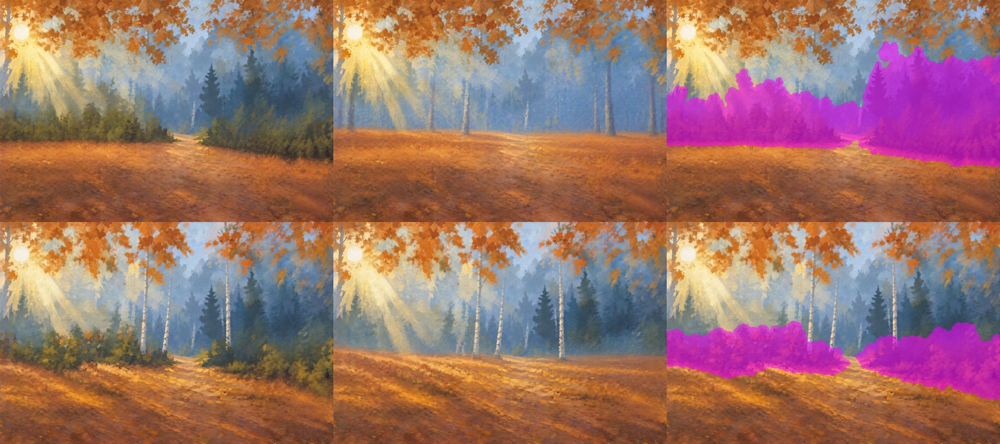
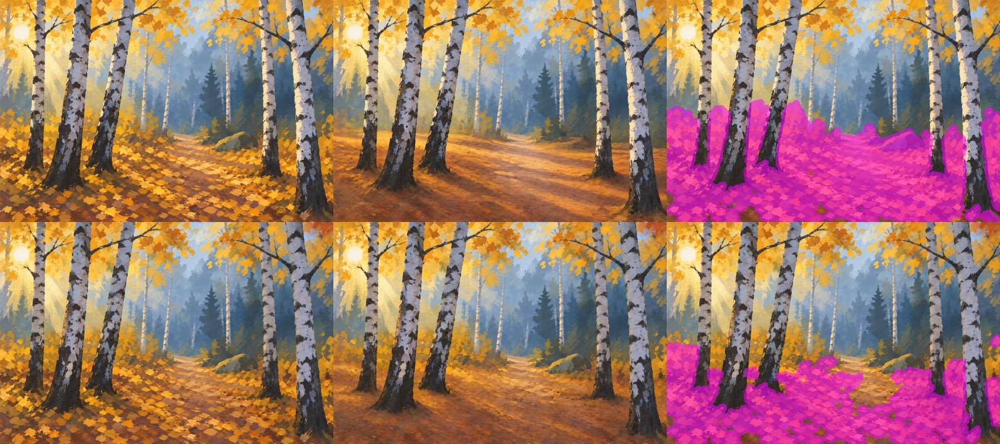
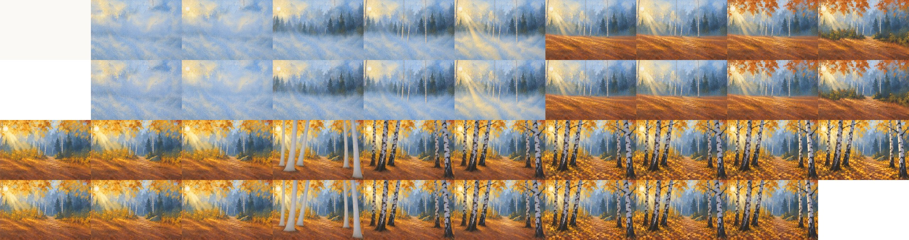

# Spike: a render changes what it wasn't asked to, and nothing catches it (#218)

2026-11-18. From #214 (`docs/spikes/v3-combined-round2.md`): v3's chain has no outlines, so its guard keeps any
big change a render makes, wherever it is. The birch grove needed four sentences written by hand after looking at
renders. This spike put what stays into the requests, made the birch grove's chain again with no hand-written
sentence, and tried to build two checks with no outline. The code is `spike/experiments/v3_combined.py` (`--stays`)
and `spike/experiments/v3_stays.py`, the numbers `spike/experiments/v3_stays.json`, the checker's brief
`spike/experiments/v3_stays_checker.md`. It is experiment code: no lesson tool, the skill, or the site changed.

**Verdict: adopt the requests and the look; the stray check by measure is dropped.**

- **Requests that name what stays: adopt.** The birch grove's chain, made again with none of the four `say`
  sentences, held: blind checkers marked no stray change in its 18 renders. In #214's 18 kept renders of the same
  picture they marked two strays nobody had listed, and they marked the two known ones among its thrown renders
  and its probe. One picture, one chain.
- **A check for a thing left standing: adopt as a report.** One measure, no outline. It flags the one known bad
  render (the firs left standing) and none of the other 47 it applies to. That is one example, and its line was
  set on the same renders. It does not see a faint thing left in part (the far trunks).
- **A check for stray changes by measure: drop.** Five measures were tried and none tells the three known bad
  renders from good ones. In its place: one look picture a unit, read by a checker in a fresh context with the list
  of what stays. Blind, it caught two of the three known strays and found two real ones in #214's kept chain. It
  missed the cow's tall grass, and seven of its nine other marks were not looked at again, so how often it marks
  wrongly isn't known.

So a chain can run with nobody watching more safely than before, and not safely yet: one of three known strays
gets past everything here.

## The requests

A "behind" request (remove a thing, paint what is behind it) now ends with: all of the thing goes, "every part of
it and every one of them, the dark, the faint and the small ones too"; then every other thing already painted, by
name, which "stay exactly as they are, wherever they can be seen now", and "no new trunk, tree, branch, bush, rock
or animal anywhere in the painting". A "back" request (take a layer off a thing) ends with the same list: "Nothing
else in the painting is touched." The names are the ones the rest of the request uses. Nothing is written by hand:
the list is the things of the units before this one. The requests are in `v3_stays.json` (`chain_218`).

Without `--stays` the requests are as they were, word for word, so #214's kept renders still match theirs.

**The birch grove's chain again:** 18 renders, 33.7 cents, 243 seconds, no render made again (#214: 18 kept and 10
made again, 50.3 cents). Nothing in the chain asks again for a stray, so "none made again" says only that the
left-standing report didn't fire; that the requests held is the checkers' reading. Where #214 needed a sentence:

| #214's sentence by hand | What #218's render did with none |
|---|---|
| The bushes: the far firs and trunks stay, no new trunk | The bushes went; the woods behind stayed |
| The fallen leaves: the rock and the bushes behind it stay | The leaves went; the rock stayed |
| The canopy: only open sky where the leaves were | No checker marked it |
| The far firs: every fir goes, the dark ones too | Every fir went on the first try |

**What didn't hold in it:**

- The far trunks were left in part (a checker marked it: the top of a tall trunk and a small one still stand).
  #214's kept render of the same unit was marked for the same thing. This is the faint-things fault.
- The rock's moss unit (step 20) changed nothing the guard kept (0.0% of the canvas; 0.7% in #214).

No lesson was built from this chain and no grader saw it. "Held" means the chain's own pictures.

## The checks, over every render at hand

77 renders: #214's three chains (48 kept), the birch grove's 10 thrown renders and its leaves probe, and #218's 18.
Four are known bad from #214's write-up: three strays (the bushes' first render, the leaves' probe, the cow's tall
grass) and one left standing (the far firs' render in the second chain, `thrown09_U02`). The other 73 are counted as good, which the checkers
showed is not quite true.

### Stray changes: five measures, none works

| Measure | What it is | How the known strays rank among the 73 others |
|---|---|---|
| Pieces apart | the share of the change not joined to its biggest piece | bushes 0.000 (lowest there is), leaves 0.026, cow 0.029; 18 others are at or over the cow, up to 0.236 |
| Weak pieces | of those, the ones that changed only a little | cow 0.016; 3 others at or over it, up to 0.131; bushes 0, leaves 0.001 |
| Off color | changed places whose paint was far from every paint the unit lays | 0.012, 0.006, 0.007; 21 to 27 others at or over each, up to 0.175 |
| On another thing | for a unit that comes back to a thing: the change that lands where another thing's unit was on top (needs the whole chain) | cow 0.010; good units of that kind run to 0.110 |
| Most of another core | the most of any earlier unit's core a change covers (needs the whole chain) | bushes 0.229 against 0.208 for the good render of the same unit; good units reach 1.0 |

Why: the bushes' stray is one solid piece joined to the bushes, in colors as near the bushes' paint as the bushes
are, on things the request itself names as behind. Only its size differs, and the plan gives no size. The cow's
hillside and meadow are one unit, so a change on the hillside is on the tall grass's own thing. Trees and leaves
are many pieces by nature.

A small vision model was also tried as the reader (gpt-5-mini, and two of the misses again on gpt-5.5; three
prompts): it caught the bushes and the firs left standing, and missed the rock and the cow each time. Not kept.

### The look, read blind

`looks` writes one picture a unit (before, after, the change tinted) and what the unit was asked for and what
stays. Four checkers, each in a fresh context on Opus with `v3_stays_checker.md`, read the 77 looks in four
folders outside the repository (`/tmp/g218/`), named r01, r02, ... in a seeded shuffle, with nothing that says
which render is which. The key was moved to another folder by hand before any checker started (the code writes it beside the folders).
A folder holds several renders of one unit (kept, thrown, #218's), so a checker could compare them; that shows
they are different tries, not which is bad.

| | Known bad | Marked | Others marked |
|---|---|---|---|
| Stray | 3 | 2 (the bushes, the leaves and rock) | 5 of 73 |
| Left standing | 1 | 1 (the far firs) | 4 of 73 |

- **Missed:** the cow's tall grass. Its checker saw dark patches go beside the cow and took them for grass blades.
- **The 5 others marked stray:** two are #214's kept sun-rays render and the thrown one of the same unit: the sun
  went with the rays. One is #214's kept render that removed the near birches: the far pale trunks went with them.
  I looked at those two kept renders and both are real: #214's lesson was built on them. The last two are the
  cat's (the sill's front face, treetops in a pane), which their checker called close; not looked at further.
- **The 4 others marked left:** three are the far trunks (#214's kept and thrown renders and #218's), which #214's
  write-up already says were erased only in part. One is a thrown render of the path.
- **On #218's chain:** no stray marked in 18 renders, one left (the far trunks).

One checker a look, one round. The checkers enlarged crops when unsure. About 100,000 tokens a folder of 14 to 24
looks.

### A thing left standing: one measure

`left_standing`: just outside what a render removed, the share of the canvas that still looks like what was
removed and not like what took its place, each pixel compared with the picture nearby. For a thing that goes
("bare" and "behind", 48 of the 77 renders). At 2% of the canvas or more the unit is reported (`ask_again` in
`erase.json`).

- The far firs' first render: 3.65%. The next highest of the other 47: 1.42%. One flagged, rightly; none wrongly.
- It does not see the far trunks left in part (0.00% to 0.13%): thin, faint things leave nothing a band can
  measure. The checkers' eyes did.
- On a layer that comes off ("back") it reads high on good renders, so it isn't used there.
- **How often it fires:** on 1 of 48. It did not fire on #218's chain.

## What the design gets from this

- **A "behind" and a "back" request name what stays** (section 6). One chain, one picture.
- **Step 5 is a checker with a look a unit and the list of what stays,** not Claude reading the chain sheet at
  256 pixels a cell. It found two strays in #214's kept chain that the sheet, the stage writers and the graders
  did not name.
- **`erase` reports a thing left standing.**
- **Open:** a stray on a thing painted in the same unit as the one that changes (the cow's hillside and meadow);
  a size for each thing in the plan, which is the one thing that would have told the bushes' stray by measure;
  faint things left in part.

## Limits

- The requests were tried on one picture, once. The cow's and the cat's chains were not made again, so nothing
  here says the new "back" request stops the tall grass redrawing the bushes.
- The line for left standing (2%) was set on the same renders it is scored on, with one bad render to find.
- The checkers are Claude, one a look. "Others marked" mixes real faults nobody had listed with wrong marks, and
  only two of the nine were looked at again.
- No lesson was built from #218's chain: way 4 of #217 and the step pictures were not run on it.

## Spend

The chain: 33.7 cents. The vision-model trials: about 35 small calls, not metered by the tools; by their token
counts a few cents, under 10. Under the issue's 50 cents.

## Running it

    python spike/experiments/v3_combined.py --stays units birch-grove --prompts   # the requests; no render
    python spike/experiments/v3_combined.py --stays erase birch-grove             # PAID: the chain, in runs/stays/
    python spike/experiments/v3_combined.py --stays looks birch-grove             # a look a unit, and asked.json
    python spike/experiments/v3_stays.py check-folders <a folder outside the repo>
    python spike/experiments/v3_stays.py results <that folder>                    # writes v3_stays.json

The measures and the blind round need #214's run folders (`runs/combined/`, git-ignored), thrown renders included.
