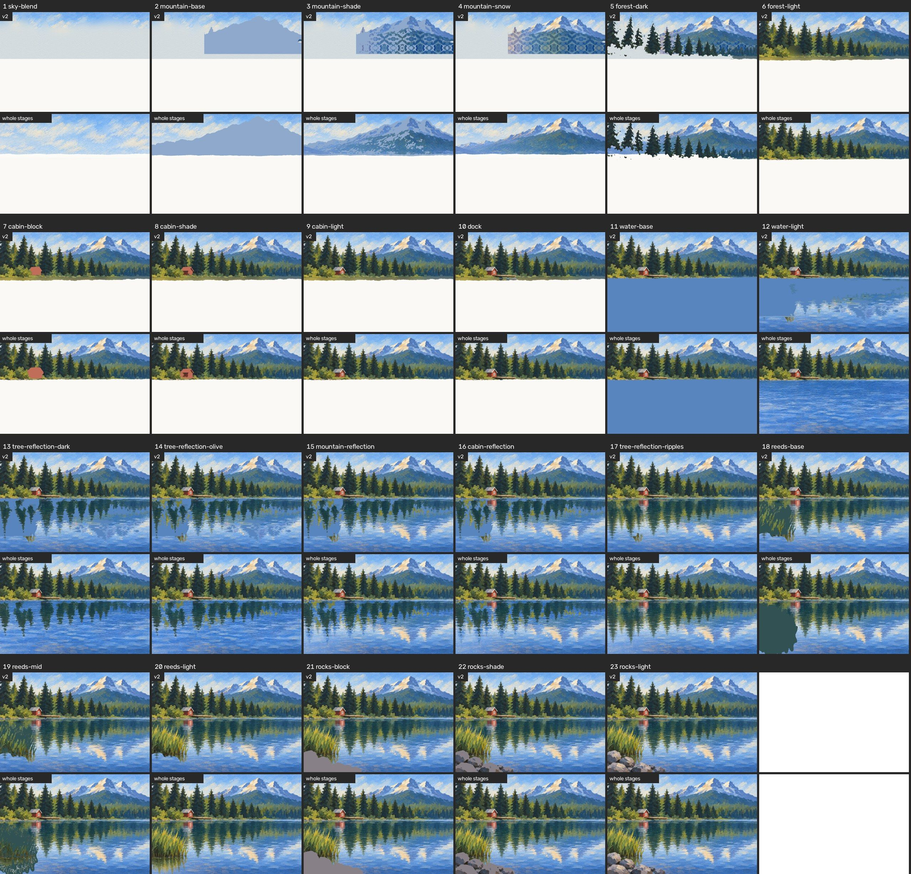
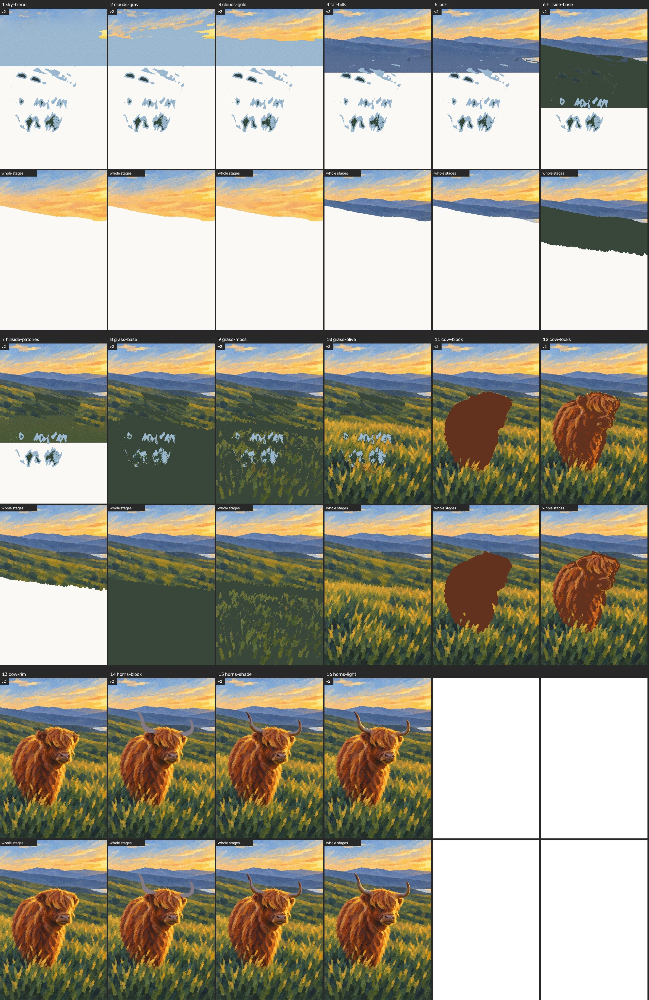
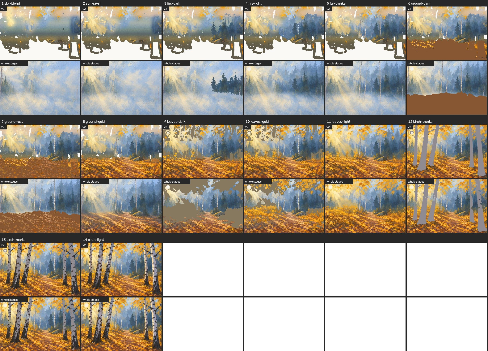
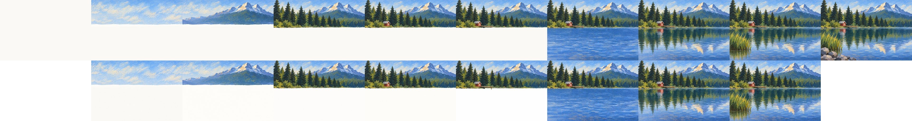
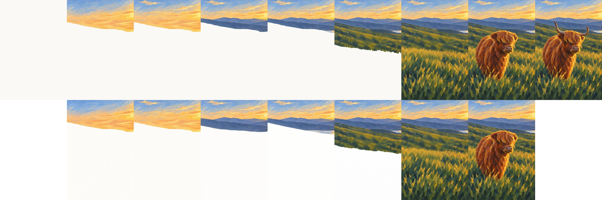
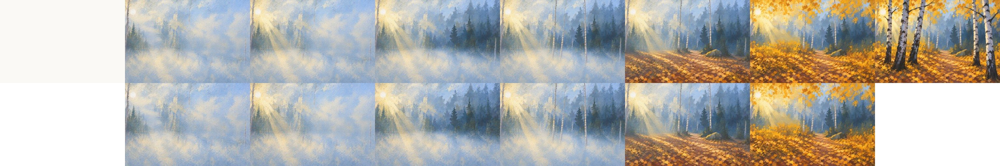
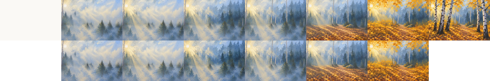

# Spike: whole-picture stages (#204)

2026-11-17. The owner's idea (#203 and #204, merged): erase things from the finish one at a time, and show the erased
pictures themselves as the pictures a lesson's stages end on. The code is `spike/experiments/v3_whole_stages.py`, its
numbers `spike/experiments/v3_whole_stages.json`, its tests `spike/tests/test_v3_whole_stages.py`, the grades
`spike/experiments/bench/scores/s204-whole.json`. It is experiment code: no lesson tool, the skill, or the site
changed.

**Verdict: adopt** whole-picture stages for the v3 design. Claude's blind graders preferred the whole-stages lesson
on all three pictures, both graders each time: five clearly, one slightly (section 5). It lost on none. The owner
looked at the lake cabin's step sheet after stage 1 and said go. These are Claude's grades, not the owner's
(`docs/decisions.md`), and nothing here becomes the pipeline until the v3 gate.

What the pictures and the numbers say:

- **Erasing backward, chained, with a guard that needs no outline, works.** 21 kept renders across three pictures.
  No step changes a pixel outside what its thing adds, and the last picture is the finish, both by construction.
- **It removes the faults the owner marked down hardest.** The blotches where the cow will stand, the tiled pattern
  on the mountain, the "blobby mess" under the birch grove, the pale hole in the lake: all gone. Every grader named
  these as what sank v2.
- **The lake cabin and the highland cow needed no redo.** 15 renders, first answer kept each time.
- **The birch grove needed three tries at its back layers** and is still not clean: the model painted firs in the mist
  where the ground had been until the request named what is behind, and step 1 still shows faint firs and trunks it
  would not remove. Both birch graders listed step 1 among the worst.
- **What a step shows inside its own thing is still v2's,** with v2's faults: big jumps (flat to finished in a step),
  and a face that appears on a step that names a gold. Graders marked both sides down for these.
- **New fault: a first step that shows too much.** Erasing the cow's clouds or the birch grove's far trunks removed
  little, so step 1 arrives nearly finished and the steps after it change almost nothing.
- **It costs 6 to 8 low renders a lesson,** 11 to 14 cents and 83 to 115 seconds one after another, where v2 spends
  about 2 cents on one background render.

## 1. What was tried

- **Units.** A part of the plan with steps of its own is a unit; parts whose steps interleave (the three
  reflections) are one. Units are in painting order.
- **Erase backward from the frozen finish, chained.** The last unit first, each render made from the last picture.
  P[u] is the picture with every unit after u erased.
- **Behind or bare.** A unit with most of its loose box outside what the earlier wide areas cover has only canvas
  behind it (the lake, the cow's hillside and grass): its render is asked for bare white canvas, and that canvas
  stays bare in every earlier picture. Every other unit's render paints what is behind it.
- **The guard, with no outline.** Of each render only the patches that changed by a lot are kept: every patch that
  changed by 9 Lab units or more and holds a pixel, inside the plan's loose box, that changed by 20 or more
  (`diff_mask`). Every other pixel stays as it was. The baseline run's outlines are read only to measure.
- **Steps inside a unit are v2's** flat coat and nearest-paint passes, cut from P[u]. They go on the thing itself:
  where the change is strong in a solid patch (`core_mask`). A unit's last step lays the whole change, so the
  picture after it is P[u] exactly.

Same plan, paints, steps and words as each baseline run. Three pictures: the lake cabin (stage 1), then the highland
cow and the birch grove.

## 2. The pictures

v2 above, whole stages below, every step.

The chains: top row, bare canvas and then the picture after each unit is added; bottom row, the raw renders.

## 3. The guard

| Picture | Thing erased | Changed (share of picture) | Same place as v2's outline (IoU) | Render moved outside the change |
|---|---|---|---|---|
| lake cabin | rocks | 5.3% | 0.88 | 5.0% |
| | reeds | 10.7% | 0.39 | 3.9% |
| | reflections | 48.0% | 0.41 | 5.1% |
| | lake (bare) | 54.5% | 0.46 | 3.7% |
| | dock | 0.7% | 0.44 | 4.1% |
| | cabin | 1.0% | 0.54 | 7.1% |
| | forest | 25.8% | 0.84 | 3.3% |
| | mountain | 24.6% | 0.27 | 2.4% |
| highland cow | horns | 2.2% | 0.49 | 2.7% |
| | cow | 24.5% | 0.83 | 2.9% |
| | grass (bare) | 50.5% | 0.75 | 1.1% |
| | hillside (bare) | 21.7% | 0.54 | 0.8% |
| | loch | 1.2% | 0.19 | 0.6% |
| | far hills | 10.3% | 0.83 | 0.5% |
| | clouds | 8.4% | 0.36 | 0.6% |
| birch grove | birches | 34.1% | 0.66 | 1.9% |
| | foliage | 80.5% | 0.18 | 1.1% |
| | ground (redo) | 43.6% | 0.57 | 0.7% |
| | far trunks | 5.3% | 0.21 | 1.5% |
| | far forest (redo) | 33.4% | 0.30 | 0.3% |
| | sun rays (redo) | 12.6% | 0.17 | 0.0% |

- **Nothing moves outside what a step adds:** 0.00% on every step of all three, and the built last picture is the
  finish. The raw renders moved 0 to 7% of the pixels outside the change; the guard threw that away.
- **A low IoU is not a fault by itself.** The change is often bigger than v2's outline for a good reason: a thing
  takes its reflection with it, the lake is the whole lower canvas, the mountain is whole behind the forest. It is a
  fault where the change is the render painting something else again: the foliage's 80.5% is mostly the forest floor
  drawn again with fewer leaves.
- **The guard was changed three times, each for a fault seen on a sheet:**
  1. The plan's box for the lake cabin's mountain stops short of its left end, and "keep nothing outside the box"
     left that end standing. The box now says where a change must start, not where it must end.
  2. The reeds' flat coat covered their reflection, and the birch leaves' flat coat covered the whole forest floor.
     Flat coats and passes now go on the core of the change only.
  3. A request made again names what is behind (section 4).
- **Still open:** the guard has four set numbers (9, 20, the 15-pixel core, the blur). None is named after a picture,
  but all were set on these three.

## 4. Renders that failed

- **Firs in the mist (birch grove, ground).** Asked to remove the ground and "continue what is around", the model
  painted misty firs where the ground was. Adding "paint no new thing there" did the same. Naming what is behind
  ("Behind them there is only this: Misty sky and haze") gave plain mist at low quality on the first try. `--redo`
  makes a unit's request with that sentence; the birch grove's ground, far forest and sun rays use it.
  
- **Things the model would not remove.** The birch grove's far trunks (44% of v2's outline of them unchanged) and
  some far firs at the left; the highland cow's clouds (49% unchanged). These are faint, soft things on a sky. What
  is left shows in step 1.
- **Redo count:** 3 of 21 kept renders are redos, all on the birch grove. 10 more renders were thrown away getting
  there (the first two tries and two probes).

## 5. The A/B

Round `s204-whole`: each baseline lesson against the same lesson with whole-stages step pictures. Same plan, paints
and words on both sides; the words weren't rewritten for the new pictures. Two graders a picture on Opus, in a
fresh context, by `spike/experiments/bench/ab_grader.md`, sides swapped for the second, folders named `pair-NN`.
real / paintable / agree, each 1 to 5.

| Picture | Grader | v2 | Whole stages | Prefers | How sure |
|---|---|---|---|---|---|
| lake cabin | g1 | 2 / 2 / 2 | 4 / 3 / 4 | whole stages | clear |
| | g2 | 2 / 3 / 2 | 3 / 3 / 3 | whole stages | clear |
| highland cow | g1 | 2 / 3 / 2 | 4 / 3 / 3 | whole stages | clear |
| | g2 | 1 / 2 / 2 | 3 / 2 / 2 | whole stages | clear |
| birch grove | g1 | 1 / 2 / 2 | 3 / 3 / 3 | whole stages | clear |
| | g2 | 2 / 2 / 2 | 3 / 3 / 2 | whole stages | slight |

- **Whole stages won all three pictures and lost none.** "real" rose on every one of the six grades, by 1 to 2
  points. "paintable" and "agree" rose or held: the words are the same on both sides.
- **What sank v2, in every grader's notes:** something on the canvas before its step (the cow's blotches through
  ten steps, the reeds and the mountain's reflection early), and patches no brush makes (the tiled mountain, hard
  boxes, white holes).
- **What the graders marked down on the whole-stages side:**
  - Big jumps: the lake cabin's steps 3, 4 and 6, the birch grove's step 8 (the ground finished at once, with a rock
    and bushes no words cover) and step 11.
  - A first step that shows too much: the cow's step 1 is the finished sunset, so steps 2 and 3 change almost
    nothing; the birch grove's step 1 has ghost firs, trunks and a sun, and not the gold-to-brown blend its words ask
    for.
  - Flat blobs: the lake cabin's mountain at step 2 and reeds at step 18, the birch grove's olive slab at step 9.
  - Small pale dots on the rocks, steps 21 and 22.
- **Both sides:** the cow's face appears at step 13, which names only a gold.
- **The graders stayed blind.** No grader's transcript opens the key or the repository.

## 6. Cost and time

| Picture | Steps | Kept renders | Cost | Render seconds, one after another |
|---|---|---|---|---|
| lake cabin | 23 | 8 | 14.1 cents | 115 |
| highland cow | 16 | 7 | 12.3 cents | 93 |
| birch grove | 14 | 6 | 10.7 cents | 83 |

- **Spend:** 31 low and medium renders, 55 cents: 37 cents kept, 18 cents thrown away on the birch grove. Under the
  $2 the issue allows.
- A chain can't run all at once, so its time grows with the number of things: 12 to 17 seconds a render.

## 7. Limits

- **Claude graded, not the owner.** On S4 (#169) Claude liked rendered stages and the owner preferred v2. Here the
  owner saw one of the three sheets (the lake cabin, before the flat-coat change) and said go.
- **Three pictures,** two of them picked because the peel changed nothing there. The sleeping cat and the four
  easier bench pictures weren't run.
- **The words don't fit the new pictures yet.** A sky that arrives finished in step 1 disagrees with words that
  describe a blend.
- **The plan is v2's.** The adopted plan-first plan (#172) names more things, so its chain would be longer.

## 8. Not done

- **The forward arm** (paint the background, then add each thing) and the **"inspired, not a copy"** arm. The
  backward form won, so neither was needed to decide; both remain open if the v3 design wants a finish that isn't
  cut from one render.
- **A second edit model.** The place it would earn its cost is the faint things gpt-image won't remove (section 4).
  It needs a new host allowed and a key.
- **Stages inside a thing.** The biggest faults left on the whole-stages side are v2's own. A chain that erases a
  thing's detail before the thing (its highlights, then its texture) is the same tool pointed one level down; S4
  (#169) tried that with separate renders and no guard of this kind.
- **Fault counts** by a fresh counter.

## Running it

    python spike/experiments/v3_whole_stages.py units lake-cabin              # the things, in order; no render
    python spike/experiments/v3_whole_stages.py erase lake-cabin              # PAID: one low render a thing, chained
    python spike/experiments/v3_whole_stages.py erase birch-grove --redo 4,2,1
    python spike/experiments/v3_whole_stages.py build lake-cabin              # step pictures and the sheet beside v2's
    python spike/experiments/v3_whole_stages.py grade lake-cabin,highland-cow,birch-grove --out <folder outside the repo>

It reads the baseline runs from `/home/user/gesso-baseline/output` and writes under
`spike/experiments/bench/runs/whole/` (git-ignored). A render already in its folder is kept.
