# The balloon lavender as a v3.1 lesson (the combined lesson)

The whole lesson as a painter would read it, made the way `docs/design/pipeline-v3.1.md` describes (section 12, step 1). The pictures are v3's. How it was made and what it cost: [v31-combined.md](v31-combined.md).

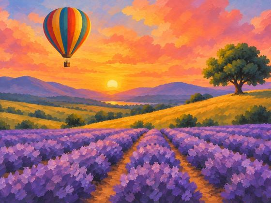

Canvas: 16 in wide, 12 in tall. 24 steps.

## Before you start

You are about to paint a striped hot-air balloon drifting over a sunset valley, with violet mountains, golden hills, a lone tree and rows of lavender running away from you. The balloon is the star, and the lavender rows lead your eye back toward the low sun. The mood is a warm, glowing evening, where every color is touched by sunset light.

**The light:** The setting sun is in the painting itself, just touching the mountains, and it shines toward you. Whatever faces it glows: the cloud edges, the sunny side of the tree and bushes, the tips of the lavender, and the sunny side of the balloon. Whatever turns away from it falls into soft shade.

**What this painting teaches:**

- **Side-to-side blend** (steps 1, 8, 14): You stroke one color side to side, then pick up the next without rinsing and stroke back over the join while both are wet. It makes the whole sunset sky, the rolling hills and the purple field, so most of the canvas starts this way. Watch for a hard line where two colors meet: add more of the lighter color there and blend again.
- **Dry brush** (steps 3, 9, 23): Only the tip of a stiff brush touches the paint, with no water, and you skim it lightly so the marks break up over the canvas texture. It puts the sunset glow on the cloud edges, the sunlit grass on the hills and the light on the balloon. If it goes on solid, the brush was too loaded: let it dry, then dry-brush the color it covered back over part of it.
- **Stamp** (steps 16, 17, 18): You press the end of a flat brush straight down to make short, blunt blocks of color, side by side in rows. It builds the whole lavender field, dark first, then middle, then a few pale tips. The one rule is to leave the darker stamps showing, because light over dark is what gives the rows depth.

**The way there:** We paint from the back of the scene to the front, each layer over a dry one. First comes the sunset sky with its clouds and sun, because it is farthest away. Next the far violet mountains and the little lake, then the golden hills, then the lone tree and the bushes on them. The lavender field comes after, laid as one dark purple and then stamped into rows aimed at one point. The striped balloon, the star of the painting, goes on last over the dry sky, so you can give it your full attention and it stays crisp.

## The sunset sky

*This stage lays the farthest thing first: a blended sunset sky with glowing clouds and a pale sun.*

### Step 1: Blend the sunset sky

**Paints:** Sky blue (2 parts white, 1 part ultramarine, a touch of red); Sunset orange (3 parts red, 2 parts yellow, 1 part white); Warm gold (1 part yellow, 1 part burnt sienna, a touch of red)

**Brush:** 2 inch wide flat

- **Start:** Start with Sky blue along the top edge of the canvas, in one long band from the left edge to the right edge.
- **Strokes:** Stroke side to side, edge to edge. Without rinsing, pick up Sunset orange and paint under the blue, then Warm gold, and stroke back over each join while it is wet.
- **Where the paint sits:** Keep the blue a band about 1 3/4 in tall at the top of the sunset sky. Orange fills the rest of the canvas, with gold glowing in a soft column down the middle and a faint blue streak halfway down.
- **Leave:** Leave no white canvas. The sunset sky runs all the way to the bottom edge, so every stroke can stay long.
- **Stop when:** The whole canvas is covered: blue at the top, orange below, a gold glow down the middle, and soft joins. A hard line where two colors meet? Add more of the lighter color and blend again.

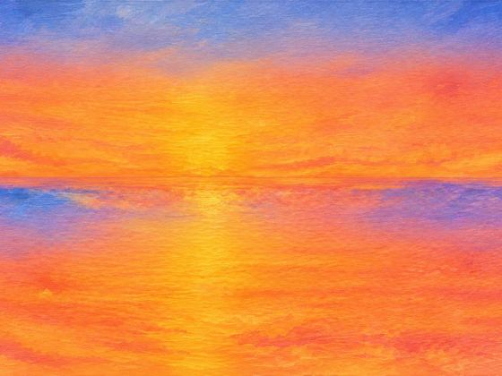

### Step 2: Lay in the coral clouds

**Paints:** Coral red (2 parts red, 1 part white, a touch of ultramarine)

**Brush:** #10 round

- **First:** The sky from step 1 must be completely dry.
- **Start:** Start with the biggest cloud. It touches the top edge, and its left side is about 8 in from the left edge.
- **Strokes:** Work Coral red in small circles with the tip of the brush, so each cloud gets a bumpy top and a soft edge. Keep the undersides flatter.
- **Where the paint sits:** Most of it is on the right side of the sunset sky. There is one big mass at the top edge, another big mass across the middle of the canvas, and smaller puffs at the left edge.
- **Leave:** Leave plenty of blue and orange sky showing between the clouds, with a few small sky holes in each big cloud.
- **Stop when:** Soft, flat coral-red clouds with bumpy edges float at the top and across the middle, with no lit edges yet. Edges too hard? Soften them with lighter circling passes.

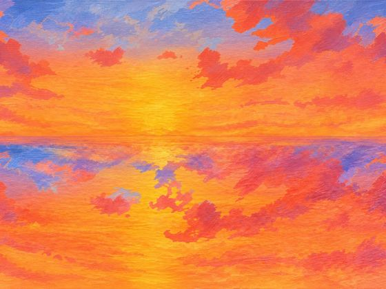

### Step 3: Light the cloud edges facing the sun

**Paints:** Sunset orange (3 parts red, 2 parts yellow, 1 part white); Warm gold (1 part yellow, 1 part burnt sienna, a touch of red)

**Brush:** 1/2 inch old stiff flat

- **First:** The coral clouds from step 2 must be dry.
- **Start:** Start on the lower edges of the clouds at the left edge of the canvas.
- **Strokes:** Dip only the tip of the dry stiff brush in Sunset orange or Warm gold and wipe it. Skim lightly along each cloud, and build up in several light passes.
- **Where the paint sits:** Most of it is on the left side of the sunset clouds. It goes on their undersides and the parts facing the gold glow, because the low sun lights them from below.
- **Leave:** Leave coral in the middle of each cloud and on most of the big cloud at the top edge. Keep the blue gaps clear.
- **Stop when:** The clouds glow orange and gold along their lower edges, broken and feathery, with coral still inside. Did it go on solid? Let it dry, then dry-brush coral back over part of it.

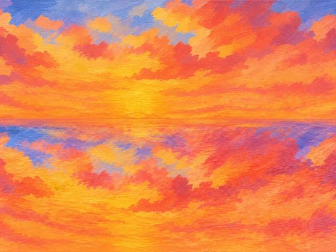

### Step 4: Paint the sun disk

**Paints:** Pale sun yellow (6 parts white, 3 parts yellow, 1 part red)

**Brush:** #6 round

- **First:** The clouds and sky must be dry.
- **Start:** Start at the sun's middle, about 6 1/2 in from the left edge. The top of the sun is about 4 3/4 in from the top edge.
- **As in step 2:** These are the same small circles you used for the bumpy clouds in step 2. This time you use a smaller brush and keep circling until the shape is round and smooth.
- **Strokes:** Work Pale sun yellow in small circles, moving outward from the middle, until the disk is about 3/4 in wide.
- **Where the paint sits:** Keep the disk solid and smooth, the brightest thing in the sky. Where the sky meets the faint horizon streak, add a few short, level dashes for the sun's glow.
- **Leave:** Leave the gold sky glowing around the disk. Don't paint a ring around it.
- **Stop when:** A small, round, pale cream sun sits low in the gold glow, with a short reflection of dashes. Lumpy circle? Keep circling until it is round.

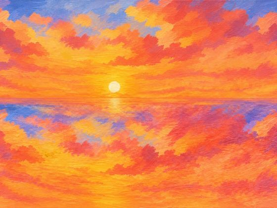

*Where this stage ends:* A blazing sunset fills the whole canvas: blue sky, coral clouds lit with orange and gold, and a small pale sun glowing low in the gold.

## The far mountains and lake

*This stage sets the horizon with soft violet mountains and a thin lake catching the sun.*

### Step 5: Lay in the violet mountains

**Paints:** Hill violet (4 parts white, 3 parts ultramarine, 1 part burnt sienna)

**Brush:** 3/4 inch flat

- **First:** The sun disk must be dry.
- **Start:** Start at the top of the first peak near the left edge of the canvas. The highest peaks reach about 4 1/2 in from the top edge.
- **Strokes:** Pull Hill violet in curved strokes down each slope. Paint two peaks near the left edge, dip down to the sun, then make a long ridge running to the right edge.
- **Where the paint sits:** Fill the far violet mountains as one flat color, about 1 3/4 in tall. End them in a straight, level bottom edge that runs from the left edge to the right edge.
- **Leave:** Leave the whole sun disk showing. The dip in the range just touches its bottom.
- **Stop when:** A flat, soft violet range runs across the canvas below the setting sun, with no darker ridges. Keep the bottom level, because the lake sits there.

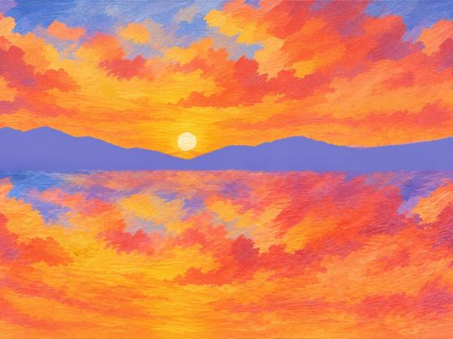

### Step 6: Darken the lower ridges

**Paints:** Deep violet (1 part ultramarine, 1 part white, a touch of red)

**Brush:** 3/4 inch flat

- **First:** The violet mountains from step 5 must be dry.
- **Start:** Start at the left edge of the canvas, along the lower part of the far violet mountains.
- **Strokes:** Keep the brush level and pull long Deep violet strokes left and right. Lift off where each slope rises toward its peak.
- **Where the paint sits:** Most of it is on the right side of the darker mountain ridges. It goes on the slopes facing you and the low ridges in front, which are shaded because the sun is behind them. Add a low third ridge reaching the right edge.
- **Leave:** Leave paler violet along the peaks on either side of the sun, so the far peaks stay lighter. Keep the sun clear.
- **Stop when:** The mountains look layered, with darker, streaky ridges in front of paler peaks and a softer, broken bottom edge.

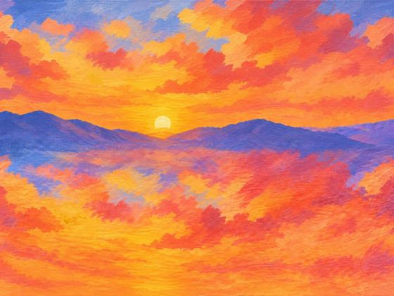

### Step 7: Streak in the little lake

**Paints:** Hill violet (4 parts white, 3 parts ultramarine, 1 part burnt sienna); Warm gold (1 part yellow, 1 part burnt sienna, a touch of red)

**Brush:** 1/2 inch flat

- **First:** The mountain ridges must be dry.
- **Start:** Start below the setting sun, at the foot of the far violet mountains, with Warm gold.
- **As in step 6:** These are the same level strokes you pulled across the ridges in step 6. Now they are shorter and flatter, and you blend two colors where they meet.
- **Strokes:** Keep the brush level and pull short, flat Warm gold strokes for the glint. Then pull Hill violet strokes outward from it, blending where they meet.
- **Where the paint sits:** The gold sits only in the middle of the little lake, under the sun. Hill violet makes dark, low shores on both sides of the glint, and the left shore runs out to the left edge of the canvas.
- **Leave:** Leave the darker mountain ridges showing above the lake, and the old sky streaks under it.
- **Stop when:** A thin strip about 7 in wide lies at the foot of the mountains: a bright gold glint between dark violet shores. Keep every streak level.

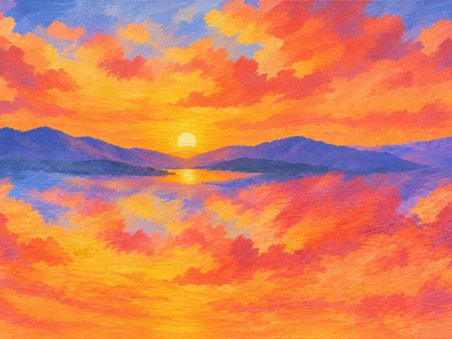

*Where this stage ends:* Layered violet mountains meet the setting sun, with a small lake glinting gold at their foot.

## The golden hills

*This stage rolls golden hills across the middle ground and gives the near slopes sunlit grass.*

### Step 8: Blend in the golden hills

**Paints:** Golden ochre (3 parts yellow, 2 parts burnt sienna, 1 part red, 1 part white); Olive green (3 parts burnt sienna, 2 parts yellow, a touch of ultramarine)

**Brush:** 3/4 inch wash brush

- **First:** The lake and mountains must be dry.
- **Start:** Start with Olive green along the foot of the far violet mountains. The top of the hills is about 5 1/4 in from the top edge.
- **As in step 1:** This is the same wet side-to-side blend you used for the sky in step 1. Now each sweep follows the swell of a hill instead of running straight across.
- **Strokes:** Stroke side to side in long sweeps that follow each hill's swell. Without rinsing, pick up Golden ochre for the crests, and stroke back over each join while it is wet.
- **Where the paint sits:** Golden ochre lights the crests and the big slope rising toward the right edge. Olive green fills the hollows where one hill tucks behind the next. Cover all the way to the bottom edge.
- **Leave:** Leave the lake's gold glint and the mountains clear.
- **Stop when:** Smooth rolling hills cover the whole bottom of the canvas: gold on the crests, olive in the hollows, no grass strokes. A hard line? Add more Golden ochre and blend again.

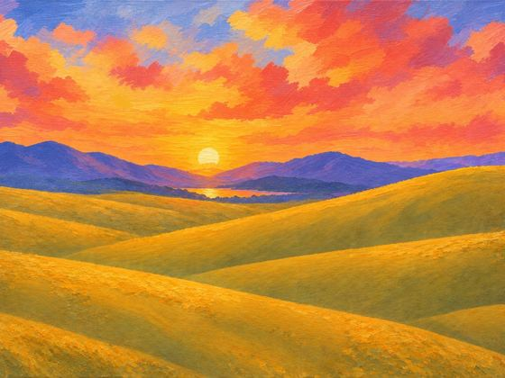

### Step 9: Dry-brush the sunlit grass

**Paints:** Warm gold (1 part yellow, 1 part burnt sienna, a touch of red)

**Brush:** 1/2 inch old stiff flat

- **First:** The hills from step 8 must be completely dry.
- **Start:** Start at the crest of the big slope that rises toward the right edge of the canvas.
- **As in step 3:** This is the same dry, skimming touch you used to light the cloud edges in step 3. Now the strokes are short and slope with the hills to look like grass.
- **Strokes:** Touch only the tip of the dry stiff brush in Warm gold and wipe it. Skim short strokes that follow the slope, in several light passes.
- **Where the paint sits:** Put it on the near hills, where the sun hits the grass: along the big middle slope, the lower slope near the right edge, and in broken patches near the bottom edge.
- **Leave:** Leave the far hills near the lake smooth. Leave olive showing in the hollows and between the strokes.
- **Stop when:** The near hills show broken, feathery light-gold grass, and the far hills stay smooth. Did it go on solid? Let it dry, then dry-brush the smooth gold from step 8 back over part of it.

*Where this stage ends:* Smooth golden hills with olive hollows roll away toward the mountains, the near slopes textured with feathery grass.

## The tree and bushes

*This stage plants the lone tree and the bushes, tapped dark first and then lit on their sunny side.*

### Step 10: Pull the tree trunk

**Paints:** Bark brown (3 parts ultramarine, 2 parts yellow, 2 parts red)

**Brush:** 1/4 inch angle

- **First:** The grass strokes must be dry.
- **Start:** Start at the base of the tree trunk, on the crest of the big slope near the right edge. Its middle is about 14 in from the left edge.
- **Strokes:** Press the full width of the angle brush for the base and pull upward. Then turn onto the edge and lighten your pressure, so each branch tapers to a point.
- **Where the paint sits:** Keep the trunk short and wide at the base, about 3/4 in tall, splitting into a few branches that fan up into the sky.
- **Leave:** Leave sky and mountain showing between the branches.
- **Stop when:** A small, dark brown trunk with forked, tapering branches stands on the hilltop. Branches all the same thickness? Lighten your pressure as you go up.

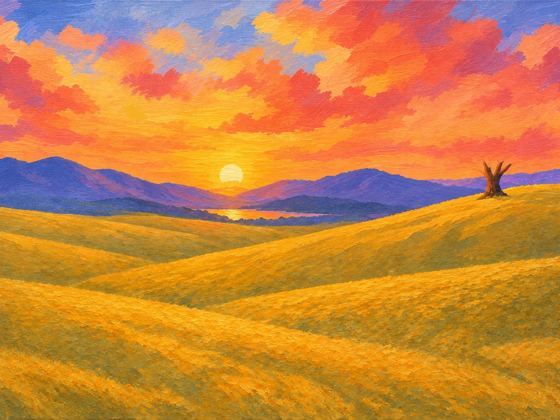

### Step 11: Dab the dark greens

**Paints:** Tree green (3 parts ultramarine, 1 part yellow, a touch of red)

**Brush:** old stiff round brush

- **First:** The trunk must be dry.
- **Start:** Start with the tree's canopy over the branches. Its top is about 2 3/4 in from the top edge.
- **Strokes:** Tap Tree green with the tip of the dry stiff brush. Build a rounded canopy about 3 3/4 in wide, then tap small clumps the same way.
- **Where the paint sits:** Most of it is on the right side of the tree's canopy and the bushes. Bushes sit as low clumps where each hill tucks behind the next, and a dark tree line runs along the far hills near the left edge.
- **Leave:** Leave sky showing through small gaps in the canopy, and keep the base of the trunk visible.
- **Stop when:** There is one flat, dark green canopy and scattered dark clumps over the hills, with no lighter leaves. Blobs instead of dots? Wipe paint off and tap again.

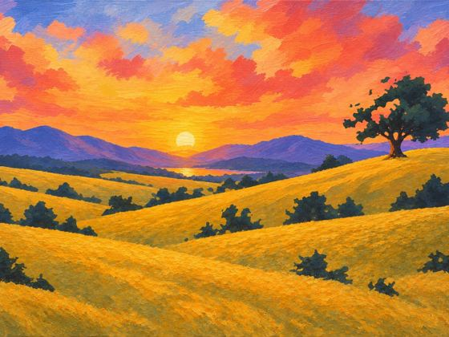

### Step 12: Dab the middle greens

**Paints:** Bark brown (3 parts ultramarine, 2 parts yellow, 2 parts red)

**Brush:** old stiff round brush

- **First:** The dark greens from step 11 must be dry.
- **Start:** Start on the bumpy outline of the nearest bush, where the light from behind catches its leaves.
- **As in step 11:** These are the same dry taps you used for the dark greens in step 11. Now you tap only along the outline of each clump, so the dark stays inside.
- **Strokes:** Tap Bark brown lightly with the tip of the dry stiff brush along the outline of each clump, following its bumps.
- **Where the paint sits:** Keep it on the rims of the bushes and the outline of the canopy, where the light from behind catches the leaves. Add a few taps along the dark tree line on the far hills.
- **Leave:** Leave the dark green from step 11 in the middle and at the base of every clump.
- **Stop when:** Each clump has a bumpy, lighter rim over its dark body. Don't cover the dark: tap only along the outline.

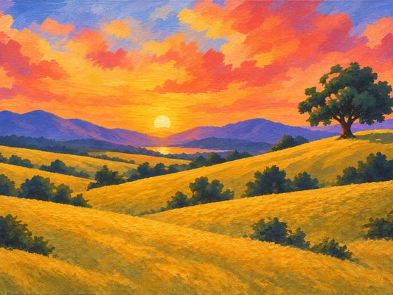

### Step 13: Tap the sunlit leaves

**Paints:** Sunlit green (3 parts burnt sienna, 2 parts yellow)

**Brush:** old stiff round brush

- **First:** The taps from step 12 must be dry.
- **Start:** Start on the top of the tree's canopy, on the side facing the sun.
- **As in step 11:** This is the same tapping you did in step 11, now with your lightest green and far fewer taps. Put them only where the sun would touch.
- **Strokes:** Tap Sunlit green lightly with the tip of the dry stiff brush, a few taps at a time, along the upper edges of each clump.
- **Where the paint sits:** Most of it is on the left side of the tree's canopy and the bushes: the canopy's sun side, the tops of the near bushes, and the far tree line near the left edge, which turns olive-gold.
- **Leave:** Leave the darker taps from steps 11 and 12 showing under and between the new ones.
- **Stop when:** A few light yellow-green leaves catch the sun, while most of each clump still reads dark. Did a patch go solid? Tap over it with the dark green from step 11.

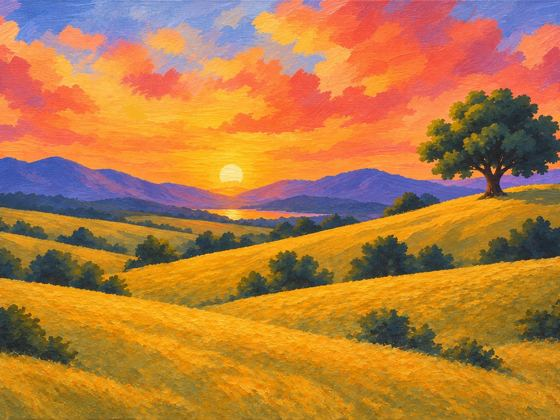

*Where this stage ends:* A leafy tree stands on the big golden slope, and dark bushes dot the hill folds, each catching a little sunlight.

## The lavender field

*This stage builds the lavender field in the foreground, with dirt paths and stamped rows that lead the eye back to the sun.*

### Step 14: Lay in the purple field

**Paints:** Lavender purple (2 parts ultramarine, 1 part white, a touch of red, a touch of burnt sienna); Shadow purple (1 part ultramarine, a touch of burnt sienna, a touch of white)

**Brush:** 2 inch wide flat

- **First:** The tree and bushes must be dry.
- **Start:** Start with Shadow purple along the bottom edge of the canvas, from the left edge to the right edge.
- **As in step 1:** This is the same wet blend you used for the sky in step 1, with the big wide brush again. This time the darker color goes in front and the lighter one at the back.
- **Strokes:** Stroke side to side, edge to edge. Without rinsing, pick up Lavender purple and work up the field, stroking back over the join while it is wet.
- **Where the paint sits:** Run the lavender field up over the lowest hills and bushes. Its top is about 7 1/4 in from the top edge, and the line can be slightly uneven. Keep it darker in front and lighter at the back.
- **Leave:** Leave the bushes along the far edge of the field poking up out of the purple, and the hills behind them.
- **Stop when:** The bottom of the canvas is a smooth purple field, darker in front, with no rows or paths. Let it dry fully.

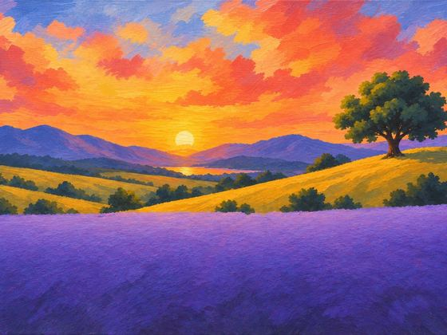

### Step 15: Pull in the dirt paths

**Paints:** Warm soil (2 parts red, 2 parts burnt sienna, 1 part yellow, 1 part white)

**Brush:** 1/2 inch flat

- **First:** The purple field must be dry.
- **Start:** Mark one dot at the far edge of the field, near the middle. Lightly draw two lines fanning from it down to the bottom edge.
- **Strokes:** Pull Warm soil along each line. Start thin at the dot and widen as you come down to the bottom edge, keeping the edges a little ragged.
- **Where the paint sits:** The two paths start about 8 in from the top edge and reach the bottom edge. The left path's left side is about 5 1/4 in from the left edge. Add a few small dots of soil near the left edge.
- **Leave:** Leave the purple field between the two paths and outside them.
- **Stop when:** Two warm orange-brown paths fan out from one point, thin at the back and wide in front. Paths running parallel? Mark the dot and the lines first.

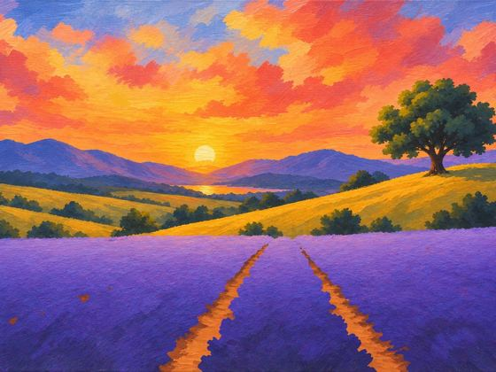

### Step 16: Stamp the dark lavender rows

**Paints:** Lavender purple (2 parts ultramarine, 1 part white, a touch of red, a touch of burnt sienna)

**Brush:** #12 bright

- **First:** The paths must be dry.
- **Start:** Start at the back of the lavender field, where the two paths come close together.
- **Strokes:** Stamp Lavender purple straight down with the end of the bright, side by side, so each row runs along a line toward the paths' dot.
- **Where the paint sits:** Fill every row, from the left edge to the right edge. Make small, tight stamps at the back, getting bigger and farther apart toward the bottom edge.
- **Leave:** Leave the dark field showing between the stamps, and keep the paths clear.
- **Stop when:** Rows of blunt purple stamps fan back between the paths, small at the back and big in front. Rows running flat across? Aim each one at the dot.

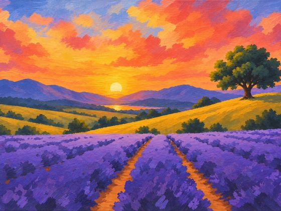

### Step 17: Stamp the middle lavender

**Paints:** Mid lavender (2 parts ultramarine, 2 parts white, 1 part red)

**Brush:** #12 bright

- **First:** The stamps from step 16 must be dry.
- **Start:** Start on the back rows near the left edge of the canvas.
- **As in step 16:** This is the same straight-down stamp you used in step 16, over the same rows. Now it uses a lighter mix and covers only the upper part of each row.
- **Strokes:** Wipe the brush, don't rinse it. Stamp Mid lavender straight down over the upper part of each row, following the row toward the dot.
- **Where the paint sits:** Most of it goes on the back half of the field and the tops of the front rows, where the light from behind catches the blooms.
- **Leave:** Leave the dark stamps from step 16 at the bottom of every row and between the stamps. That dark gives the rows depth.
- **Stop when:** The rows read mostly lighter lavender with dark underneath, and the paths stay clear. If the light pass covered the dark, leave more dark showing next time.

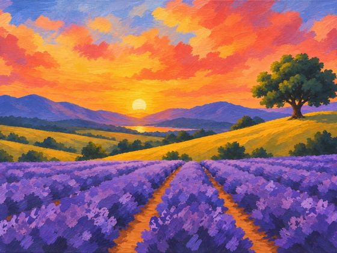

### Step 18: Tip the lavender tops with light

**Paints:** Pale lilac (2 parts white, 1 part red, 1 part ultramarine)

**Brush:** #12 bright

- **First:** The lavender from step 17 must be dry.
- **Start:** Start on the tops of the back rows, near the far ends of the paths.
- **As in step 17:** This is the same stamp as step 17, but much sparser. Just a few pale tips go on, so the darker lavender still does most of the work.
- **Strokes:** Wipe the brush, then stamp Pale lilac straight down, a few stamps at a time, along the top of each row.
- **Where the paint sits:** Most of it goes on the back half of the field and the center row between the paths. The front rows get only a few tips, where the light from behind catches them.
- **Leave:** Leave the mid and dark lavender under every tip, and keep the paths clear.
- **Stop when:** The tops of the rows sparkle with pale lilac over darker lavender. Keep the stamps separate, not a solid band.

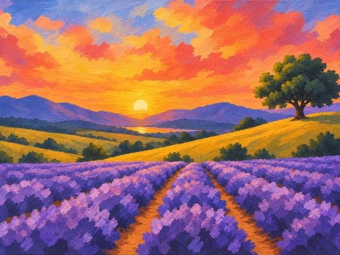

*Where this stage ends:* Rows of lavender, dark at their base and tipped with pale lilac, run back between two warm dirt paths.

## The hot-air balloon

*This stage adds the star of the painting: the striped balloon, shaded, lit and hung with its basket.*

### Step 19: Build the balloon shape

**Paints:** Warm gold (1 part yellow, 1 part burnt sienna, a touch of red)

**Brush:** 1/2 inch flat

- **First:** The sky must be dry.
- **Start:** Start with a center oval near the left edge. The balloon's top is about 1/4 in from the top edge, and its middle is about 4 in from the left edge.
- **Strokes:** Lay Warm gold as one oval. Then add curved pieces on each side, like ( ), so the round top narrows to a small neck at the bottom.
- **Where the paint sits:** Fill the hot-air balloon solid, about 3 in wide. Add a small dab under the neck where the basket will hang.
- **Leave:** Leave the clouds and sky around the balloon untouched, and keep its outline smooth and round.
- **Stop when:** A flat, warm gold balloon floats high in the sky, with no stripes. Soften where the pieces meet so it looks smooth.

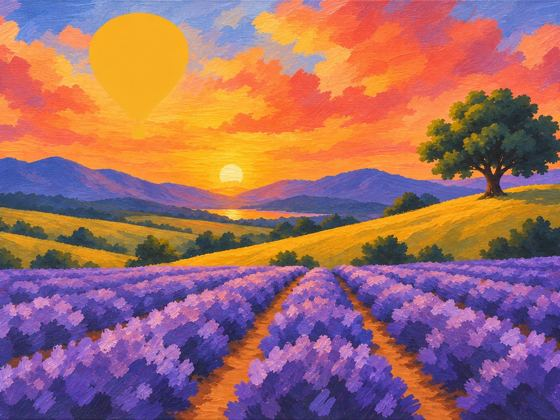

### Step 20: Paint the red stripes

**Paints:** Balloon red (1 part red, a touch of ultramarine)

**Brush:** #8 round

- **First:** The gold balloon must be dry.
- **Start:** Start at the top of the hot-air balloon with the center stripe. Its left side is about 4 in from the left edge.
- **As in step 5:** These are the same curved strokes you used down the mountain slopes in step 5. Now each one bends around the round balloon, from its top to the neck.
- **Strokes:** Pull Balloon red in curved strokes from the top down to the neck, bending each stripe with the balloon's round shape.
- **Where the paint sits:** Paint one long center stripe, a shorter broken stripe near the balloon's edge, and one curving down to the neck. Most of it is on the right side of the balloon's stripes, shading and basket.
- **Leave:** Leave wide gold bands between the red stripes.
- **Stop when:** Three thin, curved red stripes run down the gold balloon. Stripes looking straight? Curve them with the shape.

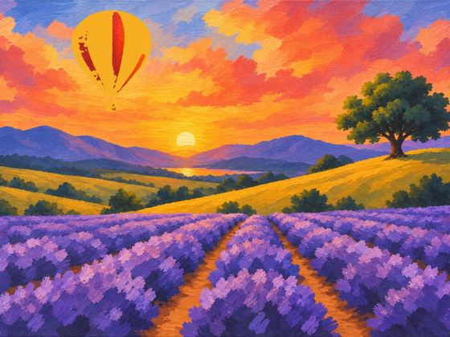

### Step 21: Paint the blue stripes

**Paints:** Balloon blue (4 parts white, 3 parts ultramarine, 1 part red)

**Brush:** #8 round

- **First:** The red stripes must be dry.
- **Start:** Start at one end of the balloon's top curve.
- **Strokes:** Pull Balloon blue in one curved stroke along the top edge of the hot-air balloon, following its round outline over to the other side.
- **Where the paint sits:** Keep it a thin cap only along the top of the balloon, about 2 3/4 in wide.
- **Leave:** Leave the rest of the balloon's gold and red untouched.
- **Stop when:** A thin blue rim caps the balloon's top curve, and everything else is unchanged.

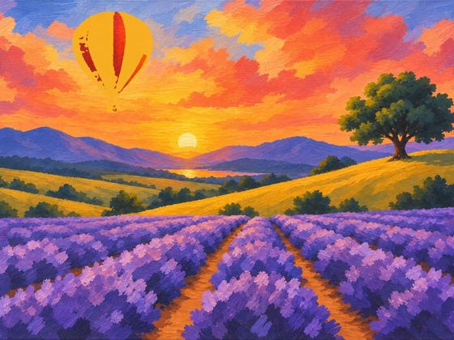

### Step 22: Shade the left side of the balloon

**Paints:** Deep red (2 parts red, 1 part ultramarine, a touch of white); Deep blue (1 part ultramarine, a touch of yellow, a touch of white)

**Brush:** #8 round

- **First:** The blue cap must be dry.
- **Start:** Start at the top of the hot-air balloon, at its outer edge on the shadow side.
- **As in step 20:** This is the same curved pull you used for the red stripes in step 20. Now the mixes are darker and gather on the shadow side.
- **Strokes:** Pull Deep red and Deep blue in curved stripes from the top down to the neck, alternating them and bending each with the balloon's round shape.
- **Where the paint sits:** Most of it is on the left side of the balloon's stripes, shading and basket. That is the shadow side away from the sun, where the stripes crowd together. Add a small dark dab under the neck.
- **Leave:** Leave gold stripes between the dark ones, and keep the side facing the sun lighter.
- **Stop when:** The balloon is striped red, blue and gold, darker on its shadow side, and it starts to look round.

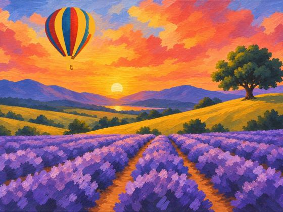

### Step 23: Light the side facing the sun

**Paints:** Pale sun yellow (6 parts white, 3 parts yellow, 1 part red); Sunset orange (3 parts red, 2 parts yellow, 1 part white)

**Brush:** 1/4 inch old stiff flat

- **First:** The dark stripes must be dry.
- **Start:** Start at the top of the gold stripe nearest the middle of the hot-air balloon.
- **As in step 3:** This is the same dry brush you used to light the cloud edges in step 3, and Sunset orange is back too. Now the brush is smaller and the strokes curve down the stripes.
- **Strokes:** Touch only the tip of the dry stiff brush in Pale sun yellow or Sunset orange and wipe it. Skim curved strokes down each stripe, from the top toward the neck.
- **Where the paint sits:** Light the middle and the side facing the sun: pale yellow on the gold stripes, a little orange over the red and blue ones, and a touch on the basket dab.
- **Leave:** Leave the stripes on the shadow side dark, and keep the area near the neck dark.
- **Stop when:** The balloon glows with broken, feathery light down its middle and sun side. Did it go on solid? Let it dry and dry-brush the stripe color back over part of it.

### Step 24: Add the ropes and basket

**Paints:** Bark brown (3 parts ultramarine, 2 parts yellow, 2 parts red)

**Brush:** #1 liner

- **First:** Everything on the balloon must be dry, or the lines will spread.
- **Start:** Start at the neck of the hot-air balloon.
- **As in step 10:** This is the Bark brown you pulled the tree trunk with in step 10. Now you thin it with water and use the liner for fine ropes and a small basket.
- **Strokes:** Hold the liner upright with thin, watery Bark brown. Pull a few short ropes down from the neck, then build the basket from short strokes.
- **Where the paint sits:** Darken a band across the neck, and make the basket a small box. Its top is about 3 1/2 in from the top edge.
- **Leave:** Leave sky showing between the ropes, and keep the basket small.
- **Stop when:** Thin ropes hang from the neck to a small brown basket, and the painting is finished. Skippy lines? Add water to the paint.

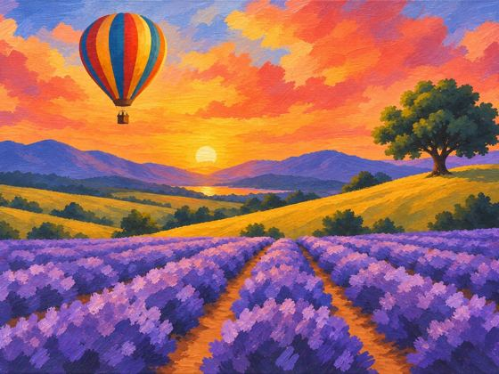

*Where this stage ends:* A round, striped balloon glows in the sunset sky, shaded on one side and lit on the other, with its small basket hanging from the neck.

## Known problems

What the finisher listed for this lesson's pictures and paints:

- **dab-sunlit-greens** (paint): Sunlit green was fitted to an ochre gold (#aa7d23), not a green.
- **dab-mid-greens** (paint): The middle greens step lists Bark brown, because Mid green was fitted to the same color and merged into it, but its picture adds a middle green.
- **paint-blue-stripes** (step): The blue stripes change almost nothing a painter would see (under 0.2% of the canvas); they show up in the next step's picture.
- **add-basket** (step): The basket changes almost nothing a painter would see (under 0.2% of the canvas); it already shows in the step before.
