# The chickadee as a v3.1 lesson (the combined lesson)

The whole lesson as a painter would read it, made the way `docs/design/pipeline-v3.1.md` describes (section 12, step 1). The pictures are v3's. How it was made and what it cost: [v31-combined.md](v31-combined.md).

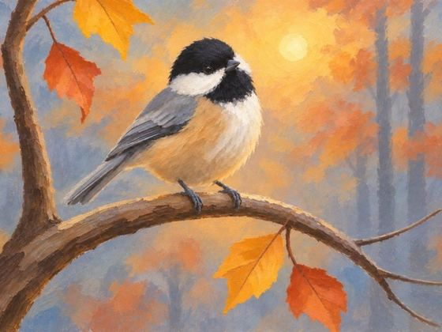

Canvas: 16 in wide, 12 in tall. 24 steps.

## Before you start

You are about to paint a little chickadee perched on a curved branch in autumn, with red and gold leaves hanging near it and a low sun glowing through hazy orange woods. The heart of the painting is the bird's black cap, white cheek and bright dark eye, sitting close to the sun. Everything else, from the soft background to the glowing branch, is there to make that small face shine.

**The light:** All the light in this painting comes from the low sun, glowing behind the bird. The sides of the leaves, the branch and the bird that face the sun get a warm bright edge, and the sides turned away from it fall into soft shadow. Many steps ask you to put paint where that sunlight falls or where it doesn't.

**What this painting teaches:**

- **Building from pieces** (steps 6, 7, 13): You build each big shape from simple pieces: a band or an oval first, then curved pieces added around it. Here it makes the trunk and branch, the four hanging leaves and the whole chickadee, so you never have to draw a hard outline freehand. Fill each shape flat and solid, and don't fuss with detail yet.
- **Dry brush** (steps 8, 9, 10, 11): Dry brush means only the tip of the brush goes in the paint, wiped nearly dry and skimmed lightly over the canvas. It shades and lights the leaves and the bark, leaving broken, see-through marks that make them look round and rough. Watch for paint going on solid: that means too much on the brush, so let it dry and skim the base color back over it.
- **Flicking** (steps 19, 20, 21): A flick is a quick, light stroke that lifts off as it goes, so each mark tapers to a point like a feather. You use it with the small fan on the belly, the wing and the sunlit chest, turning a flat bird into a soft, feathery one. Keep the brush lightly loaded, because too much paint makes flat blobs instead of feathers.

**The way there:** You start with the sky and the sun, blended wet in one go, because everything else is painted over them. Next come the far woods: hazy trunks, then dabbed autumn leaves, dark first and lighter over them, so the whole background is finished before anything sharp goes on. Then you build the branch and the hanging leaves, give them shadow and light, and line in the twigs, stems and veins. The rest of the lesson belongs to the chickadee: its shape and shading, its white cheek, its black and gray markings, and then its feathers. The face and feet come last, so the eye, the heart of the painting, gets your most careful touch.

## The sky and the sun

*This stage lays the soft blue and gold sky over the whole canvas and circles in the glowing sun.*

### Step 1: Blend the blue and gold sky

**Paints:** Soft blue-gray (1 part ultramarine, 1 part white, a touch of yellow); Golden orange (3 parts yellow, 2 parts red, 2 parts white, a touch of ultramarine); Pale yellow (4 parts white, 2 parts ultramarine, 1 part yellow, 1 part red)

**Brush:** 1 inch flat

- **Start:** Start in the upper left corner of the canvas with Soft blue-gray. Work across and down in rows until the whole canvas is covered, edge to edge.
- **Strokes:** Make short X strokes that cross each other with the 1 inch flat. While the blue is still wet, cross Golden orange and a little Pale yellow into it so the colors melt together.
- **Where the paint sits:** Keep blue as the main color everywhere. Put the gold in loose slanting streaks across the middle and toward the top, where the sun's glow will spread later.
- **Leave:** No white canvas should show anywhere. Let the X marks stay visible as a soft texture.
- **Stop when:** Stop when the canvas is a soft blue sky with warm gold streaks drifting through it and no hard edges. Let it dry completely.

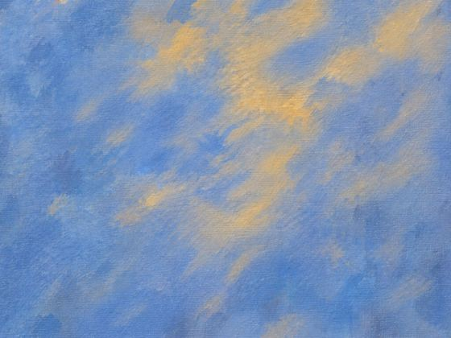

### Step 2: Circle in the sun

**Paints:** Sun cream (8 parts white, 3 parts ultramarine, 2 parts yellow, 2 parts red); Pale yellow (4 parts white, 2 parts ultramarine, 1 part yellow, 1 part red)

**Brush:** #10 round

- **First:** The sky from step 1 must be dry.
- **Start:** Put the sun high in the sky, its middle about 10 1/2 in from the left edge and 2 in from the top edge.
- **Strokes:** Circle Sun cream round and round with the tip of the #10 round to make the small disk. Then circle Pale yellow outward from it, each ring wider and softer.
- **Where the paint sits:** The disk stays creamy and brightest in its middle. The yellow glow spreads around it about a hand's width and reaches up to the top edge.
- **Leave:** Leave the blue and gold sky from step 1 showing everywhere beyond the glow.
- **Stop when:** A soft glowing sun whose bumpy edge melts into the sky. If the glow ends in a hard ring, soften it with lighter circles.

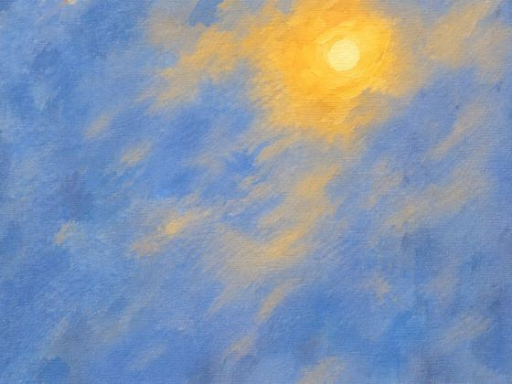

*Where this stage ends:* The canvas is a soft blue sky with drifting gold streaks and a pale sun wrapped in a warm yellow glow.

## The far woods

*This stage paints the hazy woods far away: soft blue trunks and dabbed autumn leaves, with nothing sharp, because they are distant.*

### Step 3: Pull the hazy far trunks

**Paints:** Hazy blue (3 parts ultramarine, 3 parts white, 1 part burnt sienna, a touch of yellow)

**Brush:** 1/2 inch flat

- **First:** The sun from step 2 must be dry.
- **Start:** Start at the top edge, right of the low sun, with the tallest trunk. The middle of this step's paint is about 14 1/4 in from the left edge.
- **Strokes:** Press the full width of the 1/2 inch flat and pull each trunk straight down toward the bottom edge. Turn onto the brush's edge and lighten the pressure for the thin stubby branches.
- **Where the paint sits:** Paint two tall trunks from the top edge down to the bottom edge, with a few shorter, fainter trunks and stubby branches between them. Keep them soft and plain, with no bark, because they are far away.
- **Leave:** Leave the sun's glow and the rest of the sky untouched.
- **Stop when:** Two tall hazy blue trunks and their fainter neighbors stand near the right edge of the canvas, soft-edged, with sky between them.

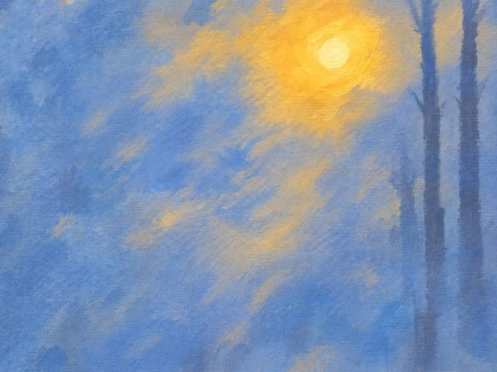

### Step 4: Dab the red-orange far leaves

**Paints:** Red-orange (1 part red, 1 part burnt sienna, 1 part white, a touch of yellow)

**Brush:** old stiff brush

- **First:** The trunks from step 3 must be dry.
- **Start:** Begin with the patch in the upper middle of the canvas. Its top is about 2 3/4 in from the top edge, and its middle is about 5 in from the left edge.
- **Strokes:** Tap Red-orange with the tip of the old stiff brush, wiped almost dry. Tap more in the middle of each patch so it gets solid, and fewer at its ragged edge.
- **Where the paint sits:** Make loose clumps: one in the upper middle, clumps around the hazy far trunks up near the top edge, small bits at the left edge, and two clumps near the bottom edge.
- **Leave:** Leave plenty of blue and gold sky between the clumps, and let the far trunks show through the clumps around them.
- **Stop when:** Scattered soft red-orange clumps that look like distant treetops. If you get blobs instead of dabs, wipe the brush on a paper towel and tap again.

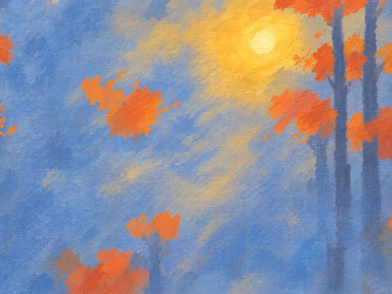

### Step 5: Dab the light orange over the far leaves

**Paints:** Light orange (1 part yellow, 1 part red, 1 part white, a touch of ultramarine)

**Brush:** old stiff brush

- **First:** The darker dabs from step 4 must be dry.
- **Start:** Start around the sun's glow and work outward and down through the middle of the canvas. The middle of this step's paint is about 8 1/4 in from the left edge.
- **As in step 4:** This is the same dry tapping you did for the darker leaves in step 4. This time use the lighter mix and tap it where the sun hits, so the darker dabs still peek through.
- **Strokes:** Tap Light orange with the tip of the dry old stiff brush. Build loose clumps that join into one big hazy mass.
- **Where the paint sits:** Spread it widely: around the sun, over the middle, and down toward the bottom, plus touches on the clumps at the left edge and around the far trunks. Put the most on the sides of the darker clumps from step 4 that face the sun.
- **Leave:** Leave some of the darker dabs from step 4 showing underneath. Keep the far trunks visible and blue sky around the mass.
- **Stop when:** A big soft orange glow of hazy autumn woods fills the middle of the canvas, with darker clumps and blue sky around it.

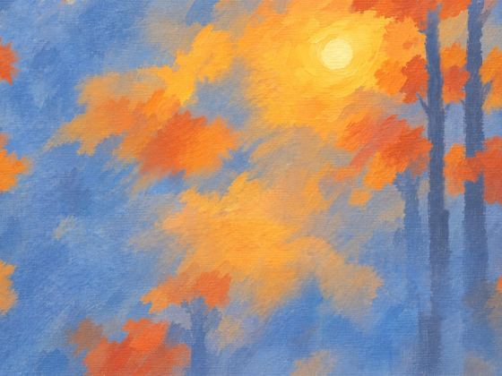

*Where this stage ends:* The background is finished: hazy blue trunks stand in a big soft glow of orange and red-orange leaves around the sun.

## The branch and leaves

*This stage builds the trunk, the curved branch and the four hanging leaves, then gives them shadow, sunlight and fine twigs and veins.*

### Step 6: Block in the trunk and branch

**Paints:** Bark brown (1 part burnt sienna, a touch of red, a touch of ultramarine, a touch of white)

**Brush:** 1/2 inch flat

- **First:** The orange dabs from step 5 must be dry.
- **Start:** Start with the trunk: one long band from the bottom edge up near the left edge, all the way to the top edge.
- **Strokes:** Build it in pieces with the 1/2 inch flat. Lay the trunk band first, then the branch in curved pieces, leaving the trunk low down and arching up across the canvas and down again.
- **Where the paint sits:** The branch is thick where it leaves the trunk and thins to a point at its far end. The right side of that point is about 2 1/2 in from the right edge. Fill everything with flat Bark brown.
- **Leave:** Leave the background showing all around the wood. Fill the wood solidly, with no gaps where the sky peeks through.
- **Stop when:** A flat brown trunk and one big arching branch, solid and even, with no shading yet.

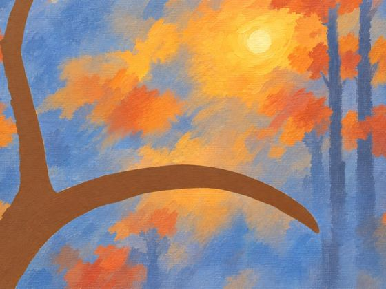

### Step 7: Block in the hanging leaves

**Paints:** Golden yellow (3 parts yellow, 1 part red, 1 part white); Red-orange (1 part red, 1 part burnt sienna, 1 part white, a touch of yellow)

**Brush:** #8 round

- **First:** The brown branch from step 6 must be dry.
- **Start:** Start with the gold leaf at the top edge, near the trunk. Its middle is about 4 in from the left edge.
- **As in step 6:** You built the branch from pieces in step 6. Now do the same thing smaller: a teardrop first, then little pointed pieces around it, with the #8 round.
- **Strokes:** With the #8 round, lay a center teardrop for each leaf. Then add pointed curved pieces on each side, smaller toward the tip, to give each leaf a jagged edge.
- **Where the paint sits:** Paint four leaves. The first is Golden yellow at the top edge, with a Red-orange leaf just under it. The other two hang from the branch: a Golden yellow leaf whose top is about 8 in from the top edge, then a Red-orange leaf further along.
- **Leave:** Leave the branch and the background around each leaf untouched.
- **Stop when:** Four flat, solid leaf shapes, two gold and two red-orange, with no veins or shading yet.

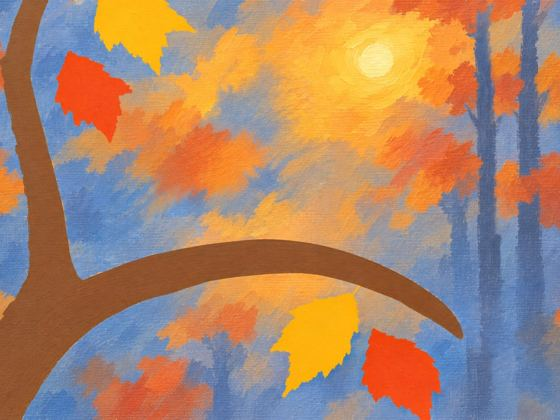

### Step 8: Shade the leaves

**Paints:** Deep gold (2 parts yellow, 1 part red); Deep red (3 parts red, 1 part burnt sienna, a touch of white)

**Brush:** 1/4 inch flat

- **First:** The leaves from step 7 must be dry.
- **Start:** Start on the gold leaf at the top edge, down its center from the end where the stem will join.
- **Strokes:** Dip only the tip of the 1/4 inch flat and wipe it nearly dry. Skim Deep gold along each gold leaf and Deep red along each red leaf, from the stem end toward the tip.
- **Where the paint sits:** Darken the center and the stem end of each leaf, which are turned away from the sun. On the red leaves it covers the half nearest the stem. Add two tiny touches on the brown wood from step 6.
- **Leave:** Leave each leaf's own bright color showing toward its tip and outer edges.
- **Stop when:** Each leaf has a broken darker half and a brighter half, so it looks curved. If it went on solid, let it dry and dry-brush the leaf color back over part of it.

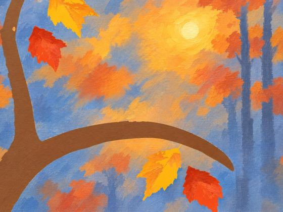

### Step 9: Light the leaves' sunny edges

**Paints:** Golden yellow (3 parts yellow, 1 part red, 1 part white); Coral orange (2 parts red, 1 part yellow, 1 part burnt sienna, 1 part white)

**Brush:** 1/4 inch flat

- **First:** The shading from step 8 must be dry.
- **Start:** Start on the upper red leaf, on the half toward its tip.
- **As in step 8:** Use the same dry brush and the same skimming touch as when you shaded the leaves in step 8. This time the paint goes on the parts facing the sun.
- **Strokes:** Dry-brush with the tip of the 1/4 inch flat, skimming lightly from the shaded part toward the leaf's tip. Use Coral orange on the red leaves and Golden yellow on the gold ones.
- **Where the paint sits:** Brighten the tip halves of the red leaves and the middles of the gold leaves, where they face the sun. Add a few tiny warm flecks along the trunk and the branch.
- **Leave:** Leave the darker shading from step 8 showing near each stem, and keep the leaves' edges ragged.
- **Stop when:** Each leaf now runs from dark to bright and looks lit, with a few warm specks on the wood. Keep the strokes broken, never solid.

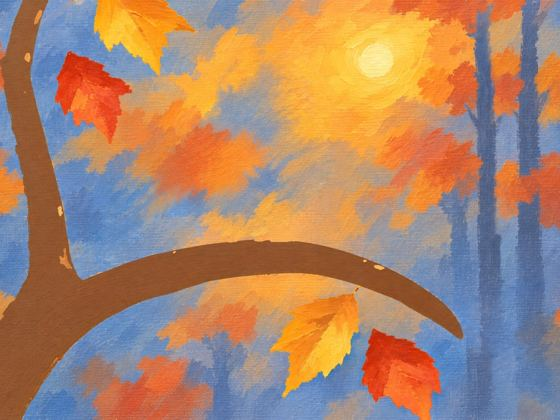

### Step 10: Shade the trunk and branch

**Paints:** Dark brown (3 parts red, 3 parts ultramarine, 1 part yellow)

**Brush:** 1/2 inch flat

- **First:** The leaves and flecks from step 9 must be dry.
- **Start:** Start at the bottom edge, where the trunk and branch join, and work up the trunk toward the top edge.
- **As in step 8:** This is the dry brush you used to shade the leaves in step 8, now with the bigger 1/2 inch flat and long strokes along the wood.
- **Strokes:** Skim the nearly dry 1/2 inch flat along the wood in short broken strokes: lengthwise up the trunk, then along the branch's curve out to its point.
- **Where the paint sits:** Darken the underside of the branch and most of the trunk, the parts turned away from the sun, in broken patches like rough bark.
- **Leave:** Leave a band of plain mid brown along the arch of the branch where the sun hits it. Keep the leaves clean.
- **Stop when:** The wood looks rough and round: dark broken bark underneath, mid brown along its sunny arch. If it goes on solid, use less paint and skim more lightly.

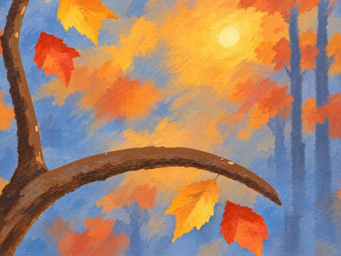

### Step 11: Catch the sun on the branch

**Paints:** Warm buff (4 parts white, 2 parts yellow, 2 parts burnt sienna, 1 part red)

**Brush:** 1/4 inch flat

- **First:** The dark bark from step 10 must be dry.
- **Start:** Start up the trunk's sunny edge. The middle of the trunk's light is about 1 1/4 in from the left edge.
- **Strokes:** Skim the nearly dry 1/4 inch flat in long broken strokes along the wood: up the trunk, then along the arch of the branch out toward its point.
- **Where the paint sits:** Keep the light to a thin rim where the sun hits: the edge of the trunk that faces the sun, and the arch of the branch. Make it brightest along the stretch where the bird will sit.
- **Leave:** Leave the mid brown and the dark bark from step 10 showing. The light is only a rim.
- **Stop when:** A thin, broken warm rim of light runs along the wood and makes it look round and sunlit.

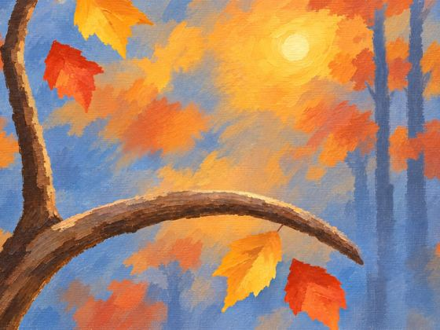

### Step 12: Line the twigs, stems and veins

**Paints:** Dark brown (3 parts red, 3 parts ultramarine, 1 part yellow)

**Brush:** liner

- **First:** Everything from step 11 must be dry, because liner lines spread on wet paint.
- **Start:** Start at the far point of the branch and pull twigs out to the right edge of the canvas.
- **As in step 10:** This is the same Dark brown you used for the bark shadows in step 10. Now thin it with water so it flows off the liner in fine lines.
- **Strokes:** Thin the paint with water and hold the liner upright. Pull each line with light pressure, thick where it leaves the wood and tapering to a point. Let the twigs fork.
- **Where the paint sits:** Add three twigs forking from the branch's end and a stem from each hanging leaf up to the wood. Add a thin twig from the trunk to the top leaves, and a center vein with a few side veins in each leaf.
- **Leave:** Leave the leaf colors and the lit wood showing. Keep the veins thin.
- **Stop when:** Twigs reach the edge, and every leaf hangs on a stem and has veins. If the lines skip, the paint is too thick: add water.

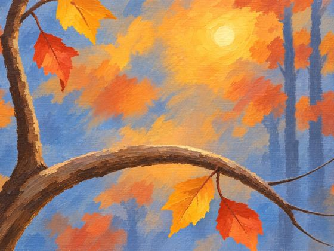

*Where this stage ends:* A rough, sunlit branch arches across the woods, with twigs reaching out and four shaded, veined leaves hanging from it.

## The chickadee's shape

*This stage builds the chickadee as one buff shape, shades it so it looks round, and paints its creamy white cheek.*

### Step 13: Block in the chickadee

**Paints:** Warm buff (4 parts white, 2 parts yellow, 2 parts burnt sienna, 1 part red)

**Brush:** 1/2 inch flat

- **First:** The twigs and veins from step 12 must be dry.
- **Start:** Start with a big oval body sitting on the arch of the branch. The middle of the bird is about 6 3/4 in from the left edge.
- **As in step 6:** Build the bird the way you built the branch in step 6: one simple shape first, the oval body, then add the head and tail as pieces.
- **Strokes:** Build the bird from pieces with the 1/2 inch flat. Lay the oval body first, then a round head on top whose top is about 1 1/4 in from the top edge, then the tapering tail.
- **Where the paint sits:** Fill the whole bird with flat Warm buff. The tail slants down toward the trunk until it almost touches the branch.
- **Leave:** Leave the branch showing where the belly rests on it. The bird sits on the branch, not over it.
- **Stop when:** One smooth, flat buff bird shape: round body, round head, long tail. Give it a second coat if the background shows through.

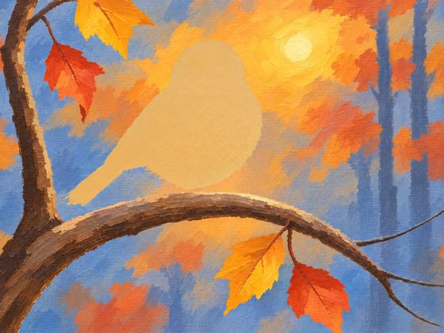

### Step 14: Shade the bird's underside

**Paints:** Golden buff (4 parts white, 2 parts burnt sienna, 1 part yellow, 1 part red)

**Brush:** 1/2 inch flat

- **First:** The buff bird from step 13 must be dry.
- **Start:** Start where the belly rests on the branch.
- **Strokes:** Pull curved strokes with the 1/2 inch flat that wrap around the round body. Run them down the tail and over the head, following each shape.
- **Where the paint sits:** Cover most of the bird thinly, and press more paint where the belly rests on the branch, the part turned away from the sun.
- **Leave:** Leave the plain buff from step 13 on the face and on the sunny front of the chest.
- **Stop when:** The bird looks round: darker at the belly, lighter toward the sun, with curved stroke marks showing.

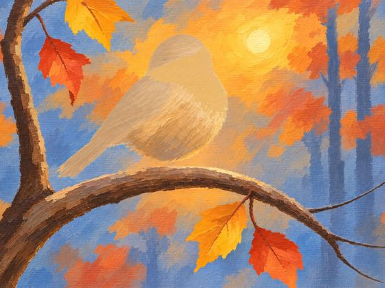

### Step 15: Paint the white cheek and chest

**Paints:** Warm white (3 parts white, 1 part burnt sienna, a touch of yellow)

**Brush:** #8 round

- **First:** The shading from step 14 must be dry.
- **Start:** Start on the face, across the head where the cheek goes. The middle of this step's paint is about 8 in from the left edge.
- **Strokes:** With the #8 round, curve each stroke around the head, following its roundness. Put it on in 2 to 3 thin coats.
- **Where the paint sits:** Paint a wide creamy band across the head, from the front of the face back toward the neck, fading to golden where it meets the chest.
- **Leave:** Leave the crown and the throat buff for now, because the cap and bib go there.
- **Stop when:** A clean creamy band across the head, soft where it meets the body. Several thin coats, dried in between, look better than one thick coat.

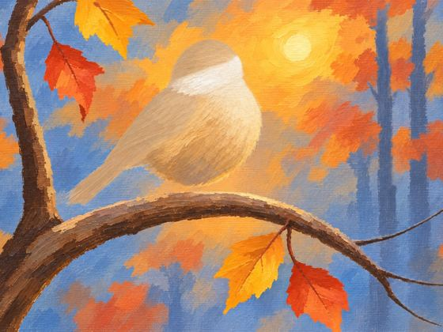

*Where this stage ends:* A round buff bird sits on the branch, darker at its belly, with a creamy white band across its head.

## The chickadee's markings

*This stage gives the chickadee its black cap and bib and its dark gray wing and tail.*

### Step 16: Paint the black cap and bib

**Paints:** Soft black (1 part ultramarine, 1 part burnt sienna, a touch of red)

**Brush:** #6 round

- **First:** The white cheek from step 15 must be dry.
- **Start:** Start with the cap over the crown. Its middle is about 7 1/4 in from the left edge, and its top is about 1 1/2 in from the top edge.
- **As in step 15:** Use the same curved strokes that followed the round head when you painted the cheek in step 15, now in black with the smaller #6 round.
- **Strokes:** With the #6 round, curve strokes over the round crown, then curve the bib under the face and down the throat. On the wing and tail, pull long curved strokes down and back toward the tail tip.
- **Where the paint sits:** The black goes on the cap, the bib, and loose streaks along the wing and down the tail.
- **Leave:** Leave the white cheek as a clean band between the cap and the bib, and let the buff body show between the wing streaks.
- **Stop when:** A bold black cap and bib frame the white cheek, and broken dark streaks mark the wing and tail.

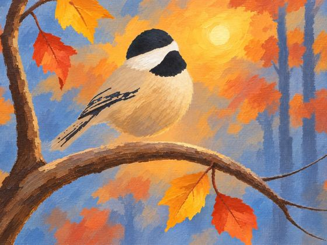

### Step 17: Paint the gray wing and tail

**Paints:** Soft blue-gray (1 part ultramarine, 1 part white, a touch of yellow)

**Brush:** 1/4 inch flat

- **First:** The black from step 16 must be dry.
- **Start:** Start at the back of the neck, just behind the black cap.
- **As in step 1:** This is the same Soft blue-gray you crossed into the sky in step 1. Here it goes on in small curved touches on the bird.
- **Strokes:** With the 1/4 inch flat, lay short curved strokes that follow the feathers down and back toward the tail.
- **Where the paint sits:** Add only small touches: a couple behind the cap and at the back of the neck, a few along the dark wing streaks, and a little near the tail tip.
- **Leave:** Leave the dark streaks from step 16 and the cap, bib and cheek showing. These are small touches, not a full coat.
- **Stop when:** A few cool gray touches start to turn the streaked wing into feathers.

### Step 18: Pull the dark wing feather lines

**Paints:** Dark slate (1 part ultramarine, 1 part white, a touch of yellow, a touch of red)

**Brush:** 1/4 inch angle

- **First:** The gray touches from step 17 must be dry.
- **Start:** Start at the shoulder of the wing, where it leaves the back of the neck.
- **As in step 3:** This is the same press-then-lift stroke you used to pull the far trunks in step 3. Now use the angle brush, so each feather line tapers to a point.
- **Strokes:** Press the full width of the 1/4 inch angle and pull each feather line down and back along the wing, lifting so it tapers. Lay the tail as long strokes that end in points.
- **Where the paint sits:** Fill the whole wing and tail with these overlapping feather strokes. Cover the dark streaks from step 16 so the wing reads as one slate-gray shape along the back.
- **Leave:** Leave the cap, cheek, bib and buff body clean.
- **Stop when:** A smooth dark gray wing and a pointed tail, made of tapered feather lines. If the lines don't taper, lighten the pressure sooner.

*Where this stage ends:* The bird now wears a bold black cap and bib around its white cheek, with a smooth slate-gray wing and pointed tail.

## The feathers

*This stage flicks in feathers so the bird looks soft, and brightens the chest where the sun catches it.*

### Step 19: Flick the belly feathers

**Paints:** Golden buff (4 parts white, 2 parts burnt sienna, 1 part yellow, 1 part red)

**Brush:** small fan

- **First:** The wing from step 18 must be dry.
- **Start:** Start low on the belly, just where it tucks under the wing.
- **As in step 14:** This is the same Golden buff you shaded the belly with in step 14. Now it goes on as quick flicks with the small fan instead of curved strokes.
- **Strokes:** Load the small fan lightly, touch down at the base and flick quickly, lifting off so each mark tapers. Angle the flicks down and back, like feathers lying away from the head.
- **Where the paint sits:** Put most of the flicks where the belly tucks under the wing, the part away from the sun, and scatter a few across the middle of the belly.
- **Leave:** Leave the lighter buff from earlier steps showing between the flicks, and keep off the wing.
- **Stop when:** The belly looks soft and feathery, warmer and darker where it tucks under the wing.

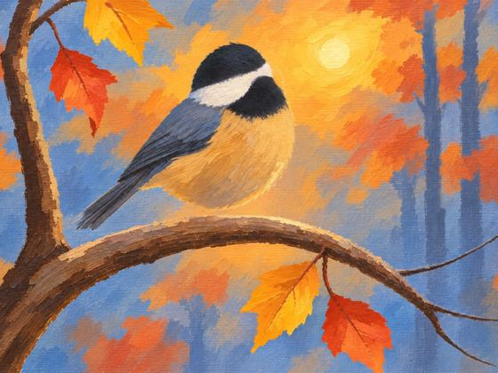

### Step 20: Flick light into the wing and tail

**Paints:** Dark slate (1 part ultramarine, 1 part white, a touch of yellow, a touch of red)

**Brush:** small fan

- **First:** The belly flicks from step 19 must be dry.
- **Start:** Start on the wing, at the edges of the feathers near the shoulder.
- **Strokes:** Load the small fan lightly and flick along each feather and down the tail, lifting off so the marks taper toward the tips.
- **Where the paint sits:** Separate the wing and tail feathers with fine flicks. Run a soft feathery line where the cap meets the cheek and around the bib, so the markings look feathered.
- **Leave:** Leave the gray and the earlier feather lines showing between the flicks.
- **Stop when:** The wing and tail show separate feathers, and the black markings have soft, feathered edges.

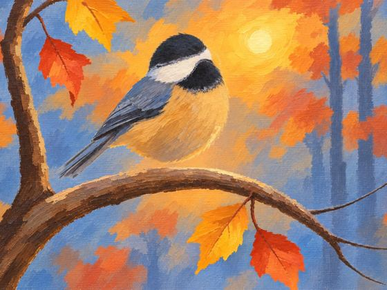

### Step 21: Flick the sunlit edge of the chest

**Paints:** Warm white (3 parts white, 1 part burnt sienna, a touch of yellow)

**Brush:** small fan

- **First:** The flicks from step 20 must be dry.
- **Start:** Start on the front of the chest, just past the bib, on the edge facing the sun. The middle of this step's paint is about 8 in from the left edge.
- **As in step 19:** Flick just as you did on the belly in step 19, using the creamy Warm white and putting the flicks where the sun catches the chest.
- **Strokes:** Load the small fan lightly and flick down the chest, lifting off so each mark tapers and follows the round curve of the breast.
- **Where the paint sits:** Mass the white along the sunny front of the chest and the edge of the cheek. Use fewer flicks as you move away from the sun. Add a few light flicks on the wing and near the tail tip.
- **Leave:** Leave the buff belly from step 19 showing between the flicks.
- **Stop when:** The chest glows creamy white where the sun catches it and fades into buff.

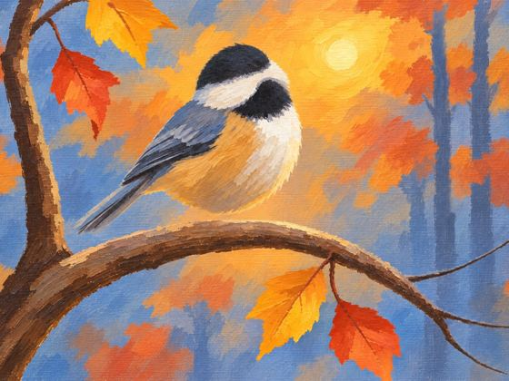

*Where this stage ends:* The bird looks soft and feathery, with separate wing feathers and a chest that glows creamy white in the sunlight.

## The face and feet

*This stage brings the bird to life with its eye, beak and gripping feet, and one tiny spark of light in the eye.*

### Step 22: Paint the eye and beak

**Paints:** Soft black (1 part ultramarine, 1 part burnt sienna, a touch of red)

**Brush:** #2 round

- **First:** The feathers from step 21 must be dry.
- **Start:** Start with the eye, at the edge of the cap where it meets the white cheek.
- **Strokes:** With the #2 round, touch down, press and lift. Make a small round press for the eye, a short pull ending on the tip for the beak, and a comma shape for each toe.
- **Where the paint sits:** Add the beak at the front of the face, and two short legs with curled toes gripping the branch where the belly rests. Add a few dots near the tail tip and small dark beads along the twigs.
- **Leave:** Leave the white cheek clean around the eye.
- **Stop when:** The bird has a dark eye, a sharp beak, and feet that grip. If you get a blob, use less paint and lift faster.

### Step 23: Line the legs and feet

**Paints:** Dark slate (1 part ultramarine, 1 part white, a touch of yellow, a touch of red)

**Brush:** liner

- **First:** The eye and feet from step 22 must be dry.
- **Start:** Start on the legs, where they leave the belly.
- **As in step 12:** This is the same liner you used for the twigs and veins in step 12. Thin the paint the same way and keep your touch just as light.
- **Strokes:** Thin the paint and hold the liner upright. Pull light, steady lines down each leg and around each toe, tapering at the claw.
- **Where the paint sits:** Firm up the legs and toes on the branch. Add a few small marks on the wing and at the tail tip, and a few thin touches along the hazy far trunks.
- **Leave:** Leave the dark feet from step 22 showing. This step only sharpens them.
- **Stop when:** Thin, crisp legs and toes grip the branch. If the lines spread, the paint underneath is still wet.

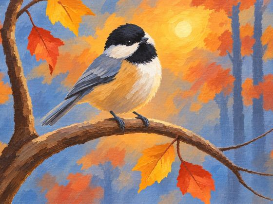

### Step 24: Dot the light in the eye

**Paints:** Warm white (3 parts white, 1 part burnt sienna, a touch of yellow)

**Brush:** #2 round

- **First:** The legs from step 23 must be dry.
- **Start:** Start with the eye: one tiny dot on the side of the eye facing the sun.
- **As in step 15:** This is the same Warm white you used for the cheek in step 15. Now use just one tiny fresh dot of it.
- **Strokes:** Dip the #2 round in fresh Warm white for each dot and touch it straight down once. Don't drag it.
- **Where the paint sits:** After the eye, add a few small light dots on the chest and on the belly near the wing, and a touch on each foot where the sun hits.
- **Leave:** Leave most of the eye dark. The shine is only a speck.
- **Stop when:** The eye sparkles and the bird looks alive. Wipe off a bad dot while it is still wet.

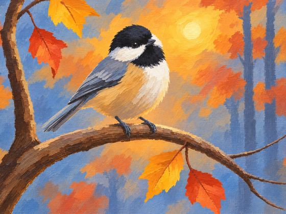

*Where this stage ends:* The finished painting: a bright-eyed chickadee grips its sunlit branch among hanging leaves and glowing autumn woods.

## Known problems

What the finisher listed for this lesson's pictures and paints:

- **blend-sky** (paint): Pale yellow was fitted to a grayish beige (#b4a795), not a pale yellow.
- **paint-sun** (paint): Sun cream was fitted to a grayish tan (#b9a78d), darker than a cream.
- **light-leaves** (paint): The leaves' light step lays Golden yellow, the same paint as their block-in, because Light gold was fitted to the same color and merged into it.
- **flick-wing-feathers** (paint): The wing's light flicks lay Dark slate, the same paint as the dark wing lines, because Light gray was fitted to the same color and merged into it; the picture's lighter gray edges come from the render.
