# The sleeping cat as a v3.1 lesson (the combined lesson)

The whole lesson as a painter would read it, made the way `docs/design/pipeline-v3.1.md` describes (section 12, step 1). The pictures are v3's. How it was made and what it cost: [v31-combined.md](v31-combined.md).

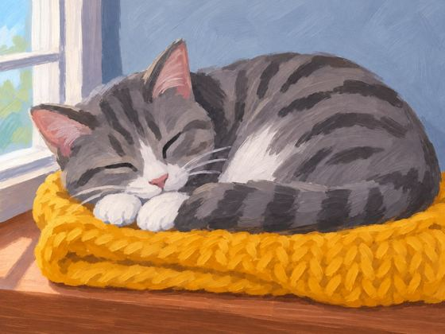

Canvas: 16 in wide, 12 in tall. 22 steps.

## Before you start

You are about to paint a gray tabby kitten curled up asleep on a golden knit blanket, in a sunny window. The heart of it is the sleeping face: closed eyes, a pink nose, a white muzzle with whiskers, and two white paws tucked in close. The mood is warm and quiet, a kitten soaking up the afternoon light.

**The light:** The light comes in through the window and falls across everything in the room. Where it lands you will paint things paler and brighter, the sunny bars on the sill and the tops of the blanket's rolls. The sides that turn away from the window get the darker paint, so the cat and the blanket look round.

**What this painting teaches:**

- **Building from pieces** (steps 5, 6, 10, 14): You make a big shape from simple pieces: a rectangle or an oval first, then curved pieces around it. You build the window frame, the folded blanket and the curled cat this way. Start with the biggest piece, and don't worry about small gaps where pieces meet.
- **Press and lift** (steps 12, 13, 17, 21): You touch the brush tip down, press so it spreads, then pull and lift to a point, which leaves a little comma. Rows of these become the blanket's chunky knit, and single ones make the pink ears and nose. If you get blobs, use less paint and lift faster.
- **Curved strokes** (steps 11, 15, 16): You bend every stroke with the shape, starting at the crest of each bump and following its curve. It is what makes the blanket's rolls and the cat's body look round instead of flat. Keep the darker paint on the side turned away from the window light.

**The way there:** We paint from the farthest thing to the nearest. First the bright view through the window, then the blue wall and the white window frame, then the wooden sill with its grain and sunny bars. Next comes the blanket, painted straight through where the cat will lie, so the cat can sit on it. Most of the lesson goes to the cat: its shape, its shadow, white patches, pink ears, stripes and fur. The face comes last, so the sleeping eyes, nose and whiskers get the freshest, sharpest marks.

## The view through the window

*This stage paints the farthest thing in the picture, the sky and leaves seen through the window.*

### Step 1: Blend the sky in the window

**Paints:** Pale sky blue (3 parts white, 1 part ultramarine, a touch of yellow); Titanium white (White, straight from the tube)

**Brush:** 3/4 inch flat

- **Start:** Start at the top left corner of the canvas, where the window view begins, with Pale sky blue across the very top.
- **Strokes:** Stroke side to side. Without rinsing, pick up Titanium white and paint lower down, then stroke back up over the join while both are wet.
- **Where the paint sits:** The clear blue sits along the top edge, where the sky is deepest; it softens to near white lower down, as sky does near the trees.
- **Leave:** Leave a few soft white holes along the left edge of the patch for clouds, and keep the rest of the canvas bare white.
- **Stop when:** Stop when the patch is about 3 1/4 in wide and 3 3/4 in tall, with no hard line where the blue meets the white.

### Step 2: Dab the far leaves

**Paints:** Leaf green (1 part yellow, 1 part ultramarine, 1 part white)

**Brush:** old stiff brush

- **First:** Let the sky be dry, so the green taps stay clean instead of turning muddy.
- **Start:** Tap where the sky turns pale low in the window view; the middle of the leaves is about 1 in from the left edge and 1 1/4 in from the top edge.
- **Strokes:** Wipe most of the paint off, then tap straight down with the brush tip; never drag it.
- **Where the paint sits:** Keep it to a few light taps low in the window view, where the far trees will grow up from.
- **Leave:** Leave the blue sky and its white cloud holes showing all around the taps.
- **Stop when:** Stop while it is only a small, soft cluster of dots. Blobs mean the brush is too wet: wipe it on a paper towel.

### Step 3: Tap in the sunlit leaves

**Paints:** Pale leaf green (4 parts white, 1 part ultramarine, a touch of yellow)

**Brush:** old stiff brush

- **First:** Let the green taps from step 2 dry first.
- **Start:** Tap the first pale dot on top of the green taps from step 2, about 1 1/4 in from the left edge.
- **As in step 2:** The same dry tap you used for the far leaves in step 2, now with a paler mix and only a few taps.
- **Strokes:** Tap with the tip of a nearly dry brush, a few times in one spot, then lift away.
- **Where the paint sits:** The pale taps go on the upper, sunlit side of the green, because the light comes from the upper left.
- **Leave:** Leave some of the darker green taps from step 2 showing underneath, and all the sky around them.
- **Stop when:** Stop after a few small taps: this is a light touch, not a new patch of leaves.

*Where this stage ends:* A small patch of soft blue sky with white cloud holes and a few leaf taps sits in the corner, and the rest of the canvas is bare.

## The wall and the window frame

*This stage paints the blue wall and the white window frame that stand in front of the view.*

### Step 4: Criss-cross the blue wall

**Paints:** Wall blue (3 parts white, 2 parts ultramarine, a touch of yellow); Pale wall blue (2 parts white, 1 part ultramarine, a touch of yellow)

**Brush:** 1 inch flat

- **First:** Let the window view dry before you start the wall.
- **Start:** Start at the top edge just right of the sky through the window, with Pale wall blue, and work across toward the right edge.
- **Strokes:** Make short crossing strokes in two directions, like overlapping X shapes, picking up Wall blue as you move across and up.
- **Where the paint sits:** Keep the paler blue close to the window, where the light falls, and the deeper blue toward the right edge and the top edge.
- **Leave:** Leave the bottom of the canvas bare; the wall's lower edge sits about 6 in from the bottom edge and slopes down gently toward the right edge.
- **Stop when:** Stop when the wall reaches the left, right and top edges as one soft criss-cross blue, with no cat or blanket on it yet.

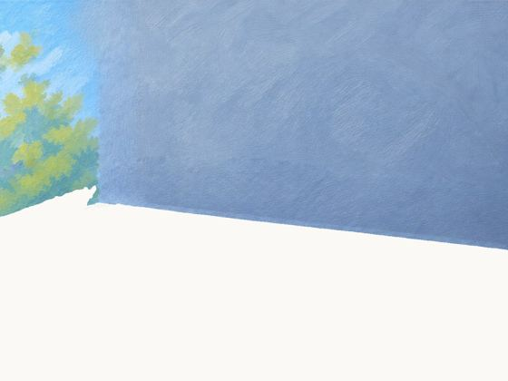

### Step 5: Block in the white window frame

**Paints:** Titanium white (White, straight from the tube)

**Brush:** 1/2 inch flat

- **First:** Let the wall and the window view dry, so the white stays clean.
- **Start:** Start with the wide upright post where the window view meets the wall, pulling it down from the top edge.
- **Strokes:** Build the frame from straight pieces: the wide post, a thinner upright, a crossbar across the upper view, then the wide ledge along the bottom of the window.
- **Where the paint sits:** The whole frame is flat white for now; its middle is about 1 3/4 in from the left edge. The shadows come in the next step.
- **Leave:** Leave the sky and leaves showing through the window between the pieces, and keep the blue wall clean where the post meets it.
- **Stop when:** Stop when the frame reaches the left and top edges as clean white pieces, about 4 1/4 in wide in all.

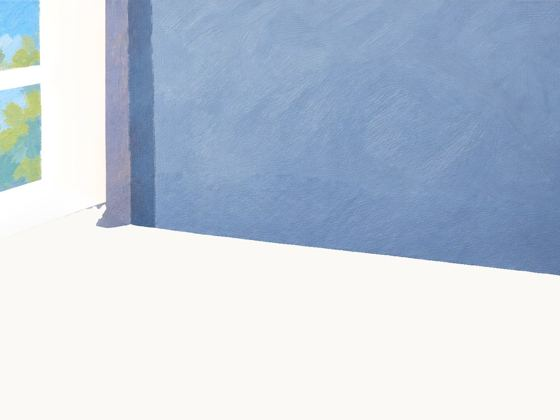

### Step 6: Shade the frame's inner faces

**Paints:** Pale wall blue (2 parts white, 1 part ultramarine, a touch of yellow)

**Brush:** 1/4 inch flat

- **First:** Let the white frame dry, or the lavender will turn chalky as it mixes in.
- **Start:** Start on the inner face of the wide post, where it turns away from the light, pulling down from the top edge.
- **As in step 5:** You build in straight pieces again, as in step 5, but with a smaller brush and only on the shadow faces.
- **Strokes:** Lay each strip as a narrow straight piece along its piece of frame: down the uprights, under the crossbar, along the lower face of the bottom ledge.
- **Where the paint sits:** The lavender sits only on the faces turned away from the window light, so the frame looks deep; its middle is about 2 in from the left edge.
- **Leave:** Leave the white lit faces of the frame clean, and the view through the window untouched.
- **Stop when:** Stop when every piece of the frame has a thin lavender shadow face as well as a white lit face.

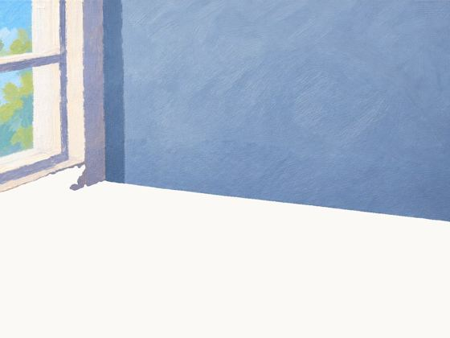

*Where this stage ends:* A soft criss-cross blue wall fills the room, with a white window frame and its lavender shadow faces, and the sill's space is still bare white.

## The windowsill

*This stage lays the wooden sill that the blanket and cat will rest on.*

### Step 7: Lay in the wooden sill

**Paints:** Warm wood brown (2 parts red, 1 part ultramarine, a touch of yellow, a touch of white)

**Brush:** 1 inch flat

- **First:** Let the wall and the frame dry, so the brown doesn't drag blue into it along the join.
- **Start:** Start along the join with the wall, about 6 1/4 in from the top edge, and work down toward the bottom edge.
- **Strokes:** Keep the brush level and pull long strokes left and right, all the way across the canvas.
- **Where the paint sits:** The whole ledge is one flat warm brown, running straight through where the blanket will lie.
- **Leave:** Keep the blue wall and the white frame clean along the join where the ledge meets them.
- **Stop when:** Stop when the ledge reaches the left, right and bottom edges and no white canvas shows anywhere.

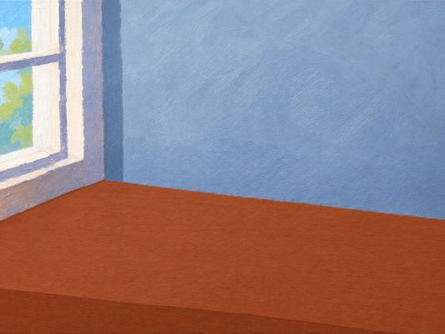

### Step 8: Darken the front of the sill

**Paints:** Dark wood brown (3 parts red, 2 parts ultramarine, 2 parts burnt sienna, 1 part white)

**Brush:** 3/4 inch flat

- **First:** Let the flat brown ledge dry first.
- **Start:** Start along the back of the ledge, right where it meets the wall.
- **As in step 7:** The same long level strokes as step 7, but now with a darker mix and a smaller brush, letting them break into streaks.
- **Strokes:** Pull long level streaks across, left and right, letting them break up as the brush runs out of paint.
- **Where the paint sits:** The streaks crowd along the back of the ledge as wood grain, and a thinner dark band runs along the front face at the bottom edge.
- **Leave:** Leave plenty of the flat brown from step 7 showing between the streaks, most of all at the left end of the sill.
- **Stop when:** Stop when the ledge reads as streaky wood across its whole width. Don't fill it solid: the gaps make the grain.

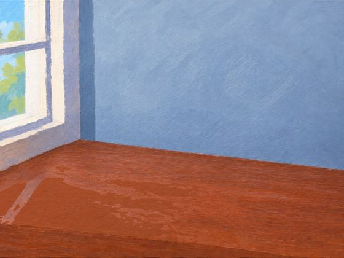

### Step 9: Dry-brush the sunlight on the sill

**Paints:** Sunlit wood (3 parts red, 3 parts white, 2 parts burnt sienna, 1 part yellow)

**Brush:** 1/2 inch flat

- **First:** Let the dark streaks from step 8 dry, or the dry brush will smear them.
- **Start:** Start at the left end of the sill, where the window light lands on the ledge.
- **Strokes:** Dip only the tip, wipe it, and skim lightly in slanting bars that run from the window across the ledge.
- **Where the paint sits:** The light bars sit at the left end of the sill, nearest the window, with the frame's shadows breaking them into bars.
- **Leave:** Leave brown showing between the bars and all along the rest of the ledge.
- **Stop when:** Stop when broken peach bars reach the left edge and bottom edge. If it went solid, let it dry and dry-brush brown back over part of it.

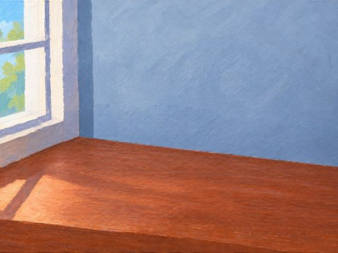

*Where this stage ends:* A warm brown ledge with dark grain streaks runs the width of the canvas, with peach sunny bars at the window end, and no white canvas shows.

## The knit blanket

*This stage builds the folded golden blanket and gives it its chunky knit.*

### Step 10: Block in the folded blanket

**Paints:** Golden yellow (1 part yellow, a touch of red)

**Brush:** 3/4 inch flat

- **First:** Let the sill dry first.
- **Start:** Start with a long rounded rectangle lying along the sill; its top is about 6 in from the top edge.
- **As in step 5:** You built the window frame from pieces in step 5; the blanket is built the same way, with round pieces instead of straight ones.
- **Strokes:** Build it in pieces: the long middle first, then curved pieces at each end like ( ), so the ends come out round.
- **Where the paint sits:** The whole blanket is one flat golden yellow, painted straight through where the cat will lie.
- **Leave:** Leave a strip of the sill's front showing, and the sunlit bars at the left end of the sill.
- **Stop when:** Stop when the shape runs to the right edge, about 14 3/4 in wide and 5 in tall, flat and smooth.

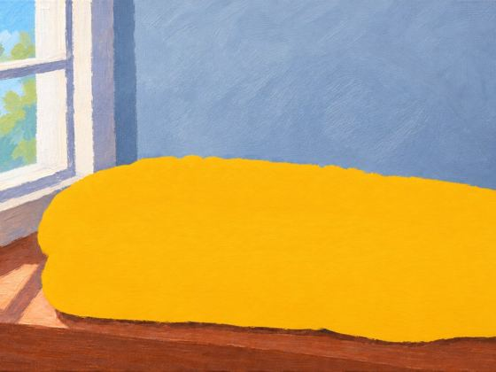

### Step 11: Shade under the blanket's rolls

**Paints:** Dark gold (2 parts yellow, 1 part red, 1 part burnt sienna)

**Brush:** 1/2 inch flat

- **First:** Let the flat yellow blanket dry first.
- **Start:** Start under the rolled top edge at the left end, where the roll curls toward the window.
- **Strokes:** Bend every stroke with the roll: start at the top of each bump and pull down and around its curve, like wrapping a tube.
- **Where the paint sits:** The shadow goes under the rolled top, along the fold, along the base where it meets the sill, and in the hollow where the cat will lie, because the light comes from the upper left.
- **Leave:** Leave the bright flat yellow from step 10 showing on the tops of the rolls, where the light hits.
- **Stop when:** Stop when the blanket looks thick and rolled, reaching the right edge.

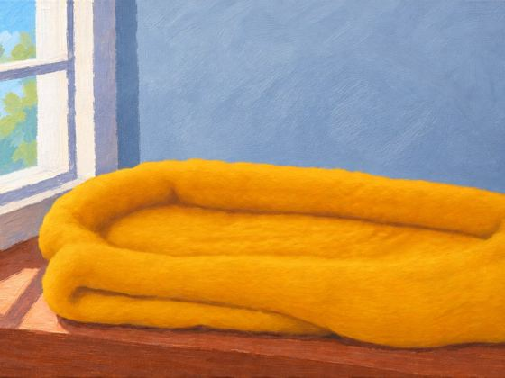

### Step 12: Comma in the dark knit loops

**Paints:** Dark gold (2 parts yellow, 1 part red, 1 part burnt sienna)

**Brush:** #8 round

- **First:** Let the shadows from step 11 dry, so the loops stay crisp.
- **Start:** Start along the rolled top edge, pressing the first marks in a row along the roll.
- **As in step 11:** This is the Dark gold from the shadows in step 11, now pressed into small commas with a round brush.
- **Strokes:** Touch the tip down, press so it spreads, then pull and lift to a point. Pair the commas into small V shapes that follow each roll's curve.
- **Where the paint sits:** Rows of loops cover the whole blanket out to the right edge, bending with each roll and the fold.
- **Leave:** Leave the bright yellow from step 10 showing between every loop, so the stitches read as separate.
- **Stop when:** Stop when rows of dark V loops cover the blanket. If you get blobs, use less paint and lift faster.

### Step 13: Comma in the light knit loops

**Paints:** Light gold (1 part yellow, a touch of red, a touch of burnt sienna)

**Brush:** #6 round

- **First:** Let the dark loops from step 12 dry first.
- **Start:** Start on the lit top of the roll nearest the window, at the left end of the blanket.
- **As in step 12:** The same press and lift as the dark loops in step 12, with a smaller brush and fewer marks, only where the light falls.
- **Strokes:** Press and lift small commas just above the dark loops, following the same curve.
- **Where the paint sits:** Put most of them in the left half of the blanket's knit loops, on the tops of the rolls, where the window light falls.
- **Leave:** Leave the dark loops from step 12 showing all through, and make fewer light loops than dark.
- **Stop when:** Stop when the rolls look chunky and knitted, with the light marks fading out toward the right edge.

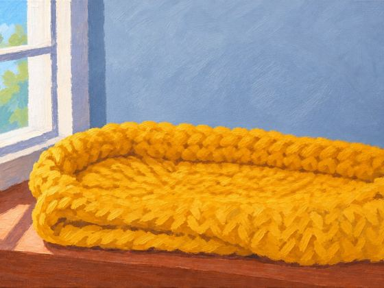

*Where this stage ends:* A thick rolled golden blanket lies on the sill, its knit loops dark in the folds and bright on the lit rolls, with no cat on it yet.

## The cat's shape

*This stage builds the curled cat as one shape, rounds it with shadow, and adds its white patches.*

### Step 14: Block in the curled cat

**Paints:** Cat gray (4 parts white, 3 parts burnt sienna, 2 parts ultramarine, a touch of yellow)

**Brush:** 1/2 inch flat

- **First:** Let the blanket dry completely, so the gray doesn't pick up yellow.
- **Start:** Start with a big oval for the curled body on the blanket; its middle is about 9 in from the left edge.
- **As in step 10:** You built the blanket from pieces in step 10; build the cat the same way, an oval body first, then the head and ears.
- **Strokes:** Build in pieces: the oval body, a circle for the head at the left end of the body, two triangle ears, then curved pieces to round the edges.
- **Where the paint sits:** The whole cat is one flat gray.
- **Leave:** Leave a band of the knit loops showing below the cat.
- **Stop when:** Stop when the cat's shape reaches the right edge, about 14 3/4 in wide and 7 in tall, with no shading.

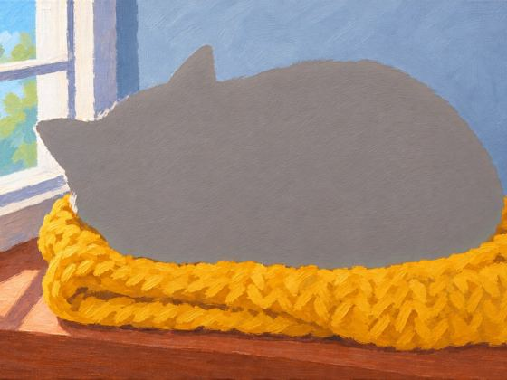

### Step 15: Shade the cat's far side

**Paints:** Dark cat gray (2 parts ultramarine, 2 parts burnt sienna, 1 part white, a touch of yellow)

**Brush:** 1/2 inch flat

- **First:** Let the flat gray cat dry first.
- **Start:** Start along the far end of the back, where the body curves down toward the blanket.
- **As in step 11:** The same curved strokes you used to round the blanket in step 11, now wrapping around the cat's body and head.
- **Strokes:** Bend each stroke around the body: from the top of the back down along its curve, and around the head and the ears.
- **Where the paint sits:** The dark goes on the far end of the back, where the body meets the blanket, along the ear edges, and in the curved hollow between head and body, away from the window light.
- **Leave:** Leave the flat gray showing on the top of the back, the face and the patch where the paws will go.
- **Stop when:** Stop when the cat looks round, darker away from the window and underneath.

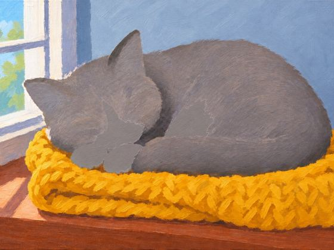

### Step 16: Paint the white muzzle, chest and paws

**Paints:** Titanium white (White, straight from the tube)

**Brush:** #8 round

- **First:** Let the dark shading dry, or the white turns gray.
- **Start:** Start with the white muzzle and chin under the face; that group's middle is about 5 1/4 in from the left edge.
- **As in step 15:** Curved strokes again, as in step 15, but with a small round brush and short strokes that follow each paw and patch.
- **Strokes:** Bend each stroke with the shape: around the round paws, down the chin, and in short pointed strokes for the fluffy edges of the chest blaze.
- **Where the paint sits:** The white goes on the muzzle and chin, the two paws resting on the blanket, and the chest blaze, whose middle is about 9 1/4 in from the left edge.
- **Leave:** Leave gray between the two paws and all around the blaze, so each patch reads alone.
- **Stop when:** Stop when the muzzle, the blaze and two plump paws are clean white.

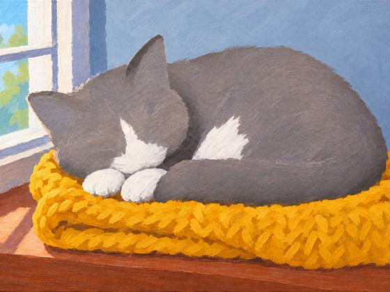

*Where this stage ends:* A round gray cat lies curled on the blanket, darker away from the window, with a white muzzle, a white chest blaze and two white paws.

## The pink ears and the stripes

*This stage gives the cat its pink ears and its tabby stripes.*

### Step 17: Press in the pink ear insides

**Paints:** Rosy pink (2 parts white, 1 part red, 1 part burnt sienna)

**Brush:** #6 round

- **First:** Let the gray ears dry first.
- **Start:** Start in the ear near the window; its middle is about 2 1/4 in from the left edge.
- **As in step 12:** The same press and lift as the knit loops in step 12, now one or two longer strokes filling each ear.
- **Strokes:** Touch the tip down near the ear's point, press to spread, and pull toward the ear's base, lifting off.
- **Where the paint sits:** The pink fills the inside of both ears; the upright ear's middle is about 6 1/4 in from the left edge.
- **Leave:** Leave a gray rim around the edge of each ear.
- **Stop when:** Stop when both ears have soft pink insides with a gray rim still showing around each.

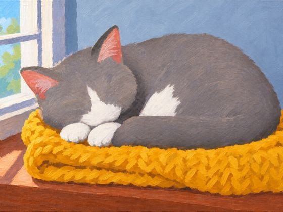

### Step 18: Pull the tabby stripes

**Paints:** Charcoal brown (3 parts burnt sienna, 2 parts ultramarine, 1 part white)

**Brush:** 1/4 inch angle

- **First:** Let the white patches and pink ears dry first.
- **Start:** Start on the top of the back, pressing the full brush down where each stripe begins.
- **Strokes:** Press the full width at the spine, then turn onto the edge and lighten as you pull down the side, so each stripe tapers to a point.
- **Where the paint sits:** The stripes wrap around the forehead, the cheeks, the back and side, and across the tail; most of them sit in the right half of the stripes.
- **Leave:** Leave the white patches, the pink ears and gray between every stripe.
- **Stop when:** Stop when tapered stripes wrap the head, body and tail. Don't make them straight: they curve with the body.

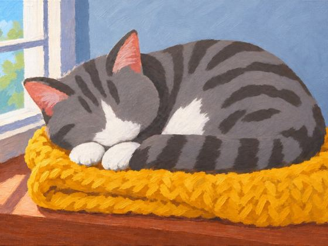

*Where this stage ends:* The cat has pink ears with gray rims and dark tapered stripes wrapping its head, body and tail.

## The fur

*This stage turns the smooth coat into soft fur.*

### Step 19: Flick in the light fur

**Paints:** Light cat gray (3 parts white, 2 parts burnt sienna, 1 part ultramarine, a touch of yellow)

**Brush:** small fan brush

- **First:** Let the stripes dry, or the flicks will smear them.
- **Start:** Start on the head and around the face; the flicks' middle is about 8 in from the left edge.
- **Strokes:** Load lightly and flick quickly along the curve of the body, lifting off as you go so each mark thins at the end.
- **Where the paint sits:** The flicks go over the gray coat and the stripe edges, thickest on the head, the back and the chest, where the light reaches.
- **Leave:** Leave the stripes and the darker gray showing between the flicks.
- **Stop when:** Stop when the coat looks soft and furry. Too much paint makes flat blobs.

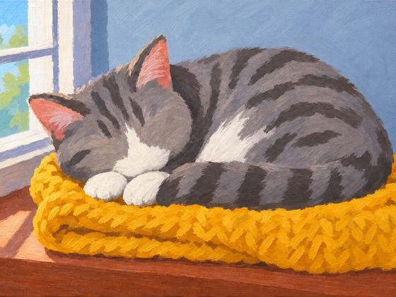

*Where this stage ends:* The coat looks furry, with light flicks over the gray and the stripes still showing through.

## The face and last details

*This stage brings the sleeping face to life, the focal point of the painting.*

### Step 20: Line the closed eyes and toes

**Paints:** Charcoal brown (3 parts burnt sienna, 2 parts ultramarine, 1 part white)

**Brush:** #1 liner

- **First:** Let the fur flicks dry, so the lines stay sharp instead of feathering.
- **Start:** Start with the closed eye nearest the window, a curved line on the face.
- **As in step 18:** This is the Charcoal brown from the stripes in step 18, now thinned and pulled as fine lines with the liner.
- **Strokes:** Thin the paint, hold the liner upright and pull each eye as a gentle downward curve, starting thick and lightening.
- **Where the paint sits:** Add a small mouth line under the muzzle and short lines between the toes on the paws.
- **Leave:** Leave the white muzzle and paws clean around each line.
- **Stop when:** Stop when the cat has two sleepy curved eyes, a mouth and toes. Skippy lines mean you need more water.

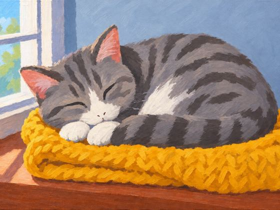

### Step 21: Press in the pink nose

**Paints:** Rosy pink (2 parts white, 1 part red, 1 part burnt sienna)

**Brush:** #2 round

- **First:** Let the eye and mouth lines dry first.
- **Start:** Start on the white muzzle; the nose's left side is about 5 1/2 in from the left edge.
- **As in step 17:** The same Rosy pink and the same press and lift as the ears in step 17, now one tiny mark with the smallest round brush.
- **Strokes:** Touch the tip down at the top of the nose, press to spread, and lift down to a point.
- **Where the paint sits:** The nose is one small triangle, about 3/4 in wide, sitting where the muzzle meets the small mouth line.
- **Leave:** Leave the white muzzle showing all around the nose.
- **Stop when:** Stop after one clean pink triangle. Don't go over it again, or it will blob.

### Step 22: Pull the white whiskers

**Paints:** Titanium white (White, straight from the tube)

**Brush:** #1 liner

- **First:** Let the nose dry first.
- **Start:** Start at the muzzle; the first fan's middle is about 5 1/2 in from the left edge.
- **As in step 20:** The same thin liner lines as the eyes in step 20, now pulled long and fine, out from the muzzle.
- **Strokes:** Thin the paint, hold the liner upright and pull each whisker out from the muzzle, lightening as you go so it tapers.
- **Where the paint sits:** One fan crosses the gray cheek and the paws; the other runs toward the chest blaze, its middle about 9 1/4 in from the left edge.
- **Leave:** Leave the face, eyes and nose untouched.
- **Stop when:** Stop after a few fine whiskers on each side. Reload often.

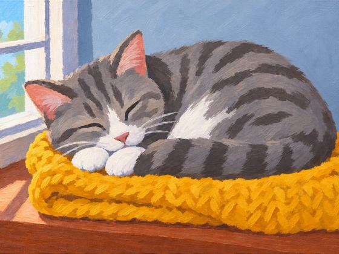

*Where this stage ends:* The kitten has closed sleepy eyes, toes, a small pink nose and fine white whiskers, and the painting is finished.

## Known problems

What the finisher listed for this lesson's pictures and paints:

- **blend-wall** (chain): The leaves outside the window don't appear in steps 1 to 3. Those pictures show only the small sky patch. In step 4 the leaves, and more sky below them, appear all at once with the wall. The first stage's closing line also promises leaf taps that its pictures don't show.
- **dab-dark-leaves** (step): The step picture looks the same as step 1. It has no green taps, so a painter can't see where the far leaves go. Step 4's picture shows them.
- **dab-pale-leaves** (step): The step picture looks the same as step 1. It shows no pale leaf taps.
- **dab-pale-leaves** (paint): 'Pale leaf green' was fitted to #a3cee2, a pale sky blue, because its step picture has no leaves to measure. Its recipe makes a blue, not a green. Mix it as its name says: Leaf green with white and a touch of yellow.
- **press-nose** (step): The step changes very little of the canvas (under 0.2%).
- **darken-sill-front** (words): The words ask for dark grain streaks. The picture shows pale, light streaks across the left and middle of the sill. Only the front band is dark.
- **block-in-cat** (words): The words say the cat's shape reaches the right edge. In the picture it stops about 1 in short of the edge, with the blanket showing beyond its back.
- **press-nose** (words): The words make the nose about 3/4 in wide. In the picture it is nearer 1/3 in.
