# The sleeping cat, with its arc (v4 spike #255, arc-add)

The whole lesson as a painter would read it: the opening, each stage's opener, and every step's words (the teacher spike's words, with the arc's "As in step N" lines added). Pictures are v3's. Back to the write-up: [v4-arc.md](v4-arc.md).

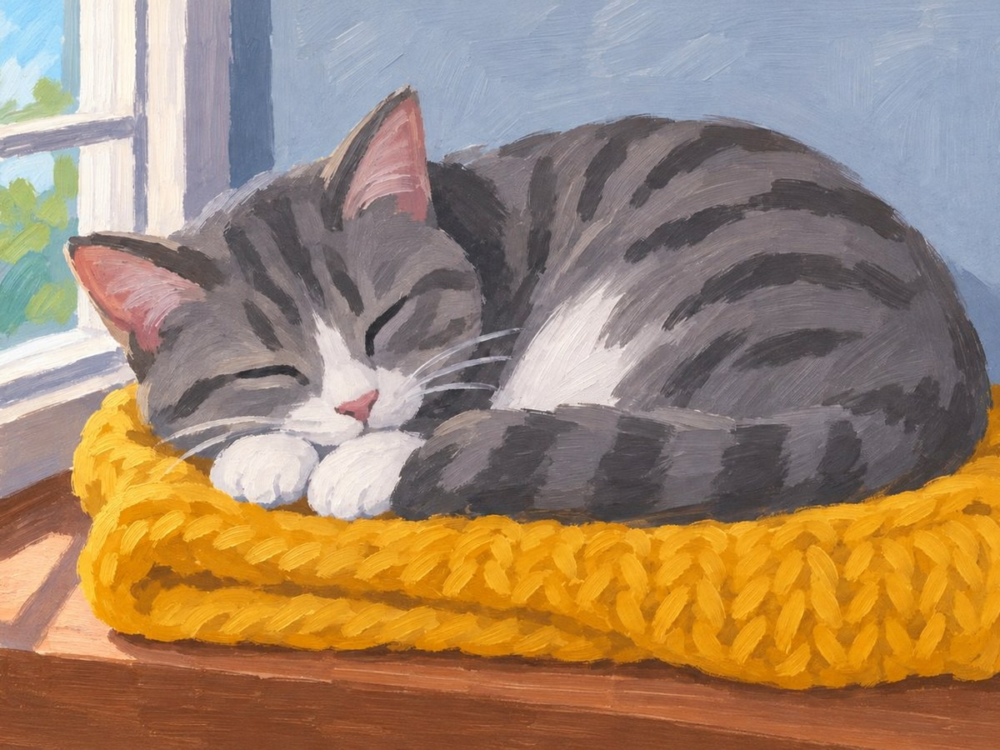

Canvas: 16 in wide, 12 in tall. 21 steps.

## What this painting teaches

- **Building from pieces** (steps 5, 6, 7, 9, 10, 13): Every big shape here starts as one simple rectangle, oval or circle with the rest added in pieces, from the window frame's bars to the curled cat.
- **Press and lift** (steps 11, 12, 17, 19): One touch, press and lift makes a comma: rows of them turn flat yellow into chunky knit, and tiny ones fill the ears and the nose.
- **Curved strokes** (steps 14, 15): Bending each stroke with the round of the body is what turns a flat gray shape into a soft, curled, sleeping cat.

**The way there:** You start with the far things a beginner can't spoil: the sky and leaves through the window, then the blue wall. Next come the window frame and the sill, which sit nearer, and then the blanket as the cat's bed. The cat goes on last as one plain gray shape, then gets its shading, white patches, stripes and fur. That way the final steps all go to its sleeping face.

## The view through the window

*This stage paints the farthest thing in the picture, the soft sky and leaves seen through the window.*

*By its end:* A small corner of soft blue sky and dappled leaves sits on otherwise bare white canvas.

### Step 1: Blend the sky in the window

**Paints:** Pale sky blue (3 parts white, 1 part ultramarine, a touch of yellow); Warm white (12 parts white, 1 part yellow, a touch of red)

**Brush:** 3/4 inch wash brush

- **Start:** Start in the upper left corner of the canvas with Pale sky blue, right at the top edge and the left edge.
- **Strokes:** Stroke side to side across the corner. Then, without rinsing, pick up Warm white, paint it in at the foot of the patch, and stroke back up over the join while both are wet.
- **Where the paint sits:** The blue stays at the top of the patch and the Warm white goes in low down, so the sky gets lighter toward its bottom, the way a sky does near the horizon.
- **Leave:** Leave the rest of the canvas bare white. The patch is only about 1 1/4 in wide and 1 3/4 in tall, with a soft, bumpy lower edge.
- **Stop when:** Stop when the corner is a smooth pale blue with no hard line where the two colors meet. If a hard line shows, add a little more Warm white at the join and blend again.

### Step 2: Dab the dark leaves

**Paints:** Leaf green (3 parts white, 2 parts ultramarine, 1 part yellow)

**Brush:** old stiff brush

- **First:** Let the sky patch dry to the touch.
- **Start:** Start at the top of the sky patch, in the upper left corner of the canvas.
- **Strokes:** Wipe most of the Leaf green off on a paper towel, then tap straight down with the tip of the stiff brush. Work down the patch's ragged outer edge, and let a short tail of taps trail down from it.
- **Where the paint sits:** Tap the upper part of the patch more often so it goes nearly solid. Tap less toward its bottom, so small gaps of pale sky still peek through.
- **Leave:** Leave the palest bit of sky showing low in the patch, and keep the rest of the canvas bare.
- **Stop when:** Stop when the corner reads as a darker clump over pale sky, with soft dappled edges. If you get blobs, the brush is too wet: wipe it and tap again.

### Step 3: Dab the sunlit leaves

**Paints:** Sunny leaf green (2 parts yellow, 1 part ultramarine, 1 part white, a touch of burnt sienna)

**Brush:** old stiff brush

- **First:** Let the Leaf green taps dry.
- **Start:** Start on the top of the dark clump, about 1/2 in from the top edge and about 1 in from the left edge.
- **Strokes:** With almost no Sunny leaf green on the stiff brush, tap just a few times with its tip, and keep each tap small.
- **Where the paint sits:** Put it only on the tops of the clump, where daylight catches the leaves. It is a tiny touch, about 1/4 in wide.
- **Leave:** Leave almost all of the Leaf green and the pale sky showing. Don't cover the clump.
- **Stop when:** Stop after a handful of taps. The corner should look nearly the same as before, just a hint brighter on top.

## The wall and the window frame

*This stage covers the bare canvas with the blue wall and stands the cream window frame over it.*

*By its end:* A brushy blue wall fills the canvas, and a crisp cream frame with lavender shadows stands over the leafy view.

### Step 4: Blend the blue wall

**Paints:** Deep wall blue (1 part ultramarine, 1 part white); Wall blue (1 part ultramarine, 1 part white, a touch of yellow)

**Brush:** 1 inch wide flat

- **First:** Let the window corner dry completely so the blue doesn't drag into it.
- **Start:** Start at the top edge, next to the window view, with Deep wall blue.
- **As in step 1:** This is the same wet side-to-side blend you used for the sky. Now it uses two blues and a wider brush.
- **Strokes:** Stroke side to side in long, wide rows down the canvas. Without rinsing, pick up Wall blue and carry it toward the right edge, stroking back over each join while it's wet. Let some strokes slant so the wall looks brushed.
- **Where the paint sits:** The deeper blue stays near the window and Wall blue spreads over the rest. Paint straight through where the frame, sill, blanket and cat will go, down to the bottom edge.
- **Leave:** Leave the window view in the upper left corner of the canvas showing, and paint carefully around its edge.
- **Stop when:** Stop when everything except the window view is blue, out to every edge of the canvas, with no hard lines between the two blues.

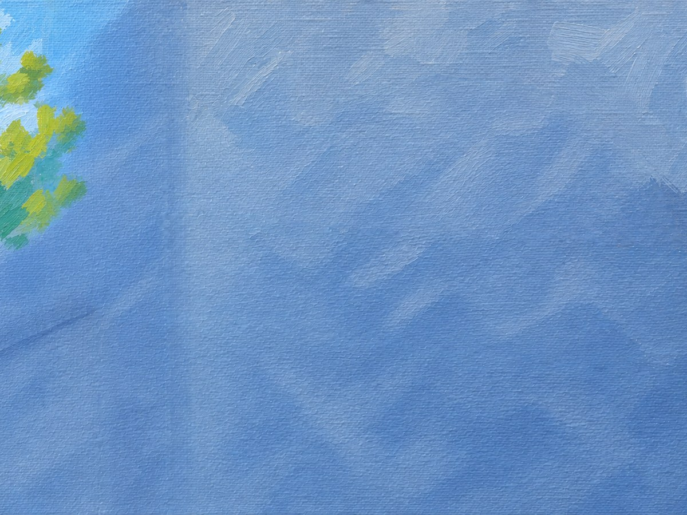

### Step 5: Block in the window frame

**Paints:** Warm white (12 parts white, 1 part yellow, a touch of red)

**Brush:** 1/2 inch flat

- **First:** Let the wall dry fully. White over damp blue goes streaky.
- **Start:** Start with the wide upright post, a tall rectangle of Warm white from the top edge down to the bottom edge. Its right side is about 3 3/4 in from the left edge.
- **Strokes:** Pull each stroke straight down the post with the flat, keeping its edge crisp against the wall. Then add the other pieces: a narrower post in the upper part of the window, a thin crossbar across the view, and lower down a thicker slanted ledge that runs out to the left edge of the canvas.
- **Where the paint sits:** Keep every piece one flat Warm white, with no shading yet.
- **Leave:** Leave sky and leaves showing in the two panes the crossbar makes. Leave blue wall in the corner where the ledge and the post meet, down at the bottom edge.
- **Stop when:** Stop when a flat cream frame stands crisp over the view and the wall, reaching the top and bottom edges.

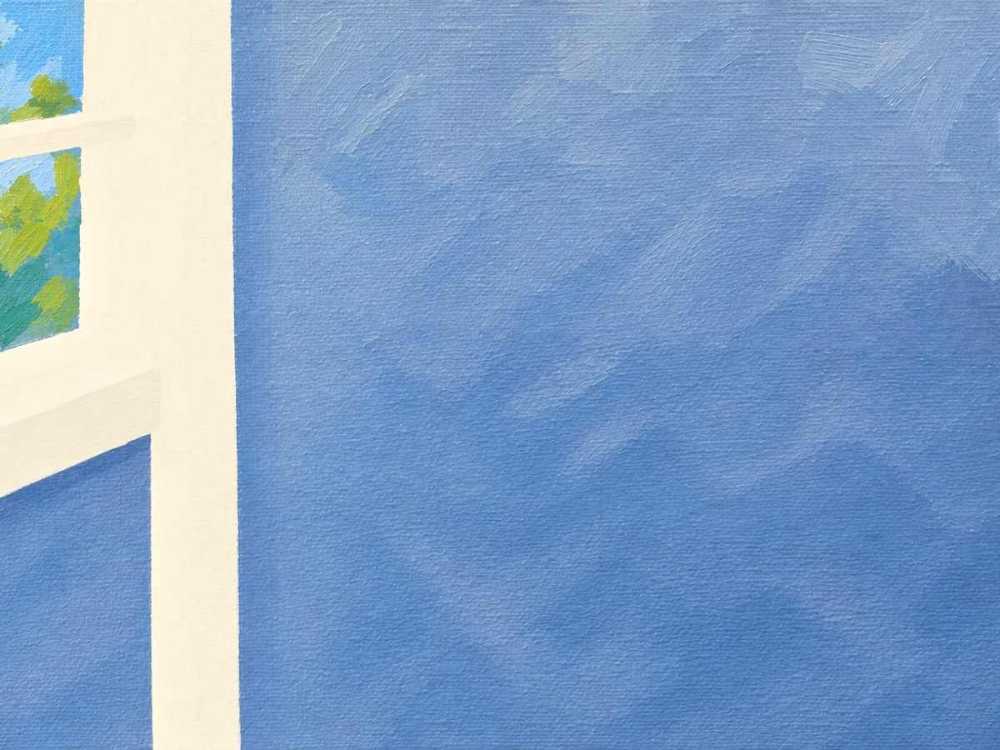

### Step 6: Shade the frame's inner sides

**Paints:** Lavender gray (6 parts white, 3 parts ultramarine, 2 parts burnt sienna)

**Brush:** 1/4 inch flat

- **First:** Let the white frame dry.
- **Start:** Start at the top edge, on the half of the wide post that faces the wall.
- **Strokes:** Lay each band in pieces with the small flat. Pull straight down the posts and straight along the crossbar and the ledge, keeping to their edges.
- **Where the paint sits:** The bands go on the faces turned away from the daylight: the wall-facing half of the wide post, the edge of the narrow post, the underside of the crossbar and the front of the slanted ledge. Then pull one long band down the wall where it meets the wide post, from the top edge to the bottom edge, for the frame's shadow.
- **Leave:** Leave cream showing on the window-facing half of each post, and leave a slim cream wedge where the ledge meets the post.
- **Stop when:** Stop when the frame looks solid and squared, cream on one face and lavender on the other, with a dark band down the wall along the wide post.

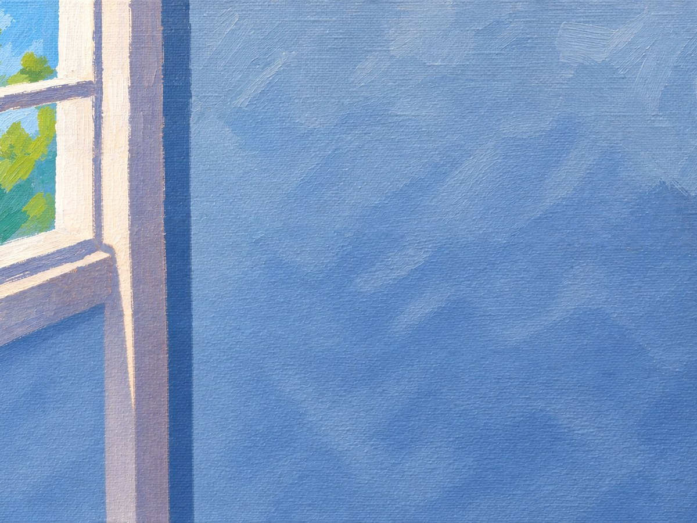

## The windowsill

*This stage builds the wooden sill the blanket and cat will rest on, with the window light falling across it.*

*By its end:* A warm brown sill runs the width of the canvas, streaky with grain and crossed by bright peach patches of window light.

### Step 7: Block in the windowsill

**Paints:** Warm wood brown (2 parts red, 1 part ultramarine, a touch of yellow, a touch of white)

**Brush:** 1 inch flat

- **First:** Let the frame and wall dry.
- **Start:** Start with the long slanted top of the sill. Its top line begins about 7 1/4 in from the top edge, at the foot of the window frame, and slopes gently down toward the right edge.
- **Strokes:** Fill that slanted rectangle with long side-to-side strokes of Warm wood brown, running along the length of the sill like wood grain. Then add the front edge as a strip across the bottom of the canvas, and a small raised lip at the left edge where the sill meets the ledge.
- **Where the paint sits:** It is all one flat brown for now, covering the wall and the foot of the frame down to the bottom edge.
- **Leave:** Leave the wall and the frame untouched above the sill's top line, and keep that line straight.
- **Stop when:** Stop when a flat brown sill runs across the canvas from the left edge to the right edge, with its front edge still readable as a separate strip.

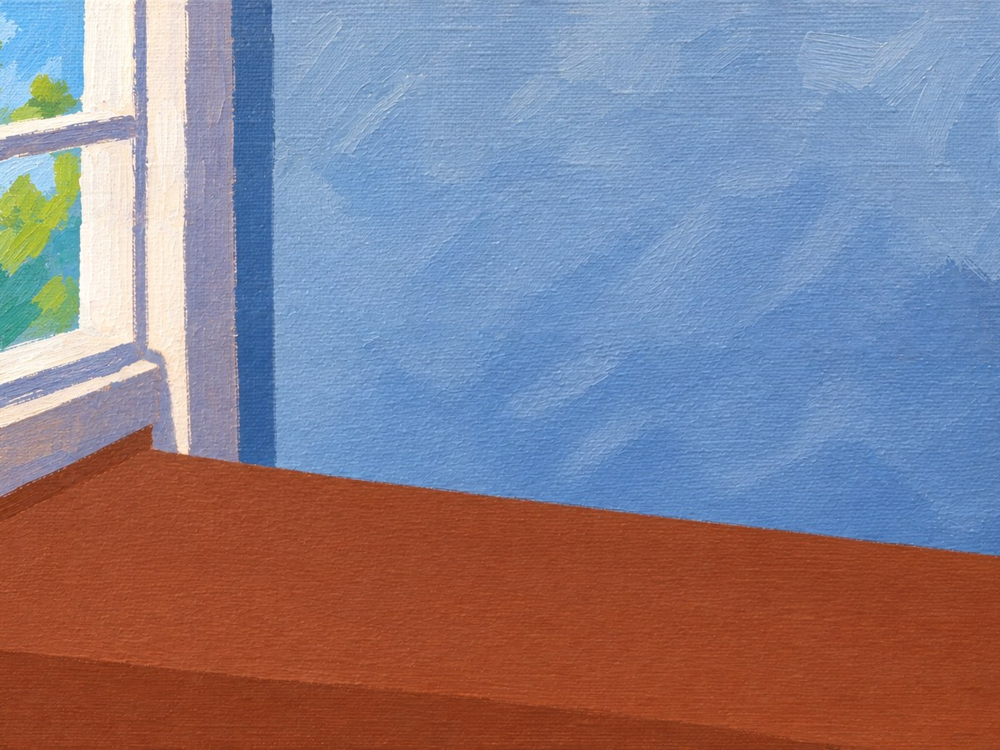

### Step 8: Shade the sill's front edge

**Paints:** Warm wood brown (2 parts red, 1 part ultramarine, a touch of yellow, a touch of white)

**Brush:** 3/4 inch flat

- **First:** Let the brown sill dry completely, or the dry brush will lift it.
- **Start:** Start on the sill top at the foot of the window frame, where the sill meets the wall.
- **Strokes:** Put only the tip of the dry brush in Warm wood brown and wipe it. Skim long, light strokes along the grain, the length of the sill, out to the right edge of the canvas. Build it up in several light passes.
- **Where the paint sits:** Lay the streaks thickest along the back of the sill, across the far stretch of its top and along the front edge, so those parts read as shade. Near the window, skim around the slanted shapes where the sunlight will fall: two long slanted pieces split by a thin diagonal bar.
- **Leave:** Leave those sunny shapes plain, and leave a few bits of the front edge broken, where the paint skips.
- **Stop when:** Stop when the sill looks streaky and grained, with the sun shapes still clear near the window. If a patch goes solid, let it dry and dry-brush back over part of it.

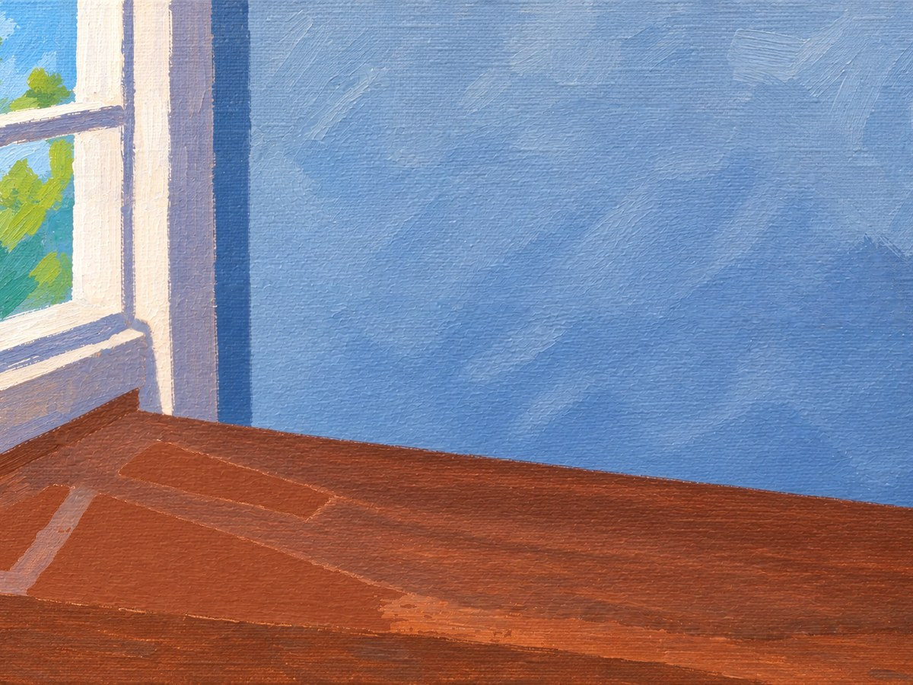

### Step 9: Lay the sunny patch on the sill

**Paints:** Sunny peach (4 parts white, 2 parts red, 1 part yellow)

**Brush:** 1/2 inch flat

- **First:** Let the dry-brushed streaks dry.
- **Start:** Start with the biggest sunny shape, the long slanted wedge on the sill top near the window. Its bottom is about 1 in from the bottom edge.
- **Strokes:** Lay Sunny peach in flat pieces with the small flat. Block in the wedge first, then a narrow slanted bar nearer the wall, then a small piece at the left edge of the canvas. Run each stroke along the slant of the window light.
- **Where the paint sits:** The peach goes where daylight through the panes lands on the sill. It slants away from the window and breaks into ragged bits at the far tip of the wedge.
- **Leave:** Leave the brown bands between the pieces showing. They are the shadows of the frame's posts and crossbar.
- **Stop when:** Stop when the sill shows three bright peach patches split by brown bands, reading as window light on wood.

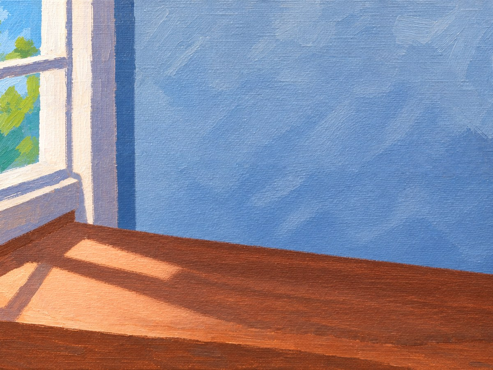

## The blanket

*This stage gives the cat its bed, a golden blanket made to look knitted with little commas of dark and light.*

*By its end:* A chunky golden knit blanket lies on the sill, ochre in its dips and glowing at the end nearest the window.

### Step 10: Block in the blanket

**Paints:** Golden yellow (1 part yellow, a touch of red)

**Brush:** 1 inch flat

- **First:** Let the sill dry.
- **Start:** Start with a long, low oval of Golden yellow across the lower middle of the canvas. Its left side is about 1 1/4 in from the left edge, and it runs all the way to the right edge.
- **Strokes:** Fill the oval with big flat strokes. Then, at the end nearest the window, add the curved roll and the folded front edge as two rounded pieces, like ( ). Carry the yellow across where the cat will lie.
- **Where the paint sits:** Keep it one flat yellow with no shading. The two bumps at the window end show the roll sitting on the fold.
- **Leave:** Leave the sunny peach patches showing on the sill near the window, and a thin line of dark sill showing along the blanket's bottom edge.
- **Stop when:** Stop when a smooth, solid golden shape lies on the sill, its bottom about 1 in from the bottom edge.

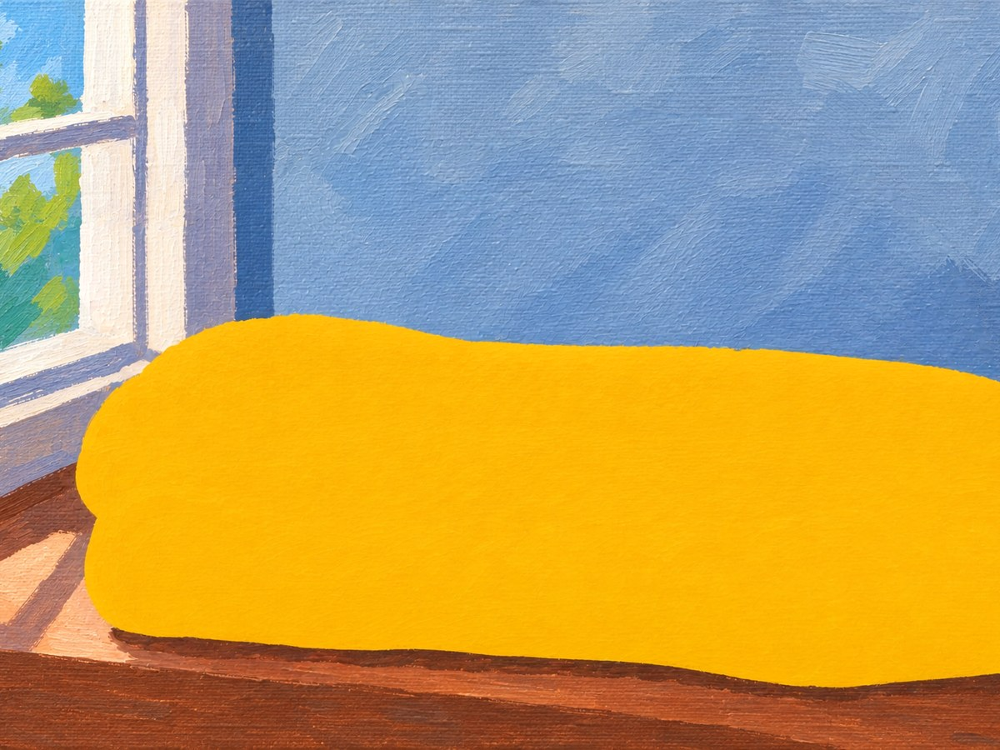

### Step 11: Tap in the dark knit loops

**Paints:** Dark ochre (2 parts yellow, 1 part red, a touch of ultramarine)

**Brush:** #8 round

- **First:** Let the Golden yellow dry fully.
- **Start:** Start along the back rim of the blanket, at the end nearest the window.
- **Strokes:** Load the round full of Dark ochre and make short commas: touch the tip down, press, then pull and lift. Run them in rows along the roll's length, and on the front fold set them in little V pairs, like knit stitches.
- **Where the paint sits:** Pack them thickest in the blanket's hollow middle, along the inner side of the back rim, and in the creases of the front fold, where the knit turns away from the light.
- **Leave:** Leave gold showing on the top of the roll, on the flat bed in the middle, and between every loop.
- **Stop when:** Stop when the whole blanket reads as chunky knit, gold on the tops and ochre in the dips, out to the right edge. If you get blobs, use less paint and lift faster.

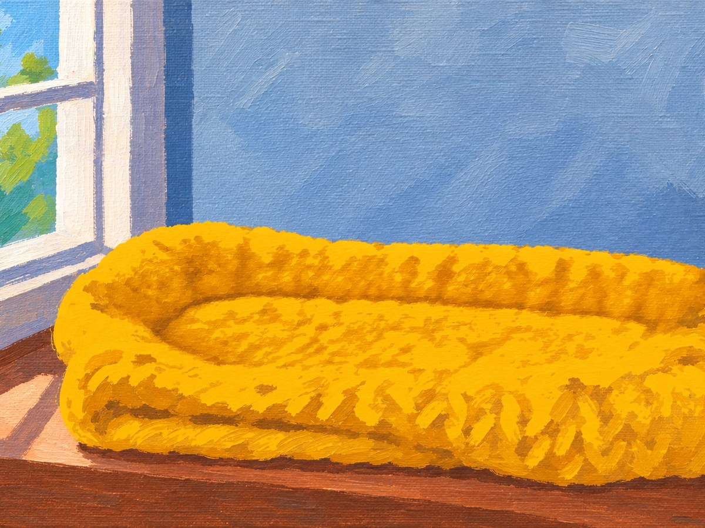

### Step 12: Tap in the light knit loops

**Paints:** Pale yellow (1 part yellow, a touch of red, a touch of burnt sienna)

**Brush:** #6 round

- **First:** Let the dark loops dry.
- **Start:** Start on the rounded end of the blanket nearest the window, on the top of the roll.
- **Strokes:** Load the smaller round with Pale yellow and make short press-and-lift commas, the same way as the dark loops but smaller.
- **Where the paint sits:** Crowd them on the rounded end facing the window, where daylight hits the knit. Then scatter just a few dots and commas over the flat bed and along the front fold.
- **Leave:** Leave most of the dark ochre loops and the gold showing. This is a light sprinkle, not a coat.
- **Stop when:** Stop when the window end of the blanket glows and the rest just sparkles here and there.

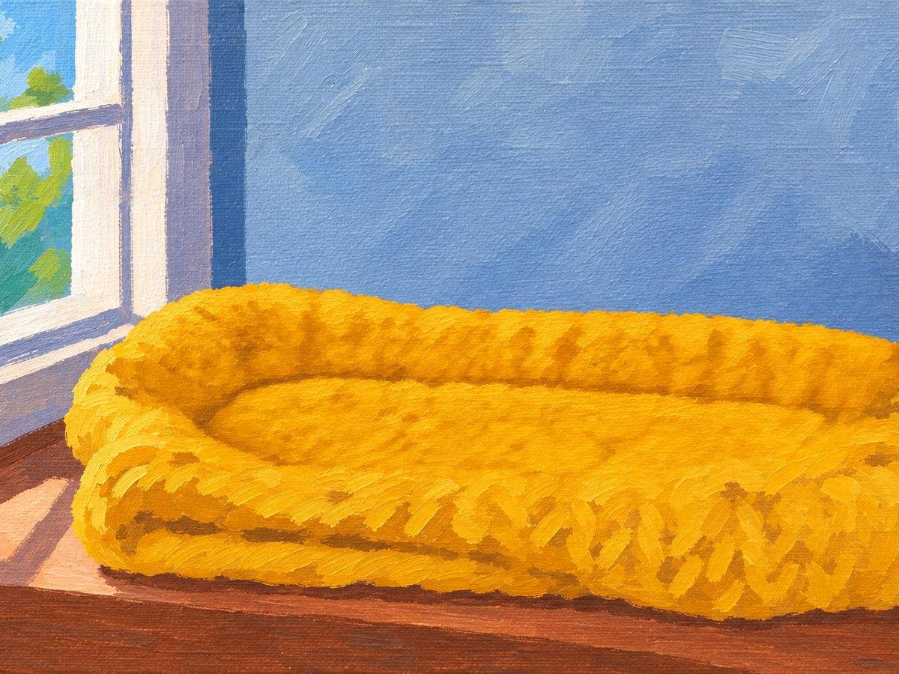

## The cat's shape

*This stage builds the cat as one gray shape and makes it look round with shading and white patches.*

*By its end:* A plain gray curled cat sleeps on the blanket, darker on its far end and tail, with a white muzzle, white paws and a white side patch.

### Step 13: Block in the curled cat

**Paints:** Mid gray (2 parts white, 1 part ultramarine, 1 part burnt sienna, a touch of yellow)

**Brush:** 1/2 inch flat

- **First:** Let the blanket dry.
- **Start:** Start with a big oval of Mid gray for the curled body, sitting in the hollow of the blanket and reaching the right edge of the canvas. Then add a circle for the head at the end nearest the window.
- **As in step 10:** Build the cat the way you built the blanket: one big oval first, then the smaller pieces around it.
- **Strokes:** Build the rest from pieces: two triangles for the ears, one standing up from the top of the head and one pointing toward the window, then curved pieces for the tail and the paws. Let your strokes follow the curl of the fur.
- **Where the paint sits:** Keep it all one flat gray. The shading comes next.
- **Leave:** Leave the blanket's front roll and fold showing in front of the cat, with a thin rim of gold where the body meets the blanket.
- **Stop when:** Stop when a flat gray curled-cat shape lies on the blanket, its bottom about 3 1/2 in from the bottom edge.

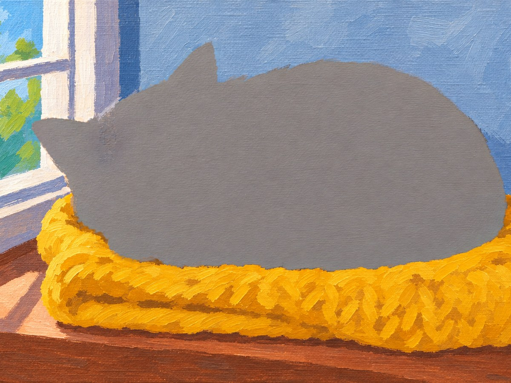

### Step 14: Shade the cat's shadow side

**Paints:** Dark gray (3 parts white, 2 parts ultramarine, 2 parts burnt sienna, a touch of yellow)

**Brush:** 1/2 inch flat

- **First:** Let the Mid gray dry.
- **Start:** Start with Dark gray in the deep curve behind the head, where the head tucks against the body.
- **Strokes:** Pull curved strokes down that crescent, from the top of the body toward the blanket. Then sweep around the round end of the body and along the tail, bending every stroke with the shape.
- **Where the paint sits:** Dark gray goes on the far round end of the body, along the tail lying in front, where the chin meets the blanket, and in the crescent behind the head. These are the parts turned away from the window light.
- **Leave:** Leave the head, the ears and the top of the body Mid gray. Also leave the muzzle, the paws and a patch on the side plain gray, ready for the white.
- **Stop when:** Stop when the cat looks round: light on its head and top, dark around its back end and tail, with a few soft gray flecks where the two meet.

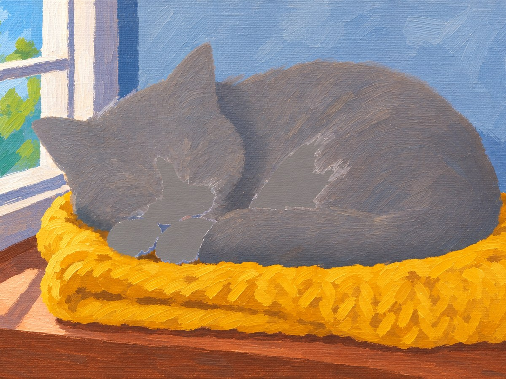

### Step 15: Paint the white patches

**Paints:** Warm white (12 parts white, 1 part yellow, a touch of red)

**Brush:** #8 round

- **First:** Let the dark gray dry.
- **Start:** Start on the muzzle and chin, the patch between the face and the paws. Its left side is about 3 1/4 in from the left edge.
- **Strokes:** Curve each Warm white stroke with the round of the shape: around the muzzle, over each front paw from its top down, and down the side patch along the fur.
- **Where the paint sits:** White goes on the muzzle and chin, on the two front paws tucked at the chin, and on a pointed patch on the side, its middle about 9 1/4 in from the left edge, where the chest fur shows.
- **Leave:** Leave a thin gray line between the two paws, and another between the paws and the chin, so they stay separate.
- **Stop when:** Stop after 2 or 3 thin coats, when the patches are bright and solid with soft, furry points along their edges. One thick coat goes streaky.

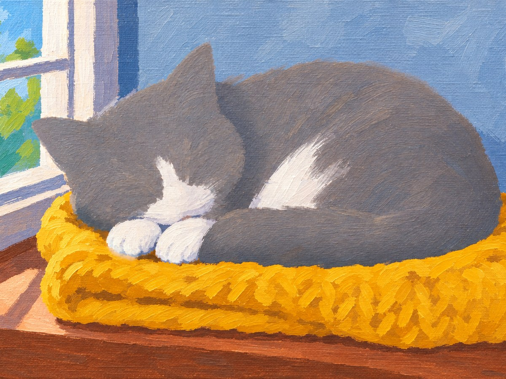

## The stripes and ears

*This stage turns the gray cat into a tabby with tapered stripes and gives it pink ears.*

*By its end:* Charcoal stripes wrap around the curled cat, and both ears are soft pink inside a gray rim.

### Step 16: Pull the dark tabby stripes

**Paints:** Charcoal (2 parts ultramarine, 2 parts burnt sienna, 1 part white, a touch of yellow)

**Brush:** 1/4 inch angle

- **First:** Let the white dry fully.
- **Start:** Start with short Charcoal stripes on the top of the head, between the ears.
- **Strokes:** Press the full width of the angle brush to start each stripe, then turn it onto its edge and lighten up so the stripe tapers. On the body, curve each stripe around the round, from the spine down toward the blanket. On the tail, pull short bands across it.
- **Where the paint sits:** Stripes go on the forehead, the cheeks, all over the body and in bands along the tail. Make them broadest on the shadowed end of the body. Darken the rims of the ears too.
- **Leave:** Leave the white muzzle, paws and side patch clean, and leave plenty of gray between the stripes.
- **Stop when:** Stop when the cat clearly reads as a tabby, its stripes wrapping around the curl.

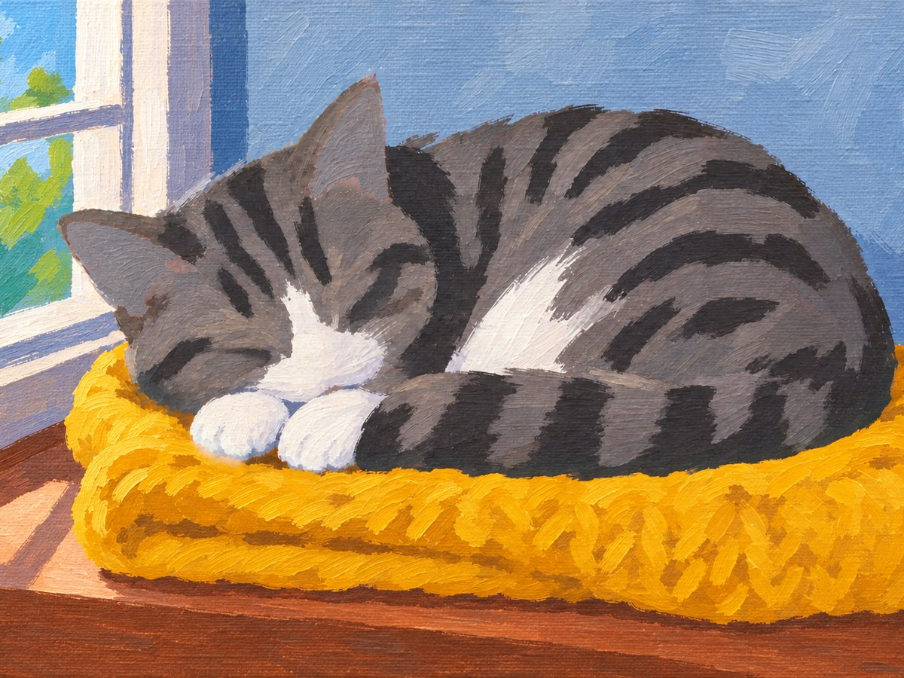

### Step 17: Paint the pink inside the ears

**Paints:** Soft pink (6 parts white, 3 parts burnt sienna, 1 part red, 1 part ultramarine)

**Brush:** #4 round

- **First:** Let the stripes dry.
- **Start:** Start in the ear that points toward the window. Its middle is about 2 1/4 in from the left edge.
- **As in step 11:** These are the same press-and-lift commas you used for the knit loops, now small with a little round.
- **Strokes:** Touch the round's tip down near the ear's base, press, then pull toward the tip and lift, so each mark points into the corner of the ear.
- **Where the paint sits:** Fill that ear with Soft pink, then the ear on the top of the head, whose middle is about 6 1/4 in from the left edge.
- **Leave:** Leave a gray rim showing all around each ear.
- **Stop when:** Stop when both ears are soft pink with a gray rim and come to a point at the tips.

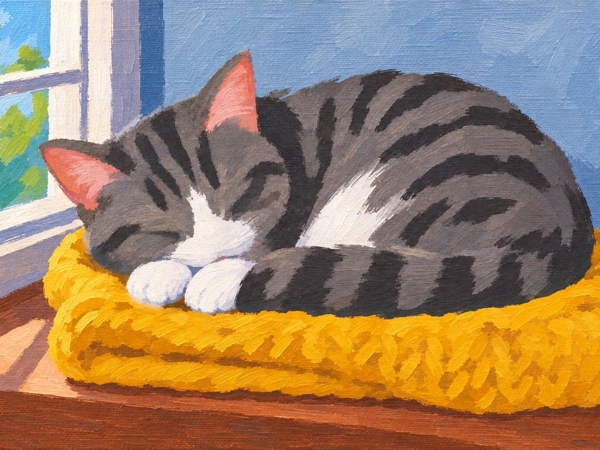

## The fur

*This stage softens the smooth gray coat into fur with quick, light flicks.*

*By its end:* Light gray flicks make the coat look soft and furry, the stripes still clear and the face still blank.

### Step 18: Flick in the light fur

**Paints:** Light gray (1 part ultramarine, 1 part burnt sienna, 1 part white, a touch of yellow)

**Brush:** small fan brush

- **First:** Let the pink and the stripes dry.
- **Start:** Start on the top of the head and the top of the curled back, where the window light hits.
- **Strokes:** With very little Light gray on the fan brush, flick short, quick strokes, lifting off each one so it thins at the end. Follow the way the fur lies around the curl.
- **Where the paint sits:** Flick over the head, the back, the round of the body and the tail, so the gray between the stripes turns into lighter, softer fur. Let some flicks cross the stripe edges to break them up.
- **Leave:** Leave the stripes mostly dark, the white patches and pink ears untouched, and the face blank.
- **Stop when:** Stop when the coat looks soft and furry and the stripes are still clear. Flat blobs mean too much paint, so wipe the brush.

## The sleeping face

*This stage spends its last careful strokes on the sleeping face, the heart of the painting.*

*By its end:* The finished painting: the tabby asleep on its knit blanket, eyes closed, with a pink nose and white whiskers fanning out.

### Step 19: Paint the pink nose

**Paints:** Soft pink (6 parts white, 3 parts burnt sienna, 1 part red, 1 part ultramarine)

**Brush:** #4 round

- **First:** Let the fur flicks dry.
- **Start:** Start on the white muzzle, just over the paws, with a small triangle nose. Its middle is about 5 3/4 in from the left edge.
- **Strokes:** Touch the round's tip down at the nose's point, press so the mark widens, then lift. Two or three tiny strokes make the triangle, wide end up.
- **Where the paint sits:** Then add a few small touches of Soft pink along the tips and inner edges of both ears to deepen them.
- **Leave:** Leave white all around the nose.
- **Stop when:** Stop when a small, neat pink nose sits on the muzzle.

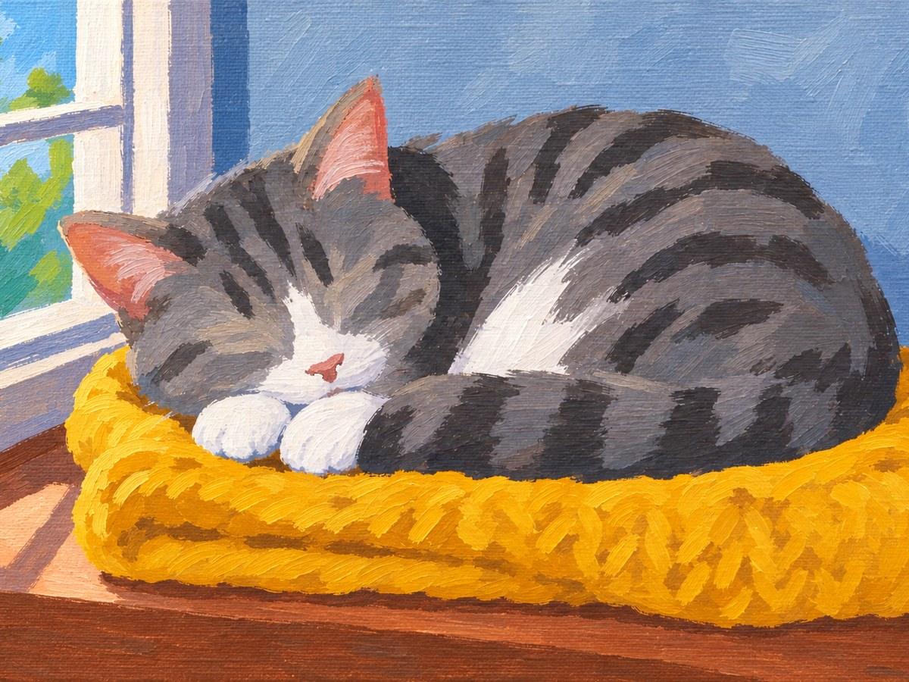

### Step 20: Line the closed eyes and mouth

**Paints:** Charcoal (2 parts ultramarine, 2 parts burnt sienna, 1 part white, a touch of yellow)

**Brush:** #1 liner

- **First:** Let the nose and the fur dry. Liner lines spread on wet paint.
- **Start:** Start with the eye nearest the window, a gentle curved line where the gray cheek meets the white muzzle.
- **As in step 16:** This is the same Charcoal you used for the stripes, now thinned with water for the liner.
- **Strokes:** Thin the Charcoal with water and hold the liner upright. Pull each line with light, steady pressure, starting a little thicker and easing off to a thin end.
- **Where the paint sits:** Line both closed eyes, then a tiny mouth line from the point of the pink nose and a few short lines on the cheek past the second eye. Add a dark shadow where the chin tucks into the paws, and a thin dark edge along the outer rims of both ears.
- **Leave:** Leave the pink nose and the white muzzle clean.
- **Stop when:** Stop when the face looks peacefully asleep. Add water if a line skips.

### Step 21: Pull the whiskers

**Paints:** Warm white (12 parts white, 1 part yellow, a touch of red)

**Brush:** #1 liner

- **First:** Let the charcoal lines dry.
- **Start:** Start at the edge of the white muzzle, near the nose.
- **As in step 20:** Hold the liner upright as you did for the eye lines, now with thinned Warm white.
- **Strokes:** Thin the Warm white and hold the liner upright. Pull each whisker out from the muzzle in one steady stroke, lightening as you go so it tapers, and reload often.
- **Where the paint sits:** Fan three or four whiskers across the cheek and over the paws toward the window, reaching to about 2 3/4 in from the left edge. Fan three or four more out the other side of the muzzle, across the cheek.
- **Leave:** Leave the eye lines and the nose untouched, and let a few whiskers cross the stripes.
- **Stop when:** Stop when thin, light whiskers fan out from both sides of the muzzle, and the painting is finished.

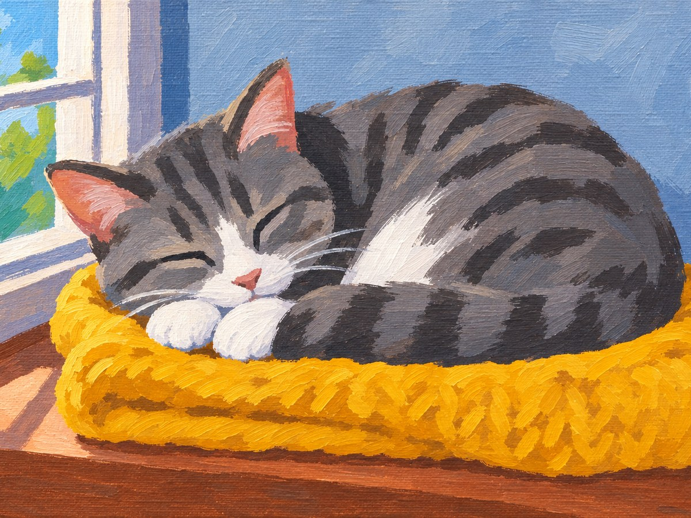
