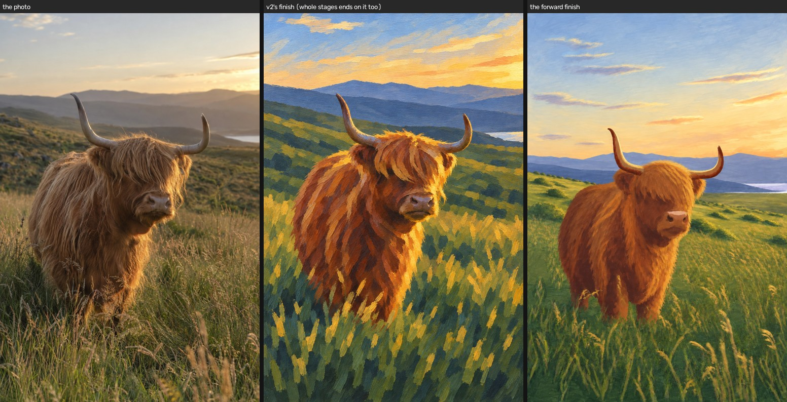
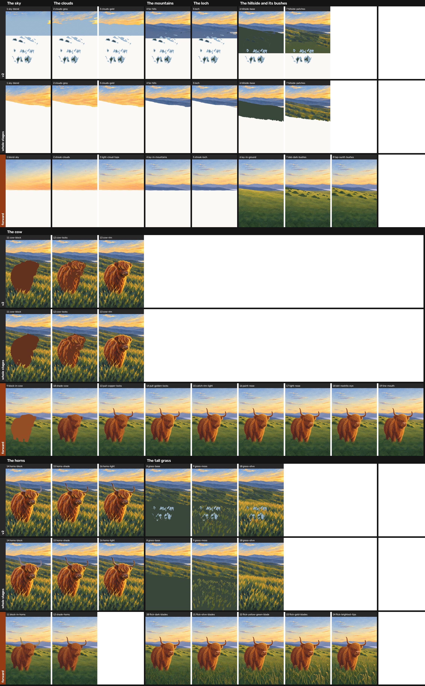
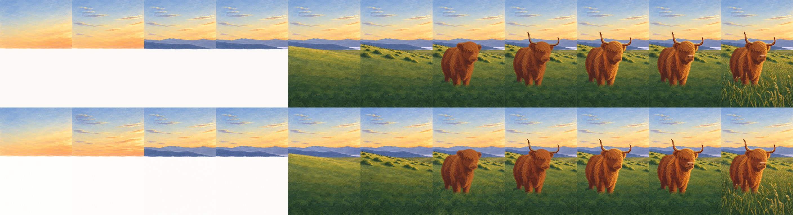

# Spike: build the painting forward (#207)

2026-11-17. A v4 idea, not part of v3. The image model paints the bare canvas a thing at a time, with the photo
beside it, and there is no finished painting to cut from: the last picture of the chain is the finish. The code is
`spike/experiments/v4_forward.py`, its numbers `spike/experiments/v4_forward.json`, its tests
`spike/tests/test_v4_forward.py`. It is experiment code: no lesson tool, the skill, or the site changed.

**Verdict: park** (owner's call, 2026-11-17, after looking at the pictures below). Owner: "A lot of the steps look
the same in that one. Might be worth tweaking in the future but I think the v3 solution is better." Stage 2 did not
run, and no graders ran. v3 goes on with whole-picture stages (#204). If this is picked up again, the two things to
fix first are the steps that look the same (the model paints more than a step asks, so the steps after it change
little) and the finish wandering from the photo.

## The two questions

**1. Is it still the painter's photo? Less than v2's finish is.**

- The cow moved and shrank. In the photo and in v2's finish it fills the left of the canvas, turned a little, with
  its legs lost in the grass. Built forward it stands in the middle, smaller, square on, with all four legs showing.
- The sky took over the top half; the photo's hillside behind the cow is now a flat green field with a few bushes.
- Shrunk to 48 by 72 pixels, so only the big shapes and colors count: the forward finish is 26.1 Lab units from the
  photo where v2's is 22.3, and its light and dark fall in the same places at 0.65 where v2's do at 0.84.
- The look changed too: smooth and soft, close to an airbrushed illustration. v2's finish has the chunky strokes a
  beginner's brush makes.

**2. Are the step pictures better? Cleaner, yes. Better taught, only partly.**

Three rows a thing: v2, whole-picture stages (#204), forward. The plans differ (v2's 16 steps, the plan-first plan's
24), so the rows are lined up by the thing being painted, each picture under its own step number.

- **Nothing is on the canvas before its step,** and nothing is erased badly. No blotches, no ghost of the cow, no
  hard-edged slab: the faults of the other two rows are gone.
- **Step 1 is only the sky.** Whole-picture stages' step 1 was the finished sunset, clouds and all; here the clouds
  arrive in steps 2 and 3. That was one of the two faults this spike was filed for.
- **The words and the back of the picture agree,** because each render was asked for what its steps say.
- **The model adds more than the step asks.** The "block in and shade the cow" render came back with a furry coat
  and a muzzle shape. So the three coat steps after it (13 to 15) change little, and the cow never looks like a flat
  shape with a dark side.
- **Six of the 24 steps change under 0.2% of the canvas.** Four are the face, which is small anyway. The other two
  are the first cloud step and the last grass tips.
- **Inside a render the steps are still v2's cuts** (a flat coat, then nearest-paint passes). The tall grass builds
  up well that way over five steps. The cow's block-in is a flat shape, then everything at once.

The chain: top row, the canvas after each render; bottom row, the raw renders.

## What was run

- **The plan** is the plan-first painter's plan (#172, `bench/plan-first/highland-cow/painter-a.json`): 24 steps in
  7 stages, written before any outline.
- **One render for each run of steps in a stage on the same thing:** 11 renders for the cow. The cow itself is three
  (its shape, its coat, its face), so each is painted to suit its steps. The request gives the canvas so far and the
  photo, the steps' own words, the paints by name and color, what the canvas shows when the stage is done (the
  plan's `after`), and the things not to paint yet.
- **The guard is #204's, turned around.** Of each render only the patches that changed by a lot are kept
  (`diff_mask`, with no box: the painter's plan has none). The rest of the canvas stays as it was.
- **Paints are fitted at the end.** Each paint starts from a rough color for its name
  (`v4_forward_paints.json`, written by hand for this picture) and moves to the color it has in its render.

## The numbers

| Render | Steps | Added (share of canvas) | Raw render moved what was already there |
|---|---|---|---|
| sky | 1 | 46.2% | |
| clouds | 2, 3 | 7.2% | 2.7% |
| mountains | 4 | 11.0% | 0.0% |
| loch | 5 | 0.5% | 0.1% |
| hillside and meadow | 6 | 56.0% | 0.3% |
| bushes | 7, 8 | 10.3% | 0.2% |
| cow, shape | 9, 10 | 19.0% | 1.4% |
| horns | 11, 12 | 1.7% | 0.3% |
| cow, coat (and the rim on the horns) | 13 to 15 | 9.7% | 0.3% |
| cow, face | 16 to 19 | 0.4% | 0.9% |
| tall grass | 20 to 24 | 33.8% | 2.0% |

- **No request was made again.** 11 renders, the first answer kept each time.
- **Drift is held.** The raw renders moved 0 to 2.7% of what was already painted (a pixel counts when it moves by
  more than 24 levels); the guard threw that away. After the guard no step changes a pixel outside what its render
  added (0.00%), and the last step picture is the chain's last canvas.
- **One render added more than asked** (the cow's shape, above), judged by eye.
- **Cost and time:** 34.8 cents and 166 seconds one after another, 3.2 cents and about 15 seconds a render. That is
  nearly three times whole-picture stages' cow (12.3 cents): more renders, and each is given two pictures.

## Limits

- One picture, one run, looked at by Claude. No graders, no fault counter.
- The words are the plan's, not a lesson's: no step text was written for these pictures.
- The rough paint colors were written by hand. A stage 2 would have the plan's writer give them.
- Nothing was tried to hold the cow to its place in the photo (a chalk outline traced from the photo and given to
  every render is the obvious thing). That is the first thing to try if this gets a go.

## Running it

    python spike/experiments/v4_forward.py units highland-cow --prompts   # the renders the plan asks for; no render
    python spike/experiments/v4_forward.py paint highland-cow             # PAID: one low render a unit, chained
    python spike/experiments/v4_forward.py build highland-cow             # step pictures, the sheet, the finishes

It writes under `spike/experiments/bench/runs/forward/` (git-ignored). A render already in its folder is kept.
