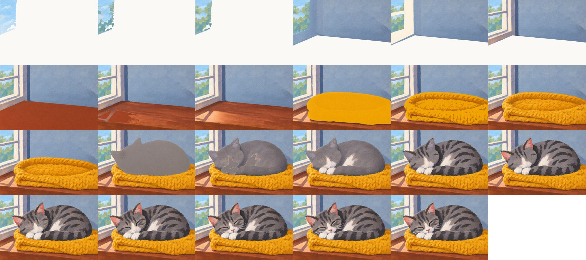

# Spike: the v4 baseline, one v3 lesson made by a program (#241)

2026-11-18. The first step of v4 (#240): measure what a lesson costs in Claude tokens before cutting anything. A
program made one v3 lesson of the sleeping cat, following `.claude/skills/paint-lesson/v3/run.md` in code, and
logged every Claude call. The code is `spike/experiments/v4_loop.py`, its numbers `spike/experiments/v4_loop.json`
(the report, the run's state and every call). It is experiment code: no lesson tool, the skill or the site changed.
The lesson is `output/sleeping-cat_v4loop_20261118-201516`, sealed, and not on the site (it wasn't made by
`/paint-lesson`).

**The number: $4.94 of Claude a lesson at the API's published rates, beside $0.35 of renders.** 23 calls, 12
helpers, 24 minutes from the photo to the seal (13 1/2 of them in Claude calls). Through the API itself, with no
Claude Code in between, the same calls would cost about $3.50 (below).

No verdict: this only measures.

## How it ran

- **A helper is one call to Claude, or a short conversation of them,** through Claude Code's one-shot mode
  (`claude -p`) on the owner's subscription, on Opus 5.5, at Claude Code's default effort (medium). The call is one
  function (`call_claude`): a message in the Messages API's shape in, the reply and its usage out. An API client
  replaces that function and nothing else.
- **No tools.** Each helper is sent everything it would have read in one message (files inline, pictures as
  pictures) and answers in one reply, as a JSON block the program saves. A follow-up (plan-check's problems, a
  stage's `feedback.md`) continues the same conversation, so what was sent before is read from the cache.
- **The flags,** checked against the Claude Code docs (headless and CLI reference) and by trying them:
  `--input-format stream-json --output-format stream-json --verbose --model opus --tools "" --strict-mcp-config
  --setting-sources "" --disable-slash-commands --system-prompt <a line>`, and `--resume <session>` to continue.
  `--bare` would drop more, but it reads only an API key, not the subscription. Each call's `result` event gives
  the usage (input, cache written, cache read, output, thinking) and Claude Code's own cost figure. That figure is
  the session's running total, not the call's. Each session's last figure summed matches the program's own sum to
  the cent ($4.936 both).
- **The helpers:** steps 0 and 1 (one conversation, 4 messages), the plan's writer (3: the plan, plan-check's
  round, and the merge `check` asked for), the chain's checker (a fresh one each round, 2 rounds), one writer a
  stage (7 stages, all at once, 5 sent back once with `feedback.md`), and a finisher for D4 and E2 (review.json,
  diagrams, notes; 2 messages). The tools ran in run.md's order, and the program did the glue.
- **What differs from a `/paint-lesson` run:** the plan's writer was sent every element file and stroke card (it
  can't ask for the ones it picks); the setup helper wasn't sent the research file; the finisher saw the step
  pictures at 768 pixels; the lesson didn't go on the site.

## Tokens and cost

Opus 5.5's rates: $4 a million input tokens, $20 output, $0.20 a cache read, $8 a cache write kept an hour.

| Helper | Calls | Sent (tokens) | Read from cache | Written (thinking) | Cost | Seconds |
|---|---|---|---|---|---|---|
| Steps 0 and 1 | 4 | 37,021 | 69,939 | 4,891 (1,690) | $0.41 | 67 |
| Plan's writer | 3 | 127,464 | 202,937 | 33,728 (10,666) | $1.74 | 282 |
| Chain's checker | 2 | 50,645 | 0 | 2,224 (1,452) | $0.45 | 31 |
| Stage writers | 12 | 124,496 | 79,880 | 20,305 (11,560) | $1.42 | 239 |
| Finisher | 2 | 66,086 | 45,256 | 19,411 (8,982) | $0.93 | 192 |
| **Lesson** | **23** | **405,712** | **398,012** | **80,559 (34,350)** | **$4.94** | **810** |
| Renders (`ledger.json`) | 16 paid | | | | $0.35 | |

"Sent" is the call's input not read from the cache. Claude Code writes all of it to the hour-long cache.

Each call, from `v4_loop.json`:

| Call | Sent | From cache | Written | Cost |
|---|---|---|---|---|
| Plan's writer, the plan | 91,785 | 0 | 17,792 | $1.09 |
| Finisher, review, diagrams, notes | 45,258 | 0 | 16,741 | $0.70 |
| Plan's writer, plan-check's round | 19,375 | 91,783 | 7,721 | $0.33 |
| Plan's writer, the merge `check` asked for | 16,304 | 111,154 | 8,215 | $0.32 |
| Finisher, looking at the diagrams | 20,828 | 45,256 | 2,670 | $0.23 |
| Chain's checker, rounds 1 and 2 | 25,277 / 25,368 | 0 | 1,140 / 1,084 | $0.23 / $0.22 |
| Stage writers, first words (7) | 14,579 to 18,684 | 0 | 1,835 to 3,201 | $0.16 to $0.21 each, $1.21 |
| Stage writers, feedback (5) | 2,010 to 3,582 | 15,085 to 18,682 | 584 to 1,077 | $0.03 to $0.05 each, $0.21 |
| Steps 0 and 1 (4) | 5,657 to 15,679 | 0 to 31,354 | 612 to 1,909 | $0.06 to $0.15 each |

The renders: the extend (one try was free from the render cache, the redo paid), the finish, 12 for the chain, and
2 more when the checker marked units 1 and 2. The merge `check` asked for didn't change the chain's requests, so
running the chain again cost nothing.

## What the money went on

| | Cost | Share |
|---|---|---|
| Instructions and data (briefs, the library, fact sheets, steps, what the tools printed, and cache reads) | $2.36 | 48% |
| Words written, thinking included | $1.61 | 33% |
| Pictures read by Claude (95 pictures, about 104,000 tokens) | $0.83 | 17% |
| What Claude Code adds to each new conversation | $0.13 | 3% |

Pictures are counted by their size (width x height / 750 tokens once the long side is 1,568 pixels; three of this
lesson's pictures measured 1,599, 2,045 and 898 tokens, where the count gives 1,622, 2,097 and 878). Written words
are the output tokens. The rest of each call's input is instructions and data. Thinking is 34,350 of the 80,559
words written: 43%, about $0.69.

## What the one-shot mode adds, so the number isn't overstated

- **About 1,400 tokens a new conversation.** A one-word message with these flags reads 1,406 tokens. That's Claude
  Code's prefix line and its context lines (the working directory, the model, the date, the account and the
  session). With Claude Code's own system prompt left in (no `--system-prompt`), it is about 3,000. Over 12
  conversations that is $0.13.
- **Every input token is written to the hour-long cache, at twice the input rate.** 405,712 tokens at $8 is $3.25
  of the $4.94. The API would charge $4 for a call whose input is never read again (the chain's checker, a stage
  writer that gets no feedback). It would also charge $5 for a five-minute cache where a conversation goes on. Priced
  that way, the same calls come to **$3.58, or $3.50 without Claude Code's 1,400 tokens.** So about $1.40 of the
  $4.94 is the one-shot mode's, not the lesson's.
- On the subscription the dollars aren't paid. They are what the weekly usage stands for, and what an app on the
  API would pay.

## How the lesson compares with the cat's v3 lesson

| | v3 (`sleeping-cat_skill_20261118-080533`) | This run |
|---|---|---|
| Steps, stages | 21, 8 | 22, 7 |
| Units, chain renders | 14, 13 | 13, 12 |
| Paints, mixes | 17, 10 | 16, 10 |
| Chain checker's marks | U02 stray, then U10 left, then U02 again with no tries left (kept as a known problem) | U01 and U02 stray (the sky and leaves outside the window); none after one redo |
| Merges `check` asked for | 1 (the sill's two browns) | 3 pairs (the sill's browns, the blanket's golds, the cat's three grays) |
| Known problems | 7 | 6 |
| Sentences `check-text` took out | 2 | 0 (5 of 7 stages had one feedback round) |
| Diagrams | 2 | 6 |
| Render cost | $0.60 | $0.35 |

The step pictures:

By eye they look like a v3 lesson's (no ghost or blotch, and a flat block-in for the sill, the blanket and the
cat), but no grader compared them. One finding isn't about cost. **Four of the six known problems come from the merges `check` asked for.** The
two grays the cat is shaded and lit with were fitted to the cat's own gray and merged into it. So were the
blanket's stitch gold and the sill's dark edge. Each of those steps now names the paint its block-in used, though
its picture shows a darker or lighter mark. v3's lesson had one such problem. The comparison with v3 is a single
run each, so how often this happens isn't known.

v3's own run wasn't measured: a `/paint-lesson` session records no tokens, so this run can't say how much the
program saves over it. The first look on #241 estimated a lesson's content at about 150,000 tokens. This run sent
406,000. The difference is the library sent to the plan's writer (about 77,000 tokens), the plan sent back in full
three times, and the finisher's 22 step pictures.

## The three biggest costs, the candidates for the next sub-issues

1. **The plan's writer: $1.74, 35%.** Its first message is 92,000 tokens, and 194,000 of its 220,000 characters
   are the library: every element file (49 KB), every stroke card (45 KB), the research file (75 KB) and the
   technique (25 KB). That is about $0.62 of cache writes. It also wrote the whole plan three times (33,700
   tokens, $0.67), once for plan-check's round and once for the merge. Candidates: send the element list and
   let the writer ask for the files it picks, or send only the research's "For Gesso" sections. Answer
   plan-check and `check` with changes to the plan, not the whole file again.
2. **The stage writers: $1.42, 29%.** Seven writers at about 15,000 tokens each, 4,250 of them pictures. The brief
   is the same in every folder and is written to the cache seven times. Five of seven stages needed a feedback
   round ($0.21). Candidates: one shared cached prefix (the brief, the photo and the finish) before each stage's
   own folder; fewer feedback rounds, by fixing what `check-text` most often fails (#177).
3. **The cache writes themselves: $3.25, 66% of the bill, about $1.40 of it the one-shot mode's.** This cuts
   across the first two. It goes when the call moves to the API (#240's interface), with a cache only where a
   conversation goes on. Of what's left, the finisher ($0.93, 19%: 16,700 words written, half of them thinking)
   and the chain's checker ($0.45: 13 looks of about 1,500 tokens each, every round) are next. The checker is
   #221's candidate for a cheaper model.

Words written are a third of the bill in every helper. Lower effort on the yes/no and fill-in helpers (the
checker, the feedback rounds) is a lever none of the three above covers.
