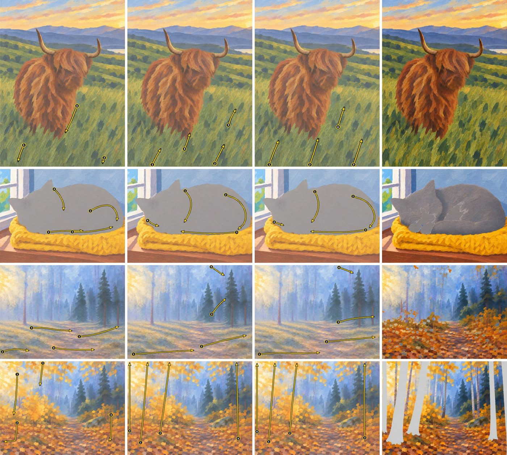

# v4 spike (P1): stroke maps

Spike for #256, under #240 (`docs/design/pipeline-v4-plan.md`, Wave 2). Code: `spike/experiments/v4_stroke_maps.py`.
Its test: `spike/tests/test_v4_stroke_maps.py`. The arrows, the writers' answers, the blind graders and every call's
tokens: `spike/experiments/v4_stroke_maps.json` (its `report` key holds the numbers below). The student test's
answers: `spike/experiments/v4_stroke_maps/map-<variant>.json`. Run on 2026-11-19.

**Verdict: drop arrows from the change alone (`change`). Park the writer's arrows checked against the change
(`both`). Drop the writer's arrows on their own (`writer`), since `both` matches them on every measure.** No map raised
the student's score: `both` +0.00 (± 0.08), `change` −0.06, `writer` −0.13 against the adopted words, with the bar at
+0.25. Without a map the image model already runs its strokes the way the after picture does (0.78 on the new grain
measure, where 1 means the same direction everywhere), so a map has little left to fix. The blind graders preferred
the lesson *without* change-only maps 6 of 6 times. The change only gives the strokes' line, not which way along it
the brush moves, so those arrows pull grass, trunks and ears backwards. `both` won 2 of 6 (both reads of the cow) and
tied the other 4. The graders said the writer's maps help a painter place things (the horns, the nostrils, the trunks)
and mislead on dabbing steps, where an arrow suggests a dragged stroke. Maps cost about $1.33 of Claude a lesson as
one call a step. That is the price of the whole lesson's words, against the $1 aim.

It is parked rather than dropped because the graders saw help in placement that the student test can't credit, and
two fixes are cheap (see "If it comes back").

## What was run

The three bench lessons (`spike/experiments/bench/v3-words/`: the highland cow, 23 steps; the sleeping cat, 21; the
birch grove, 20) with the adopted words, lesson-slots plus the long arc (`arc-add-long`, `docs/spikes/v4-arc.md`). The
pictures and words are the same on both sides, so only the map differs. The baseline is those words with no map:
carry, graded alone, 3.26 (cow), 3.48 (cat), 3.45 (birch).

**A map** is the step's before picture, a little paler, with at most four arrows drawn on it by a tool: a yellow line
with an arrowhead along the way the strokes run (bent where they bend), and a numbered dot at each start, 1 where to
begin. It shows this step only (#255 found that the image model paints toward any canvas described further ahead).
An image model never draws it.

**The three sources of arrows:**

| | how | Claude a lesson |
|---|---|---|
| `change` | From what the step changed alone. Inside the student test's change mask, a structure tensor of the after picture (and of the change itself, for thin marks) gives the strokes' line at every point. Each arrow is traced along it from a deep point in one of the change's biggest pieces, shared out by area. The start is a guess: the stroke's top end, or its left end when it runs side to side. | none |
| `writer` | One fresh Claude call a step (`claude -p`, Opus, no tools). It reads the step's words, paints and brush, and its before, after and change pictures, each on a grid in inches. It names 1 to 4 arrows as points in inches, and says where the words and the picture disagree. The tool draws them. | $1.12 |
| `both` | The same call, also shown the `change` arrows (a picture and their points). It keeps, moves or replaces them. Where the words and the after picture disagree on direction, it follows the picture and says so. | $1.33 |

*Rows: cow 17 (grass flicks), cat 14 (shading), birch 9 (dabbed leaves on the floor), birch 15 (trunks). Columns:
`change`, `writer`, `both`, the after picture. `change` sends the cow's flicks and the birch trunks downward. The
words say to pull them up from the base, and `writer` and `both` do. On birch 9 every source draws long sweeps for a
dabbing step.*

**How the map reaches the tests** (the issue's comment asked for this decision):

- **The student (carry)** gets two pictures in one edit: the canvas, and the map. The prompt adds that the second
  picture is the step's stroke map and its arrows, dots and numbers are never to be painted. Drawing the arrows on the
  before picture itself was ruled out: the image model would be editing a canvas with arrows on it. A 3-render pilot
  checked the two-picture route: no arrow, dot or pale wash came through. A colour check on all 192 results found no
  arrow yellow outside the yellows the after pictures have (the highest counts were the cat's blanket and the birch
  leaves, checked by eye). The
  grader still sees only the before, the real after and the result, so it grades the painting, not the map.
- **A grain measure, new** (`grain`, no Claude), since neither student form could see direction (#174). Inside the
  real change, tile by tile, it compares which way the result's strokes run with which way the real after's do: the
  mean of cos(2 × the angle between them), weighted by how clearly each tile has a grain. 1 is the same direction, 0
  no relation, −1 crossways. Check: the baseline's results score 0.78, and the same results turned 90 degrees score
  0.02.
- **The blind graders** (`bench/ab_grader.md`, two a picture, sides swapped) see every step's picture and words once,
  and the map under the side that has one. They were asked to name any map that points the wrong way or sits on the
  wrong thing.

## Results

### The student test (carry, graded alone, all 64 steps)

| | cow | cat | birch | all 64, against the baseline | steps rose / fell |
|---|---|---|---|---|---|
| no map (arc-add-long) | 3.26 | 3.48 | 3.45 | | |
| `change` | 3.39 (+0.13) | 3.43 (−0.05) | 3.15 (**−0.30**) | −0.06 (± 0.09) | 13 / 15 |
| `writer` | 3.13 (−0.13) | 3.43 (−0.05) | 3.25 (−0.20) | −0.13 (± 0.08) | 9 / 16 |
| `both` | 3.43 (+0.17) | 3.43 (−0.05) | 3.30 (−0.15) | **0.00 (± 0.08)** | 12 / 11 |

(± is one standard error of the mean step difference. One lesson's mean moves about 0.13 between runs.)

- **No source clears the bar on any picture.** `both` gains most on the cow (+0.17) and is level overall.
- **The birch grove falls with every source** (−0.15 to −0.30; over the three runs' 60 birch steps, 16 fell and 5 rose). Since that happens
  whatever the arrows are, the likely cause is the second picture itself: the birch has many faint steps, and a pale
  copy of the canvas beside it may pull the image model off them. A map with no arrows would test that (20 renders,
  about $0.45). It wasn't run.

### Does the image model run its strokes the right way? (the grain measure, 57 steps with a grain)

| | grain | against no map | the 7 steps where no map scored under 0.5 |
|---|---|---|---|
| no map | 0.78 | | 0.24 |
| `change` | 0.78 | −0.01 (± 0.02) | 0.20 |
| `writer` | 0.75 | −0.04 (± 0.03) | 0.20 |
| `both` | 0.76 | −0.02 (± 0.02) | 0.22 |

**The maps don't change which way the strokes run, not even on the steps that got it wrong.** The adopted words
already say it ("Strokes: pull curved strokes down that crescent"), and the image model already follows them, so
direction was not what held the student's score back. The low steps (cow 7 and 12, cat 1 and 18, birch 1 and 17) are
faint or mixed changes, where a 1,024-pixel render's brushwork is mostly the image model's own.

### The blind graders

| | cow | cat | birch | preferred |
|---|---|---|---|---|
| `change` | 2 for no map | 2 for no map | 2 for no map | **0 of 6 (6 against)** |
| `writer` | 1 for the map, 1 no difference | 2 no difference | 2 no difference | 1 of 6 |
| `both` | **2 for the map** | 2 no difference | 2 no difference | 2 of 6 |

What they said:

- **`change` draws strokes backwards.** The change gives a stroke's line, not which way along it the brush moves, and
  the guess (top end first) is wrong for anything pulled up from its base: "They reverse the flick direction in the
  three grass steps (16-18), reverse the horn strokes" (cow). "The core trunk-pulling technique is drawn backwards"
  (birch). "Step 17 pulls tip to base, where the words say base to tip" (the cat's ears). It also starts where the
  words don't, since it never reads them (the cat's wall, step 4).
- **The writer's maps help with place.** "They make the horns and face much easier for a beginner to place" (cow,
  `both`). "Mostly helped a little with where to start and which way to pull" (cat, `writer`).
- **They mislead on dabbing and tapping.** Every grader of the birch named steps 9 to 11 (leaves dabbed onto the
  floor and the trees): long arrows for a stroke that isn't dragged, and some running "into areas the words say to
  leave alone". The cow's step 9 (tapped bushes) and step 19 (short touches) got the same complaint.
- **The shared picture faults decide the scores.** Every grader said the steps that would stop a painter (the cat's
  2 to 4, #262; the cow's 7, 8 and 22; the birch's 9 and 15) fail in the pictures, and no map fixes them. `real`,
  `paintable` and `agree` were the same on both sides in most reads.

### Where the words and the picture disagree

Asked to say so, the writers found 6 steps where the words' stroke direction and the after picture's differ (4 by
`writer`, 4 by `both`, two of them the same): cow 7 and 8 (the words say level strokes across the meadow, and the
picture's lower meadow is steep diagonals), cow 15 (the locks slant, not straight down), cat 16 (the haunch stripes
run nearly level), birch 1 (vertical streaks in the haze, against side to side) and birch 5 (taps that build into
downward patches). In `both` the writer once kept the words over the picture: birch 15, "the words say to pull up from
each trunk's foot, so the arrows here run upward". That is the right call, since the picture can't show which way a
stroke was pulled. Neither writer flagged the cat's step 4 (the wall: side to side in the words, diagonal in the
picture, #262). It drew the words' side-to-side arrows. These are the same kind of fault as #262: the stroke card
and the picture don't match. A writer that reads both pictures can list them as it goes.

### What it costs

| | Claude, a lesson (API rates) | renders a carry run | seconds a step |
|---|---|---|---|
| `change` | none (a tool, under a second a step) | $1.42 | |
| `writer` | $1.12 (5.2 cents a step) | $1.42 | 12 |
| `both` | $1.33 (6.2 cents a step) | $1.42 | 13 |

A render with a map costs 2.2 cents against 1.6 without, for the second picture. A step's call costs about what a
student-test reader does, mostly Claude Code's own system additions and four pictures. A map from the writer that
already writes the step (lesson-slots reads every step's before, after and change pictures) would add only the
arrows' output tokens, a few cents a lesson.

Of this spike: **$4.26 of renders** (192, inside the owner's $4.30 for this issue, 2026-11-19) and $20.08 of Claude at
the API's rates, all through `claude -p` on the subscription: the map writers $7.33, carry's grader $5.74, the blind
graders $6.81.

## If it comes back

`both` is the form to bring back, with three changes, tested against the same baseline:

1. **The arrows come from the lesson's writer**, as part of each step's lines (it already says Start and Strokes),
   not from a call a step. That takes the cost from $1.33 to a few cents.
2. **No arrow for a stroke that isn't dragged.** A tapping, dabbing or press-and-lift card gets dots on where the
   first touches go, or no map. The card says which kind the stroke is.
3. **The direction along the line is the card's and the words', never the change's.** The change gives the line and
   where it bends, and the words say which end the brush starts at.

What would settle it, before more renders: the owner's painting (#252). If the owner found themselves guessing where
a step's first strokes go, maps are worth another run. If the guessing was about how much to paint and when to stop,
they aren't.

## Limits

- One render run a variant, and one grade a result. On the student test the three variants differ by less than
  twice the run-to-run spread.
- The student is an image model, which paints its own brushwork. It can read a map's place and line, but nothing
  shows it reads a stroke's sense (which end it starts at). The grain measure is blind to sense too: it compares
  lines, mod 180 degrees.
- A map was never tested without arrows, so the birch grove's fall can't be put on the second picture for certain.
- The graders read 64 extra pictures a lesson. Several said the shared faults decided their scores, so a small help
  from the maps would show as "no difference".
- The maps are drawn on the before picture. The real page would put the map beside the step's picture and the Where
  outline (`docs/vision.md`), which this spike didn't try.
