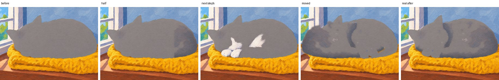
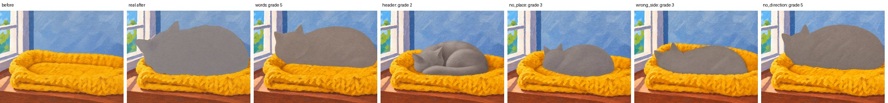

# v4 yardstick (Y1): the student test

Spike for #174, under #240 (`docs/design/pipeline-v4-plan.md`, Wave 0). Code: `spike/experiments/v4_student.py`.
Its test: `spike/tests/test_v4_student.py`. Every answer, measure, grade and call's tokens:
`spike/experiments/v4_student.json` (its `report` key holds the numbers below). Run on 2026-11-18.

**Verdict: adopt both forms, with different jobs.** **Carry it out** (the image model does the step's words on the
before picture, and a blind grader scores the result) is v4's score: it falls on every worsening that changes a
picture, and it is the only form that agrees at all with the blind graders. **Pick one of four** is the cheap fault
finder: its repeat runs agree closely, and the steps where it scores *below the header alone* are steps whose
words point the painter the wrong way. Neither form measures stroke direction yet.

## What was measured

The three v3 lessons frozen in `spike/experiments/bench/v3-words/` (the highland cow, 23 steps; the sleeping cat,
21; the birch grove, 20): 64 steps, as the v3 gate made them. Nothing was made again. The before picture of step N
is `steps/N-1.jpg` (a blank canvas for step 1).

Every reader and grader is one fresh call to Claude (Opus, `claude -p` with no tools, through `v4_loop.call_claude`).
It gets only what the message holds, never `data/` or the plan. The image model is the pipeline's
(`run.edit_image`, low quality).

### Form 1: pick one of four

The reader gets the before picture, the step as the lesson page gives it (canvas size, step name, part, paints with
recipes and swatch colours, brush, numbered words, tip) and four pictures. It gives each picture a chance in
percent. The score is the chance it gave the real after (0.25 is a guess).

**How the near misses are made.** The step's change is found where the blurred colour moved more than 5 ΔE between
the before and after pictures. Each picture is the before picture with a change laid in through a soft mask:

- **real**: the step's own change.
- **moved**: the change mirrored side to side. When that mirror looks too like the real one (a change that is
  nearly symmetric, or covers the canvas), it is mirrored top to bottom instead, and as a last resort it is rolled
  half the canvas. Tests *where*.
- **half**: half of the change, cut across its longer side at the middle. Tests *how much* and *when to stop*.
- **next step's**: the next step's change instead (the step before's, for the last step). Tests *what*.

All four go through the same mask and feathering, so a seam can't give the real one away. One cost of that: very
faint parts of a change (under about 5 ΔE) drop out of the real picture too. The order of the four is shuffled once
for each step and kept the same for every kind of words. Example, cat step 14:

### Form 2: carry it out

The image model gets the before picture and the step's words with a fixed preamble: paint what the step asks for,
change nothing else. That is one low-quality edit a step. The result is compared with the real after in two ways:

- **a measure** (`beats`): first the result's colour is matched to the before picture where nothing was meant to
  change (the model shifts the whole picture's colour a little, and that shift swamped small steps in the first
  try). Then: of the before picture and the three near misses, the share the result is closer to the real after
  than to, on blurred colour. Two more are in the file, `toward` (how far it got from before to after) and `where`
  (overlap of the changed areas), but both are swamped by how much the model repaints.
- **a grader**: one call a step. It sees the before picture, the real after and that step's results unlabelled, in
  shuffled order, and never the words. It scores each result 1 to 5 for doing the step the way the picture shows.

### The words: as they are, and made worse

- **words**: v3's words as they are.
- **header**: name, paints and brush only, no words and no tip. This is the floor: what the name alone gets.
- **no_place**: every place taken out (the measured Where line, the outline lines, "under the belly", "the right
  half"). Done by one Claude call a lesson with a fixed brief, and saved in the results file.
- **wrong_side**: every side swapped (left for right, top for bottom, upper for lower, above for below), by a fixed
  word swap.
- **no_direction**: which way the strokes run taken out ("side to side", "bend with the shape"), the same way as
  no_place.

The worsened words ran on 8 steps a lesson (24 in all) that name a side and change more than half a percent of the
canvas, spread evenly through each lesson. For pick, the header ran on all 64 steps. For carry, it ran on those 24.
The words were run twice on the 24, to see the spread between runs.

### The blind graders

Two fresh graders a lesson, the old way: every step's picture and words in front of them, by the owner's rubric
(`bench/ab_grader.md`, one lesson rather than a pair). Each also gave every step a 1 to 5 `paintable`. Both graders
gave every lesson real 3, paintable 3, agree 2, and their worst steps mostly matched:

| Lesson | Grader 1 | Grader 2 | Both |
|---|---|---|---|
| highland cow | 8, 14, 23 | 14, 22, 8 | 8, 14 |
| sleeping cat | 16, 4, 14 | 4, 14, 8 | 4, 14 |
| birch grove | 9, 16, 17 | 9, 15, 17 | 9, 17 |

Joined across the two graders, that makes 12 worst steps.

## Results

### The baseline: v3's words

| | pick (chance on the real after) | carry, measure (`beats`) | carry, grader (1 to 5) |
|---|---|---|---|
| all 64 steps, words | 0.68 (74 of 88 readers' top choice is the real one) | 0.65 | 3.31 |
| highland cow | 0.65 | 0.59 | 3.13 |
| sleeping cat | 0.72 | 0.71 | 3.36 |
| birch grove | 0.61 | 0.63 | 3.18 |

(The means run over 88 answers: 64 steps once and the 24 subset steps a second time. The per-lesson numbers are
step means, with the two runs averaged.) This is what W1 and W2's words get measured against.

### Does the score follow the words?

The change against v3's words, on the same steps, and on how many steps it fell or rose:

| Words | pick | carry, measure | carry, grader |
|---|---|---|---|
| header only | **−0.13** (53 fell, 9 rose, of 64) | **−0.18** (12 fell, 3 rose, of 24) | **−0.92** (15 fell, 3 rose) |
| no_place | −0.08 (17 fell, 5 rose) | **−0.18** (11 fell, 2 rose) | **−0.67** (14 fell, 2 rose) |
| wrong_side | **−0.27** (15 fell, 8 rose) | **−0.22** (11 fell, 2 rose) | **−0.88** (15 fell, 2 rose) |
| no_direction | −0.03 (12 fell, 9 rose) | +0.01 (5 fell, 3 rose) | +0.13 (3 fell, 7 rose) |

- **Both forms fall when the words are taken away or turned around.** Carry falls on all three of header,
  no_place and wrong_side. Pick hardly notices place taken out: its near misses are easy enough to rule out without
  a place (the mirrored one most of all).
- **The header alone gets far on pick: 0.53, against 0.25 for a guess.** The step name and paints rule out the
  mirrored and next-step pictures on their own. The words add 0.13. Carry's header floor is lower in comparison
  (2.6 against 3.3 on the grader).
- **Neither form moves when the stroke direction is taken out.** Part of that is v3's words: they hardly say a
  direction (the 24 steps lost a phrase or two each, often only "bend every stroke with the shape"). Part is the
  forms themselves: a reader can't see a stroke's direction in a 640-pixel picture, and the image model paints its
  own strokes. Wave 2's stroke maps (P1) will need a way to measure this that neither form has. The first thing to
  try is a near miss with the strokes turned 90 degrees.
- **The image model sometimes paints from sense, not from the words.** Cat step 13 with the sides swapped still
  put the cat on the blanket, smaller. The header alone gave a curled cat with a face. That is the risk the plan
  named, and the grader caught it (3 and 2, against 5 for the real words):

### Repeatability (the words run twice on 24 steps)

| | rank agreement between runs (Spearman) | mean difference a step |
|---|---|---|
| pick | 0.90 | 0.04 |
| carry, measure | 0.74 | 0.12 |
| carry, grader | 0.73 | 0.33 points |

For a lesson mean over about 21 steps, carry's spread is about 0.07 grader points. A words spike has to beat v3 by
clearly more than that.

### Does it find the steps the blind graders marked worst?

| Form | Spearman with the graders' per-step `paintable` | the graders' 12 worst steps in its lowest third (4 is chance) |
|---|---|---|
| pick | 0.09 | 1 |
| carry, measure | 0.12 | 5 |
| carry, grader | **0.42** | **6** |

**Pick doesn't find them.** The graders' worst steps are mostly big jumps and picture faults: cat 4 (the whole wall
at once), cow 8, cat 14, birch 9. Those steps have long, specific words and a big change, so a reader picks their
after easily. Pick asks whether the words point at the right picture. The graders ask whether a beginner could get
there. Carry comes closer because a big jump is as hard for the image model as it is for a painter. Some of
carry's agreement therefore comes from how hard the step is, not from the words.

**What pick does find: words that point the wrong way.** On four steps the words score at least 0.25 *below* the
header alone, and in each one the reader picked the half-done picture because the words say the paint covers less
than the picture does:

- **cat 2**, dark leaves: the measured Where line says "about 1/4 in wide and 1 1/4 in tall". The leaves in the
  picture cover more.
- **cow 2**, cloud streaks: "Its bottom is about 2 in from the top edge". The picture's streaks run down the whole
  sky.
- **birch 20**, sunlit leaves: the tip says "most of the Pale gold goes in the right half". The picture spreads it
  wider.
- **birch 10**, golden leaves: the words keep "about 1/2 in clear at the left edge, about 2 1/2 in clear at the
  right". The reader, reading that, chose the half-done picture.

These are the sheet's measured boxes and the writer's tips understating a step. That is the evidence in the v4
plan ("a step's words don't say where the paint goes"), now found by a program. None of the 12 graded worst steps
is among them. The old graders, with the after picture in front of them, read past it.

### The owner's painting (#252)

The owner's notes from painting the cat aren't in yet. When they arrive, check them against the cat's low carry grades
(steps 2, 3, 4, 8 and 12, graded 1 or 2), the graders' worst steps (4, 8, 14, 16) and pick's word fault on step 2.

## Cost

Of this spike: **$2.92 of renders** (184, under the owner's $5 for this issue), and $14.50 of Claude at the API's
rates (pick $9.54, carry's grader $2.41, the blind graders $1.54, the worsened words $1.02). All of it went through
`claude -p` on the subscription, logged call by call in `calls`.

Of one lesson of about 21 steps, as v4's spikes would run it:

| Form | Claude | renders | seconds a step | wall time, 6 at once |
|---|---|---|---|---|
| pick | about $0.90 (4.3 cents a reader) | none | 7.6 | about 30 s |
| carry | about $0.61 (2.9 cents a single-result grade) | about $0.33 (1.6 cents an edit) | 13 render + 7.5 grade | about 1 min |
| both | about $1.50 | about $0.33 | | |

Most of a pick reader's cost is the cache write of Claude Code's own system additions and five pictures. Through
the API, with a short system prompt, it would be about half.

## How v4's spikes use it

- **Score:** carry, graded. Report each lesson's mean grade beside v3's (3.13, 3.36, 3.18), from one run a lesson
  and with the same grader brief. A words spike counts as better only by more than the 0.07 spread. Carry's
  measure goes beside it as a check that needs no Claude.
- **Faults:** pick, with the header run. Every step whose words score 0.25 or more below its header is listed as a
  word fault to fix: words pointing the wrong way.
- **Run both on all steps.** Running the header on every step in carry too (another $0.33 of renders a lesson)
  would let carry list word faults as well. It wasn't run here.
- **Not measured by either:** stroke direction. P1 (#256) needs its own near miss before it can be scored.

## Limits

- One run of each form a step, plus a second on 24 steps. The worsened words ran on 24 steps, not all 64.
- Carry's grader sees all of a step's results together, so on the 24 steps its grades are relative to each other
  (on the other 40 it grades one result alone).
- The near misses are only as hard as stated: the header alone already scores 0.53 on pick.
- A student made of models is not a painter. #252 is the check.
